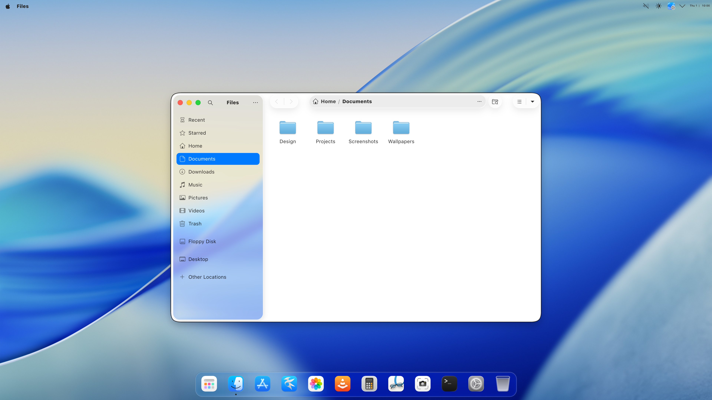
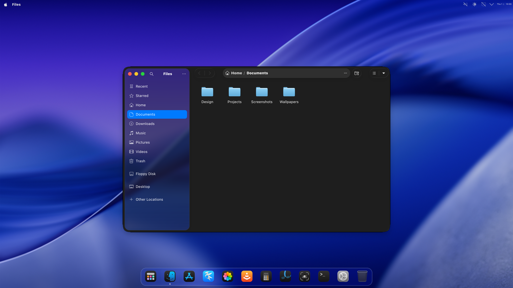
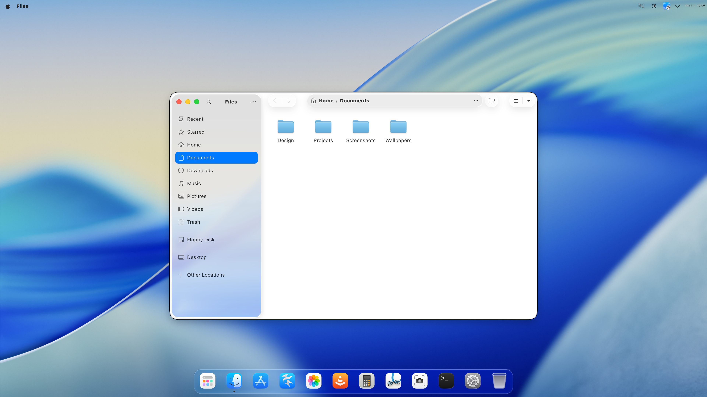
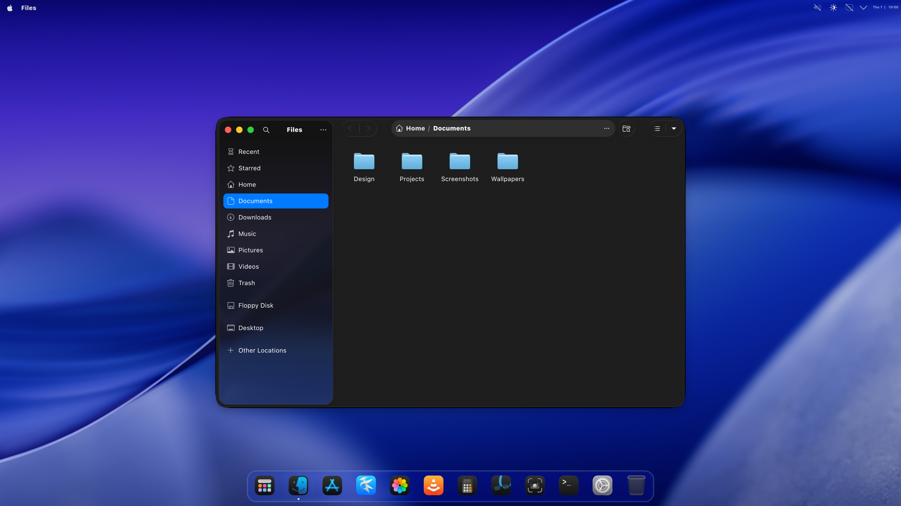

# Glass preset gallery

Material presets for **v0.63rc2**. Each pair shows the same preset in light and dark mode.

The Dock retains v0.62.0 optics in every view. These are independent community themes, not Apple or KDE products.

## Tahoe (Clear)

| Light mode | Dark mode |
| --- | --- |
|  |  |

| Setting | Value |
| --- | --- |
| `BlurStrength` | `5.0` |
| `NoiseStrength` | `0` |
| `RgbDriftStrength` | `10.0` |
| `MagnifyGlassStrength` | `0.02` |
| `RefractionWidth` | `38.0` |
| `HighlightWidth` | `16.0` |
| `HighlightStrength` | `0.1` |
| `Brightness` | `1.0` |
| `Contrast` | `1.0` |
| `Saturation` | `1.33` |
| `DarkGradientOverlay` | `False` |
| `GradientTopColor` | `#000000` |
| `GradientBottomColor` | `#000000` |
| `GradientTopOpacity` | `0.38` |
| `GradientBottomOpacity` | `0.02` |
| `GradientCenterColor` | `#000000` |
| `GradientCenterOpacity` | `0.02` |
| `GradientCenterPosition` | `0.55` |
| `GradientTopDarkColor` | `#000000` |
| `GradientCenterDarkColor` | `#000000` |
| `GradientBottomDarkColor` | `#000000` |
| `BlurDecorations` | `True` |

## Tahoe (Frosted)

| Light mode | Dark mode |
| --- | --- |
|  |  |

| Setting | Value |
| --- | --- |
| `BlurStrength` | `12.0` |
| `NoiseStrength` | `0` |
| `RgbDriftStrength` | `10.0` |
| `MagnifyGlassStrength` | `0.02` |
| `RefractionWidth` | `38.0` |
| `HighlightWidth` | `16.0` |
| `HighlightStrength` | `0.1` |
| `Brightness` | `1.0` |
| `Contrast` | `1.0` |
| `Saturation` | `1.33` |
| `DarkGradientOverlay` | `False` |
| `GradientTopColor` | `#000000` |
| `GradientBottomColor` | `#000000` |
| `GradientTopOpacity` | `0.38` |
| `GradientBottomOpacity` | `0.02` |
| `GradientCenterColor` | `#000000` |
| `GradientCenterOpacity` | `0.02` |
| `GradientCenterPosition` | `0.55` |
| `GradientTopDarkColor` | `#000000` |
| `GradientCenterDarkColor` | `#000000` |
| `GradientBottomDarkColor` | `#000000` |
| `BlurDecorations` | `True` |

## Golden Gate (Official)

| Light mode | Dark mode |
| --- | --- |
|  |  |

| Setting | Value |
| --- | --- |
| `BlurStrength` | `4.0` |
| `NoiseStrength` | `0` |
| `RgbDriftStrength` | `8.0` |
| `MagnifyGlassStrength` | `0.032` |
| `RefractionWidth` | `64.0` |
| `HighlightWidth` | `16.0` |
| `HighlightStrength` | `0.1` |
| `Brightness` | `1.1` |
| `Contrast` | `1.0` |
| `Saturation` | `1.13` |
| `DarkGradientOverlay` | `True` |
| `GradientTopColor` | `#cecece` |
| `GradientBottomColor` | `#cecece` |
| `GradientTopOpacity` | `1.0` |
| `GradientBottomOpacity` | `0.0` |
| `GradientCenterColor` | `#cecece` |
| `GradientCenterOpacity` | `0.69` |
| `GradientCenterPosition` | `0.56` |
| `GradientTopDarkColor` | `#000000` |
| `GradientCenterDarkColor` | `#000000` |
| `GradientBottomDarkColor` | `#000000` |
| `BlurDecorations` | `True` |

