<p align="center">
  <!-- Adapted with ImageGen from artwork by Apple: https://developer.apple.com/assets/elements/icons/macos-26/macos-26-128x128_2x.png. Tux design by Larry Ewing. -->
  
</p>

<h1 align="center">macOS Tahoe Shell for KDE Linux</h1>

<p align="center">
  <a href="README.md" lang="en" hreflang="en">🇺🇸 English</a> ·
  <a href="README.es.md" lang="es" hreflang="es">🇪🇸 Español</a> ·
  <a href="README.zh-CN.md" lang="zh-CN" hreflang="zh-CN">🇨🇳 简体中文</a> ·
  <a href="README.pt-BR.md" lang="pt-BR" hreflang="pt-BR">🇧🇷 Português (Brasil)</a> ·
  <a href="README.de.md" lang="de" hreflang="de">🇩🇪 Deutsch</a> ·
  <a href="README.fr.md" lang="fr" hreflang="fr">🇫🇷 Français</a> ·
  <a href="README.it.md" lang="it" hreflang="it">🇮🇹 Italiano</a> ·
  <a href="README.ja.md" lang="ja" hreflang="ja">🇯🇵 日本語</a> ·
  <a href="README.ko.md" lang="ko" hreflang="ko">🇰🇷 한국어</a> ·
  <a href="README.ru.md" lang="ru" hreflang="ru">🇷🇺 Русский</a> ·
  <a href="README.ar.md" lang="ar" hreflang="ar" aria-current="page">🇸🇦 العربية</a> ·
  <a href="README.hi.md" lang="hi" hreflang="hi">🇮🇳 हिन्दी</a> ·
  <a href="README.nl.md" lang="nl" hreflang="nl">🇳🇱 Nederlands</a> ·
  <a href="README.pl.md" lang="pl" hreflang="pl">🇵🇱 Polski</a> ·
  <a href="README.tr.md" lang="tr" hreflang="tr">🇹🇷 Türkçe</a>
</p>

<p align="center">
  <a href="https://github.com/lestercorderomurillo/macos-tahoe-liquid-kde/releases"></a>
  <a href="https://github.com/lestercorderomurillo/macos-tahoe-liquid-kde/actions/workflows/test.yml"></a>
  <a href="https://kde.org/plasma-desktop/"></a>
  <a href="LICENSE"></a>
  <a href="https://github.com/lestercorderomurillo/macos-tahoe-liquid-kde/issues/new"></a>
</p>


<p align="center">
  <sub>اختر التوزيع لمعرفة حالة اختبارها.</sub>
</p>

<p align="center">
  <a href="tests/vm/PROOF.md#cachyos" title="CachyOS"></a>
  <a href="tests/vm/PROOF.md#arch" title="Arch Linux"></a>
  <a href="tests/vm/PROOF.md#endeavouros" title="EndeavourOS"></a>
  <a href="tests/vm/PROOF.md#fedora" title="Fedora"></a>
  <a href="tests/vm/PROOF.md#manjaro" title="Manjaro"></a>
  <a href="tests/vm/PROOF.md#artix" title="Artix Linux (OpenRC)"></a>
  <a href="tests/vm/PROOF.md#garuda" title="Garuda Linux"></a>
  <a href="tests/vm/PROOF.md#nobara" title="Nobara Linux"></a>
  <a href="tests/vm/PROOF.md#opensuse" title="openSUSE Tumbleweed"></a>
  <a href="tests/vm/PROOF.md#neon" title="KDE neon"></a>
  <a href="tests/vm/PROOF.md#debian" title="Debian testing / sid (Plasma 6.6+)"></a>
  <a href="tests/vm/PROOF.md#nixos" title="NixOS (experimental)"></a>
</p>

يقوم هذا المشروع بتخصيص مظهر ومشاعر مكتب KDE الخاص بك على Linux. لا تشمل أو تتصل بخدمات آبل. إذا كنت بحاجة إلى خدمات آبل، [التسوق مباشرة مع Apple](https://www.apple.com/store).

> [!CAUTION]
> **سياسة الإصدارات المتجددة**
> تجريبي تتلقى تحديثات يومية التحديثات قد تخسر التوافق. تجنب أنظمة الإنتاج [أبلغ عن المشكلات هنا](https://github.com/lestercorderomurillo/macos-tahoe-liquid-kde/issues/new).

> [!NOTE]
> يتم تجميد الميزات في التنفيذ لسلسلة 0.8x ، مع الإصدارات التي تركز على إصلاحات الأخطاء حتى 0.90.

> [!WARNING]
> **احذر من إعادة التعبئة الجدار المدفوع: هذا الموضوع مجاني.**
>
> إذا وجدت هذا الموضوع من خلال أي قناة من طرف ثالث، فأنت لا تحتاج إلى الدفع للحصول عليه: قم بتنزيله مباشرة من هذا المستودع. نحن نحافظ على هذا المشروع مجانًا حتى يتمكن الجميع من الاستمتاع به دون جدار دفع. لا توجد حاجة لشراء أو الاشتراك.

<br>


تقارير الحذاء، وتصحيحات، واختبار وثائق: انظر المادة [دليل المساهمة](CONTRIBUTING.md).

مساهمون في إعداد البرامج وصحفيين في جميع أنحاء تاهو وغولدن غيت:

<p>
  <a href="https://github.com/lestercorderomurillo"></a>
  <a href="https://github.com/yanhenrique-dev"></a>
  <a href="https://github.com/naevui"></a>
  <a href="https://github.com/caioniehues"></a>
  <a href="https://github.com/404-not-found129"></a>
  <a href="https://github.com/myakupozluk"></a>
  <a href="https://github.com/EMS1998"></a>
  <a href="https://github.com/allfritz"></a>
  <a href="https://github.com/elegos"></a>
  <a href="https://github.com/kozeki-uii"></a>
  <a href="https://github.com/imightbelosthere"></a>
  <a href="https://github.com/evaildev"></a>
  <a href="https://github.com/xarblu"></a>
  <a href="https://github.com/PKMNPlatin"></a>
  <a href="https://github.com/matinlotfali"></a>
  <a href="https://github.com/luisbocanegra"></a>
  <a href="https://github.com/OliverChase2003"></a>
  <a href="https://github.com/RoxasYTB"></a>
  <a href="https://github.com/Flagwill"></a>
  <a href="https://github.com/4l3j0Ok"></a>
  <a href="https://github.com/0xrushi"></a>
  <a href="https://github.com/aenriii"></a>
  <a href="https://github.com/andreas399"></a>
  <a href="https://github.com/Andrew-Sor"></a>
  <a href="https://github.com/ardashir77"></a>
  <a href="https://github.com/azizaktas"></a>
  <a href="https://github.com/binary-pleb"></a>
  <a href="https://github.com/bneils"></a>
  <a href="https://github.com/FAYZER77"></a>
  <a href="https://github.com/fxrncyyisingithub"></a>
  <a href="https://github.com/germanbagutteorsomething"></a>
  <a href="https://github.com/iNarrow12"></a>
  <a href="https://github.com/IsaiahSHanson"></a>
  <a href="https://github.com/kuau"></a>
  <a href="https://github.com/Lando0007"></a>
  <a href="https://github.com/LilT59"></a>
  <a href="https://github.com/marcosfantonio"></a>
  <a href="https://github.com/moulikanand12345-lang"></a>
  <a href="https://github.com/nanechi"></a>
  <a href="https://github.com/nousernameget"></a>
  <a href="https://github.com/OpalSand"></a>
  <a href="https://github.com/P0sixSplo1t-2"></a>
  <a href="https://github.com/rokan00"></a>
  <a href="https://github.com/RussH"></a>
  <a href="https://github.com/Salkio"></a>
  <a href="https://github.com/Shivamingale3"></a>
  <a href="https://github.com/shoko3756"></a>
  <a href="https://github.com/Sonicx9876"></a>
  <a href="https://github.com/Tias-dev"></a>
  <a href="https://github.com/txhammer68"></a>
  <a href="https://github.com/vanshdev0101"></a>
  <a href="https://github.com/vialolis"></a>
  <a href="https://github.com/Whiddu"></a>
  <a href="https://github.com/yingmanwumen"></a>
  <a href="https://github.com/yofriendfromschool1"></a>
  <a href="https://github.com/zhaokelei"></a>
  <a href="https://github.com/blaykelarue"></a>
  <a href="https://github.com/JacobJS34"></a>
  <a href="https://github.com/Leon-Swains"></a>
  <a href="https://github.com/LucipurrsDad"></a>
  <a href="https://github.com/SinglerGold2"></a>
</p>

<br>


### Dock متعدد الألوان

<p align="center">
  
</p>

<br>

### Shell (Alpha)

<p align="center">
  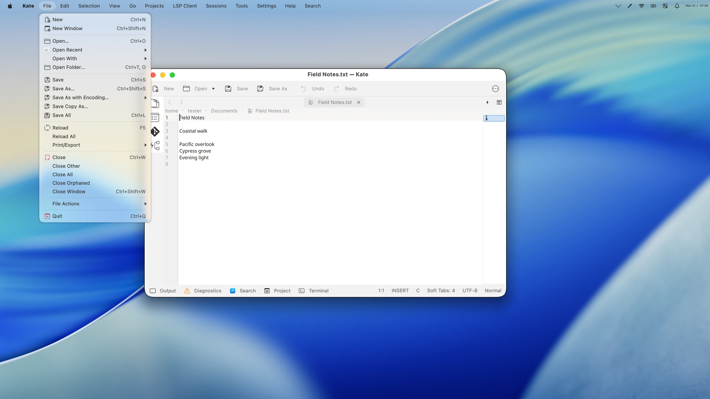
  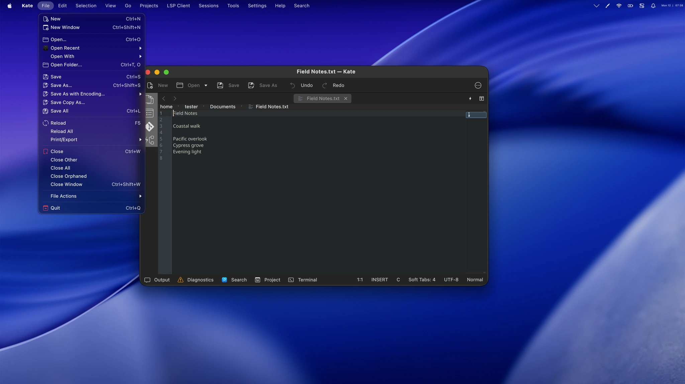
</p>

<br>

### زجاج أكريليك 2.0 مع تباين ملاءم

<br>

### Launchpad (Alpha)

<p align="center">
  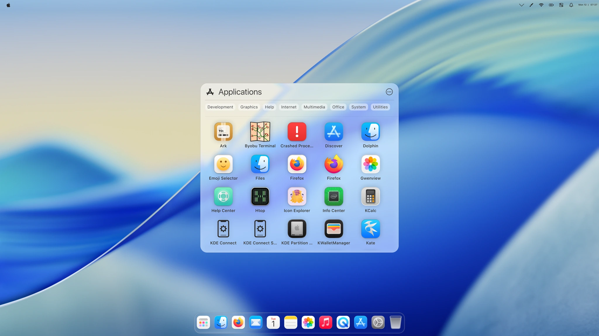
  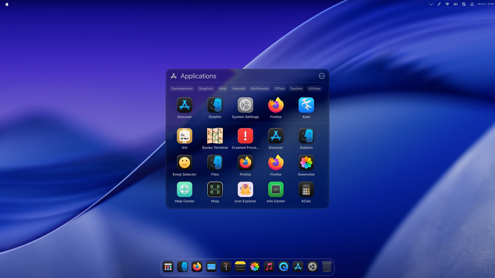
</p>

<br>

### مركز التحكم (ألفا)

<p align="center">
  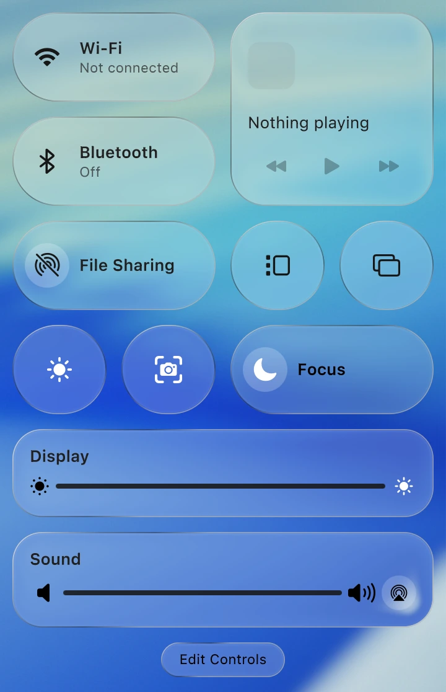
  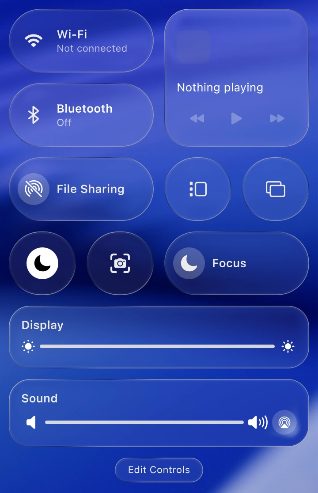
</p>

<br>

### الإخطارات (الفا)

<p align="center">
  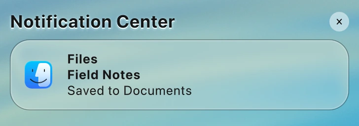
  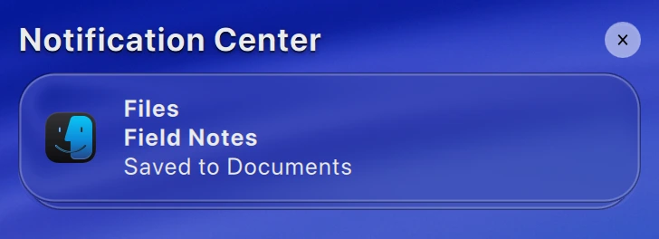
</p>

<p align="center">
  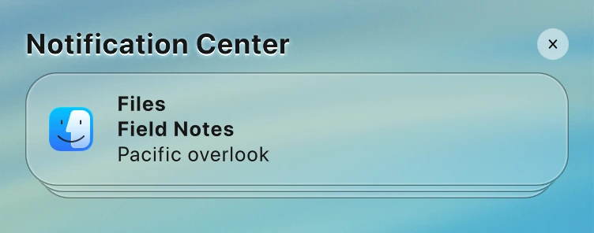
  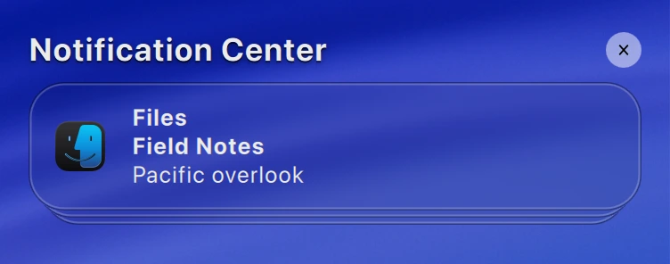
</p>

<br>

### Finder (Alpha)

<p align="center">
  <a href="src/screenshots/previews/readme-tahoe-light-finder-8b64ba8e3a8b.webp">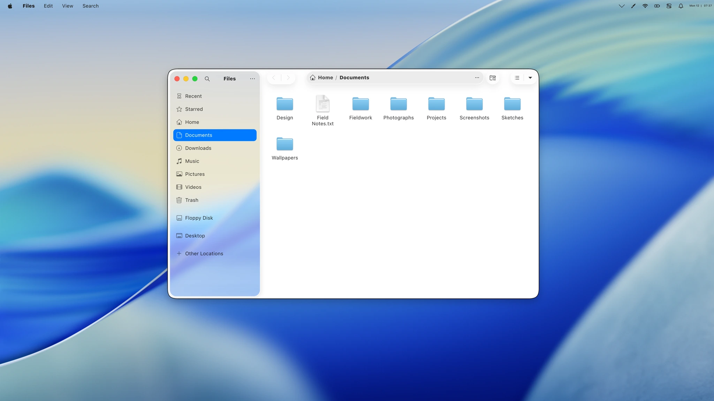</a>
  <a href="src/screenshots/previews/readme-tahoe-dark-finder-dd8777a43699.webp">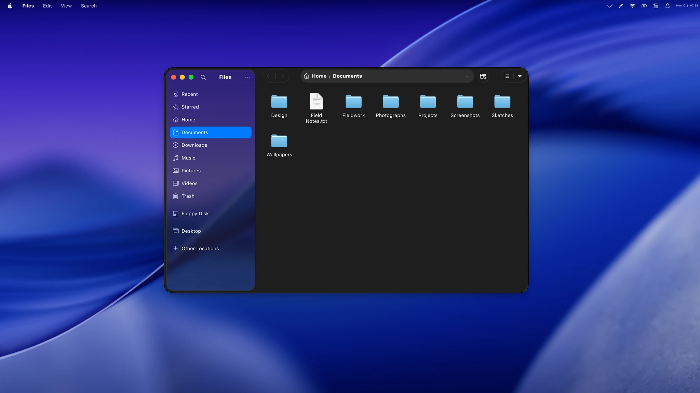</a>
</p>

<br>

### التقويم (ألفا)

<p align="center">
  
  
</p>

<br>

### Bluetooth (Alpha)

<p align="center">
  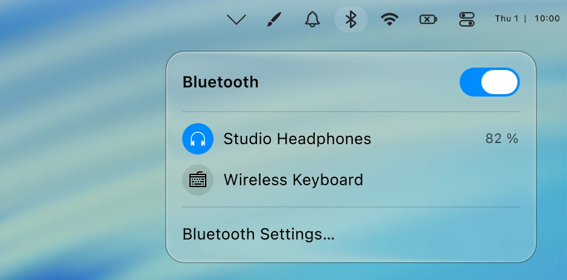
  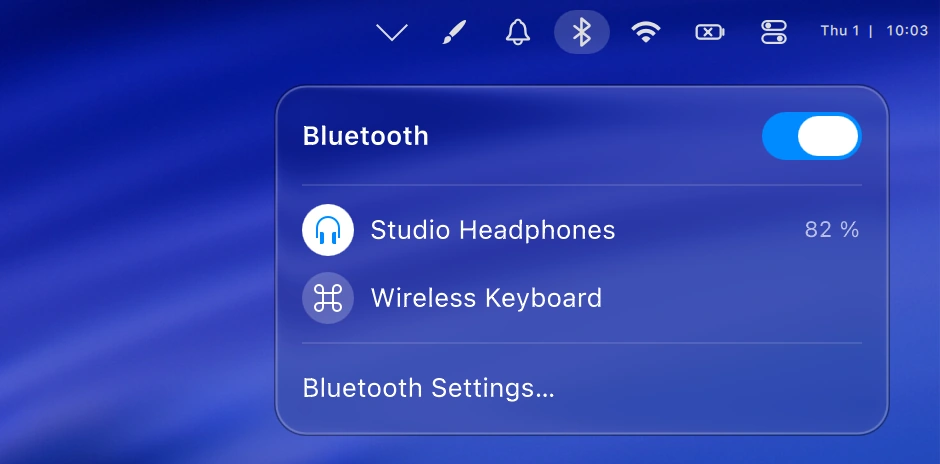
</p>

### Wi-Fi (Alpha)

<p align="center">
  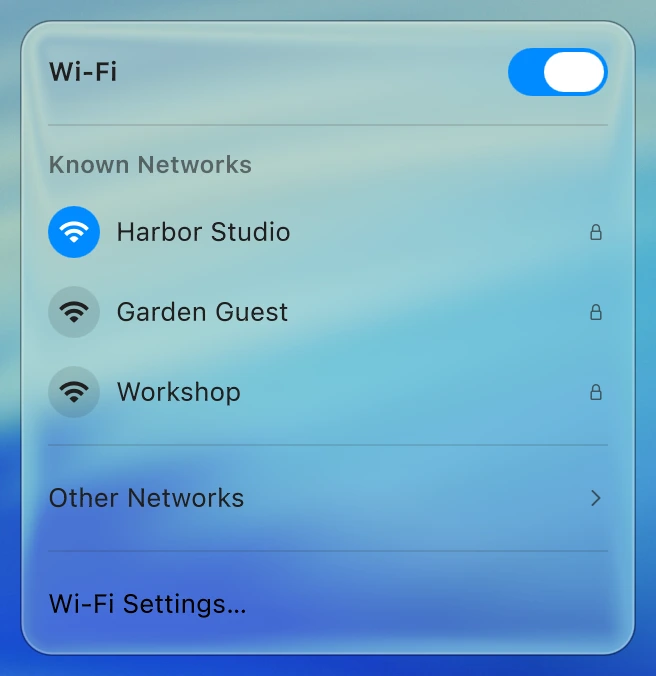
  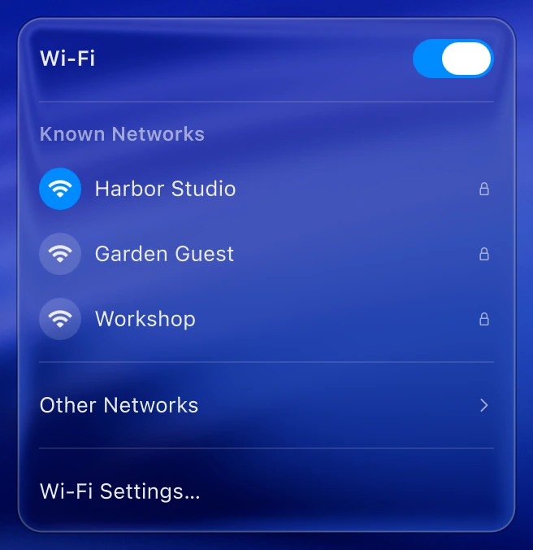
</p>

<br>

### البطارية (ألفا)

<p align="center">
  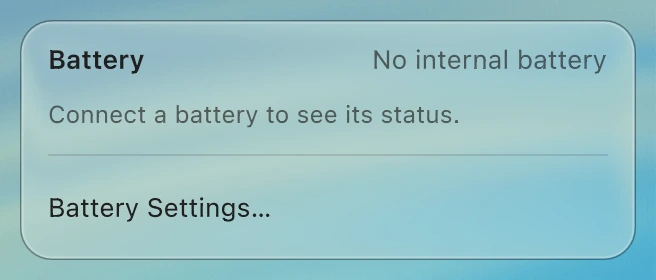
  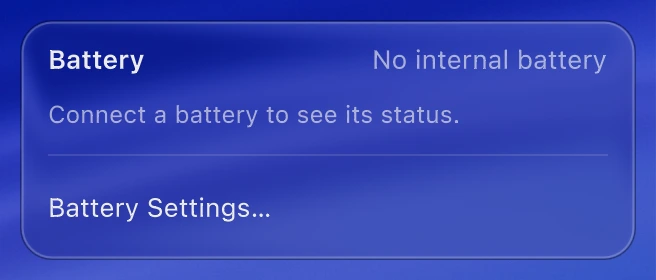
</p>

<br>

### سجل الحافظة (ألفا)

<p align="center">
  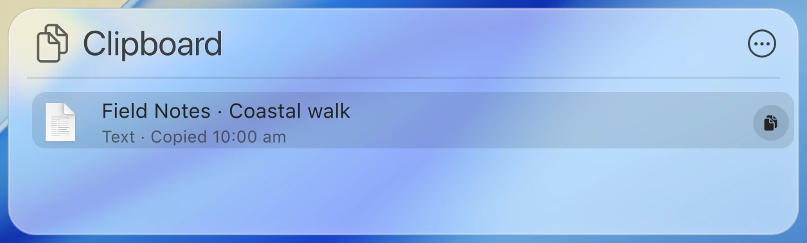
  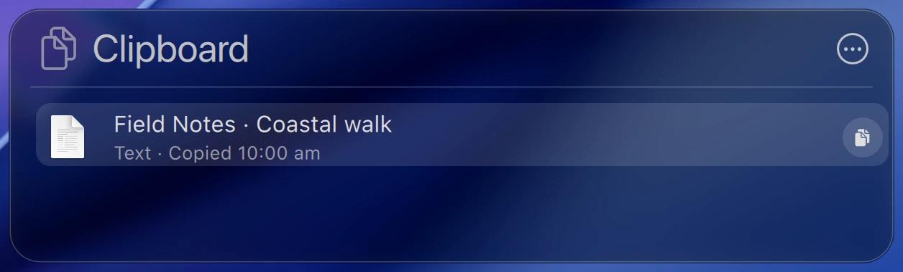
</p>

<br>

### معلومات النظام (ألفا)

<p align="center">
  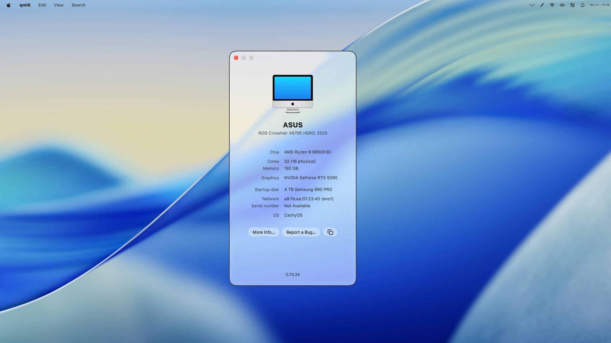
  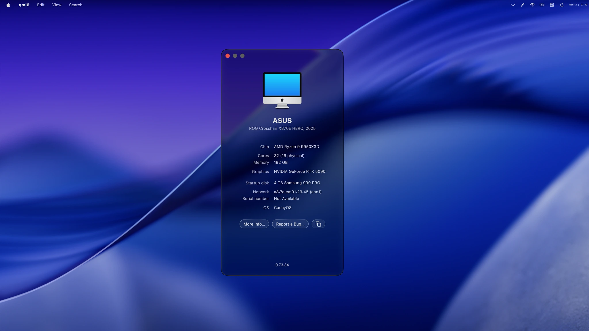
</p>

<br>

### سمة Plasma (ألفا)

<p align="center">
  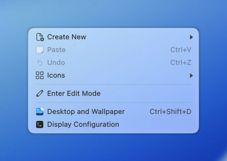
  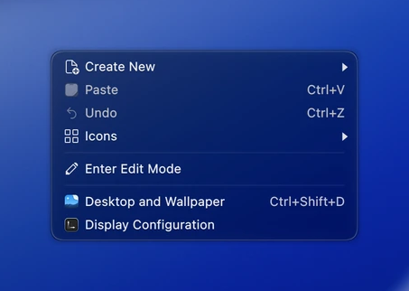
</p>

<br>

### شاشة الإقلاع (ألفا)

<p align="center">
  
</p>

<br>


- **مظهر:** مواضيع خفيفة ومظلمة منسقة للمكتب، والتطبيقات، والعلامات، وتزيين النوافذ، مع التبديل الآلي ورق خلفية لكل جهاز. [إعدادات تزيين النوافذ الخاصة بالتطبيق](docs/app-window-decorations.md)
- **آثار الزجاج:** القليل من التضليل والانكسار واللون، مع نص يتكيف مع الخلفية في القوائم المدعومة.
- **المرفأ:** تطبيقات مدمجة، زوم تحليق، شاركات الإخطار والخفاء القابل للتكوين. المرفأ يتبعك بين العروض
- **شريط القائمة و مركز التحكم:** قائمة التطبيقات العالمية والتحكمات السريعة في النظام، مع إعدادات شريط القائمة المشتركة عبر الشاشات.
- **لوحة الإطلاق:** ابحث عن تطبيقات، استفحص الفئات و حفظ المفضلة في أي من التخطيطين.
- **أجهزة سطح المكتب:** إضافة وتنظيم الوسائط المجمعة للقماش السائل على سطح المكتب الخاص بك.
- **الإخطارات:** لافتات زجاجية وتاريخ مُجموع، مع إجراءات سريعة وردود عندما تدعمها التطبيقات.
- **تاريخ المقطع:** إبحث عن النصوص والصور المنسخة واستعادتها، ووضع الأدوات التي تريد الاحتفاظ بها.
- **تكامل التطبيقات:** التصفح في نمط البحث في Nautilus ، وتكامل قائمة GTK وموضوع Firefox مع نسخ احتياطية من الملفات الشخصية.
- **معلومات النظام وبدء العمل:** نافذة معلومات النظام ذات الموضوع وفرق إطلاق متطابق اختياري.
- **الإعداد والتحقيق:** مرمّح رسمي مع مجموعة من أصول الموضوع والتحديثات والإعدادات النسخة الاحتياطية التي يمكن استعادتها عند إزالة التثبيت.
- **اللغات:** اختر لغة التثبيت في الإعدادات أجهزة البلازما تتبع لغة سطح المكتب
- **التوافق:** البلازما 6.6 ⁇ 6.8 على الأنظمة القائمة على Arch و Fedora، openSUSE، Debian و KDE neon.
- **الميزات الاختيارية:** حماية لوحة OLED ودعم تجربي لـ NixOS ومدير المنزل.

<br>


تحميل و فتح التركيب:

```bash
git clone --filter=blob:none https://github.com/lestercorderomurillo/macos-tahoe-liquid-kde.git
cd macos-tahoe-liquid-kde
./installer
```

اختر **Express** للتثبيت. للتحديث أو الإزالة شغّل `./installer` مرة أخرى.

لإخلاء مساحة على القرص مع الاحتفاظ بنسخة Git وتغييراتك المحلية:

```bash
./installer --free-space
```

| لغة التركيب | الحالة |
| --- | --- |
| 🇺🇸 English |  |
| 🇪🇸 Español |  |
| 🇨🇳 简体中文 |  |
| 🇧🇷 Português (Brasil) |  |
| 🇩🇪 Deutsch |  |
| 🇫🇷 Français |  |
| 🇮🇹 Italiano |  |
| 🇷🇺 Русский |  |
| 🇯🇵 日本語 |  |
| 🇰🇷 한국어 |  |
| 🇸🇦 العربية |  |
| 🇮🇳 हिन्दी |  |
| 🇳🇱 Nederlands |  |
| 🇵🇱 Polski |  |
| 🇹🇷 Türkçe |  |

<details>
<summary><b>المتطلبات</b></summary>

مطلوبة سطح المكتب، أدوات بناء و حزم النظام.

- KDE Plasma 6.6+
- Python 3.10+ و PyQt6
- `sudo`
- أدوات التطوير Qt 6
- حزم تطوير KDE و Qt 6 للبلاسموايدات المجمعة و تأثيرات KWin
- `cmake`, `g++`و `pkg-config` عند اختيار الميزات المجمعة
- `dbus-send`
- `systemctl` أو `crontab` بالنسبة للمواصفات المخطط لها

**dinit:** يكتشف الجهاز التثبيت (dinit) ويستخدم إدخالات cron لكل مستخدم للتبديل التلقائي للضوء / الظلام والرعاية بالبيانات OLED. مطلوب ديمون التشغيل التثبيت `crontab` وحدها لا تبدأ على Artix/dinit، إعداده مع:

```bash
sudo pacman -S --needed cronie cronie-dinit
sudo dinitctl --system enable cronie
```

التبديلات الآلية تعمل في 06:00 و 18:00 أثناء تسجيل الدخول الخلفي cron لا يحتوي على وقت تسجيل الدخول. يعمل التبديل اليدوي للضوء والظلام بشكل مستقل عن cron. صور الشاشة القائمة على Artix تغطي OpenRC.

الأصول مرتبطة تتطلب الاعتمادات المفقودة والزوايا المتديرة الاختيارية لـ KDE الوصول إلى الإنترنت. تحديثات Verified Rounded Corners تقوم بإزالة المصادر والأرشيفات القديمة التي تم تحميلها. إعادة التثبيت يستبدل أشجار الأصول المدارة في مكانها النسخة الناجحة إزالة بياناتها المؤقتة، والنسخة اللاحقة تنظيف المقاطعة القابلة للتخلص منها. يتم الاحتفاظ بنسخ احتياطية لاسترداد، ونسخ احتياطية لمصفحة المتصفح وتفضيلات المستخدم. الصور والحزم التقاط VM للمطورين ليست محفظات التثبيت ولا يتم إزالتها تلقائيًا.

| المنتجات | أدوات Qt 6 | حزم تطوير KDE Plasma 6 |
|--------|------------|-----------------------------------|
| عائلة أرش | `pacman -S qt6-tools` | `pacman -S extra-cmake-modules plasma-workspace kdecoration libplasma libnotificationmanager libksysguard plasma-activities-stats` |
| عائلة فيدورا | `dnf install qt6-qttools-devel` | `dnf install extra-cmake-modules plasma-workspace-devel kdecoration-devel libplasma-devel knotifications-devel libksysguard-devel kf6-plasma-activities-devel` |
| openSUSE Tumbleweed | `zypper install qt6-tools-devel` | `zypper install extra-cmake-modules plasma6-workspace-devel kdecoration-devel libKF6Plasma-devel libnotificationmanager6-devel libksysguard6-devel libKF6PlasmaActivitiesStats6-devel` |

على Fedora، يقوم الجهاز بتثبيت Fedora GTK 3 المصدر العالمي للقوائم `unity-gtk3-module`، ويحمله عند تسجيل الدخول لتطبيقات GTK 3

</details>

<details>
<summary><b>الرعاية OLED</b></summary>

تغييرات إختيارية في اللوحة تم تعطيلها بشكل افتراضي.

تمكينها على **حماية OLED** الصفحة اختر فترة التحول وتحريك أكبر بكسل هناك يتم تعطيلها بشكل افتراضي.

**التحكم اليدوي**

```bash
mac-tahoe-oled-care shift
mac-tahoe-oled-care restore
mac-tahoe-oled-care status
```

</details>

<br>


تحقق من دعم نظام التوزيع الخاص بك، النظام الإبتدائي والنسخة البلازما.

<details>
<summary><b>اختبار التوزيعات</b></summary>

جرب الموضوع في سطح مكتب بلازما معزول.

```bash
./vm <os>
```

**OS:** `cachyos` · `arch` · `manjaro` · `endeavouros` · `garuda` · `fedora` · `nobara` · `opensuse` · `neon` · `debian` · `artix` · `kubuntu`

`all` يطلق كل التوزيع. تزويد الأهداف السحابية تلقائيًا يستخدم الأهداف الأخرى معدات التصنيع الرسمية للصيغة المعيارية للصيغة المعيارية (ISO). اتبعوا [دليل إعداد و تأهيل الكمبيوتر](tests/vm/README.md).

`./vm kubuntu` يبدأ مع ISO الرسمي Kubuntu 26.04.1 LTS مع SHA-256 التحقق (مرفأ SSH `2234` بعد إعداد الضيوف). هذا الهدف الرجعي للمطلق الجديد ينتظر التأهيل الكامل المباشر

`./vm debian` يستخدم صورة سحابة ديبيان الرسمية للتجربة (فوركي) ، ويتحقق من مبلغ التحقق من SHA-512 ، ويتيح مكتب بلازما. تسجيل الدخول `tester` مع كلمة مرور `tester`(إنجليزية) الـ SSH متوفرة على `127.0.0.1:2232`. . يفتح التركيب من نسخة ضيفة يمكن كتابتها في `/home/tester/macos-tahoe-liquid-kde`(إنجليزية) يتم تركيب مخزن المضيف للقراءة فقط. الاستخدام `./vm debian --clean` لإعادة بناء الضيف القابل للتخلص منه من الصفر

جميع التوزيعات الـ 11 في هذا الجدول اجتازت مؤهلات VM مباشرة. حدد شارة حالة لقطات الشاشة المراجعة ونتائج الاختبار.

| | الاسم | الحالة |
|:--:|------|---------|
|  | CachyOS | [](tests/vm/PROOF.md#cachyos) |
|  | Arch Linux | [](tests/vm/PROOF.md#arch) |
|  | EndeavourOS | [](tests/vm/PROOF.md#endeavouros) |
|  | Fedora | [](tests/vm/PROOF.md#fedora) |
|  | Manjaro | [](tests/vm/PROOF.md#manjaro) |
|  | Artix Linux (OpenRC) | [](tests/vm/PROOF.md#artix) |
|  | Garuda Linux | [](tests/vm/PROOF.md#garuda) |
|  | Nobara | [](tests/vm/PROOF.md#nobara) |
|  | openSUSE Tumbleweed | [](tests/vm/PROOF.md#opensuse) |
|  | KDE neon | [](tests/vm/PROOF.md#neon) |
|  | اختبار ديبيان / sid (بلازما 6.6+) | [](tests/vm/PROOF.md#debian) |

**نيكسوس ومدير المنزل (اختبار)**

استخدم وحدات القش **ليس التركيب الرسومي**. . التحقق المباشر من سطح المكتب في انتظار.

**مدخلات الفلك** (تطلب نيكس بي جيز و مدير المنزل):

```nix
inputs.mac-tahoe = {
  url = "github:lestercorderomurillo/macos-tahoe-liquid-kde/v0.55.2";
  inputs.nixpkgs.follows = "nixpkgs";
  inputs.home-manager.follows = "home-manager";
};
```

**NixOS:** الاستيراد `inputs.mac-tahoe.nixosModules.default`.

```nix
services.desktopManager.plasma6.enable = true;
services.mac-tahoe.enable = true;
# services.mac-tahoe.plymouth.enable = true; # optional boot splash
```

**Home Manager:** الاستيراد `inputs.mac-tahoe.homeManagerModules.default`.

```nix
programs.mac-tahoe = {
  enable = true;
  mode = "auto"; # or "light" / "dark"
  # appleAssets = true;
  # oledCare.enable = true;
};
```

**أصول شركة آبل:** الخطوط غير الحرة، والحائط خلفية وأصوات اختيارية. إمكانيات `appleAssets` يتطلب أيضاً:

```nix
nixpkgs.config.allowUnfreePredicate = pkg:
  builtins.elem (lib.getName pkg) [ "mac-tahoe-apple-assets" ];
```

**الألواح:** أيضاً استيراد وحدات إدارة البلازما الخاصة بك `inputs.mac-tahoe.homeManagerModules.plasma-manager`. . تمكين `programs.mac-tahoe.panels.enable` و المجموعة `programs.mac-tahoe.panels.launchers`، على سبيل المثال `[ "applications:org.kde.dolphin.desktop" ]`. . هذا يحل محل التخطيط دون استيراد الرؤوس القائمة.

**إعدادات الكتابة:** إبق `kdeglobals`, `kwinrc`, `plasmarc`, `plasmashellrc`, `kcminputrc`, `plasma-org.kde.plasma.desktop-appletsrc`, `Kvantum/kvantum.kvconfig` وتكوين GTK الحي قابل للكتابة. تجنب مفاتيح إدارة البلازما غير المتغيرة التي يتم إدارتها بواسطة مفتاح الموضوع.

تسجيل الخروج والعودة بعد تنشيط. لا يتم تشكيل ملفات تعريف Firefox و علامات التوقيت GTK و SDDM. في مدير المنزل، تعيين `programs.mac-tahoe.gtkAppmenuModule` إلى المسار الكامل لمكتبة وحدات قائمة تطبيقات GTK 3 المثبتة لتحملها عند تسجيل الدخول. قبل تعطيل الرعاية OLED، تشغيل `mac-tahoe-oled-care restore`(إنجليزية) قبل إزالة الوحدات، اختر بريز. إزالة يترك إعدادات المستخدم في مكانها.

</details>

<details>
<summary><b>أنظمة البداية</b></summary>

يستخدم التبديل الآلي للموضوع والرعاية OLED الخلفيات التالية في الجدول:

| نظام البداية | الجدول | اختبار مسجل |
| --- | --- | --- |
| systemd | توقيت المستخدم |  |
| OpenRC | كل مستخدم |  |
| dinit | كل مستخدم |   |

OpenRC و dinit يتطلبون إشعار cron يعمل [نتائج اختبار سطح المكتب](tests/vm/PROOF.md) · [صنعة تخطيط الدينيت](CONTRIBUTING.md#setup).

</details>

<details>
<summary><b>إصدارات البلازما</b></summary>

يتم دعم البلازما 6.6 ⁇ 6.8 التأثيرات المجمعة تستخدم SDK المضيف.

| Plasma | الدعم | منذ |
|--------|---------|-------|
| الإصدار 6.5 وما قبله |  | لا ينطبق |
| 6.6 |  | v0.1.0 |
| 6.7 |  | v0.19.0 |
| 6.8 |  | v0.54.1 |

</details>

<br>


هذا المشروع إعادة تنفيذ مستقلة مستوحاة من تصميم macOS. لا يتبع Apple أو KDE ولا يحظى بتأييد أي منهما. «macOS» و«Apple» علامتان تجاريتان لشركة Apple Inc.

شعار macOS والخلفيات وأصوات النظام وخطوط SF Pro وSF Mono المرفقة ملك لشركة Apple ولا يشملها ترخيص هذا المشروع. تحتفظ المكونات الأخرى بتراخيصها وإشعارات حقوق النشر الخاصة بها. يبين فهرس إشعارات الأطراف الثالثة نطاقها وما لم يُوثق من مصادرها.

يخضع المشروع ككل لترخيص [GPL-3.0](LICENSE)، وتظل تراخيص المكونات الفردية وحقوق الأطراف الثالثة سارية. راجع [إشعارات حقوق النشر](NOTICE) و[التراخيص وهوية المشروع](LICENSING.md) و[إشعارات الأطراف الثالثة](THIRD_PARTY_NOTICES.md).

<br>


<details>
<summary><b>المشاريع والأصول والإقرارات</b></summary>

إشارات المشروع ومكونات الطرف الثالث:

- **[EliverLara](https://github.com/EliverLara/TahoeLauncher)**: `TahoeLauncher`: إشارة لتصميم أداة الإطلاق.
- **[vinceliuice](https://github.com/vinceliuice)**: `MacTahoe-icon-theme`: أيقونات القاعدة والمؤشرين إشارة تصميم GTK [`MacTahoe-gtk-theme` Firefox CSS/SVG](https://github.com/vinceliuice/MacTahoe-gtk-theme/tree/main/other/firefox) يتم الحفاظ عليها هنا كشوكة مرخصة من MIT مع نسخة احتياطية للملفات الشخصية واستعادة الدعم.
- **[taj-ny](https://github.com/taj-ny/kwin-effects-forceblur)** و **[4v3ngR](https://github.com/4v3ngR/kwin-effects-glass)**: Better Blur و fork: رمز فوق التيار المستخدم من قبل أكريليك غلاس (مؤلفي KWin blur يبقى مدعوم في العناوين المصدرة).
- **[luisbocanegra](https://github.com/luisbocanegra/plasma-panel-colorizer)**: `plasma-panel-colorizer` v7.3.0 ، يتم جمعها خارج الاتصال وتثبيتها بواسطة خطوة التخطيط للوون للوحات (GPL-3.0 ، الترخيص الذي تم شحنه إلى جانب).
- **[jaxparrow07](https://github.com/jaxparrow07/liquidglass-kde-widgets)**: `liquidglass-kde-widgets` يقدم مجموعة متجمعة من أجهزة الكمبيوتر المكتبية لـ Liquid Glass (شملت رخصة GPL-3.0).
- **[RoxasYTB](https://github.com/RoxasYTB)**: [ويدج الصور](https://github.com/jaxparrow07/liquidglass-kde-widgets/pull/41) يعرض الصور على سطح المكتب. [التبديل الآلي بين الصلب والزجاج](https://github.com/jaxparrow07/liquidglass-kde-widgets/pull/40) يغير الوسائط إلى الزجاج عندما تكون نافذة مفتوحة على الشاشة.
- **[Matin Lotfaliei / KDE-Rounded-Corners](https://github.com/matinlotfali/KDE-Rounded-Corners)**: تأثير نافذة مستديرة GPL-3.0 KWin ، تم الحصول عليه من الإصدار v0.9.0 المثبت وبناء على الإنترنت ضد SDK KWin المضيف (الترخيص مثبت بجوار).
- **[ful1e5](https://github.com/ful1e5)**: `apple_cursor`: إشارة تصميم السير البديل.
- **[sahibjotsaggu](https://github.com/sahibjotsaggu)**: `San-Francisco-Pro-Fonts`: مصدر حزمة SF Pro / SF Mono.
- **[Lucide](https://github.com/lucide-icons/lucide)**: نسخة الرموز المجمعة في القائمة العالمية (ISC، © Lucide Contributors).
- **[512pixels.net](https://512pixels.net/projects/default-mac-wallpapers-in-5k/)**: أرشيف خلفية macOS عالية الدقة.

إذا كانت هناك إئتمان مفقود، من فضلك [افتح بلاغًا](https://github.com/lestercorderomurillo/macos-tahoe-liquid-kde/issues/new).

</details>


[صور الشاشة و اختبارات الجهاز](TESTING.md).
