<p align="center">
  <!-- Artwork: https://developer.apple.com/assets/elements/icons/macos-26/macos-26-128x128_2x.png -->
  
</p>

<h1 align="center">macOS Tahoe für KDE Plasma</h1>

<p align="center">
  <a href="README.md" lang="en" hreflang="en">🇺🇸 English</a> ·
  <a href="README.es.md" lang="es" hreflang="es">🇪🇸 Español</a> ·
  <a href="README.zh-CN.md" lang="zh-CN" hreflang="zh-CN">🇨🇳 简体中文</a> ·
  <a href="README.pt-BR.md" lang="pt-BR" hreflang="pt-BR">🇧🇷 Português (Brasil)</a> ·
  <a href="README.de.md" lang="de" hreflang="de" aria-current="page">🇩🇪 Deutsch</a> ·
  <a href="README.fr.md" lang="fr" hreflang="fr">🇫🇷 Français</a>
</p>

<p align="center">
  <a href="https://github.com/lestercorderomurillo/macos-tahoe-liquid-kde/releases"></a>
  <a href="https://github.com/lestercorderomurillo/macos-tahoe-liquid-kde/actions/workflows/test.yml"></a>
  <a href="https://kde.org/plasma-desktop/"></a>
  <a href="LICENSE"></a>
  <a href="https://github.com/lestercorderomurillo/macos-tahoe-liquid-kde/issues/new"></a>
</p>


<p align="center">
  macOS Tahoe Stil für KDE Plasma 6.6, 6.7 und 6.8+.
</p>

<p align="center">
  <sub>Eine Distribution auswählen, um ihren Teststatus zu sehen.</sub>
</p>

<p align="center">
  <a href="tests/vm/PROOF.md#cachyos" title="CachyOS"></a>
  <a href="tests/vm/PROOF.md#arch" title="Arch Linux"></a>
  <a href="tests/vm/PROOF.md#endeavouros" title="EndeavourOS"></a>
  <a href="tests/vm/PROOF.md#fedora" title="Fedora"></a>
  <a href="tests/vm/PROOF.md#manjaro" title="Manjaro"></a>
  <a href="tests/vm/PROOF.md#artix" title="Artix Linux (OpenRC)"></a>
  <a href="tests/vm/PROOF.md#garuda" title="Garuda Linux"></a>
  <a href="tests/vm/PROOF.md#nobara" title="Nobara Linux"></a>
  <a href="tests/vm/PROOF.md#opensuse" title="openSUSE Tumbleweed"></a>
  <a href="tests/vm/PROOF.md#neon" title="KDE neon"></a>
  <a href="tests/vm/PROOF.md#debian" title="Debian testing / sid (Plasma 6.6+)"></a>
  <a href="tests/vm/PROOF.md#nixos" title="NixOS (experimental)"></a>
</p>

> [!CAUTION]
> **Rolling-Release-Prinzip**
> Experimentell. Erhält tägliche Aktualisierungen. Aktualisierungen können die Kompatibilität beeinträchtigen. Produktivsysteme vermeiden; [Probleme hier melden](https://github.com/lestercorderomurillo/macos-tahoe-liquid-kde/issues/new).

> [!WARNING]
> **Vorsicht vor kostenpflichtigen Neuverpackungen: Dieses Design ist KOSTENLOS.**
>
> Wenn du dieses Design über einen Drittanbieter gefunden hast, musst du dafür nicht bezahlen: Lade es direkt aus diesem Repository herunter. Wir halten dieses Projekt kostenlos, damit es alle ohne Bezahlschranke nutzen können. Weder Kauf noch Abonnement sind erforderlich.

<br>


Fehlerberichte, Korrekturen, Tests und Dokumentation: siehe [Beitragsrichtlinien](CONTRIBUTING.md).

Code-Mitwirkende und Personen, die Fehler in Tahoe und Golden Gate melden:

<p>
  <a href="https://github.com/lestercorderomurillo"></a>
  <a href="https://github.com/yanhenrique-dev"></a>
  <a href="https://github.com/naevui"></a>
  <a href="https://github.com/caioniehues"></a>
  <a href="https://github.com/404-not-found129"></a>
  <a href="https://github.com/myakupozluk"></a>
  <a href="https://github.com/EMS1998"></a>
  <a href="https://github.com/allfritz"></a>
  <a href="https://github.com/elegos"></a>
  <a href="https://github.com/kozeki-uii"></a>
  <a href="https://github.com/imightbelosthere"></a>
  <a href="https://github.com/evaildev"></a>
  <a href="https://github.com/xarblu"></a>
  <a href="https://github.com/PKMNPlatin"></a>
  <a href="https://github.com/matinlotfali"></a>
  <a href="https://github.com/luisbocanegra"></a>
  <a href="https://github.com/OliverChase2003"></a>
  <a href="https://github.com/RoxasYTB"></a>
  <a href="https://github.com/Flagwill"></a>
  <a href="https://github.com/4l3j0Ok"></a>
  <a href="https://github.com/0xrushi"></a>
  <a href="https://github.com/aenriii"></a>
  <a href="https://github.com/andreas399"></a>
  <a href="https://github.com/Andrew-Sor"></a>
  <a href="https://github.com/ardashir77"></a>
  <a href="https://github.com/azizaktas"></a>
  <a href="https://github.com/binary-pleb"></a>
  <a href="https://github.com/bneils"></a>
  <a href="https://github.com/FAYZER77"></a>
  <a href="https://github.com/fxrncyyisingithub"></a>
  <a href="https://github.com/germanbagutteorsomething"></a>
  <a href="https://github.com/iNarrow12"></a>
  <a href="https://github.com/IsaiahSHanson"></a>
  <a href="https://github.com/kuau"></a>
  <a href="https://github.com/Lando0007"></a>
  <a href="https://github.com/LilT59"></a>
  <a href="https://github.com/marcosfantonio"></a>
  <a href="https://github.com/moulikanand12345-lang"></a>
  <a href="https://github.com/nanechi"></a>
  <a href="https://github.com/nousernameget"></a>
  <a href="https://github.com/OpalSand"></a>
  <a href="https://github.com/P0sixSplo1t-2"></a>
  <a href="https://github.com/rokan00"></a>
  <a href="https://github.com/RussH"></a>
  <a href="https://github.com/Salkio"></a>
  <a href="https://github.com/Shivamingale3"></a>
  <a href="https://github.com/shoko3756"></a>
  <a href="https://github.com/Sonicx9876"></a>
  <a href="https://github.com/Tias-dev"></a>
  <a href="https://github.com/txhammer68"></a>
  <a href="https://github.com/vanshdev0101"></a>
  <a href="https://github.com/vialolis"></a>
  <a href="https://github.com/Whiddu"></a>
  <a href="https://github.com/yingmanwumen"></a>
  <a href="https://github.com/yofriendfromschool1"></a>
  <a href="https://github.com/zhaokelei"></a>
</p>

<br>


### Tahoe Finder (Alpha)

Dateiverwaltung im Finder-Stil mit Tahoe-Glas.

<p align="center">
  <a href="src/screenshots/previews/readme-tahoe-light-finder-4203d60bcd59.webp"></a>
  <a href="src/screenshots/previews/readme-tahoe-dark-finder-3fba4166a2d8.webp">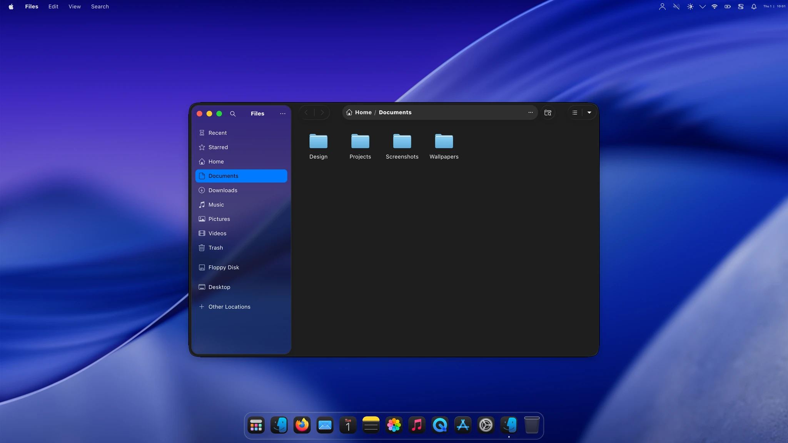</a>
</p>

<details>
<summary>Rote und blaue Akzente im hellen und dunklen Modus</summary>

<table>
<tr><th>Akzent</th><th>Hell</th><th>Dunkel</th></tr>
<tr><td>Rot</td><td><a href="src/screenshots/previews/readme-tahoe-light-finder-red-cf60519353bc.webp">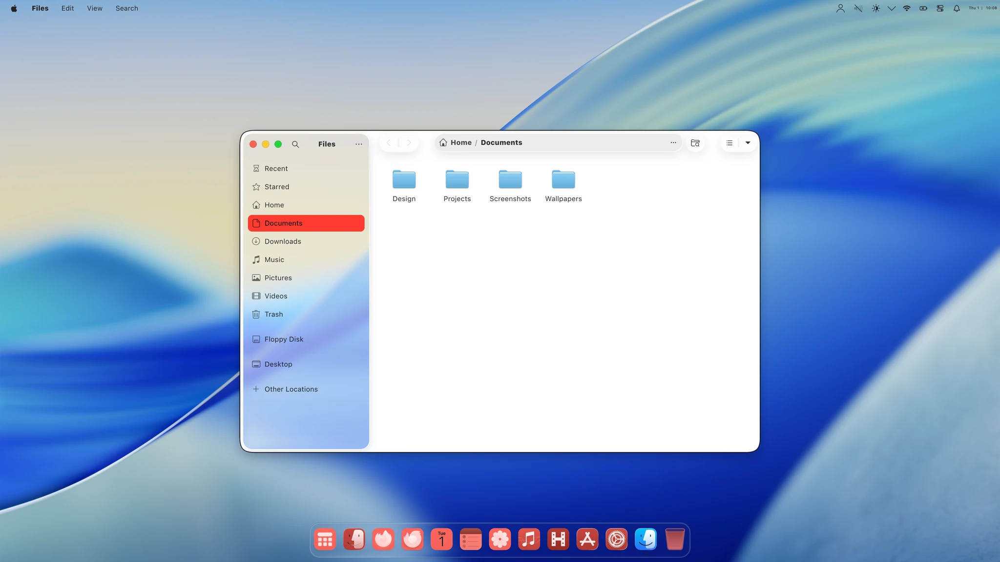</a></td><td><a href="src/screenshots/previews/readme-tahoe-dark-finder-red-a5d3144faf0f.webp">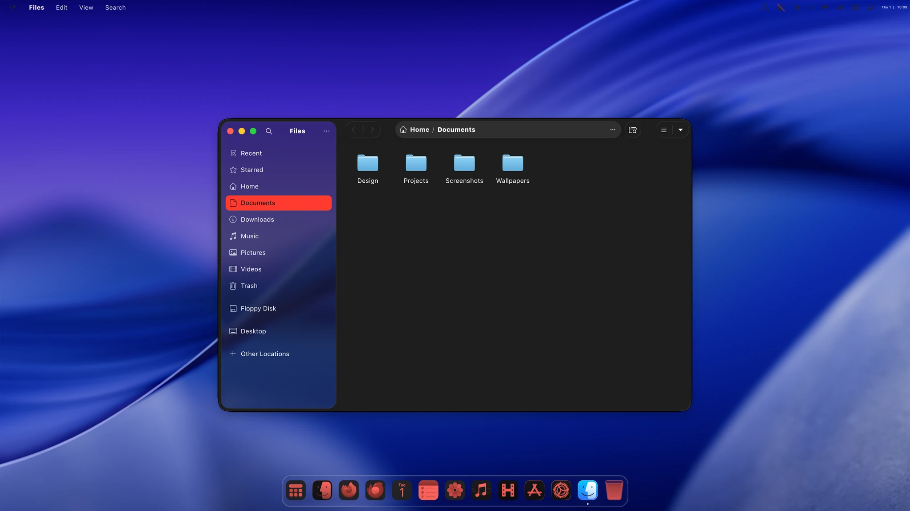</a></td></tr>
<tr><td>Blau</td><td><a href="src/screenshots/previews/readme-tahoe-light-finder-blue-ad74eeb6e7a1.webp">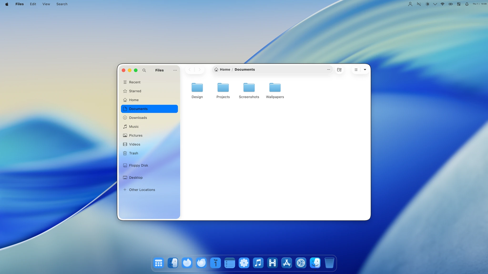</a></td><td><a href="src/screenshots/previews/readme-tahoe-dark-finder-blue-2a9bacc3b9a9.webp"></a></td></tr>
</table>

</details>

<br>

### Tahoe Launchpad (Alpha)

Anwendungen finden, Kategorien durchsuchen und Favoriten griffbereit halten.

<p align="center">
  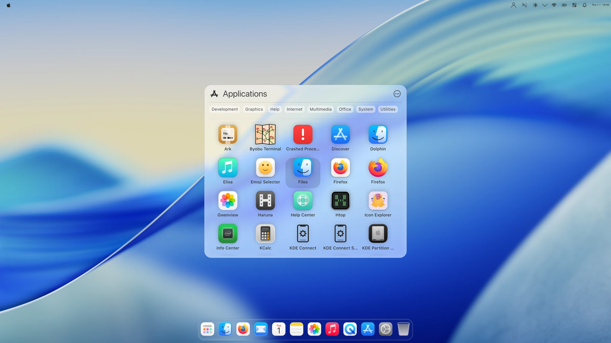
  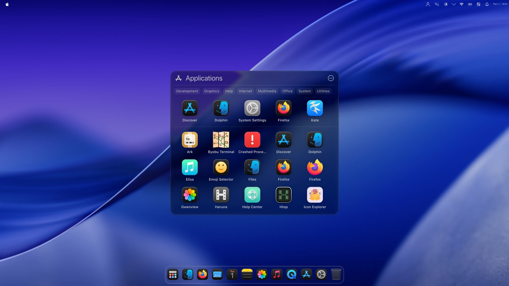
</p>

<br>

### Tahoe Dock (Alpha)

Glasbrechung, Vergrößerung beim Überfahren, rote Benachrichtigungszähler und automatisches Ausblenden.

<p align="center">
  <a href="src/screenshots/previews/readme-tahoe-light-dock-regular-6d506b3465fd.webp">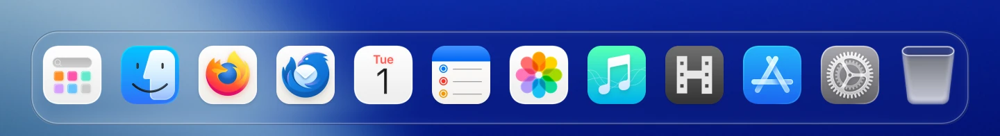</a>
  <a href="src/screenshots/previews/readme-tahoe-dark-dock-regular-9254e2db86a7.webp">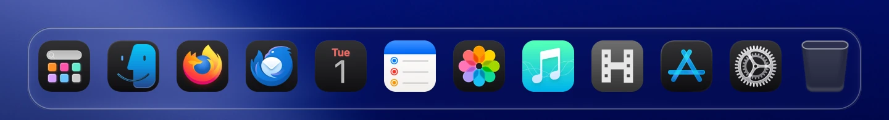</a>
</p>

<p align="center">
  <a href="src/screenshots/previews/readme-tahoe-light-dock-clear-843c40a052a7.webp">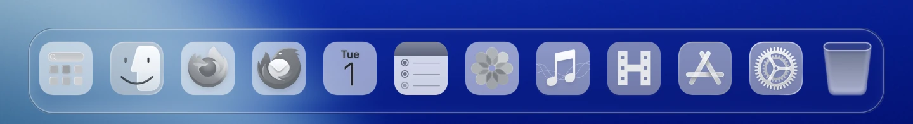</a>
  <a href="src/screenshots/previews/readme-tahoe-dark-dock-clear-58edd6d52e38.webp">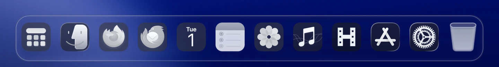</a>
</p>

<p align="center">
  <a href="src/screenshots/previews/readme-tahoe-light-dock-blue-d39bb78e2f1d.webp">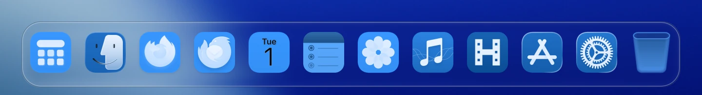</a>
  <a href="src/screenshots/previews/readme-tahoe-dark-dock-blue-a292ebe93f08.webp">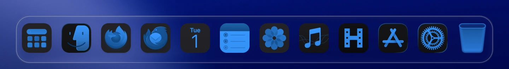</a>
</p>

<p align="center">
  <a href="src/screenshots/previews/readme-tahoe-light-dock-purple-b8d6d4a59d58.webp">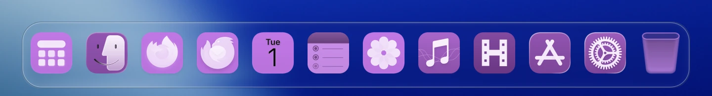</a>
  <a href="src/screenshots/previews/readme-tahoe-dark-dock-purple-090970372f80.webp">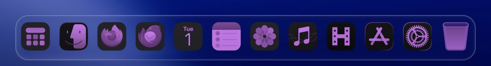</a>
</p>

<p align="center">
  <a href="src/screenshots/previews/readme-tahoe-light-dock-pink-c0b0ba00ddeb.webp">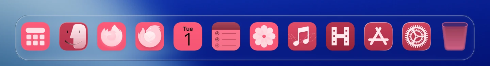</a>
  <a href="src/screenshots/previews/readme-tahoe-dark-dock-pink-ba6941817529.webp"></a>
</p>

<p align="center">
  <a href="src/screenshots/previews/readme-tahoe-light-dock-red-19adb9d798fd.webp"></a>
  <a href="src/screenshots/previews/readme-tahoe-dark-dock-red-379c09615f96.webp">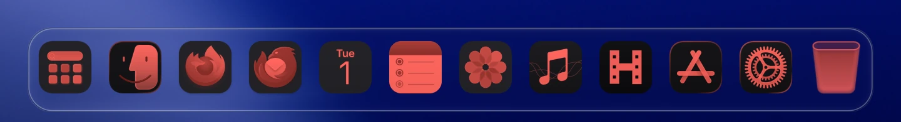</a>
</p>

<p align="center">
  <a href="src/screenshots/previews/readme-tahoe-light-dock-orange-18c4663ce547.webp">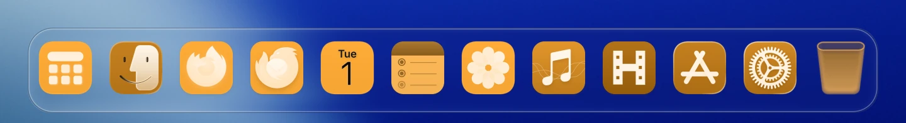</a>
  <a href="src/screenshots/previews/readme-tahoe-dark-dock-orange-5079b478c649.webp">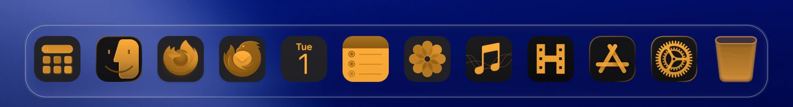</a>
</p>

<p align="center">
  <a href="src/screenshots/previews/readme-tahoe-light-dock-yellow-c7656eaf2b61.webp"></a>
  <a href="src/screenshots/previews/readme-tahoe-dark-dock-yellow-c1945efddc21.webp">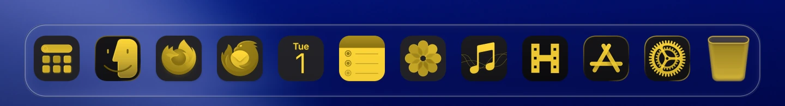</a>
</p>

<p align="center">
  <a href="src/screenshots/previews/readme-tahoe-light-dock-green-ac9611249165.webp">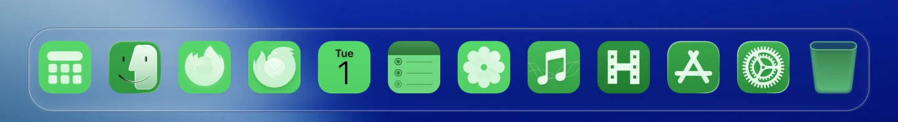</a>
  <a href="src/screenshots/previews/readme-tahoe-dark-dock-green-84eab2e65cf2.webp">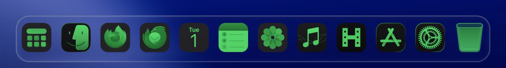</a>
</p>

<p align="center">
  <a href="src/screenshots/previews/readme-tahoe-light-dock-gray-18617e5c0df8.webp">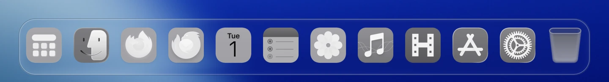</a>
  <a href="src/screenshots/previews/readme-tahoe-dark-dock-gray-e7baf051c7cb.webp">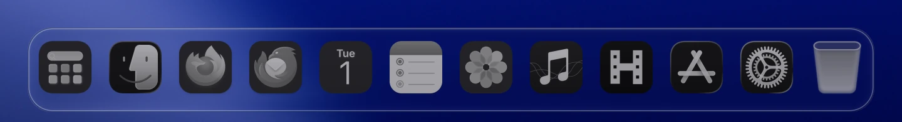</a>
</p>

<br>

### Tahoe Shell (Alpha)

Schneller Zugriff auf Systemeinstellungen, Anwendungen und Sitzungsaktionen.

<p align="center">
  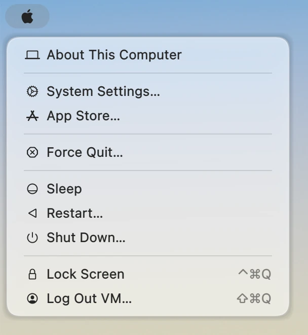
  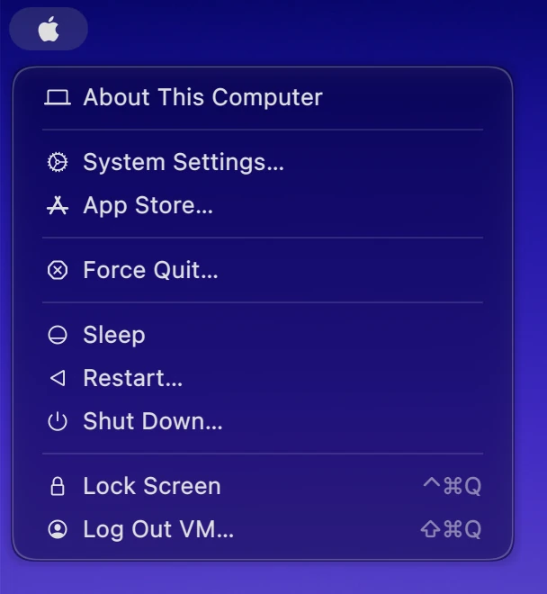
</p>

<br>

### Tahoe Kontrollzentrum (Alpha)

WLAN, Klang, Helligkeit und Benachrichtigungen in einem Glasmenü. Aktualisierungen folgen in Kürze.

<p align="center">
  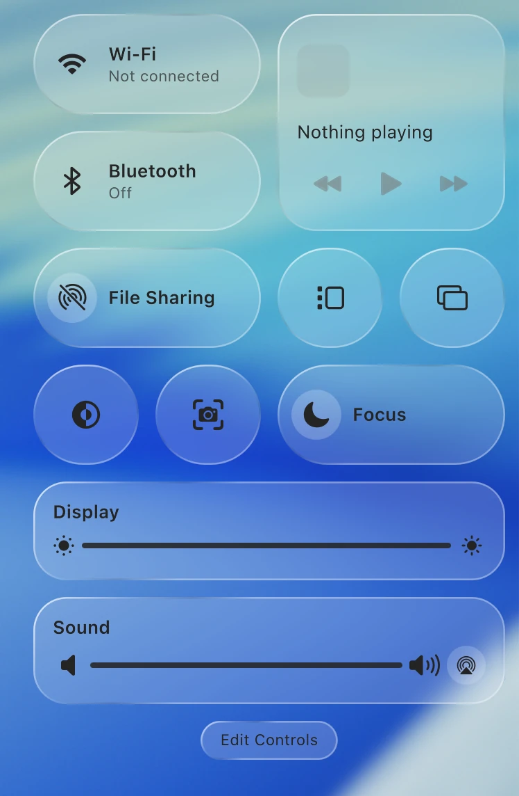
  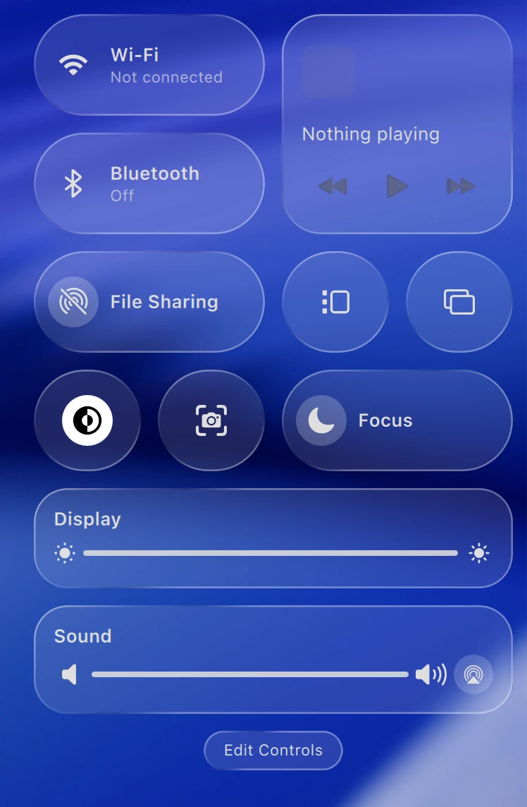
</p>

<br>

### Tahoe Zwischenablageverlauf (Alpha)

Kopierte Texte und Bilder direkt im Launchpad finden und wiederverwenden.

<p align="center">
  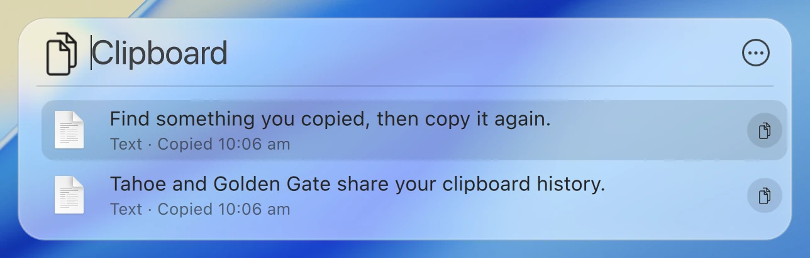
  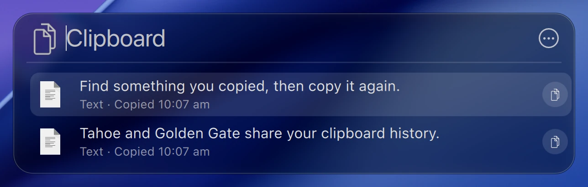
</p>

<br>

### Tahoe Systeminformationen (Alpha)

Details zu Hardware, Software und Design auf einen Blick.

<p align="center">
  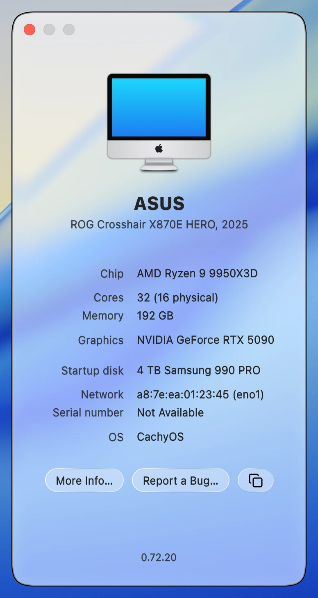
  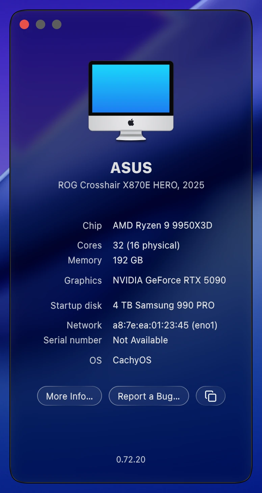
</p>

<br>

### Tahoe Plasma-Design (Alpha)

Durchscheinende Menüs und Popups mit abgestimmten hellen und dunklen Farben.

<p align="center">
  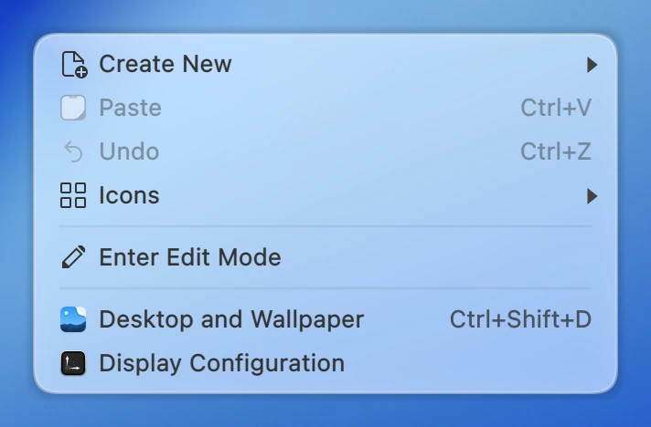
  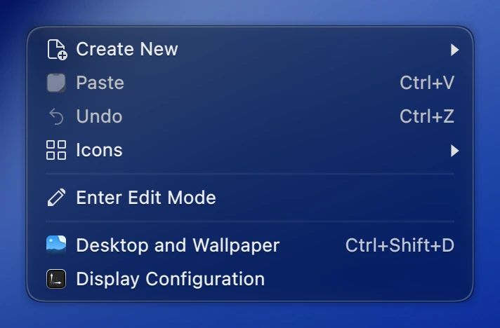
</p>

<br>

### Tahoe Startbildschirm (Alpha)

Ein abgestimmtes Erscheinungsbild vom Start bis zum Herunterfahren mit integrierter Entsperrung LUKS2-verschlüsselter Laufwerke.

<p align="center">
  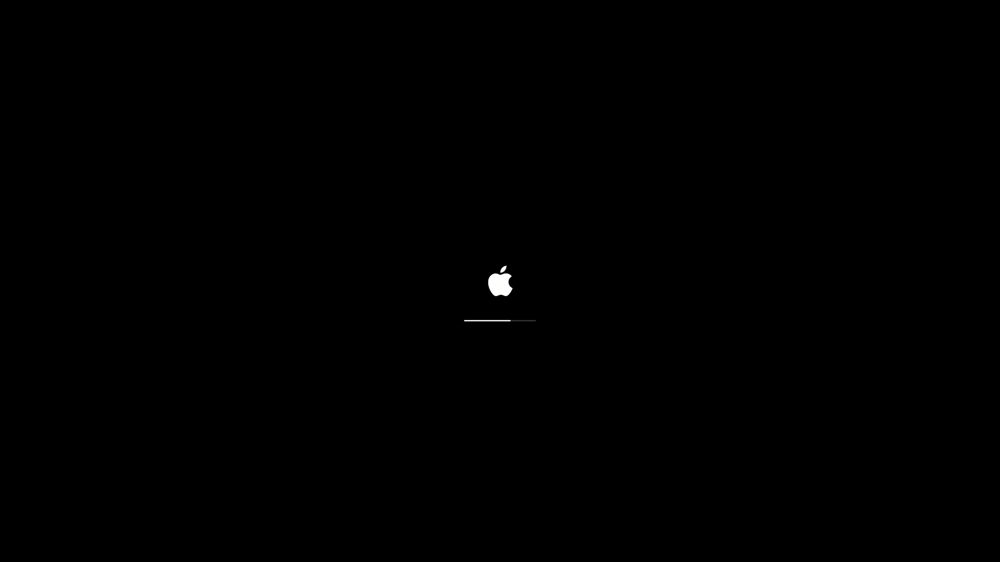
</p>

<br>


- **Sprachen:** Installationsprogramm auf Englisch, Spanisch, vereinfachtem Chinesisch, brasilianischem Portugiesisch, Deutsch und Französisch; übersetzte Plasma-Widgets.
- **Installationsprogramm:** grafische Komponentenauswahl, mitgelieferte Designressourcen und Aktualisierungsunterstützung.
- **Distributionen:** Installation von Abhängigkeiten für Arch-basierte, Fedora-basierte, openSUSE-, Debian- und KDE-neon-Systeme.
- **Zeitplanung:** automatischer Designwechsel und OLED-Schutz über systemd-Benutzertimer oder cron unter OpenRC.
- **Glaseffekte:** einstellbare Unschärfe, Brechung und dreifarbige Verläufe für helle und dunkle Modi.
- **Kompatibilität:** Plasma 6.6–6.8 mit nativen Effekten, die gegen die installierten Qt- und KWin-Versionen kompiliert werden.
- **Launchpad:** zwei Anordnungen, integrierte oder abgetrennte Suche, Favoriten und scrollbare Anwendungskategorien.
- **Dock:** Vergrößerung beim Überfahren, Benachrichtigungsabzeichen, automatisches Ausblenden und Erhalt angehefteter Einträge bei Neuinstallation.
- **Erscheinungsbild:** synchronisierte helle/dunkle Stile für Desktop, Anwendungen, Symbole und Fensterdekorationen; Hintergrundbilder pro Monitor.
- **Anwendungsintegration:** globale Menüs, GTK-Menükorrekturen, Nautilus im Finder-Stil und Firefox-Design mit Profilsicherungen.
- **Wiederherstellung:** Prüfung der Voraussetzungen, Einstellungssicherungen und Wiederherstellung bei der Deinstallation.
- **Optionale Funktionen:** OLED-Panel-Verschiebungen, Zwischenablageverlauf mit angehefteten Einträgen und Bildvorschauen sowie experimentelle NixOS- und Home-Manager-Module.
- **Tests:** Regressionstests, Distributionscontainer und Plasma-VMs.

<br>


Installationsprogramm herunterladen und öffnen:

```bash
git clone --filter=blob:none https://github.com/lestercorderomurillo/macos-tahoe-liquid-kde.git
cd macos-tahoe-liquid-kde
./installer
```

Zum Installieren **Express** wählen. Zum Aktualisieren oder Deinstallieren `./installer` erneut öffnen.

Speicherplatz freigeben und dabei Git-Arbeitskopie und lokale Arbeit erhalten:

```bash
./installer --free-space
```

| Sprache des Installationsprogramms | Status |
| --- | --- |
| 🇺🇸 Englisch |  |
| 🇪🇸 Spanisch |  |
| 🇨🇳 Vereinfachtes Chinesisch |  |
| 🇧🇷 Brasilianisches Portugiesisch |  |
| 🇩🇪 Deutsch |  |
| 🇫🇷 Französisch |  |
| 🇮🇹 Italienisch |  |
| 🇯🇵 Japanisch |  |
| 🇰🇷 Koreanisch |  |
| 🇷🇺 Russisch |  |
| 🇸🇦 Arabisch |  |
| 🇮🇳 Hindi |  |
| 🇳🇱 Niederländisch |  |
| 🇵🇱 Polnisch |  |
| 🇹🇷 Türkisch |  |

<details>
<summary><b>Voraussetzungen</b></summary>

Erforderlicher Desktop, Build-Werkzeuge und Systempakete.

- KDE Plasma 6.6+
- Python 3.10+ und PyQt6
- `sudo`
- Qt-6-Entwicklungswerkzeuge
- KDE- und Qt-6-Entwicklungspakete für die kompilierten Plasmoids und KWin-Effekte
- `cmake`, `g++` und `pkg-config` wenn kompilierte Funktionen ausgewählt sind
- `dbus-send`
- `systemctl` oder `crontab` für geplante Funktionen

**dinit:** Das Installationsprogramm erkennt dinit und verwendet benutzerspezifische cron-Einträge für den automatischen Hell-/Dunkelwechsel und OLED-Schutz. Ein laufender cron-Dienst ist erforderlich; die Installation von `crontab` allein startet ihn nicht. Unter Artix/dinit vorbereiten mit:

```bash
sudo pacman -S --needed cronie cronie-dinit
sudo dinitctl --system enable cronie
```

Automatische Wechsel erfolgen bei angemeldeter Sitzung um 06:00 und 18:00 Uhr; das cron-Backend holt beim Anmelden keine verpassten Wechsel nach. Der manuelle Hell-/Dunkelwechsel funktioniert unabhängig von cron. Die Desktop-Prüfung für dinit steht aus; vorhandene Artix-Bilder decken OpenRC ab.

Die Ressourcen werden mitgeliefert. Fehlende Abhängigkeiten und das optionale KDE Rounded Corners benötigen Internetzugang. Geprüfte Rounded-Corners-Aktualisierungen entfernen ältere heruntergeladene Quellen und Archive. Eine Neuinstallation ersetzt die verwalteten Ressourcenverzeichnisse an Ort und Stelle; erfolgreiche Kopien entfernen ihre temporären Daten, spätere Kopien bereinigen unterbrochene temporäre Bereitstellungen. Wiederherstellungssicherungen, Browserprofilsicherungen und Benutzereinstellungen bleiben erhalten. VM-Abbilder für die Entwicklung und Aufnahmepakete sind keine Installer-Caches und werden niemals automatisch entfernt.

| Distribution | Qt-6-Werkzeuge | KDE-Plasma-6-Entwicklungspakete |
|--------|------------|-----------------------------------|
| Arch-Familie | `pacman -S qt6-tools` | `pacman -S extra-cmake-modules plasma-workspace kdecoration libplasma libnotificationmanager libksysguard plasma-activities-stats` |
| Fedora-Familie | `dnf install qt6-qttools-devel` | `dnf install extra-cmake-modules plasma-workspace-devel kdecoration-devel libplasma-devel knotifications-devel libksysguard-devel kf6-plasma-activities-devel` |
| openSUSE Tumbleweed | `zypper install qt6-tools-devel` | `zypper install extra-cmake-modules plasma6-workspace-devel kdecoration-devel libKF6Plasma-devel libnotificationmanager6-devel libksysguard6-devel libKF6PlasmaActivitiesStats6-devel` |

</details>

<details>
<summary><b>OLED-Schutz</b></summary>

Optionale Panel-Verschiebungen; standardmäßig deaktiviert.

Auf der Seite **OLED-Schutz** aktivieren. Dort Intervall und maximale Pixelverschiebung wählen; standardmäßig deaktiviert.

**Manuelle Steuerung**

```bash
mac-tahoe-oled-care shift
mac-tahoe-oled-care restore
mac-tahoe-oled-care status
```

</details>

<details>
<summary><b>In einer virtuellen Maschine testen</b></summary>

Das Design in einem isolierten Plasma-Desktop ausprobieren.

```bash
./vm <os>
```

**OS:** `cachyos` · `arch` · `manjaro` · `endeavouros` · `garuda` · `fedora` · `nobara` · `opensuse` · `neon` · `debian` · `artix` · `kubuntu`

`all` startet alle Distributionen. Cloud-Ziele werden automatisch eingerichtet; die übrigen verwenden offizielle ISO-Installer mit festgelegter Prüfsumme. Siehe [VM-Einrichtungs- und Prüfanleitung](tests/vm/README.md).

`./vm kubuntu` startet die offizielle Kubuntu-26.04.1-LTS-ISO mit SHA-256-Prüfung (SSH-Port `2234` nach Einrichtung des Gasts). Die vollständige Laufzeitprüfung dieses neuen Starter-Regressionstests steht noch aus.

`./vm debian` verwendet das offizielle Debian-testing-Cloud-Abbild (Forky), prüft dessen SHA-512-Prüfsumme und richtet einen Plasma-Desktop ein. Als `tester` mit Passwort `tester` anmelden; SSH ist unter `127.0.0.1:2232` erreichbar. Das Installationsprogramm startet aus einer beschreibbaren Gastkopie unter `/home/tester/macos-tahoe-liquid-kde`; das Host-Repository wird schreibgeschützt eingebunden. Mit `./vm debian --clean` lässt sich der temporäre Gast von Grund auf neu erstellen.

</details>

<details>
<summary><b>NixOS und Home Manager (im Test)</b></summary>

Die Flake-Module verwenden, **nicht das grafische Installationsprogramm**. Die Live-Desktop-Prüfung steht aus.

**Flake-Eingabe** (benötigt Nixpkgs und Home Manager):

```nix
inputs.mac-tahoe = {
  url = "github:lestercorderomurillo/macos-tahoe-liquid-kde/v0.55.2";
  inputs.nixpkgs.follows = "nixpkgs";
  inputs.home-manager.follows = "home-manager";
};
```

**NixOS:** `inputs.mac-tahoe.nixosModules.default` importieren.

```nix
services.desktopManager.plasma6.enable = true;
services.mac-tahoe.enable = true;
# services.mac-tahoe.plymouth.enable = true; # optional boot splash
```

**Home Manager:** `inputs.mac-tahoe.homeManagerModules.default` importieren.

```nix
programs.mac-tahoe = {
  enable = true;
  mode = "auto"; # or "light" / "dark"
  # appleAssets = true;
  # oledCare.enable = true;
};
```

**Apple-Ressourcen:** optionale unfreie Schriften, Hintergrundbilder und Klänge. Die Aktivierung von `appleAssets` erfordert außerdem:

```nix
nixpkgs.config.allowUnfreePredicate = pkg:
  builtins.elem (lib.getName pkg) [ "mac-tahoe-apple-assets" ];
```

**Panels:** Zusätzlich das eigene plasma-manager-Modul und `inputs.mac-tahoe.homeManagerModules.plasma-manager` importieren. `programs.mac-tahoe.panels.enable` aktivieren und `programs.mac-tahoe.panels.launchers` festlegen, z. B. `[ "applications:org.kde.dolphin.desktop" ]`. Dadurch wird die Anordnung ersetzt, ohne vorhandene angeheftete Einträge zu übernehmen.

**Beschreibbare Einstellungen:** `kdeglobals`, `kwinrc`, `plasmarc`, `plasmashellrc`, `kcminputrc`, `plasma-org.kde.plasma.desktop-appletsrc`, `Kvantum/kvantum.kvconfig` und die aktive GTK-Konfiguration beschreibbar halten. Unveränderliche plasma-manager-Schlüssel vermeiden, die vom Design-Umschalter verwaltet werden.

Nach der Aktivierung ab- und wieder anmelden. Firefox-Profile, GTK-Lesezeichen und SDDM werden nicht konfiguriert. Globale GTK-Menüs benötigen `programs.mac-tahoe.gtkAppmenuModule`. Vor dem Deaktivieren des OLED-Schutzes `mac-tahoe-oled-care restore` ausführen; vor dem Entfernen der Module Breeze auswählen. Benutzereinstellungen bleiben beim Entfernen erhalten.

</details>

<br>


Unterstützung für Distribution, Init-System und Plasma-Version prüfen.

<details>
<summary><b>Distributionen</b></summary>

Alle elf Distributionen in dieser Tabelle haben die Live-VM-Prüfung bestanden. Ein Statusabzeichen auswählen, um geprüfte Bildschirmfotos und Testergebnisse zu sehen.

| | Name | Status |
|:--:|------|---------|
|  | CachyOS | [](tests/vm/PROOF.md#cachyos) |
|  | Arch Linux | [](tests/vm/PROOF.md#arch) |
|  | EndeavourOS | [](tests/vm/PROOF.md#endeavouros) |
|  | Fedora | [](tests/vm/PROOF.md#fedora) |
|  | Manjaro | [](tests/vm/PROOF.md#manjaro) |
|  | Artix Linux (OpenRC) | [](tests/vm/PROOF.md#artix) |
|  | Garuda Linux | [](tests/vm/PROOF.md#garuda) |
|  | Nobara | [](tests/vm/PROOF.md#nobara) |
|  | openSUSE Tumbleweed | [](tests/vm/PROOF.md#opensuse) |
|  | KDE neon | [](tests/vm/PROOF.md#neon) |
|  | Debian testing / sid (Plasma 6.6+) | [](tests/vm/PROOF.md#debian) |

</details>

<details>
<summary><b>Init-Systeme</b></summary>

Automatischer Designwechsel und OLED-Schutz verwenden folgende Planungs-Backends:

| Init-System | Zeitplanung | Dokumentierte Tests |
| --- | --- | --- |
| systemd | Benutzertimer |  |
| OpenRC | Benutzerspezifisches cron |  |
| dinit | Benutzerspezifisches cron |   |

OpenRC und dinit benötigen einen laufenden cron-Dienst.
[Desktop-Testergebnisse](tests/vm/PROOF.md) · [dinit-Planungsprüfung](CONTRIBUTING.md#setup).

</details>

<details>
<summary><b>Plasma-Versionen</b></summary>

Plasma 6.6–6.8 wird unterstützt; kompilierte Effekte verwenden das Host-SDK.

| Plasma | Unterstützung | Seit |
|--------|---------|-------|
| 6.5 und älter |  | Nicht zutreffend |
| 6.6 |  | v0.1.0 |
| 6.7 |  | v0.19.0 |
| 6.8 |  | v0.54.1 |

</details>

<br>


Was bereits funktioniert und was wir ergänzen möchten.

<details>
<summary><b>Komponentenstatus</b></summary>

Der aktuelle Status jeder Komponente.

| Komponente | Status |
|-----------|--------|
| Farbschemata |  |
| Hintergrundbilder |  |
| Schriftarten |  |
| Mauszeiger |  |
| Plasma-Design |  |
| Kvantum-Design |  |
| GTK-Design |  |
| Acrylic Glass |  |
| KDE Rounded Corners |  |
| Automatischer Design-Umschalter |  |
| OLED-Schutz |  |
| Installer-Oberfläche |  |
| Lokalisierung |  |
| Aurorae-Dekorationen |  |
| Globales Menü |  |
| Dock |  |
| Nautilus im Finder-Stil |  |
| Launchpad |  |
| Shell |  |
| Zwischenablageverlauf |  |
| Systeminformationen |  |
| Papierkorb |  |
| Klänge |  |
| Startbildschirm |  |
| Herunterfahrbildschirm |  |
| Firefox-Design |  |
| Symbole |  |
| Unterstützung mehrerer Distributionen |  |
| OpenRC-Tests |  |
| Konsole-Design |  |
| Kate-Design |  |
| SDDM-Design |  |
| Kalender |  |
| Kontrollzentrum, WLAN, Akku und Benachrichtigungen |  |
| Systemeinstellungen |  |
| Betriebssystemauswahl |  |

</details>

<br>

**[Fehler melden](https://github.com/lestercorderomurillo/macos-tahoe-liquid-kde/issues/new)** oder **Apple-Menü → Über diesen Computer → Fehler melden…** verwenden.

Angeben:

- Deine Plasma-Version: `plasmashell --version`
- Deine Distribution: `grep PRETTY_NAME /etc/os-release`
- Die Designversion: `cat VERSION`
- Ein Bildschirmfoto oder eine Aufnahme bei Darstellungsproblemen

Pull Requests fokussiert halten und mit `./vm` prüfen. Siehe [CONTRIBUTING.md](CONTRIBUTING.md).

Der gemeinsame [Werkzeugsatz zur Symbolerzeugung](CONTRIBUTING.md#icon-generation-toolset) erstellt aus unseren mitgelieferten Symbolen helle, dunkle, einfarbige und durchscheinende Glasvarianten mit beliebiger RGB-Tönung. Er erzeugt, zeigt, prüft und verpackt Symbole offline für beide Editionen, ohne ein Desktop-Design anzuwenden.

<br>


Dies ist eine unabhängige Neuimplementierung, inspiriert von der macOS-Ästhetik. Sie ist weder mit Apple oder KDE verbunden noch von ihnen unterstützt. „macOS“ und „Apple“ sind Marken von Apple Inc.

Das macOS-Emblem, die mitgelieferten Hintergrundbilder, Systemklänge und SF-Pro-/SF-Mono-Schriften bleiben Eigentum von Apple und sind nicht von der Projektlizenz abgedeckt. Andere Komponenten behalten ihre eigenen Lizenzen und Urheberrechtshinweise; Umfang und bekannte Lücken in den Herkunftsnachweisen stehen im folgenden Verzeichnis der Drittanbieterhinweise.

Das Gesamtwerk ist unter [GPL-3.0](LICENSE) lizenziert; einzelne Komponentenlizenzen und Rechte Dritter gelten weiterhin. Siehe [Urheberrechtshinweise](NOTICE), [Lizenzierung und Projektidentität](LICENSING.md) und [Drittanbieterhinweise](THIRD_PARTY_NOTICES.md).

<br>


<details>
<summary><b>Projekte, Ressourcen und Danksagungen</b></summary>

Projektreferenzen und Komponenten Dritter:

- **[EliverLara](https://github.com/EliverLara/TahoeLauncher)**: `TahoeLauncher`: Designreferenz für Launchpad.
- **[vinceliuice](https://github.com/vinceliuice)**: `MacTahoe-icon-theme`: Basissymbole und Mauszeiger; GTK-Designreferenz. [`MacTahoe-gtk-theme` Firefox CSS/SVG](https://github.com/vinceliuice/MacTahoe-gtk-theme/tree/main/other/firefox) wird hier als MIT-lizenzierter Fork mit Unterstützung für Profilsicherung und -wiederherstellung gepflegt.
- **[taj-ny](https://github.com/taj-ny/kwin-effects-forceblur)** und **[4v3ngR](https://github.com/4v3ngR/kwin-effects-glass)**: Better Blur und dessen Glas-Fork: von Acrylic Glass verwendeter Upstream-Code (die Autoren des KWin-Unschärfeeffekts bleiben in den Quelltextköpfen genannt).
- **[luisbocanegra](https://github.com/luisbocanegra/plasma-panel-colorizer)**: `plasma-panel-colorizer` v7.3.0, offline mitgeliefert und beim Einrichtungsschritt für die Anordnung installiert, um Panels einzufärben (GPL-3.0, Lizenz liegt bei).
- **[Matin Lotfaliei / KDE-Rounded-Corners](https://github.com/matinlotfali/KDE-Rounded-Corners)**: der GPL-3.0-lizenzierte KWin-Effekt für abgerundete Fenster, aus der festgelegten Version v0.9.0 abgerufen und online gegen das KWin-SDK des Hosts gebaut (Lizenz wird mitinstalliert).
- **[ful1e5](https://github.com/ful1e5)**: `apple_cursor`: alternative Designreferenz für Mauszeiger.
- **[sahibjotsaggu](https://github.com/sahibjotsaggu)**: `San-Francisco-Pro-Fonts`: Quelle des SF-Pro-/SF-Mono-Pakets.
- **[Lucide](https://github.com/lucide-icons/lucide)**: im globalen Menü mitgelieferte Kopiersymbole (ISC, © Lucide Contributors).
- **[512pixels.net](https://512pixels.net/projects/default-mac-wallpapers-in-5k/)**: Archiv hochauflösender macOS-Hintergrundbilder.

Falls eine Danksagung fehlt, bitte [ein Issue eröffnen](https://github.com/lestercorderomurillo/macos-tahoe-liquid-kde/issues/new).

</details>


[Installer-Bildschirmfotos und Tests](TESTING.md).
