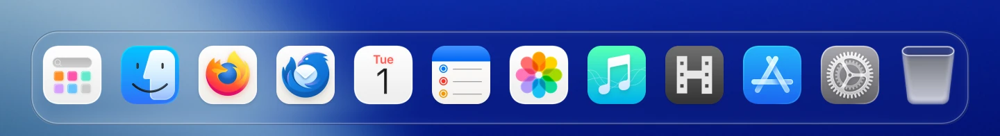
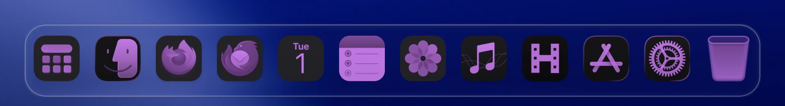
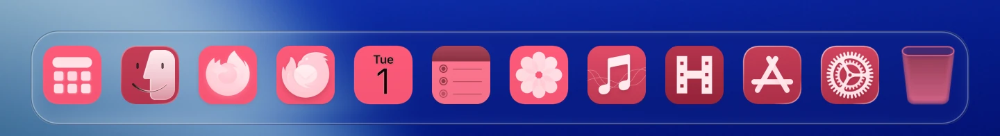
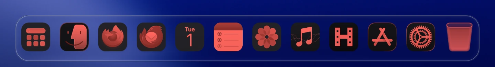
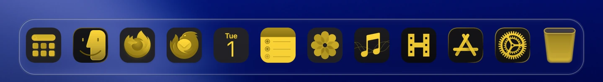
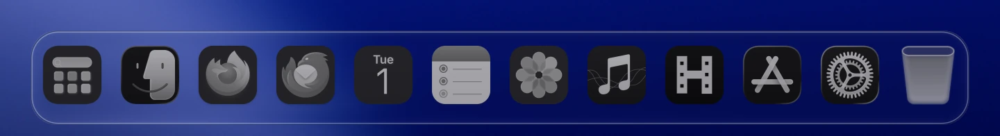
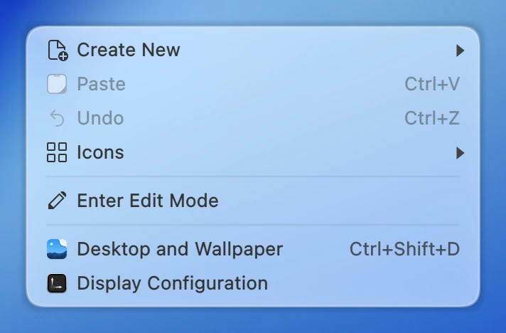

<p align="center">
  <!-- Artwork: https://developer.apple.com/assets/elements/icons/macos-26/macos-26-128x128_2x.png -->
  
</p>

<h1 align="center">macOS Tahoe para KDE Plasma</h1>

<p align="center">
  <a href="README.md" lang="en" hreflang="en">🇺🇸 English</a> ·
  <a href="README.es.md" lang="es" hreflang="es" aria-current="page">🇪🇸 Español</a> ·
  <a href="README.zh-CN.md" lang="zh-CN" hreflang="zh-CN">🇨🇳 简体中文</a> ·
  <a href="README.pt-BR.md" lang="pt-BR" hreflang="pt-BR">🇧🇷 Português (Brasil)</a> ·
  <a href="README.de.md" lang="de" hreflang="de">🇩🇪 Deutsch</a> ·
  <a href="README.fr.md" lang="fr" hreflang="fr">🇫🇷 Français</a>
</p>

<p align="center">
  <a href="https://github.com/lestercorderomurillo/macos-tahoe-liquid-kde/releases"></a>
  <a href="https://github.com/lestercorderomurillo/macos-tahoe-liquid-kde/actions/workflows/test.yml"></a>
  <a href="https://kde.org/plasma-desktop/"></a>
  <a href="LICENSE"></a>
  <a href="https://github.com/lestercorderomurillo/macos-tahoe-liquid-kde/issues/new"></a>
</p>


<p align="center">
  macOS Tahoe estilo para KDE Plasma 6.6, 6.7 y 6.8+.
</p>

<p align="center">
  <sub>Selecciona una distribución para ver el estado de sus pruebas.</sub>
</p>

<p align="center">
  <a href="tests/vm/PROOF.md#cachyos" title="CachyOS"></a>
  <a href="tests/vm/PROOF.md#arch" title="Arch Linux"></a>
  <a href="tests/vm/PROOF.md#endeavouros" title="EndeavourOS"></a>
  <a href="tests/vm/PROOF.md#fedora" title="Fedora"></a>
  <a href="tests/vm/PROOF.md#manjaro" title="Manjaro"></a>
  <a href="tests/vm/PROOF.md#artix" title="Artix Linux (OpenRC)"></a>
  <a href="tests/vm/PROOF.md#garuda" title="Garuda Linux"></a>
  <a href="tests/vm/PROOF.md#nobara" title="Nobara Linux"></a>
  <a href="tests/vm/PROOF.md#opensuse" title="openSUSE Tumbleweed"></a>
  <a href="tests/vm/PROOF.md#neon" title="KDE neon"></a>
  <a href="tests/vm/PROOF.md#debian" title="Debian testing / sid (Plasma 6.6+)"></a>
  <a href="tests/vm/PROOF.md#nixos" title="NixOS (experimental)"></a>
</p>

> [!CAUTION]
> **Filosofía de actualización continua**
> Experimental. Recibe actualizaciones diarias. Las actualizaciones pueden romper la compatibilidad. Evita los sistemas de producción; [informa de problemas aquí](https://github.com/lestercorderomurillo/macos-tahoe-liquid-kde/issues/new).

> [!WARNING]
> **Cuidado con quienes lo redistribuyen de pago: este tema es GRATUITO.**
>
> Si encontraste este tema a través de un canal de terceros, no necesitas pagar para obtenerlo: descárgalo directamente de este repositorio. Mantenemos este proyecto gratuito para que todos puedan disfrutarlo sin barreras de pago. No se requiere compra ni suscripción.

<br>


Informes de errores, correcciones, pruebas y documentación: consulta la [guía de contribución](CONTRIBUTING.md).

Colaboradores de código y personas que informan de errores en Tahoe y Golden Gate:

<p>
  <a href="https://github.com/lestercorderomurillo"></a>
  <a href="https://github.com/yanhenrique-dev"></a>
  <a href="https://github.com/naevui"></a>
  <a href="https://github.com/caioniehues"></a>
  <a href="https://github.com/404-not-found129"></a>
  <a href="https://github.com/myakupozluk"></a>
  <a href="https://github.com/EMS1998"></a>
  <a href="https://github.com/allfritz"></a>
  <a href="https://github.com/elegos"></a>
  <a href="https://github.com/kozeki-uii"></a>
  <a href="https://github.com/imightbelosthere"></a>
  <a href="https://github.com/evaildev"></a>
  <a href="https://github.com/xarblu"></a>
  <a href="https://github.com/PKMNPlatin"></a>
  <a href="https://github.com/matinlotfali"></a>
  <a href="https://github.com/luisbocanegra"></a>
  <a href="https://github.com/OliverChase2003"></a>
  <a href="https://github.com/RoxasYTB"></a>
  <a href="https://github.com/Flagwill"></a>
  <a href="https://github.com/4l3j0Ok"></a>
  <a href="https://github.com/0xrushi"></a>
  <a href="https://github.com/aenriii"></a>
  <a href="https://github.com/andreas399"></a>
  <a href="https://github.com/Andrew-Sor"></a>
  <a href="https://github.com/ardashir77"></a>
  <a href="https://github.com/azizaktas"></a>
  <a href="https://github.com/binary-pleb"></a>
  <a href="https://github.com/bneils"></a>
  <a href="https://github.com/FAYZER77"></a>
  <a href="https://github.com/fxrncyyisingithub"></a>
  <a href="https://github.com/germanbagutteorsomething"></a>
  <a href="https://github.com/iNarrow12"></a>
  <a href="https://github.com/IsaiahSHanson"></a>
  <a href="https://github.com/kuau"></a>
  <a href="https://github.com/Lando0007"></a>
  <a href="https://github.com/LilT59"></a>
  <a href="https://github.com/marcosfantonio"></a>
  <a href="https://github.com/moulikanand12345-lang"></a>
  <a href="https://github.com/nanechi"></a>
  <a href="https://github.com/nousernameget"></a>
  <a href="https://github.com/OpalSand"></a>
  <a href="https://github.com/P0sixSplo1t-2"></a>
  <a href="https://github.com/rokan00"></a>
  <a href="https://github.com/RussH"></a>
  <a href="https://github.com/Salkio"></a>
  <a href="https://github.com/Shivamingale3"></a>
  <a href="https://github.com/shoko3756"></a>
  <a href="https://github.com/Sonicx9876"></a>
  <a href="https://github.com/Tias-dev"></a>
  <a href="https://github.com/txhammer68"></a>
  <a href="https://github.com/vanshdev0101"></a>
  <a href="https://github.com/vialolis"></a>
  <a href="https://github.com/Whiddu"></a>
  <a href="https://github.com/yingmanwumen"></a>
  <a href="https://github.com/yofriendfromschool1"></a>
  <a href="https://github.com/zhaokelei"></a>
</p>

<br>


### Tahoe Finder (Alpha)

Exploración de archivos al estilo Finder con el cristal de Tahoe.

<p align="center">
  <a href="src/screenshots/previews/readme-tahoe-light-finder-4203d60bcd59.webp"></a>
  <a href="src/screenshots/previews/readme-tahoe-dark-finder-3fba4166a2d8.webp"></a>
</p>

<details>
<summary>Acentos rojos y azules en modo claro y oscuro</summary>

<table>
<tr><th>Acento</th><th>Claro</th><th>Oscuro</th></tr>
<tr><td>Rojo</td><td><a href="src/screenshots/previews/readme-tahoe-light-finder-red-cf60519353bc.webp"></a></td><td><a href="src/screenshots/previews/readme-tahoe-dark-finder-red-a5d3144faf0f.webp"></a></td></tr>
<tr><td>Azul</td><td><a href="src/screenshots/previews/readme-tahoe-light-finder-blue-ad74eeb6e7a1.webp"></a></td><td><a href="src/screenshots/previews/readme-tahoe-dark-finder-blue-2a9bacc3b9a9.webp"></a></td></tr>
</table>

</details>

<br>

### Tahoe Launchpad (Alpha)

Encuentra aplicaciones, explora categorías y mantén tus favoritos al alcance.

<p align="center">
  
  
</p>

<br>

### Tahoe Dock (Alpha)

Refracción del cristal, ampliación al pasar el cursor, burbujas rojas con el número de notificaciones y ocultación automática.

<p align="center">
  <a href="src/screenshots/previews/readme-tahoe-light-dock-regular-6d506b3465fd.webp"></a>
  <a href="src/screenshots/previews/readme-tahoe-dark-dock-regular-9254e2db86a7.webp"></a>
</p>

<p align="center">
  <a href="src/screenshots/previews/readme-tahoe-light-dock-clear-843c40a052a7.webp"></a>
  <a href="src/screenshots/previews/readme-tahoe-dark-dock-clear-58edd6d52e38.webp"></a>
</p>

<p align="center">
  <a href="src/screenshots/previews/readme-tahoe-light-dock-blue-d39bb78e2f1d.webp"></a>
  <a href="src/screenshots/previews/readme-tahoe-dark-dock-blue-a292ebe93f08.webp"></a>
</p>

<p align="center">
  <a href="src/screenshots/previews/readme-tahoe-light-dock-purple-b8d6d4a59d58.webp"></a>
  <a href="src/screenshots/previews/readme-tahoe-dark-dock-purple-090970372f80.webp"></a>
</p>

<p align="center">
  <a href="src/screenshots/previews/readme-tahoe-light-dock-pink-c0b0ba00ddeb.webp"></a>
  <a href="src/screenshots/previews/readme-tahoe-dark-dock-pink-ba6941817529.webp"></a>
</p>

<p align="center">
  <a href="src/screenshots/previews/readme-tahoe-light-dock-red-19adb9d798fd.webp"></a>
  <a href="src/screenshots/previews/readme-tahoe-dark-dock-red-379c09615f96.webp"></a>
</p>

<p align="center">
  <a href="src/screenshots/previews/readme-tahoe-light-dock-orange-18c4663ce547.webp"></a>
  <a href="src/screenshots/previews/readme-tahoe-dark-dock-orange-5079b478c649.webp"></a>
</p>

<p align="center">
  <a href="src/screenshots/previews/readme-tahoe-light-dock-yellow-c7656eaf2b61.webp"></a>
  <a href="src/screenshots/previews/readme-tahoe-dark-dock-yellow-c1945efddc21.webp"></a>
</p>

<p align="center">
  <a href="src/screenshots/previews/readme-tahoe-light-dock-green-ac9611249165.webp"></a>
  <a href="src/screenshots/previews/readme-tahoe-dark-dock-green-84eab2e65cf2.webp"></a>
</p>

<p align="center">
  <a href="src/screenshots/previews/readme-tahoe-light-dock-gray-18617e5c0df8.webp"></a>
  <a href="src/screenshots/previews/readme-tahoe-dark-dock-gray-e7baf051c7cb.webp"></a>
</p>

<br>

### Tahoe Shell (Alpha)

Acceso rápido a los ajustes del sistema, aplicaciones y controles de sesión.

<p align="center">
  
  
</p>

<br>

### Tahoe Centro de control (Alpha)

Wi-Fi, sonido, brillo y notificaciones en un menú de cristal. Las actualizaciones llegarán muy pronto.

<p align="center">
  
  
</p>

<br>

### Tahoe Historial del portapapeles (Alpha)

Encuentra y reutiliza texto e imágenes copiados directamente desde Launchpad.

<p align="center">
  
  
</p>

<br>

### Tahoe Información del sistema (Alpha)

Los detalles de tu hardware, software y tema de un vistazo.

<p align="center">
  
  
</p>

<br>

### Tahoe Tema Plasma (Alpha)

Menús y ventanas emergentes translúcidos con colores claros y oscuros coordinados.

<p align="center">
  
  
</p>

<br>

### Tahoe Pantalla de inicio (Alpha)

Una apariencia coordinada desde el inicio hasta el apagado, con desbloqueo integrado de unidades cifradas con LUKS2.

<p align="center">
  
</p>

<br>


- **Idiomas:** instalador en inglés, español, chino simplificado, portugués de Brasil, alemán y francés; componentes de Plasma traducidos.
- **Instalador:** selección gráfica de componentes, recursos del tema incluidos y soporte de actualizaciones.
- **Distribuciones:** instalación de dependencias para sistemas basados en Arch, basados en Fedora, openSUSE, Debian y KDE neon.
- **Planificación:** cambio automático de tema y protección OLED mediante temporizadores de usuario systemd o cron en OpenRC.
- **Efectos de cristal:** desenfoque, refracción y degradados de tres colores ajustables para los modos claro y oscuro.
- **Compatibilidad:** Plasma 6.6–6.8, con efectos nativos compilados contra las versiones instaladas de Qt y KWin.
- **Launchpad:** dos disposiciones, búsqueda integrada o separada, favoritos y categorías de aplicaciones desplazables.
- **Dock:** ampliación al pasar el cursor, insignias de notificación, ocultación automática y conservación de elementos fijados al reinstalar.
- **Apariencia:** estilos claros/oscuros sincronizados para el escritorio, aplicaciones, iconos y decoraciones de ventanas; fondos por monitor.
- **Integración de aplicaciones:** menús globales, correcciones de menús GTK, Nautilus al estilo Finder y tema para Firefox con copias de perfiles.
- **Recuperación:** comprobación de requisitos, copias de ajustes y restauración al desinstalar.
- **Funciones opcionales:** desplazamientos de paneles OLED, historial del portapapeles con elementos fijados y vistas previas de imágenes, y módulos experimentales de NixOS y Home Manager.
- **Pruebas:** pruebas de regresión, contenedores de distribuciones y VM de Plasma.

<br>


Descarga y abre el instalador:

```bash
git clone --filter=blob:none https://github.com/lestercorderomurillo/macos-tahoe-liquid-kde.git
cd macos-tahoe-liquid-kde
./installer
```

Elige **Express** para instalar. Abre `./installer` de nuevo para actualizar o desinstalar.

Para liberar espacio en disco conservando tu copia de Git y el trabajo local:

```bash
./installer --free-space
```

| Idioma del instalador | Estado |
| --- | --- |
| 🇺🇸 Inglés |  |
| 🇪🇸 Español |  |
| 🇨🇳 Chino simplificado |  |
| 🇧🇷 Portugués de Brasil |  |
| 🇩🇪 Alemán |  |
| 🇫🇷 Francés |  |
| 🇮🇹 Italiano |  |
| 🇯🇵 Japonés |  |
| 🇰🇷 Coreano |  |
| 🇷🇺 Ruso |  |
| 🇸🇦 Árabe |  |
| 🇮🇳 Hindi |  |
| 🇳🇱 Neerlandés |  |
| 🇵🇱 Polaco |  |
| 🇹🇷 Turco |  |

<details>
<summary><b>Requisitos</b></summary>

Escritorio, herramientas de compilación y paquetes del sistema necesarios.

- KDE Plasma 6.6+
- Python 3.10+ y PyQt6
- `sudo`
- Herramientas de desarrollo Qt 6
- Paquetes de desarrollo KDE y Qt 6 para los plasmoides compilados y efectos KWin
- `cmake`, `g++`, y `pkg-config` cuando se seleccionan funciones compiladas
- `dbus-send`
- `systemctl` o `crontab` para las funciones programadas

**dinit:** el instalador detecta dinit y utiliza entradas cron por usuario para el cambio automático claro/oscuro y la protección OLED. Se requiere un demonio cron activo; instalar `crontab` por sí solo no lo inicia. En Artix/dinit, prepáralo con:

```bash
sudo pacman -S --needed cronie cronie-dinit
sudo dinitctl --system enable cronie
```

Los cambios automáticos se ejecutan a las 06:00 y 18:00 mientras la sesión está abierta; el backend cron no recupera los cambios pendientes al iniciar sesión. El cambio manual claro/oscuro funciona independientemente de cron. La validación del escritorio dinit está pendiente; las capturas existentes de Artix corresponden a OpenRC.

Los recursos están incluidos. Las dependencias que falten y KDE Rounded Corners opcional requieren acceso a internet. Las actualizaciones verificadas de Rounded Corners eliminan las fuentes y archivos descargados anteriores. La reinstalación reemplaza los árboles de recursos gestionados en su ubicación; las copias correctas eliminan sus datos temporales y las posteriores limpian la preparación desechable interrumpida. Se conservan las copias de recuperación, las copias de perfiles de navegador y las preferencias del usuario. Las imágenes de VM de desarrollo y los paquetes de capturas no son cachés del instalador y nunca se eliminan automáticamente.

| Distribución | Herramientas Qt 6 | Paquetes de desarrollo KDE Plasma 6 |
|--------|------------|-----------------------------------|
| Familia Arch | `pacman -S qt6-tools` | `pacman -S extra-cmake-modules plasma-workspace kdecoration libplasma libnotificationmanager libksysguard plasma-activities-stats` |
| Familia Fedora | `dnf install qt6-qttools-devel` | `dnf install extra-cmake-modules plasma-workspace-devel kdecoration-devel libplasma-devel knotifications-devel libksysguard-devel kf6-plasma-activities-devel` |
| openSUSE Tumbleweed | `zypper install qt6-tools-devel` | `zypper install extra-cmake-modules plasma6-workspace-devel kdecoration-devel libKF6Plasma-devel libnotificationmanager6-devel libksysguard6-devel libKF6PlasmaActivitiesStats6-devel` |

</details>

<details>
<summary><b>Protección OLED</b></summary>

Desplazamientos opcionales de los paneles; desactivados por defecto.

Actívalo en la página **Protección OLED**. Elige allí el intervalo y el desplazamiento máximo en píxeles; está desactivado por defecto.

**Controles manuales**

```bash
mac-tahoe-oled-care shift
mac-tahoe-oled-care restore
mac-tahoe-oled-care status
```

</details>

<details>
<summary><b>Probar en una máquina virtual</b></summary>

Prueba el tema en un escritorio Plasma aislado.

```bash
./vm <os>
```

**OS:** `cachyos` · `arch` · `manjaro` · `endeavouros` · `garuda` · `fedora` · `nobara` · `opensuse` · `neon` · `debian` · `artix` · `kubuntu`

`all` inicia todas las distribuciones. Los destinos de nube se preparan automáticamente; los demás utilizan sus instaladores ISO oficiales fijados por suma de comprobación. Sigue la [guía de preparación y validación de VM](tests/vm/README.md).

`./vm kubuntu` arranca la ISO oficial de Kubuntu 26.04.1 LTS con verificación SHA-256 (puerto SSH `2234` tras preparar el invitado). Este nuevo destino de regresión del lanzador está pendiente de validación completa en vivo.

`./vm debian` utiliza la imagen de nube oficial de Debian testing (Forky), verifica su suma SHA-512 y prepara un escritorio Plasma. Inicia sesión como `tester` con contraseña `tester`; SSH está disponible en `127.0.0.1:2232`. El instalador se abre desde una copia escribible del invitado en `/home/tester/macos-tahoe-liquid-kde`; el repositorio del anfitrión se monta como solo lectura. Usa `./vm debian --clean` para reconstruir el invitado desechable desde cero.

</details>

<details>
<summary><b>NixOS y Home Manager (en pruebas)</b></summary>

Usa los módulos flake, **no el instalador gráfico**. La validación del escritorio en vivo está pendiente.

**Entrada flake** (requiere Nixpkgs y Home Manager):

```nix
inputs.mac-tahoe = {
  url = "github:lestercorderomurillo/macos-tahoe-liquid-kde/v0.55.2";
  inputs.nixpkgs.follows = "nixpkgs";
  inputs.home-manager.follows = "home-manager";
};
```

**NixOS:** importa `inputs.mac-tahoe.nixosModules.default`.

```nix
services.desktopManager.plasma6.enable = true;
services.mac-tahoe.enable = true;
# services.mac-tahoe.plymouth.enable = true; # optional boot splash
```

**Home Manager:** importa `inputs.mac-tahoe.homeManagerModules.default`.

```nix
programs.mac-tahoe = {
  enable = true;
  mode = "auto"; # or "light" / "dark"
  # appleAssets = true;
  # oledCare.enable = true;
};
```

**Recursos de Apple:** fuentes, fondos de pantalla y sonidos opcionales no libres. Activar `appleAssets` también requiere:

```nix
nixpkgs.config.allowUnfreePredicate = pkg:
  builtins.elem (lib.getName pkg) [ "mac-tahoe-apple-assets" ];
```

**Paneles:** importa también tu propio módulo plasma-manager y `inputs.mac-tahoe.homeManagerModules.plasma-manager`. Activa `programs.mac-tahoe.panels.enable` y configura `programs.mac-tahoe.panels.launchers`, por ejemplo `[ "applications:org.kde.dolphin.desktop" ]`. Esto reemplaza la disposición sin importar los elementos fijados existentes.

**Ajustes escribibles:** mantén `kdeglobals`, `kwinrc`, `plasmarc`, `plasmashellrc`, `kcminputrc`, `plasma-org.kde.plasma.desktop-appletsrc`, `Kvantum/kvantum.kvconfig` y la configuración GTK activa con permisos de escritura. Evita claves inmutables de plasma-manager gestionadas por el cambiador de tema.

Cierra sesión y vuelve a entrar después de activar. No se configuran los perfiles de Firefox, los marcadores GTK ni SDDM. Los menús globales GTK necesitan `programs.mac-tahoe.gtkAppmenuModule`. Antes de desactivar la protección OLED, ejecuta `mac-tahoe-oled-care restore`; antes de eliminar los módulos, selecciona Breeze. La eliminación conserva los ajustes del usuario.

</details>

<br>


Comprueba el soporte de tu distribución, sistema de inicio y versión de Plasma.

<details>
<summary><b>Distribuciones</b></summary>

Las 11 distribuciones de esta tabla pasaron la validación en VM en vivo. Selecciona una insignia de estado para ver capturas revisadas y resultados de pruebas.

| | Nombre | Estado |
|:--:|------|---------|
|  | CachyOS | [](tests/vm/PROOF.md#cachyos) |
|  | Arch Linux | [](tests/vm/PROOF.md#arch) |
|  | EndeavourOS | [](tests/vm/PROOF.md#endeavouros) |
|  | Fedora | [](tests/vm/PROOF.md#fedora) |
|  | Manjaro | [](tests/vm/PROOF.md#manjaro) |
|  | Artix Linux (OpenRC) | [](tests/vm/PROOF.md#artix) |
|  | Garuda Linux | [](tests/vm/PROOF.md#garuda) |
|  | Nobara | [](tests/vm/PROOF.md#nobara) |
|  | openSUSE Tumbleweed | [](tests/vm/PROOF.md#opensuse) |
|  | KDE neon | [](tests/vm/PROOF.md#neon) |
|  | Debian testing / sid (Plasma 6.6+) | [](tests/vm/PROOF.md#debian) |

</details>

<details>
<summary><b>Sistemas de inicio</b></summary>

El cambio automático de tema y la protección OLED utilizan los siguientes backends de planificación:

| Sistema de inicio | Planificación | Pruebas registradas |
| --- | --- | --- |
| systemd | Temporizadores de usuario |  |
| OpenRC | Cron por usuario |  |
| dinit | Cron por usuario |   |

OpenRC y dinit requieren un demonio cron activo.
[Resultados de pruebas de escritorio](tests/vm/PROOF.md) · [Prueba de planificación dinit](CONTRIBUTING.md#setup).

</details>

<details>
<summary><b>Versiones de Plasma</b></summary>

Plasma 6.6–6.8 está soportado; los efectos compilados utilizan el SDK del anfitrión.

| Plasma | Soporte | Desde |
|--------|---------|-------|
| 6.5 y anteriores |  | No aplicable |
| 6.6 |  | v0.1.0 |
| 6.7 |  | v0.19.0 |
| 6.8 |  | v0.54.1 |

</details>

<br>


Lo que funciona ahora y lo que planeamos añadir.

<details>
<summary><b>Estado de componentes</b></summary>

El estado actual de cada componente.

| Componente | Estado |
|-----------|--------|
| Paletas de colores |  |
| Fondos de pantalla |  |
| Fuentes |  |
| Cursores |  |
| Tema Plasma |  |
| Tema Kvantum |  |
| Tema GTK |  |
| Acrylic Glass |  |
| KDE Rounded Corners |  |
| Cambiador automático de tema |  |
| Protección OLED |  |
| Interfaz del instalador |  |
| Traducción |  |
| Decoraciones Aurorae |  |
| Menú global |  |
| Dock |  |
| Nautilus al estilo Finder |  |
| Launchpad |  |
| Shell |  |
| Historial del portapapeles |  |
| Información del sistema |  |
| Papelera |  |
| Sonidos |  |
| Pantalla de inicio |  |
| Pantalla de apagado |  |
| Tema Firefox |  |
| Iconos |  |
| Soporte de múltiples distribuciones |  |
| Pruebas de OpenRC |  |
| Tema Konsole |  |
| Tema Kate |  |
| Tema SDDM |  |
| Calendario |  |
| Centro de control, Wi-Fi, batería y notificaciones |  |
| Preferencias del sistema |  |
| Selector de sistema operativo |  |

</details>

<br>

**[Informa de un error](https://github.com/lestercorderomurillo/macos-tahoe-liquid-kde/issues/new)** o usa **Menú Apple → Acerca de este equipo → Informar de un error…**.

Incluye:

- Tu versión de Plasma: `plasmashell --version`
- Tu distribución: `grep PRETTY_NAME /etc/os-release`
- La versión del tema: `cat VERSION`
- Una captura o grabación para problemas visuales

Mantén las solicitudes de cambios centradas y valida con `./vm`. Consulta [CONTRIBUTING.md](CONTRIBUTING.md).

El [conjunto compartido de herramientas de generación de iconos](CONTRIBUTING.md#icon-generation-toolset) crea apariencias claras, oscuras, monocromas y de cristal translúcido a partir de nuestros iconos incluidos, con cualquier tinte RGB. Genera, previsualiza, verifica y empaqueta iconos sin conexión para ambas ediciones sin aplicar un tema de escritorio.

<br>


Esta es una reimplementación independiente inspirada en la estética de macOS. No está afiliada ni respaldada por Apple o KDE. «macOS» y «Apple» son marcas comerciales de Apple Inc.

El emblema de macOS, los fondos incluidos, los sonidos del sistema y las fuentes SF Pro / SF Mono siguen siendo propiedad de Apple y no están cubiertos por la licencia de este proyecto. Los demás componentes conservan sus licencias y avisos de copyright; consulta el índice de avisos de terceros a continuación para conocer el alcance y las lagunas de procedencia conocidas.

Licenciado como conjunto bajo [GPL-3.0](LICENSE); las licencias de los componentes y los derechos de terceros siguen siendo aplicables. Consulta los [avisos de copyright](NOTICE), la [licencia e identidad del proyecto](LICENSING.md) y los [avisos de terceros](THIRD_PARTY_NOTICES.md).

<br>


<details>
<summary><b>Proyectos, recursos y agradecimientos</b></summary>

Referencias del proyecto y componentes de terceros:

- **[EliverLara](https://github.com/EliverLara/TahoeLauncher)**: `TahoeLauncher`: Referencia de diseño de Launchpad.
- **[vinceliuice](https://github.com/vinceliuice)**: `MacTahoe-icon-theme`: iconos y cursores base; referencia de diseño GTK. [`MacTahoe-gtk-theme` Firefox CSS/SVG](https://github.com/vinceliuice/MacTahoe-gtk-theme/tree/main/other/firefox) se mantiene aquí como una bifurcación bajo licencia MIT con soporte de copia y restauración de perfiles.
- **[taj-ny](https://github.com/taj-ny/kwin-effects-forceblur)** y **[4v3ngR](https://github.com/4v3ngR/kwin-effects-glass)**: Better Blur y su bifurcación de cristal: código de origen utilizado por Acrylic Glass (los autores del desenfoque de KWin conservan su crédito en las cabeceras del código).
- **[luisbocanegra](https://github.com/luisbocanegra/plasma-panel-colorizer)**: `plasma-panel-colorizer` v7.3.0, incluido sin conexión e instalado por el paso de disposición para teñir los paneles (GPL-3.0, licencia incluida).
- **[Matin Lotfaliei / KDE-Rounded-Corners](https://github.com/matinlotfali/KDE-Rounded-Corners)**: el efecto de ventanas redondeadas de KWin bajo GPL-3.0, descargado desde la versión fijada v0.9.0 y compilado en línea contra el SDK KWin del anfitrión (licencia instalada junto a él).
- **[ful1e5](https://github.com/ful1e5)**: `apple_cursor`: referencia alternativa de diseño de cursores.
- **[sahibjotsaggu](https://github.com/sahibjotsaggu)**: `San-Francisco-Pro-Fonts`: origen del paquete SF Pro / SF Mono.
- **[Lucide](https://github.com/lucide-icons/lucide)**: iconos de copia incluidos en el menú global (ISC, © Lucide Contributors).
- **[512pixels.net](https://512pixels.net/projects/default-mac-wallpapers-in-5k/)**: archivo de fondos de macOS en alta resolución.

Si falta algún crédito, [abre una incidencia](https://github.com/lestercorderomurillo/macos-tahoe-liquid-kde/issues/new).

</details>


[Capturas del instalador y pruebas](TESTING.md).
