<p align="center">
  <!-- Artwork: https://developer.apple.com/assets/elements/icons/macos-26/macos-26-128x128_2x.png -->
  
</p>

<h1 align="center">macOS Tahoe for KDE Plasma</h1>

<p align="center">
  <a href="README.md" lang="en" hreflang="en">🇺🇸 English</a> ·
  <a href="README.es.md" lang="es" hreflang="es" aria-current="page">🇪🇸 Español</a> ·
  <a href="README.zh-CN.md" lang="zh-CN" hreflang="zh-CN">🇨🇳 简体中文</a> ·
  <a href="README.pt-BR.md" lang="pt-BR" hreflang="pt-BR">🇧🇷 Português (Brasil)</a> ·
  <a href="README.de.md" lang="de" hreflang="de">🇩🇪 Deutsch</a> ·
  <a href="README.fr.md" lang="fr" hreflang="fr">🇫🇷 Français</a>
</p>

<p align="center">
  <a href="https://github.com/lestercorderomurillo/macos-tahoe-liquid-kde/releases"></a>
  <a href="https://github.com/lestercorderomurillo/macos-tahoe-liquid-kde/actions/workflows/test.yml"></a>
  <a href="https://kde.org/plasma-desktop/"></a>
  <a href="LICENSE"></a>
  <a href="https://github.com/lestercorderomurillo/macos-tahoe-liquid-kde/issues/new"></a>
</p>

<p align="center">Estilo macOS Tahoe para KDE Plasma 6.6, 6.7 y 6.8+.</p>

> [!CAUTION]
> Experimental, con actualizaciones frecuentes que pueden romper la compatibilidad. Evita sistemas de producción. Este proyecto es gratuito: no requiere compras ni suscripciones.

<p align="center"><sub>Selecciona una distribución para consultar sus pruebas.</sub></p>

<p align="center">
  <a href="tests/vm/PROOF.md#cachyos" title="CachyOS"></a>
  <a href="tests/vm/PROOF.md#arch" title="Arch Linux"></a>
  <a href="tests/vm/PROOF.md#endeavouros" title="EndeavourOS"></a>
  <a href="tests/vm/PROOF.md#fedora" title="Fedora"></a>
  <a href="tests/vm/PROOF.md#manjaro" title="Manjaro"></a>
  <a href="tests/vm/PROOF.md#artix" title="Artix Linux (OpenRC)"></a>
  <a href="tests/vm/PROOF.md#garuda" title="Garuda Linux"></a>
  <a href="tests/vm/PROOF.md#nobara" title="Nobara Linux"></a>
  <a href="tests/vm/PROOF.md#opensuse" title="openSUSE Tumbleweed"></a>
  <a href="tests/vm/PROOF.md#neon" title="KDE neon"></a>
  <a href="tests/vm/PROOF.md#debian" title="Debian testing / sid (Plasma 6.6+)"></a>
  <a href="tests/vm/PROOF.md#nixos" title="NixOS (experimental)"></a>
</p>

## Instalación y actualizaciones

Descarga el repositorio y abre el instalador:

```bash
git clone --filter=blob:none https://github.com/lestercorderomurillo/macos-tahoe-liquid-kde.git
cd macos-tahoe-liquid-kde
./installer
```

Elige **Express** para instalar. Abre `./installer` de nuevo para actualizar o desinstalar.

Esta edición utiliza Tahoe, el fondo de pantalla correspondiente y el preajuste 1 del lanzador. Puedes cambiar las opciones en el asistente.

El instalador está disponible en inglés, español, chino simplificado, portugués de Brasil, alemán y francés. Los idiomas previstos para el instalador figuran en el [estado completo](README.md).

## Requisitos y compatibilidad

Necesitas KDE Plasma 6.6 o posterior, Python 3.10+, PyQt6, `sudo`, herramientas de desarrollo Qt 6/KDE y, para los componentes compilados, `cmake`, `g++` y `pkg-config`. Las descargas, dependencias que falten y KDE Rounded Corners requieren internet.

Plasma 6.6–6.8 está soportado; 6.5 y anteriores no. Los efectos nativos se compilan contra Qt y KWin del sistema. Hay pruebas en máquinas virtuales para 11 distribuciones: CachyOS, Arch, EndeavourOS, Fedora, Manjaro, Artix/OpenRC, Garuda, Nobara, openSUSE Tumbleweed, KDE neon y Debian testing/sid. Esto no equivale a cobertura de toda configuración.

El cambio automático claro/oscuro y la protección OLED usan temporizadores de usuario systemd o cron por usuario en OpenRC/dinit. OpenRC y dinit necesitan un demonio cron activo. La validación del escritorio dinit y de Kubuntu sigue pendiente; las fotografías de Artix corresponden a OpenRC.

## Funciones y fotografías

### Tahoe Finder (Alpha)

Navegación de archivos al estilo Finder con el cristal de Tahoe.

<p align="center">
  <a href="src/screenshots/showcase_light_2k-5dedfb291557.webp">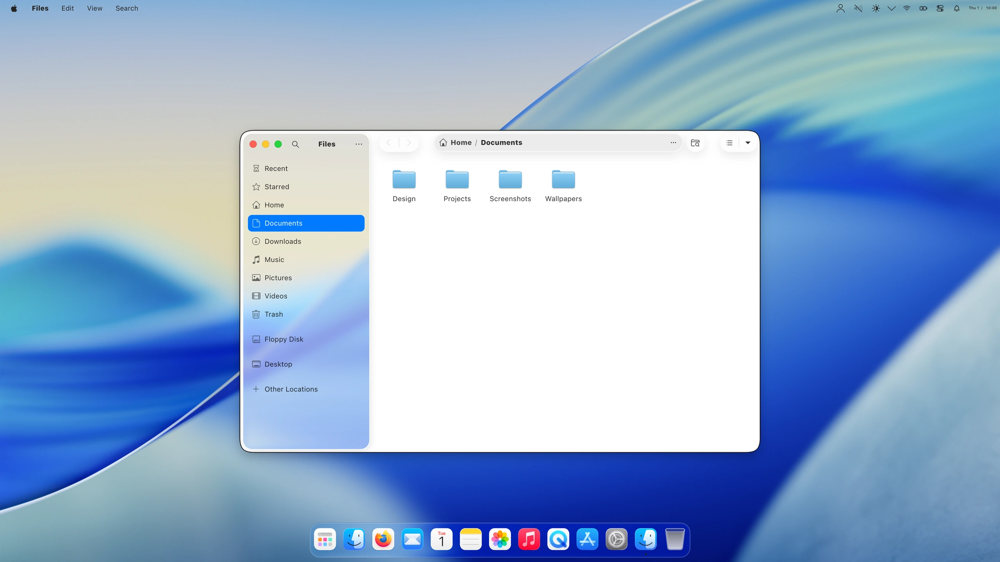</a>
  <a href="src/screenshots/showcase_dark_2k-b6fcdffe7c22.webp">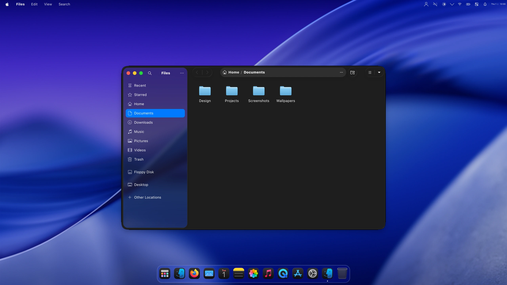</a>
</p>

<details>
<summary>Acentos rojos y azules en modo claro y oscuro</summary>

<table>
<tr><th>Acento</th><th>Claro</th><th>Oscuro</th></tr>
<tr><td>Rojo</td><td><a href="src/screenshots/previews/tahoe-light-finder-red-a330af534340.webp">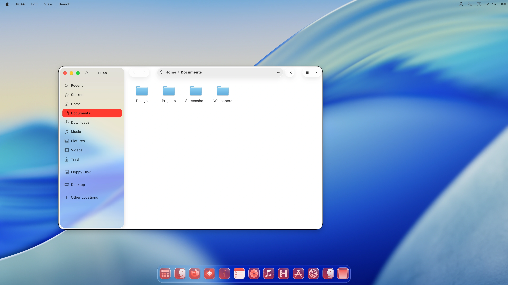</a></td><td><a href="src/screenshots/previews/tahoe-dark-finder-red-10e9028543a1.webp">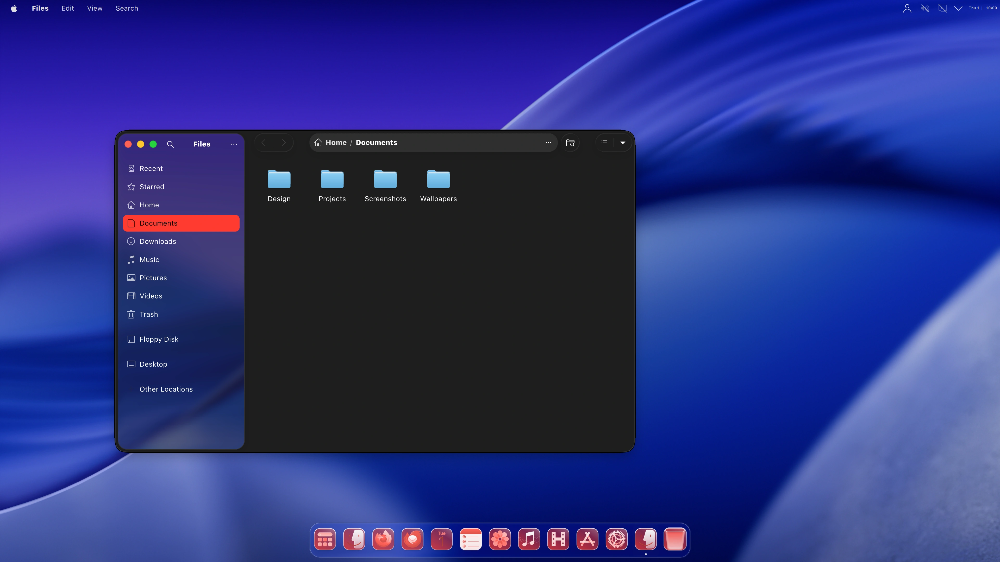</a></td></tr>
<tr><td>Azul</td><td><a href="src/screenshots/previews/tahoe-light-finder-blue-bbf03b509a68.webp">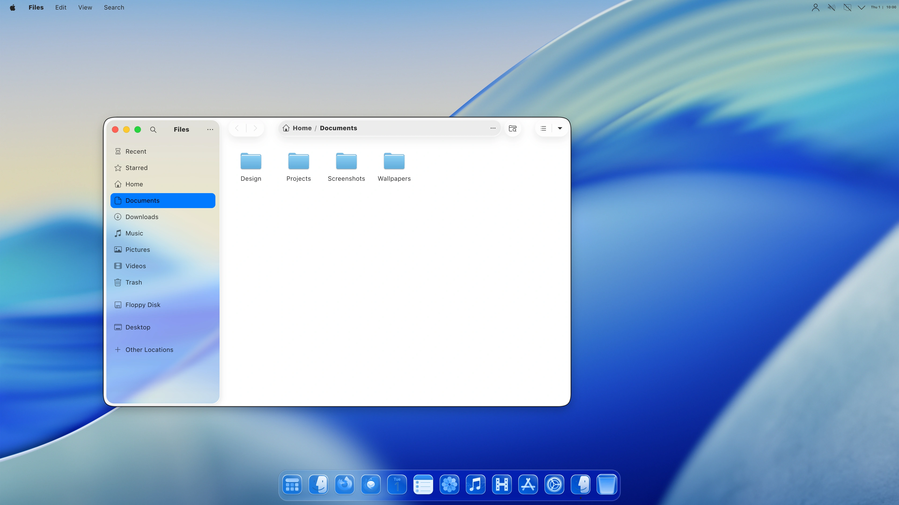</a></td><td><a href="src/screenshots/previews/tahoe-dark-finder-blue-8ac67b97300d.webp">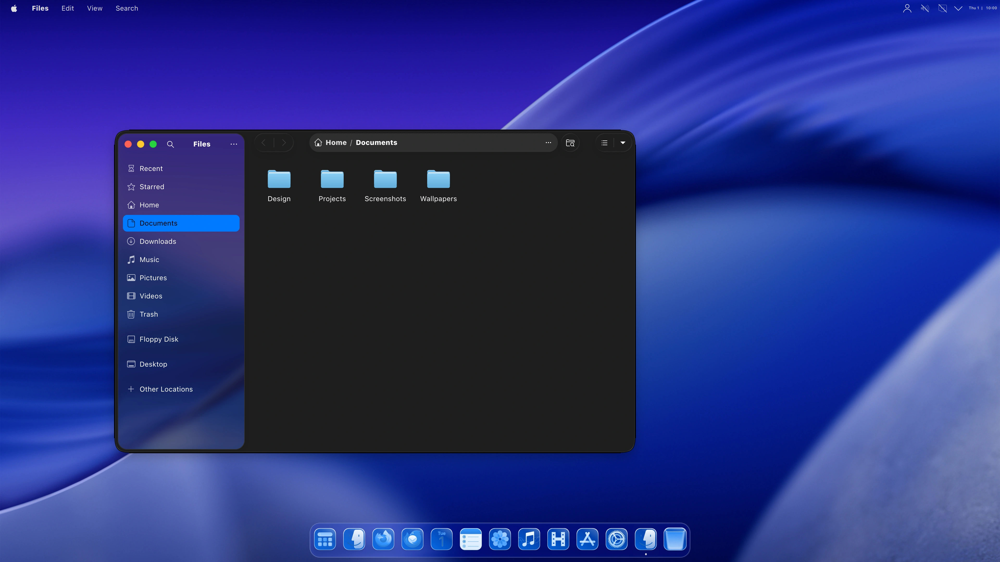</a></td></tr>
</table>

</details>

### Tahoe Launchpad (Alpha)

Busca aplicaciones, explora categorías y conserva tus favoritos. Hay dos preajustes seleccionables.

<p align="center">
  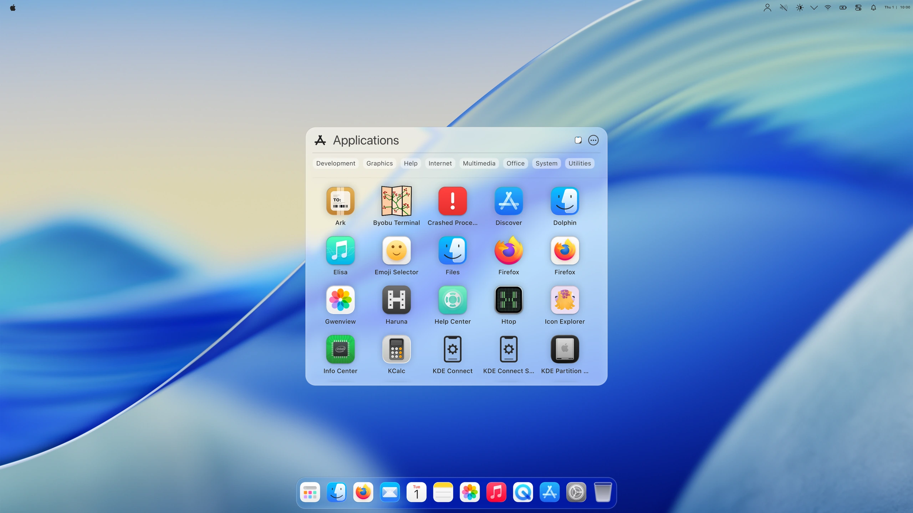
  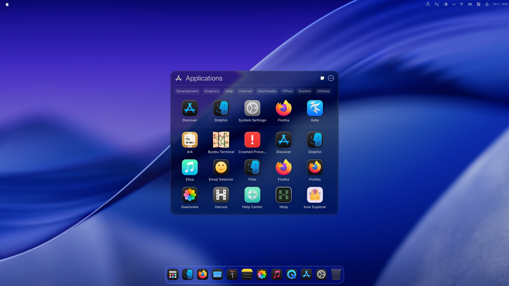
</p>

### Tahoe Dock (Alpha)

Refracción del cristal, ampliación al pasar el cursor, contadores de notificaciones y ocultación automática.

<p align="center"><a href="src/screenshots/previews/tahoe-dock-regular-light-reference-74619aaa7764.webp">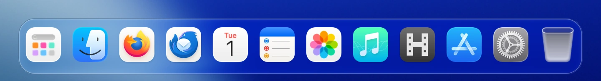</a><br>Normal · Claro</p>

<p align="center"><a href="src/screenshots/previews/tahoe-dock-regular-dark-reference-5a56afc6c7ac.webp">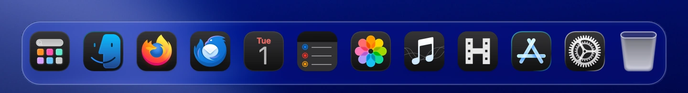</a><br>Normal · Oscuro</p>

<p align="center"><a href="src/screenshots/previews/tahoe-dock-clear-light-reference-97f0fdd5e0a1.webp">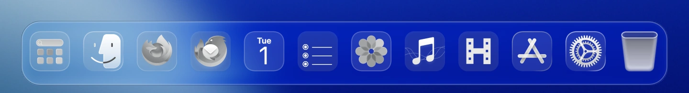</a><br>Transparente · Claro</p>

<p align="center"><a href="src/screenshots/previews/tahoe-dock-clear-dark-reference-9cdf564ebb32.webp">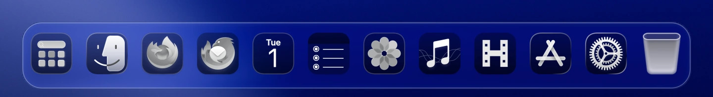</a><br>Transparente · Oscuro</p>

<p align="center"><a href="src/screenshots/previews/tahoe-dock-blue-light-reference-451ebd6e17bc.webp">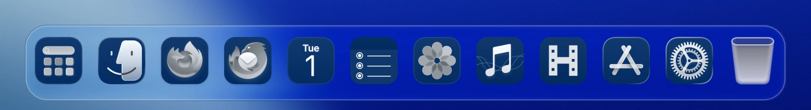</a><br>Azul · Claro</p>

<p align="center"><a href="src/screenshots/previews/tahoe-dock-blue-dark-reference-a2757a9e1690.webp">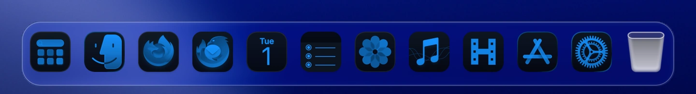</a><br>Azul · Oscuro</p>

<p align="center"><a href="src/screenshots/previews/tahoe-dock-purple-light-reference-ce34696e8a65.webp">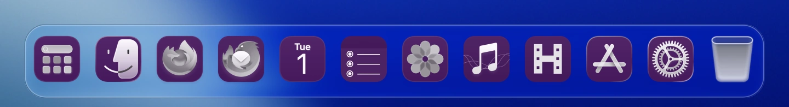</a><br>Morado · Claro</p>

<p align="center"><a href="src/screenshots/previews/tahoe-dock-purple-dark-reference-a9513c3b6673.webp">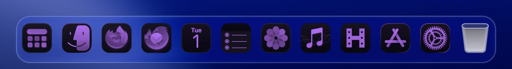</a><br>Morado · Oscuro</p>

<p align="center"><a href="src/screenshots/previews/tahoe-dock-pink-light-reference-080e7323ffb1.webp"></a><br>Rosa · Claro</p>

<p align="center"><a href="src/screenshots/previews/tahoe-dock-pink-dark-reference-37badc9241a8.webp">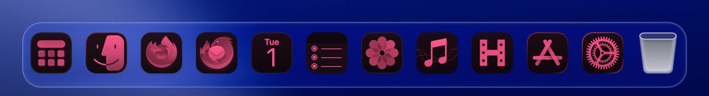</a><br>Rosa · Oscuro</p>

<p align="center"><a href="src/screenshots/previews/tahoe-dock-red-light-reference-a654bc25c74f.webp">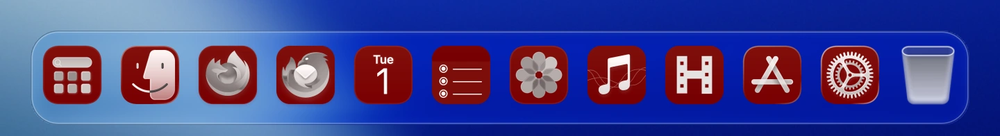</a><br>Rojo · Claro</p>

<p align="center"><a href="src/screenshots/previews/tahoe-dock-red-dark-reference-2799aac75e5c.webp">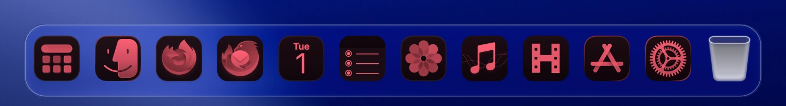</a><br>Rojo · Oscuro</p>

<p align="center"><a href="src/screenshots/previews/tahoe-dock-orange-light-reference-25bcc0e95908.webp">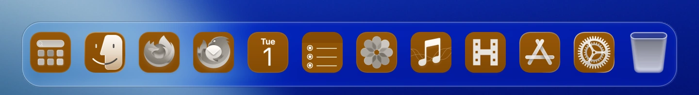</a><br>Naranja · Claro</p>

<p align="center"><a href="src/screenshots/previews/tahoe-dock-orange-dark-reference-70fab1e16209.webp">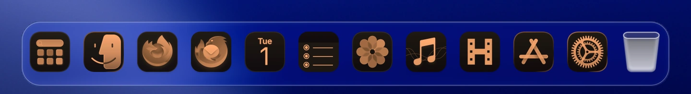</a><br>Naranja · Oscuro</p>

<p align="center"><a href="src/screenshots/previews/tahoe-dock-yellow-light-reference-ccb4a109822b.webp">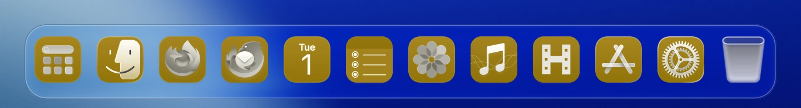</a><br>Amarillo · Claro</p>

<p align="center"><a href="src/screenshots/previews/tahoe-dock-yellow-dark-reference-9bde557131d1.webp">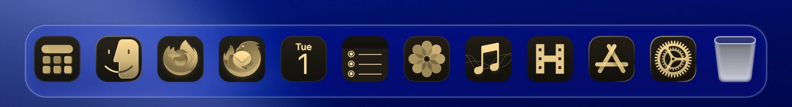</a><br>Amarillo · Oscuro</p>

<p align="center"><a href="src/screenshots/previews/tahoe-dock-green-light-reference-36f3c1ba2de1.webp">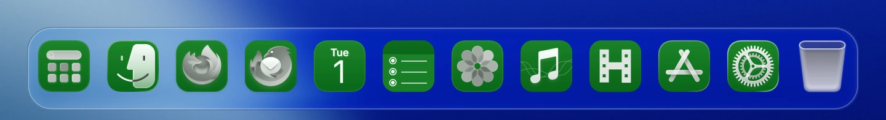</a><br>Verde · Claro</p>

<p align="center"><a href="src/screenshots/previews/tahoe-dock-green-dark-reference-6f4857af9d43.webp">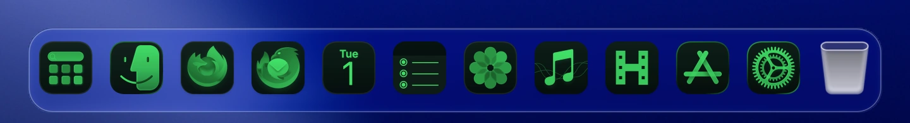</a><br>Verde · Oscuro</p>

<p align="center"><a href="src/screenshots/previews/tahoe-dock-gray-light-reference-de7e0b3ebeae.webp">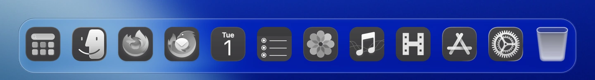</a><br>Gris · Claro</p>

<p align="center"><a href="src/screenshots/previews/tahoe-dock-gray-dark-reference-85d9f5de1cae.webp">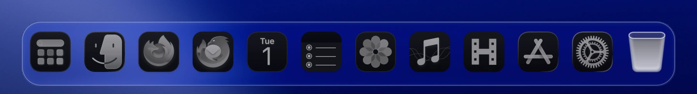</a><br>Gris · Oscuro</p>

### Tahoe Shell (Alpha)

Acceso a ajustes del sistema, aplicaciones y controles de sesión.

<p align="center">
  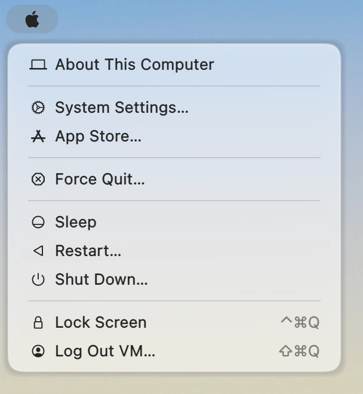
  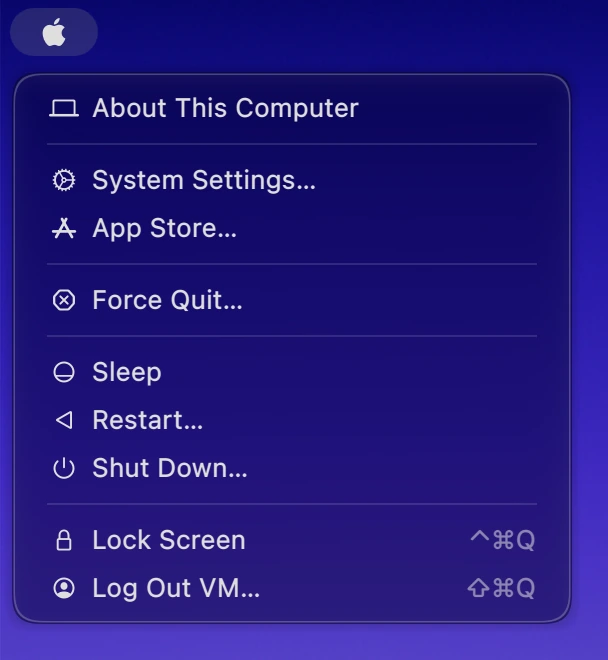
</p>

### Tahoe Centro de control (Alpha)

Wi-Fi, sonido, brillo y notificaciones en un menú de cristal.

<p align="center">
  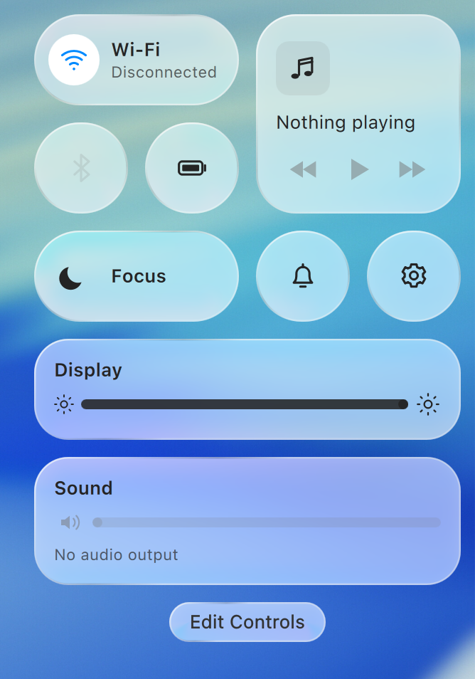
  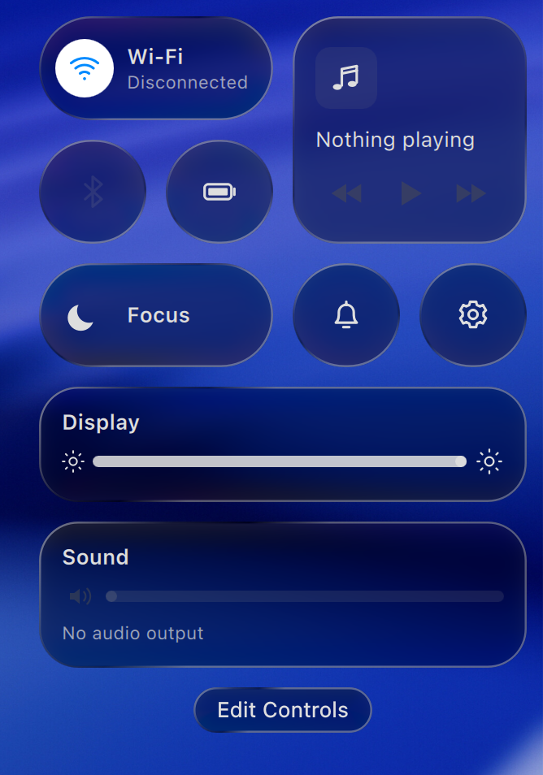
</p>

### Tahoe Historial del portapapeles (Alpha)

Busca y reutiliza texto e imágenes copiados directamente desde Launchpad.

<p align="center">
  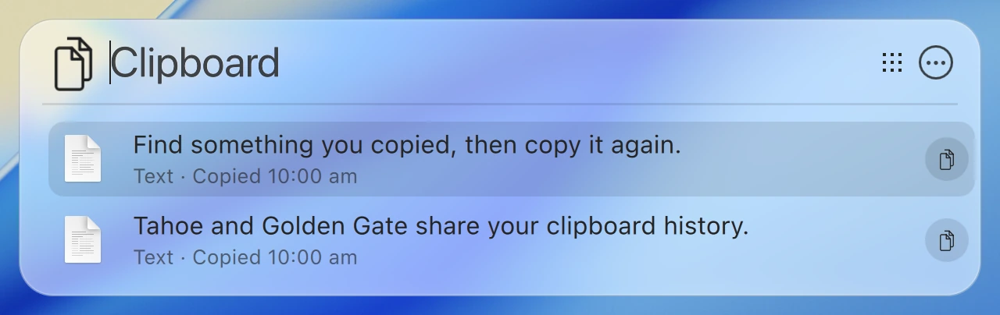
  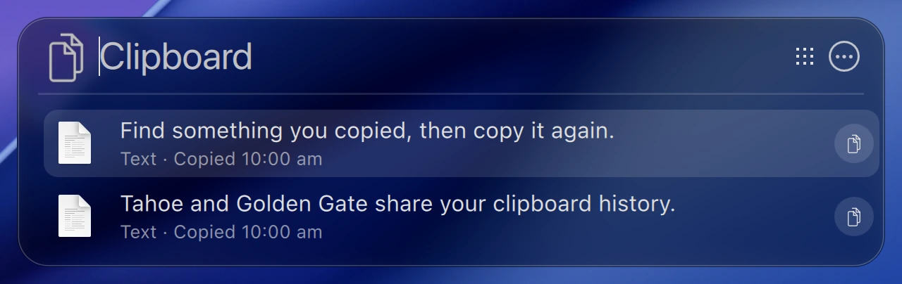
</p>

### Tahoe Información del sistema

Información del hardware, software y tema.

<p align="center">
  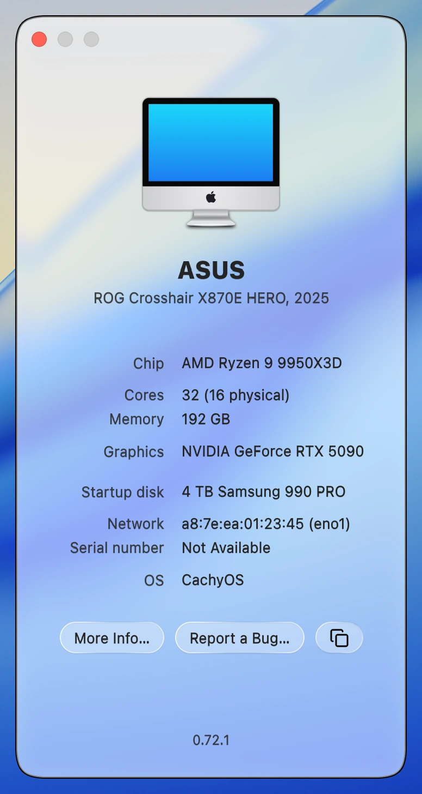
  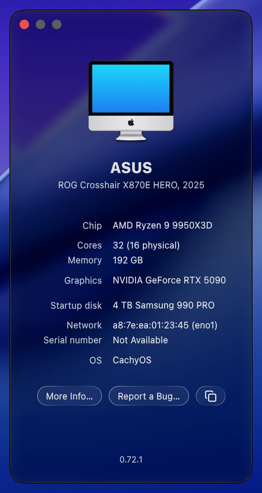
</p>

### Tahoe Tema Plasma (Alpha)

Menús y ventanas emergentes translúcidos con colores claros y oscuros coordinados.

<p align="center">
  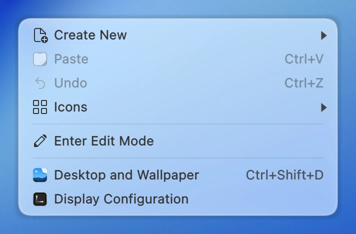
  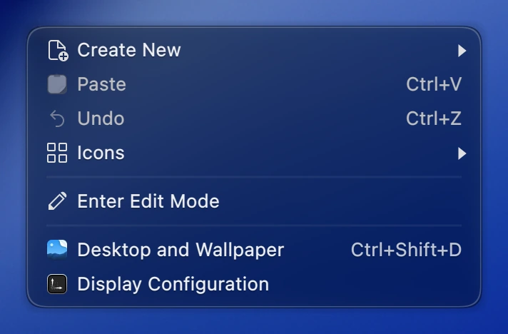
</p>

### Tahoe Pantalla de inicio (Alpha)

Pantalla de inicio con desbloqueo integrado de unidades cifradas con LUKS2.

<p align="center">
  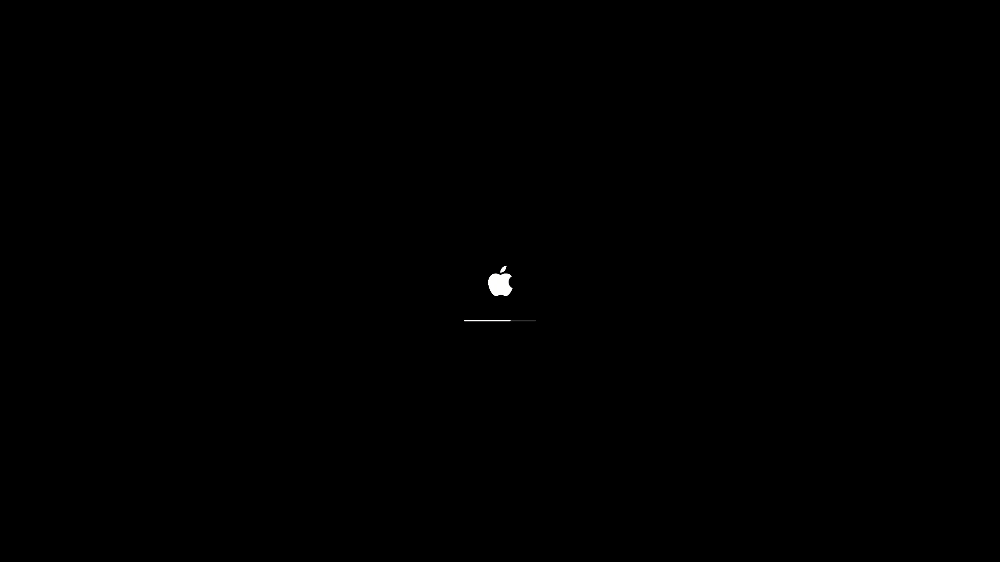
</p>

## Opciones y herramientas

El asistente permite elegir componentes, iconos, fondos, botones y sombras de ventanas. La reinstalación conserva la personalización del Dock salvo que elijas restablecerla. El tema sincroniza la apariencia clara/oscura, integra menús globales y estilos GTK/Qt y guarda copias de los perfiles de Firefox antes de modificarlos.

La protección OLED es opcional y está desactivada por defecto. Actívala en su página del asistente y elige el intervalo y desplazamiento máximo. Controles manuales:

```bash
mac-tahoe-oled-care shift
mac-tahoe-oled-care restore
mac-tahoe-oled-care status
```

Para probar en un escritorio aislado usa `./vm <os>`. Consulta la [guía de máquinas virtuales](tests/vm/README.md). Kubuntu sigue pendiente de validación completa. NixOS y Home Manager son experimentales: utiliza los módulos flake, no el instalador gráfico; consulta la [configuración detallada en inglés](README.md).

La [guía de contribución](CONTRIBUTING.md) documenta configuración avanzada y el generador de iconos compartido. Ejecuta `./icon-toolset` desde Tahoe para generar, previsualizar y verificar iconos de ambas ediciones sin aplicar el tema al escritorio. Para liberar espacio de Git conservando el trabajo local: `./installer --free-space`.

Consulta los [resultados y límites de las pruebas](tests/vm/PROOF.md) y las [fotografías del instalador](TESTING.md). Las fotografías conservan su procedencia original; no representan una nueva validación de cada versión.

[Referencia técnica completa y estado de componentes (inglés)](README.md)

## Contribuciones y errores

[Informa de errores](https://github.com/lestercorderomurillo/macos-tahoe-liquid-kde/issues/new) incluyendo la versión de Plasma (`plasmashell --version`), la distribución, la versión del tema y una captura o grabación si el problema es visual. Consulta la [guía de contribución](CONTRIBUTING.md).

Colaboradores de código y personas que han informado de errores en Tahoe y Golden Gate:

<p>
  <a href="https://github.com/lestercorderomurillo"></a>
  <a href="https://github.com/yanhenrique-dev"></a>
  <a href="https://github.com/naevui"></a>
  <a href="https://github.com/caioniehues"></a>
  <a href="https://github.com/404-not-found129"></a>
  <a href="https://github.com/myakupozluk"></a>
  <a href="https://github.com/EMS1998"></a>
  <a href="https://github.com/allfritz"></a>
  <a href="https://github.com/elegos"></a>
  <a href="https://github.com/kozeki-uii"></a>
  <a href="https://github.com/imightbelosthere"></a>
  <a href="https://github.com/evaildev"></a>
  <a href="https://github.com/xarblu"></a>
  <a href="https://github.com/PKMNPlatin"></a>
  <a href="https://github.com/matinlotfali"></a>
  <a href="https://github.com/luisbocanegra"></a>
  <a href="https://github.com/OliverChase2003"></a>
  <a href="https://github.com/RoxasYTB"></a>
  <a href="https://github.com/Flagwill"></a>
  <a href="https://github.com/4l3j0Ok"></a>
  <a href="https://github.com/0xrushi"></a>
  <a href="https://github.com/aenriii"></a>
  <a href="https://github.com/andreas399"></a>
  <a href="https://github.com/Andrew-Sor"></a>
  <a href="https://github.com/ardashir77"></a>
  <a href="https://github.com/azizaktas"></a>
  <a href="https://github.com/binary-pleb"></a>
  <a href="https://github.com/bneils"></a>
  <a href="https://github.com/FAYZER77"></a>
  <a href="https://github.com/fxrncyyisingithub"></a>
  <a href="https://github.com/germanbagutteorsomething"></a>
  <a href="https://github.com/iNarrow12"></a>
  <a href="https://github.com/IsaiahSHanson"></a>
  <a href="https://github.com/kuau"></a>
  <a href="https://github.com/Lando0007"></a>
  <a href="https://github.com/LilT59"></a>
  <a href="https://github.com/marcosfantonio"></a>
  <a href="https://github.com/moulikanand12345-lang"></a>
  <a href="https://github.com/nanechi"></a>
  <a href="https://github.com/nousernameget"></a>
  <a href="https://github.com/OpalSand"></a>
  <a href="https://github.com/P0sixSplo1t-2"></a>
  <a href="https://github.com/rokan00"></a>
  <a href="https://github.com/RussH"></a>
  <a href="https://github.com/Salkio"></a>
  <a href="https://github.com/Shivamingale3"></a>
  <a href="https://github.com/shoko3756"></a>
  <a href="https://github.com/Sonicx9876"></a>
  <a href="https://github.com/Tias-dev"></a>
  <a href="https://github.com/txhammer68"></a>
  <a href="https://github.com/vanshdev0101"></a>
  <a href="https://github.com/vialolis"></a>
  <a href="https://github.com/Whiddu"></a>
  <a href="https://github.com/yingmanwumen"></a>
  <a href="https://github.com/yofriendfromschool1"></a>
  <a href="https://github.com/zhaokelei"></a>
</p>

## Licencia y créditos

Proyecto independiente inspirado en macOS, sin afiliación ni respaldo de Apple o KDE. El conjunto se distribuye bajo [GPL-3.0](LICENSE); las licencias de cada componente y los derechos de terceros siguen vigentes. El emblema, los fondos, los sonidos y las fuentes SF de Apple no están cubiertos por la licencia del proyecto. Consulta [NOTICE](NOTICE), [LICENSING.md](LICENSING.md) y [THIRD_PARTY_NOTICES.md](THIRD_PARTY_NOTICES.md).

<details>
<summary>Créditos y avisos originales (inglés)</summary>

This is an independent reimplementation inspired by the macOS aesthetic. It is not affiliated with or endorsed by Apple or KDE. "macOS" and "Apple" are trademarks of Apple Inc.

The macOS emblem, bundled wallpapers, system sounds, and SF Pro / SF Mono fonts remain Apple's property and are not covered by this project's license. Other components retain their own licenses and copyright notices; see the third-party notice index below for scope and known provenance gaps.

Licensed [GPL-3.0](LICENSE) as a whole; individual component licenses and third-party rights remain applicable. See [copyright notices](NOTICE), [licensing and project identity](LICENSING.md), and [third-party notices](THIRD_PARTY_NOTICES.md).


Project references and third-party components:

- **[EliverLara](https://github.com/EliverLara/TahoeLauncher)**: `TahoeLauncher`: Launchpad design reference.
- **[vinceliuice](https://github.com/vinceliuice)**: `MacTahoe-icon-theme`: base icons and cursors; GTK design reference. [`MacTahoe-gtk-theme` Firefox CSS/SVG](https://github.com/vinceliuice/MacTahoe-gtk-theme/tree/main/other/firefox) is maintained here as an MIT-licensed fork with profile backup and restore support.
- **[taj-ny](https://github.com/taj-ny/kwin-effects-forceblur)** and **[4v3ngR](https://github.com/4v3ngR/kwin-effects-glass)**: Better Blur and its glass fork: upstream code used by Acrylic Glass (the KWin blur authors stay credited in the source headers).
- **[luisbocanegra](https://github.com/luisbocanegra/plasma-panel-colorizer)**: `plasma-panel-colorizer` v7.3.0, bundled offline and installed by the layout step to tint the panels (GPL-3.0, license shipped alongside).
- **[Matin Lotfaliei / KDE-Rounded-Corners](https://github.com/matinlotfali/KDE-Rounded-Corners)**: the GPL-3.0 KWin rounded-window effect, fetched from the pinned v0.9.0 release and built online against the host KWin SDK (license installed alongside).
- **[ful1e5](https://github.com/ful1e5)**: `apple_cursor`: alternate cursor design reference.
- **[sahibjotsaggu](https://github.com/sahibjotsaggu)**: `San-Francisco-Pro-Fonts`: source of the SF Pro / SF Mono bundle.
- **[Lucide](https://github.com/lucide-icons/lucide)**: copy icons bundled in the global menu (ISC, © Lucide Contributors).
- **[512pixels.net](https://512pixels.net/projects/default-mac-wallpapers-in-5k/)**: high-resolution macOS wallpaper archive.

If a credit is missing, please [open an issue](https://github.com/lestercorderomurillo/macos-tahoe-liquid-kde/issues/new).

</details>
