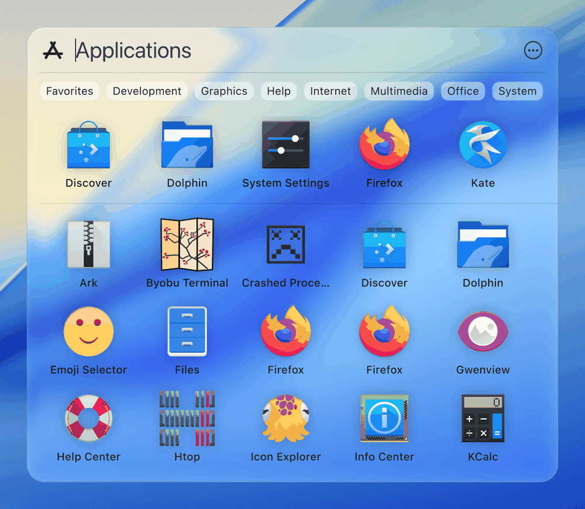
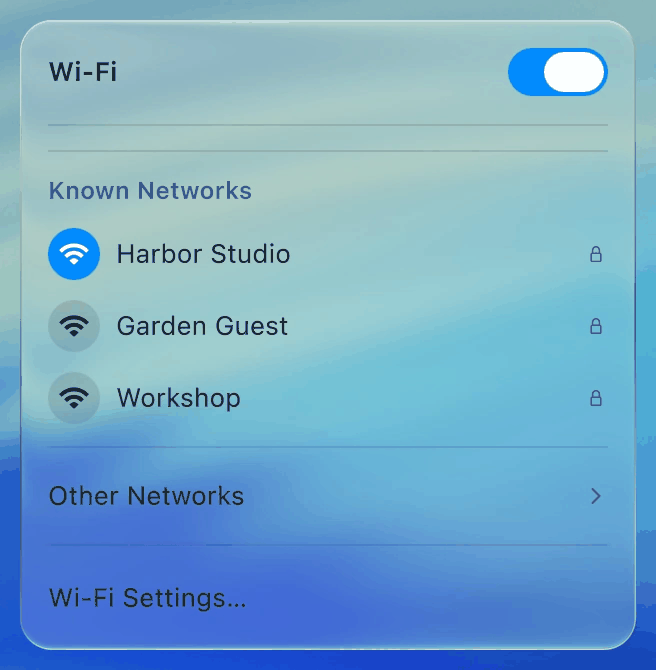

<p align="center">
  <!-- Adapted with ImageGen from artwork by Apple: https://developer.apple.com/assets/elements/icons/macos-26/macos-26-128x128_2x.png. Tux design by Larry Ewing. -->
  
</p>

<h1 align="center">Shell macOS Tahoe pour KDE sous Linux</h1>

<p align="center">
  <a href="README.md" lang="en" hreflang="en">🇺🇸 English</a> ·
  <a href="README.es.md" lang="es" hreflang="es">🇪🇸 Español</a> ·
  <a href="README.zh-CN.md" lang="zh-CN" hreflang="zh-CN">🇨🇳 简体中文</a> ·
  <a href="README.pt-BR.md" lang="pt-BR" hreflang="pt-BR">🇧🇷 Português (Brasil)</a> ·
  <a href="README.de.md" lang="de" hreflang="de">🇩🇪 Deutsch</a> ·
  <a href="README.fr.md" lang="fr" hreflang="fr" aria-current="page">🇫🇷 Français</a> ·
  <a href="README.it.md" lang="it" hreflang="it">🇮🇹 Italiano</a> ·
  <a href="README.ja.md" lang="ja" hreflang="ja">🇯🇵 日本語</a> ·
  <a href="README.ko.md" lang="ko" hreflang="ko">🇰🇷 한국어</a> ·
  <a href="README.ru.md" lang="ru" hreflang="ru">🇷🇺 Русский</a> ·
  <a href="README.ar.md" lang="ar" hreflang="ar">🇸🇦 العربية</a> ·
  <a href="README.hi.md" lang="hi" hreflang="hi">🇮🇳 हिन्दी</a> ·
  <a href="README.nl.md" lang="nl" hreflang="nl">🇳🇱 Nederlands</a> ·
  <a href="README.pl.md" lang="pl" hreflang="pl">🇵🇱 Polski</a> ·
  <a href="README.tr.md" lang="tr" hreflang="tr">🇹🇷 Türkçe</a>
</p>

<p align="center">
  <a href="https://github.com/lestercorderomurillo/macos-tahoe-liquid-kde/releases"></a>
  <a href="https://github.com/lestercorderomurillo/macos-tahoe-liquid-kde/actions/workflows/test.yml"></a>
  <a href="https://kde.org/plasma-desktop/"></a>
  <a href="LICENSE"></a>
  <a href="https://github.com/lestercorderomurillo/macos-tahoe-liquid-kde/issues/new"></a>
</p>


<p align="center">
  <sub>Sélectionnez une distribution pour consulter l’état de ses tests.</sub>
</p>

<p align="center">
  <a href="tests/vm/PROOF.md#cachyos" title="CachyOS"></a>
  <a href="tests/vm/PROOF.md#arch" title="Arch Linux"></a>
  <a href="tests/vm/PROOF.md#endeavouros" title="EndeavourOS"></a>
  <a href="tests/vm/PROOF.md#fedora" title="Fedora"></a>
  <a href="tests/vm/PROOF.md#manjaro" title="Manjaro"></a>
  <a href="tests/vm/PROOF.md#artix" title="Artix Linux (OpenRC)"></a>
  <a href="tests/vm/PROOF.md#garuda" title="Garuda Linux"></a>
  <a href="tests/vm/PROOF.md#nobara" title="Nobara Linux"></a>
  <a href="tests/vm/PROOF.md#opensuse" title="openSUSE Tumbleweed"></a>
  <a href="tests/vm/PROOF.md#neon" title="KDE neon"></a>
  <a href="tests/vm/PROOF.md#debian" title="Debian testing / sid (Plasma 6.6+)"></a>
  <a href="tests/vm/PROOF.md#nixos" title="NixOS (experimental)"></a>
</p>

Ce projet personnalise l’apparence de votre bureau KDE sous Linux. Il n’inclut aucun service Apple et ne se connecte à aucun de ces services. Si vous avez besoin de services Apple, [achetez directement auprès d’Apple](https://www.apple.com/store).

> [!CAUTION]
> **Principe de publication continue**
> Expérimental. Reçoit des mises à jour quotidiennes. Les mises à jour peuvent rompre la compatibilité. Évitez les systèmes de production ; [signalez les problèmes ici](https://github.com/lestercorderomurillo/macos-tahoe-liquid-kde/issues/new).

> [!WARNING]
> **Méfiez-vous des redistributions payantes : ce thème est GRATUIT.**
>
> Si vous avez découvert ce thème par un canal tiers, vous n’avez pas besoin de payer pour l’obtenir : téléchargez-le directement depuis ce dépôt. Nous gardons ce projet gratuit pour que chacun puisse en profiter sans barrière payante. Aucun achat ni abonnement n’est nécessaire.

<br>


Signalements de bogues, corrections, tests et documentation : consultez le [guide de contribution](CONTRIBUTING.md).

Contributeurs au code et personnes signalant des bogues dans Tahoe et Golden Gate :

<p>
  <a href="https://github.com/lestercorderomurillo"></a>
  <a href="https://github.com/yanhenrique-dev"></a>
  <a href="https://github.com/naevui"></a>
  <a href="https://github.com/caioniehues"></a>
  <a href="https://github.com/404-not-found129"></a>
  <a href="https://github.com/myakupozluk"></a>
  <a href="https://github.com/EMS1998"></a>
  <a href="https://github.com/allfritz"></a>
  <a href="https://github.com/elegos"></a>
  <a href="https://github.com/kozeki-uii"></a>
  <a href="https://github.com/imightbelosthere"></a>
  <a href="https://github.com/evaildev"></a>
  <a href="https://github.com/xarblu"></a>
  <a href="https://github.com/PKMNPlatin"></a>
  <a href="https://github.com/matinlotfali"></a>
  <a href="https://github.com/luisbocanegra"></a>
  <a href="https://github.com/OliverChase2003"></a>
  <a href="https://github.com/RoxasYTB"></a>
  <a href="https://github.com/Flagwill"></a>
  <a href="https://github.com/4l3j0Ok"></a>
  <a href="https://github.com/0xrushi"></a>
  <a href="https://github.com/aenriii"></a>
  <a href="https://github.com/andreas399"></a>
  <a href="https://github.com/Andrew-Sor"></a>
  <a href="https://github.com/ardashir77"></a>
  <a href="https://github.com/azizaktas"></a>
  <a href="https://github.com/binary-pleb"></a>
  <a href="https://github.com/bneils"></a>
  <a href="https://github.com/FAYZER77"></a>
  <a href="https://github.com/fxrncyyisingithub"></a>
  <a href="https://github.com/germanbagutteorsomething"></a>
  <a href="https://github.com/iNarrow12"></a>
  <a href="https://github.com/IsaiahSHanson"></a>
  <a href="https://github.com/kuau"></a>
  <a href="https://github.com/Lando0007"></a>
  <a href="https://github.com/LilT59"></a>
  <a href="https://github.com/marcosfantonio"></a>
  <a href="https://github.com/moulikanand12345-lang"></a>
  <a href="https://github.com/nanechi"></a>
  <a href="https://github.com/nousernameget"></a>
  <a href="https://github.com/OpalSand"></a>
  <a href="https://github.com/P0sixSplo1t-2"></a>
  <a href="https://github.com/rokan00"></a>
  <a href="https://github.com/RussH"></a>
  <a href="https://github.com/Salkio"></a>
  <a href="https://github.com/Shivamingale3"></a>
  <a href="https://github.com/shoko3756"></a>
  <a href="https://github.com/Sonicx9876"></a>
  <a href="https://github.com/Tias-dev"></a>
  <a href="https://github.com/txhammer68"></a>
  <a href="https://github.com/vanshdev0101"></a>
  <a href="https://github.com/vialolis"></a>
  <a href="https://github.com/Whiddu"></a>
  <a href="https://github.com/yingmanwumen"></a>
  <a href="https://github.com/yofriendfromschool1"></a>
  <a href="https://github.com/zhaokelei"></a>
  <a href="https://github.com/blaykelarue"></a>
  <a href="https://github.com/JacobJS34"></a>
  <a href="https://github.com/Leon-Swains"></a>
  <a href="https://github.com/LucipurrsDad"></a>
  <a href="https://github.com/SinglerGold2"></a>
  <a href="https://github.com/CiderGuru"></a>
  <a href="https://github.com/soumyadeep70"></a>
</p>

<br>


### Dock multicolore

Accordez la teinte des icônes du Dock à votre bureau.

<p align="center">
  
</p>

<br>

### Quickbar

Accédez aux menus de l’application active depuis la barre du haut.

<p align="center">
  
</p>

<br>

### Launchpad

Recherchez des applications ou parcourez-les par catégorie.

<p align="center">
  
</p>

<br>

### Centre de contrôle

Réglez le Wi-Fi, le son et la luminosité dans un seul menu.

<p align="center">
  
</p>

<br>

### Les notifications

Retrouvez les notifications récentes regroupées par application.

<p align="center">
  
</p>

<br>

### Finder

Parcourez vos fichiers dans une fenêtre de style Finder.

<p align="center">
  <a href="src/screenshots/previews/tahoe-finder-light-dark-21d755ca3c50.gif"></a>
</p>

<br>

### Calendrier

Ouvrez l’horloge pour afficher le calendrier du mois.

<p align="center">
  
</p>

<br>

### Bluetooth

Connectez vos appareils associés et vérifiez leur batterie.

<p align="center">
  
</p>

### Wi-Fi

Consultez les réseaux disponibles et l’état de la connexion.

<p align="center">
  
</p>

<br>

### Batterie

Vérifiez le niveau de la batterie et son état de charge.

<p align="center">
  
</p>

<br>

### Historique du presse-papiers

Réutilisez le texte et les images que vous avez copiés.

<p align="center">
  
</p>

<br>

### Informations sur le système

Consultez les détails du matériel, des logiciels et du thème.

<p align="center">
  
</p>

<br>

### Thème Plasma

Les menus et les fenêtres contextuelles suivent le thème clair ou sombre.

<p align="center">
  
</p>

<br>

### Écran de démarrage

Un écran assorti au thème s’affiche au démarrage.

<p align="center">
  
</p>

<br>

### Contraste adaptatif

La couleur du texte s’adapte au fond pour garder les libellés lisibles.

<p align="center">
  
</p>

<br>


- **Apparence :** Thèmes clairs et sombres coordonnés pour le bureau, les applications, les icônes et les décorations de fenêtres, avec basculement automatique et fonds d’écran par moniteur.
- **Effets de verre :** Flou, réfraction et teinte réglables, avec du texte qui s’adapte à l’arrière-plan dans les menus compatibles.
- **Dock :** Applications épinglées, agrandissement au survol, badges de notification et masquage configurable. Le Dock vous suit d’un écran à l’autre.
- **Barre de menus et Centre de contrôle :** Menus globaux des applications et réglages rapides du système, avec des paramètres de barre de menus partagés entre les écrans.
- **Launchpad :** Recherchez des applications, parcourez les catégories et enregistrez vos favoris.
- **Widgets de bureau :** Ajoutez des widgets Liquid Glass directement sur votre bureau.
- **Notifications :** Bannières en verre et historique groupé, avec actions rapides et réponses dans les applications compatibles.
- **Historique du presse-papiers :** Retrouvez et réutilisez le texte et les images copiés, et épinglez les éléments à conserver.
- **Intégration des applications :** Navigation façon Finder dans Nautilus, intégration des menus GTK et thème Firefox avec sauvegarde des profils.
- **Informations système et démarrage :** Fenêtre d’informations système et écran de démarrage facultatif assortis au thème.
- **Installation et restauration :** Installateur graphique avec les ressources du thème, les mises à jour et la sauvegarde des paramètres, restaurables lors de la désinstallation.
- **Langues :** La langue de l’installateur se choisit dans les réglages. Les composants graphiques Plasma suivent la langue du bureau.
- **Compatibilité :** Plasma 6.6–6.8 sur les systèmes basés sur Arch ou Fedora, openSUSE, Debian et KDE neon.
- **Fonctions facultatives :** Protection des écrans OLED et prise en charge expérimentale de NixOS et Home Manager.

<br>


**Avant de lancer le programme d’installation sur votre PC, testez-le dans une machine virtuelle avec votre distribution et votre version de Plasma.**

```bash
git clone --filter=blob:none https://github.com/lestercorderomurillo/macos-tahoe-liquid-kde.git
cd macos-tahoe-liquid-kde
./installer
```

Choisissez **Express** pour installer. Rouvrez `./installer` pour mettre à jour ou désinstaller.

Pour libérer de l’espace disque tout en conservant votre copie Git et votre travail local :

```bash
./installer --free-space
```

| Langue de l’installateur | État |
| --- | --- |
| 🇺🇸 Anglais |  |
| 🇪🇸 Espagnol |  |
| 🇨🇳 Chinois simplifié |  |
| 🇧🇷 Portugais du Brésil |  |
| 🇩🇪 Allemand |  |
| 🇫🇷 Français |  |
| 🇮🇹 Italien |  |
| 🇷🇺 Russe |  |
| 🇯🇵 Japonais |  |
| 🇰🇷 Coréen |  |
| 🇸🇦 Arabe |  |
| 🇮🇳 Hindi |  |
| 🇳🇱 Néerlandais |  |
| 🇵🇱 Polonais |  |
| 🇹🇷 Turc |  |

<details>
<summary><b>Prérequis</b></summary>

Bureau, outils de compilation et paquets système requis.

- KDE Plasma 6.6+
- Python 3.10+ et PyQt6
- `sudo`
- Outils de développement Qt 6
- Paquets de développement KDE et Qt 6 pour les plasmoïdes compilés et les effets KWin
- `cmake`, `g++` et `pkg-config` lorsque des fonctionnalités compilées sont sélectionnées
- `dbus-send`
- `systemctl` ou `crontab` pour les fonctionnalités planifiées

**dinit :** l’installateur détecte dinit et utilise des entrées cron par utilisateur pour le changement automatique clair/sombre et la protection OLED. Un démon cron actif est nécessaire ; installer `crontab` seul ne le démarre pas. Sur Artix/dinit, préparez-le avec :

```bash
sudo pacman -S --needed cronie cronie-dinit
sudo dinitctl --system enable cronie
```

Les changements automatiques ont lieu à 06:00 et 18:00 pendant la session ; le backend cron ne rattrape pas les changements manqués à la connexion. Le changement manuel clair/sombre fonctionne indépendamment de cron. La validation du bureau dinit reste en attente ; les captures Artix existantes couvrent OpenRC.

Les ressources sont incluses. Les dépendances manquantes et KDE Rounded Corners facultatif nécessitent internet. Les mises à jour vérifiées de Rounded Corners suppriment les anciennes sources et archives téléchargées. La réinstallation remplace sur place les arborescences de ressources gérées ; les copies réussies suppriment leurs données temporaires et les copies suivantes nettoient les préparations jetables interrompues. Les sauvegardes de récupération, de profils de navigateur et les préférences utilisateur sont conservées. Les images VM de développement et les lots de captures ne sont pas des caches de l’installateur et ne sont jamais supprimés automatiquement.

| Distribution | Outils Qt 6 | Paquets de développement KDE Plasma 6 |
|--------|------------|-----------------------------------|
| Famille Arch | `pacman -S qt6-tools` | `pacman -S extra-cmake-modules plasma-workspace kdecoration libplasma libnotificationmanager libksysguard plasma-activities-stats` |
| Famille Fedora | `dnf install qt6-qttools-devel` | `dnf install extra-cmake-modules plasma-workspace-devel kdecoration-devel libplasma-devel knotifications-devel libksysguard-devel kf6-plasma-activities-devel` |
| openSUSE Tumbleweed | `zypper install qt6-tools-devel` | `zypper install extra-cmake-modules plasma6-workspace-devel kdecoration-devel libKF6Plasma-devel libnotificationmanager6-devel libksysguard6-devel libKF6PlasmaActivitiesStats6-devel` |

</details>

<details>
<summary><b>Protection OLED</b></summary>

Décalages facultatifs des panneaux ; désactivés par défaut.

Activez-la sur la page **Protection OLED**. Choisissez-y l’intervalle et le déplacement maximal en pixels ; elle est désactivée par défaut.

**Commandes manuelles**

```bash
mac-tahoe-oled-care shift
mac-tahoe-oled-care restore
mac-tahoe-oled-care status
```

</details>

<br>


Vérifiez la prise en charge de votre distribution, de votre système d’initialisation et de votre version de Plasma.

<details>
<summary><b>Tests des distributions</b></summary>

Essayez le thème dans un bureau Plasma isolé.

```bash
./vm <os>
```

**OS:** `cachyos` · `arch` · `manjaro` · `endeavouros` · `garuda` · `fedora` · `nobara` · `opensuse` · `neon` · `debian` · `artix` · `kubuntu`

`all` lance toutes les distributions. Les cibles cloud sont configurées automatiquement ; les autres utilisent leurs installateurs ISO officiels épinglés par somme de contrôle. Suivez le [guide de configuration et de validation des VM](tests/vm/README.md).

`./vm kubuntu` démarre l’ISO officielle Kubuntu 26.04.1 LTS avec vérification SHA-256 (port SSH `2234` après configuration de l’invité). Cette nouvelle cible de régression du lanceur attend une validation complète en conditions réelles.

`./vm debian` utilise l’image cloud officielle Debian testing (Forky), vérifie sa somme SHA-512 et configure un bureau Plasma. Connectez-vous comme `tester` avec le mot de passe `tester` ; SSH est disponible sur `127.0.0.1:2232`. L’installateur s’ouvre depuis une copie accessible en écriture dans l’invité à `/home/tester/macos-tahoe-liquid-kde` ; le dépôt hôte est monté en lecture seule. Utilisez `./vm debian --clean` pour reconstruire l’invité jetable depuis zéro.

Les 11 distributions de ce tableau ont réussi la validation en VM réelle. Sélectionnez un badge d’état pour consulter les captures examinées et les résultats des tests.

| | Nom | État |
|:--:|------|---------|
|  | CachyOS | [](tests/vm/PROOF.md#cachyos) |
|  | Arch Linux | [](tests/vm/PROOF.md#arch) |
|  | EndeavourOS | [](tests/vm/PROOF.md#endeavouros) |
|  | Fedora | [](tests/vm/PROOF.md#fedora) |
|  | Manjaro | [](tests/vm/PROOF.md#manjaro) |
|  | Artix Linux (OpenRC) | [](tests/vm/PROOF.md#artix) |
|  | Garuda Linux | [](tests/vm/PROOF.md#garuda) |
|  | Nobara | [](tests/vm/PROOF.md#nobara) |
|  | openSUSE Tumbleweed | [](tests/vm/PROOF.md#opensuse) |
|  | KDE neon | [](tests/vm/PROOF.md#neon) |
|  | Debian testing / sid (Plasma 6.6+) | [](tests/vm/PROOF.md#debian) |

**NixOS et Home Manager (en test)**

Utilisez les modules flake, **pas l’installateur graphique**. La validation du bureau en conditions réelles reste en attente.

**Entrée flake** (nécessite Nixpkgs et Home Manager) :

```nix
inputs.mac-tahoe = {
  url = "github:lestercorderomurillo/macos-tahoe-liquid-kde/v0.55.2";
  inputs.nixpkgs.follows = "nixpkgs";
  inputs.home-manager.follows = "home-manager";
};
```

**NixOS :** importez `inputs.mac-tahoe.nixosModules.default`.

```nix
services.desktopManager.plasma6.enable = true;
services.mac-tahoe.enable = true;
# services.mac-tahoe.plymouth.enable = true; # optional boot splash
```

**Home Manager :** importez `inputs.mac-tahoe.homeManagerModules.default`.

```nix
programs.mac-tahoe = {
  enable = true;
  mode = "auto"; # or "light" / "dark"
  # appleAssets = true;
  # oledCare.enable = true;
};
```

**Ressources Apple :** polices, fonds d’écran et sons non libres facultatifs. Activer `appleAssets` nécessite également :

```nix
nixpkgs.config.allowUnfreePredicate = pkg:
  builtins.elem (lib.getName pkg) [ "mac-tahoe-apple-assets" ];
```

**Panneaux :** importez également votre propre module plasma-manager et `inputs.mac-tahoe.homeManagerModules.plasma-manager`. Activez `programs.mac-tahoe.panels.enable` et définissez `programs.mac-tahoe.panels.launchers`, par exemple `[ "applications:org.kde.dolphin.desktop" ]`. Cela remplace la disposition sans importer les éléments épinglés existants.

**Réglages accessibles en écriture :** gardez `kdeglobals`, `kwinrc`, `plasmarc`, `plasmashellrc`, `kcminputrc`, `plasma-org.kde.plasma.desktop-appletsrc`, `Kvantum/kvantum.kvconfig` et la configuration GTK active accessibles en écriture. Évitez les clés plasma-manager immuables gérées par le commutateur de thème.

Déconnectez-vous puis reconnectez-vous après l’activation. Les profils Firefox, les signets GTK et SDDM ne sont pas configurés. Les menus globaux GTK nécessitent `programs.mac-tahoe.gtkAppmenuModule`. Avant de désactiver la protection OLED, exécutez `mac-tahoe-oled-care restore` ; avant de retirer les modules, sélectionnez Breeze. Le retrait conserve les réglages utilisateur.

</details>

<details>
<summary><b>Systèmes d’initialisation</b></summary>

Le changement automatique de thème et la protection OLED utilisent les backends de planification suivants :

| Système d’initialisation | Planification | Tests consignés |
| --- | --- | --- |
| systemd | Minuteries utilisateur |  |
| OpenRC | Cron par utilisateur |  |
| dinit | Cron par utilisateur |   |

OpenRC et dinit nécessitent un démon cron actif.
[Résultats des tests du bureau](tests/vm/PROOF.md) · [Vérification de la planification dinit](CONTRIBUTING.md#setup).

</details>

<details>
<summary><b>Versions de Plasma</b></summary>

Plasma 6.6–6.8 est pris en charge ; les effets compilés utilisent le SDK de l’hôte.

| Plasma | Prise en charge | Depuis |
|--------|---------|-------|
| 6.5 et antérieures |  | Sans objet |
| 6.6 |  | v0.1.0 |
| 6.7 |  | v0.19.0 |
| 6.8 |  | v0.54.1 |

</details>

<br>


Il s’agit d’une réimplémentation indépendante inspirée de l’esthétique macOS. Elle n’est ni affiliée à Apple ou KDE, ni approuvée par eux. « macOS » et « Apple » sont des marques d’Apple Inc.

L’emblème macOS, les fonds d’écran inclus, les sons système et les polices SF Pro / SF Mono restent la propriété d’Apple et ne sont pas couverts par la licence de ce projet. Les autres composants conservent leurs licences et avis de droit d’auteur ; consultez l’index des avis de tiers ci-dessous pour leur portée et les lacunes de provenance connues.

L’ensemble est sous licence [GPL-3.0](LICENSE) ; les licences de chaque composant et les droits des tiers restent applicables. Consultez les [avis de droit d’auteur](NOTICE), la [licence et l’identité du projet](LICENSING.md) et les [avis de tiers](THIRD_PARTY_NOTICES.md).

<br>


<details>
<summary><b>Projets, ressources et remerciements</b></summary>

Références du projet et composants tiers :

- **[EliverLara](https://github.com/EliverLara/TahoeLauncher)**: `TahoeLauncher`: Référence de conception de Launchpad.
- **[vinceliuice](https://github.com/vinceliuice)**: `MacTahoe-icon-theme`: icônes et curseurs de base ; référence de conception GTK. [`MacTahoe-gtk-theme` Firefox CSS/SVG](https://github.com/vinceliuice/MacTahoe-gtk-theme/tree/main/other/firefox) est maintenu ici comme un fork sous licence MIT avec prise en charge de la sauvegarde et de la restauration des profils.
- **[taj-ny](https://github.com/taj-ny/kwin-effects-forceblur)** et **[4v3ngR](https://github.com/4v3ngR/kwin-effects-glass)**: Better Blur et son fork de verre : code amont utilisé par Acrylic Glass (les auteurs du flou KWin restent crédités dans les en-têtes des sources).
- **[luisbocanegra](https://github.com/luisbocanegra/plasma-panel-colorizer)**: `plasma-panel-colorizer` v7.3.0, inclus hors ligne et installé par l’étape de disposition pour teinter les panneaux (GPL-3.0, licence incluse).
- **[jaxparrow07](https://github.com/jaxparrow07/liquidglass-kde-widgets)** : `liquidglass-kde-widgets` fournit la collection de widgets de bureau Liquid Glass incluse avec le thème (GPL-3.0, licence incluse).
- **[RoxasYTB](https://github.com/RoxasYTB)** : Le [widget Photos](https://github.com/jaxparrow07/liquidglass-kde-widgets/pull/41) affiche des photos sur le bureau. Le [basculement automatique entre Solid et Glass](https://github.com/jaxparrow07/liquidglass-kde-widgets/pull/40) active le style Glass lorsqu’une fenêtre est ouverte à l’écran.
- **[Matin Lotfaliei / KDE-Rounded-Corners](https://github.com/matinlotfali/KDE-Rounded-Corners)**: l’effet KWin de fenêtres arrondies sous GPL-3.0, récupéré depuis la version épinglée v0.9.0 et compilé en ligne contre le SDK KWin de l’hôte (licence installée avec).
- **[ful1e5](https://github.com/ful1e5)**: `apple_cursor`: référence alternative de conception des curseurs.
- **[sahibjotsaggu](https://github.com/sahibjotsaggu)**: `San-Francisco-Pro-Fonts`: source du lot SF Pro / SF Mono.
- **[Lucide](https://github.com/lucide-icons/lucide)**: icônes de copie incluses dans le menu global (ISC, © Lucide Contributors).
- **[512pixels.net](https://512pixels.net/projects/default-mac-wallpapers-in-5k/)**: archive de fonds d’écran macOS en haute résolution.

Si un crédit manque, veuillez [ouvrir un signalement](https://github.com/lestercorderomurillo/macos-tahoe-liquid-kde/issues/new).

</details>


[Captures de l’installateur et tests](TESTING.md).
