<p align="center">
  <!-- Artwork: https://developer.apple.com/assets/elements/icons/macos-26/macos-26-128x128_2x.png -->
  
</p>

<h1 align="center">macOS Tahoe for KDE Plasma</h1>

<p align="center">
  <a href="README.md" lang="en" hreflang="en">🇺🇸 English</a> ·
  <a href="README.es.md" lang="es" hreflang="es">🇪🇸 Español</a> ·
  <a href="README.zh-CN.md" lang="zh-CN" hreflang="zh-CN">🇨🇳 简体中文</a> ·
  <a href="README.pt-BR.md" lang="pt-BR" hreflang="pt-BR">🇧🇷 Português (Brasil)</a> ·
  <a href="README.de.md" lang="de" hreflang="de">🇩🇪 Deutsch</a> ·
  <a href="README.fr.md" lang="fr" hreflang="fr" aria-current="page">🇫🇷 Français</a>
</p>

<p align="center">
  <a href="https://github.com/lestercorderomurillo/macos-tahoe-liquid-kde/releases"></a>
  <a href="https://github.com/lestercorderomurillo/macos-tahoe-liquid-kde/actions/workflows/test.yml"></a>
  <a href="https://kde.org/plasma-desktop/"></a>
  <a href="LICENSE"></a>
  <a href="https://github.com/lestercorderomurillo/macos-tahoe-liquid-kde/issues/new"></a>
</p>

<p align="center">Le style macOS Tahoe pour KDE Plasma 6.6, 6.7 et 6.8+.</p>

> [!CAUTION]
> Projet expérimental avec des mises à jour fréquentes pouvant rompre la compatibilité. Évitez les systèmes de production. Ce projet est gratuit : aucun achat ni abonnement n’est nécessaire.

<p align="center"><sub>Sélectionnez une distribution pour consulter ses tests.</sub></p>

<p align="center">
  <a href="tests/vm/PROOF.md#cachyos" title="CachyOS"></a>
  <a href="tests/vm/PROOF.md#arch" title="Arch Linux"></a>
  <a href="tests/vm/PROOF.md#endeavouros" title="EndeavourOS"></a>
  <a href="tests/vm/PROOF.md#fedora" title="Fedora"></a>
  <a href="tests/vm/PROOF.md#manjaro" title="Manjaro"></a>
  <a href="tests/vm/PROOF.md#artix" title="Artix Linux (OpenRC)"></a>
  <a href="tests/vm/PROOF.md#garuda" title="Garuda Linux"></a>
  <a href="tests/vm/PROOF.md#nobara" title="Nobara Linux"></a>
  <a href="tests/vm/PROOF.md#opensuse" title="openSUSE Tumbleweed"></a>
  <a href="tests/vm/PROOF.md#neon" title="KDE neon"></a>
  <a href="tests/vm/PROOF.md#debian" title="Debian testing / sid (Plasma 6.6+)"></a>
  <a href="tests/vm/PROOF.md#nixos" title="NixOS (experimental)"></a>
</p>

## Installation et mises à jour

Téléchargez le dépôt et ouvrez l’installateur :

```bash
git clone --filter=blob:none https://github.com/lestercorderomurillo/macos-tahoe-liquid-kde.git
cd macos-tahoe-liquid-kde
./installer
```

Choisissez **Express** pour installer. Rouvrez `./installer` pour mettre à jour ou désinstaller.

Cette édition utilise Tahoe, son fond d’écran et le préréglage 1 du lanceur. Vous pouvez modifier les options dans l’assistant.

L’installateur est disponible en anglais, espagnol, chinois simplifié, portugais du Brésil, allemand et français. Les langues prévues figurent dans l’[état complet](README.md).

## Prérequis et compatibilité

KDE Plasma 6.6 ou ultérieur, Python 3.10+, PyQt6, `sudo` et les outils de développement Qt 6/KDE sont nécessaires. Les composants compilés nécessitent `cmake`, `g++` et `pkg-config`. Les téléchargements, les dépendances manquantes et KDE Rounded Corners nécessitent internet.

Plasma 6.6–6.8 est pris en charge ; les versions 6.5 et antérieures ne le sont pas. Les effets natifs sont compilés contre Qt et KWin du système. Onze distributions ont été testées en machine virtuelle : CachyOS, Arch, EndeavourOS, Fedora, Manjaro, Artix/OpenRC, Garuda, Nobara, openSUSE Tumbleweed, KDE neon et Debian testing/sid. Cela ne couvre pas toutes les configurations.

Le changement automatique clair/sombre et la protection OLED utilisent des minuteries utilisateur systemd ou cron par utilisateur avec OpenRC/dinit. OpenRC et dinit nécessitent un démon cron actif. La validation du bureau dinit et de Kubuntu reste en attente ; les photographies Artix correspondent à OpenRC.

## Fonctionnalités et photographies

### Tahoe Finder (Alpha)

Navigation de fichiers de style Finder avec le verre Tahoe.

<p align="center">
  <a href="src/screenshots/previews/readme-tahoe-light-finder-4203d60bcd59.webp"></a>
  <a href="src/screenshots/previews/readme-tahoe-dark-finder-3fba4166a2d8.webp">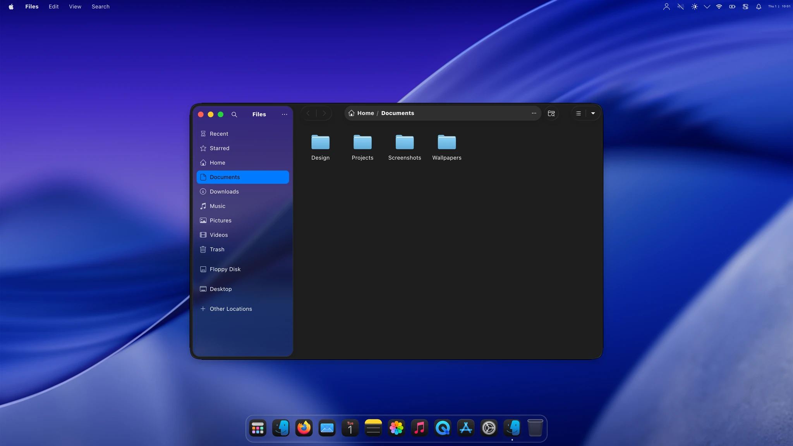</a>
</p>

<details>
<summary>Accents rouges et bleus en modes clair et sombre</summary>

<table>
<tr><th>Accent</th><th>Clair</th><th>Sombre</th></tr>
<tr><td>Rouge</td><td><a href="src/screenshots/previews/readme-tahoe-light-finder-red-cf60519353bc.webp">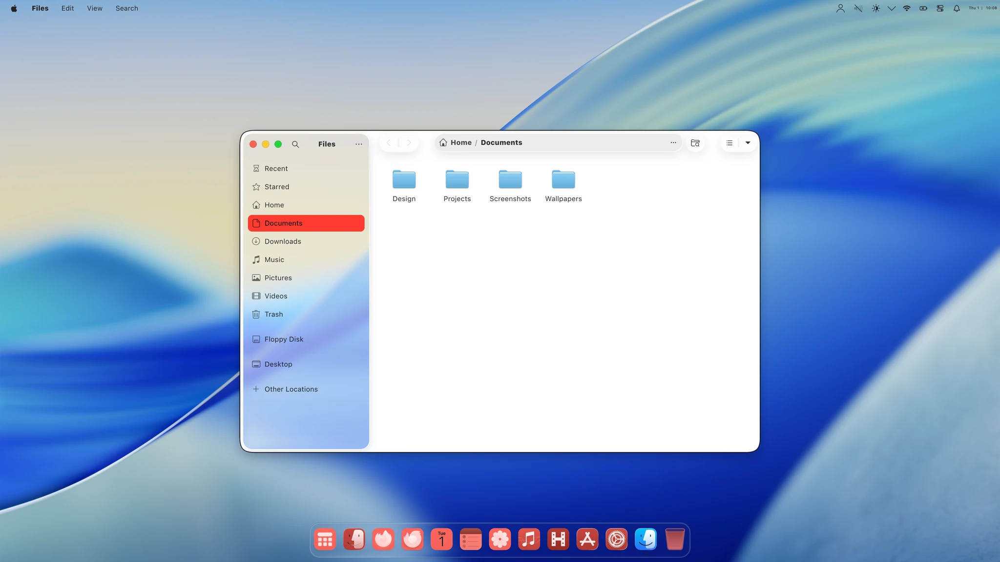</a></td><td><a href="src/screenshots/previews/readme-tahoe-dark-finder-red-a5d3144faf0f.webp">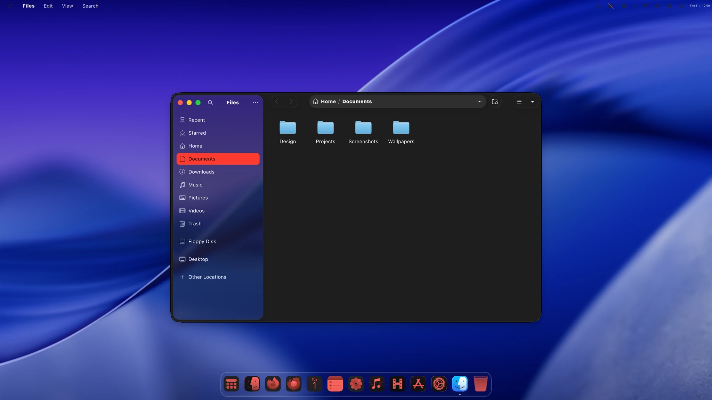</a></td></tr>
<tr><td>Bleu</td><td><a href="src/screenshots/previews/readme-tahoe-light-finder-blue-ad74eeb6e7a1.webp">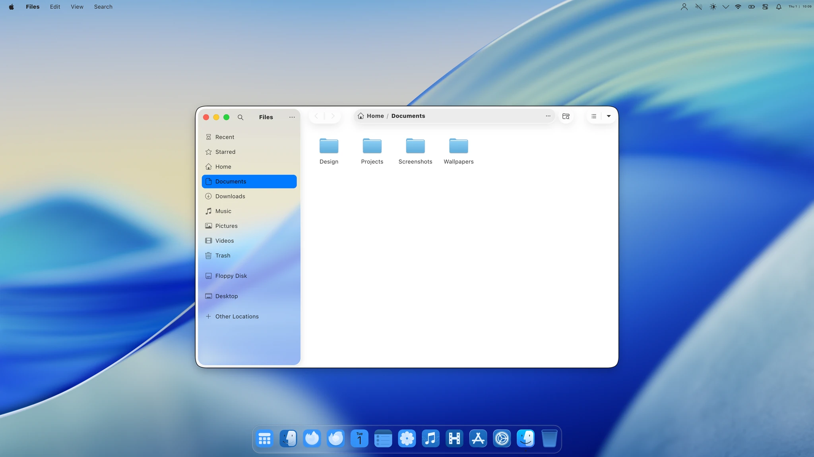</a></td><td><a href="src/screenshots/previews/readme-tahoe-dark-finder-blue-2a9bacc3b9a9.webp"></a></td></tr>
</table>

</details>

### Tahoe Launchpad (Alpha)

Recherchez des applications, parcourez les catégories et gardez vos favoris. Deux préréglages sont disponibles.

<p align="center">
  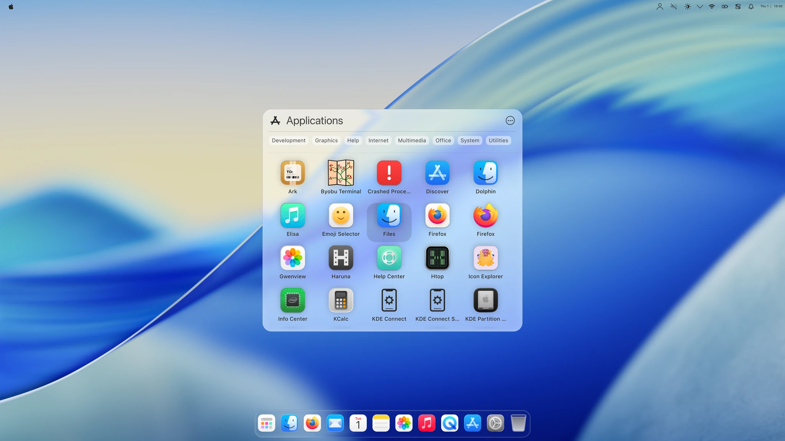
  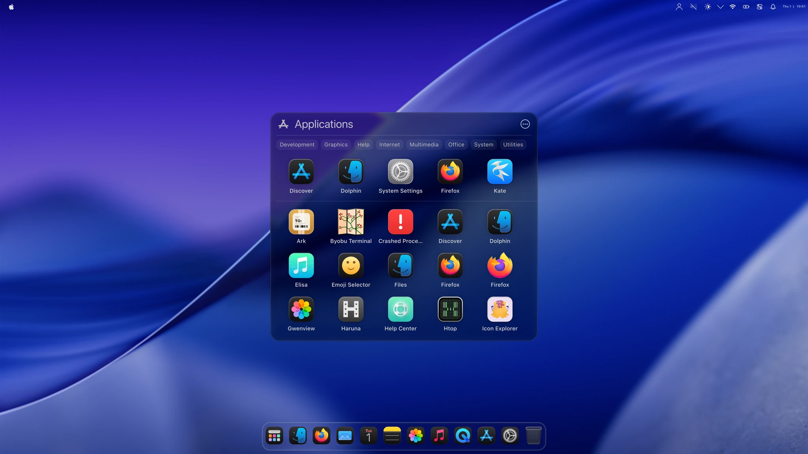
</p>

### Tahoe Dock (Alpha)

Réfraction du verre, agrandissement au survol, compteurs de notifications et masquage automatique.

<p align="center"><a href="src/screenshots/previews/readme-tahoe-light-dock-regular-6d506b3465fd.webp">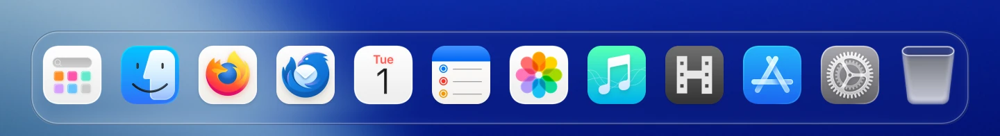</a><br>Standard · Clair</p>

<p align="center"><a href="src/screenshots/previews/readme-tahoe-dark-dock-regular-9254e2db86a7.webp">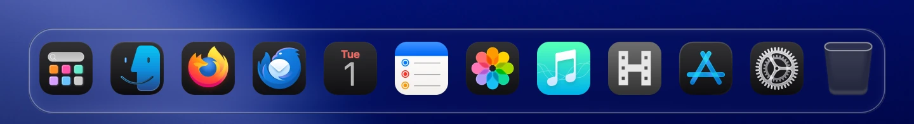</a><br>Standard · Sombre</p>

<p align="center"><a href="src/screenshots/previews/readme-tahoe-light-dock-clear-843c40a052a7.webp">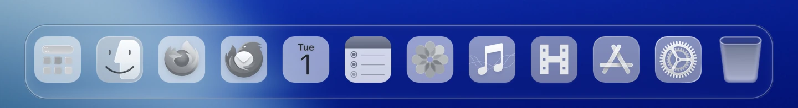</a><br>Transparent · Clair</p>

<p align="center"><a href="src/screenshots/previews/readme-tahoe-dark-dock-clear-58edd6d52e38.webp">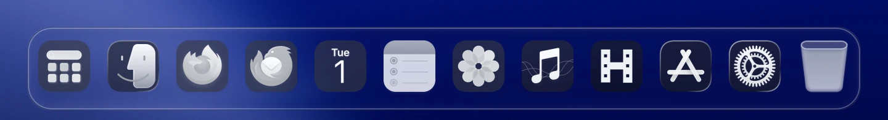</a><br>Transparent · Sombre</p>

<p align="center"><a href="src/screenshots/previews/readme-tahoe-light-dock-blue-d39bb78e2f1d.webp">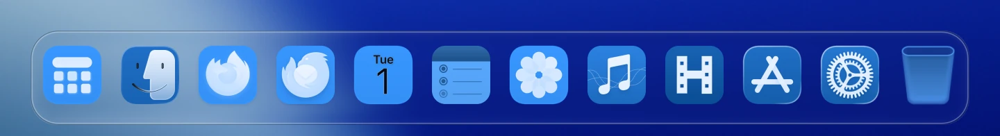</a><br>Bleu · Clair</p>

<p align="center"><a href="src/screenshots/previews/readme-tahoe-dark-dock-blue-a292ebe93f08.webp">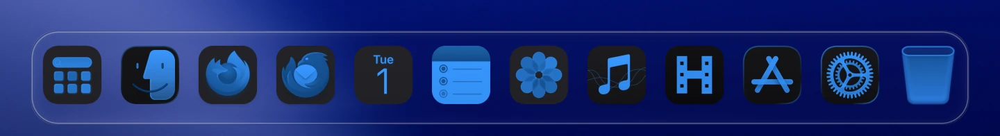</a><br>Bleu · Sombre</p>

<p align="center"><a href="src/screenshots/previews/readme-tahoe-light-dock-purple-b8d6d4a59d58.webp">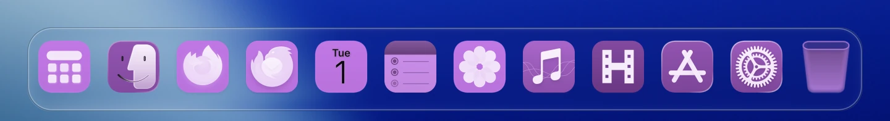</a><br>Violet · Clair</p>

<p align="center"><a href="src/screenshots/previews/readme-tahoe-dark-dock-purple-090970372f80.webp">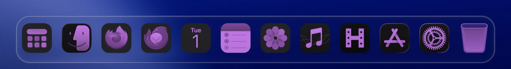</a><br>Violet · Sombre</p>

<p align="center"><a href="src/screenshots/previews/readme-tahoe-light-dock-pink-c0b0ba00ddeb.webp">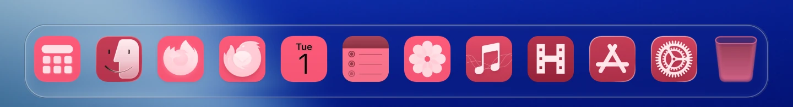</a><br>Rose · Clair</p>

<p align="center"><a href="src/screenshots/previews/readme-tahoe-dark-dock-pink-ba6941817529.webp"></a><br>Rose · Sombre</p>

<p align="center"><a href="src/screenshots/previews/readme-tahoe-light-dock-red-19adb9d798fd.webp"></a><br>Rouge · Clair</p>

<p align="center"><a href="src/screenshots/previews/readme-tahoe-dark-dock-red-379c09615f96.webp">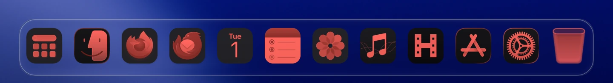</a><br>Rouge · Sombre</p>

<p align="center"><a href="src/screenshots/previews/readme-tahoe-light-dock-orange-18c4663ce547.webp">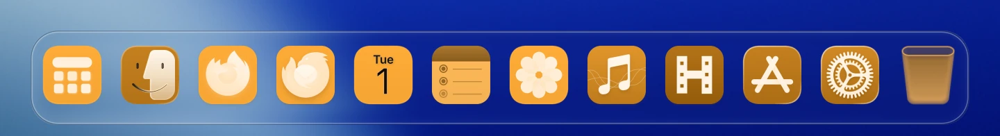</a><br>Orange · Clair</p>

<p align="center"><a href="src/screenshots/previews/readme-tahoe-dark-dock-orange-5079b478c649.webp">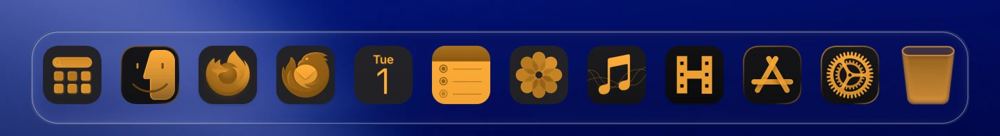</a><br>Orange · Sombre</p>

<p align="center"><a href="src/screenshots/previews/readme-tahoe-light-dock-yellow-c7656eaf2b61.webp"></a><br>Jaune · Clair</p>

<p align="center"><a href="src/screenshots/previews/readme-tahoe-dark-dock-yellow-c1945efddc21.webp">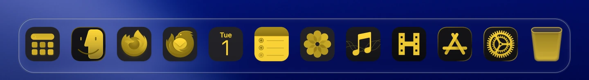</a><br>Jaune · Sombre</p>

<p align="center"><a href="src/screenshots/previews/readme-tahoe-light-dock-green-ac9611249165.webp">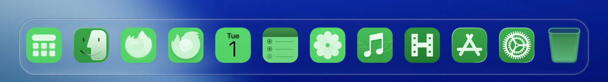</a><br>Vert · Clair</p>

<p align="center"><a href="src/screenshots/previews/readme-tahoe-dark-dock-green-84eab2e65cf2.webp">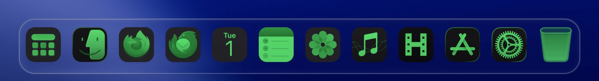</a><br>Vert · Sombre</p>

<p align="center"><a href="src/screenshots/previews/readme-tahoe-light-dock-gray-18617e5c0df8.webp">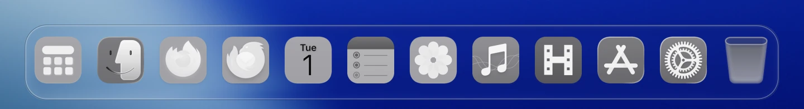</a><br>Gris · Clair</p>

<p align="center"><a href="src/screenshots/previews/readme-tahoe-dark-dock-gray-e7baf051c7cb.webp">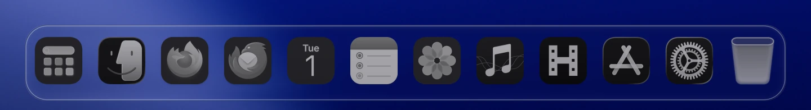</a><br>Gris · Sombre</p>

### Tahoe Shell (Alpha)

Accès aux réglages système, aux applications et aux commandes de session.

<p align="center">
  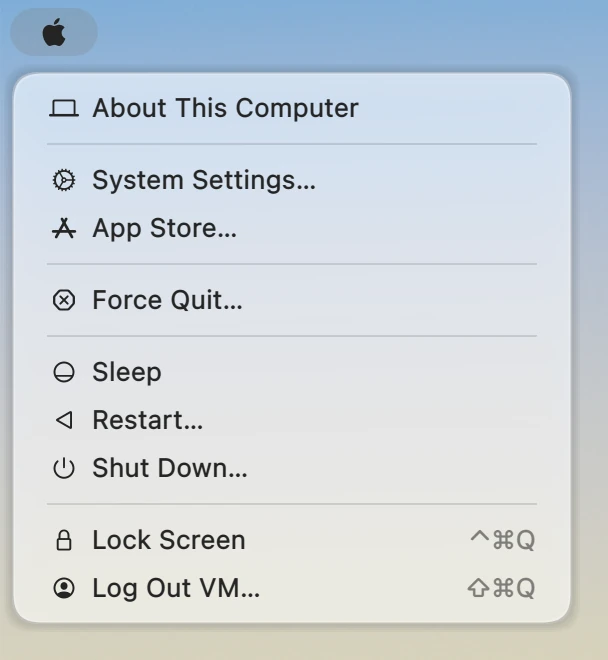
  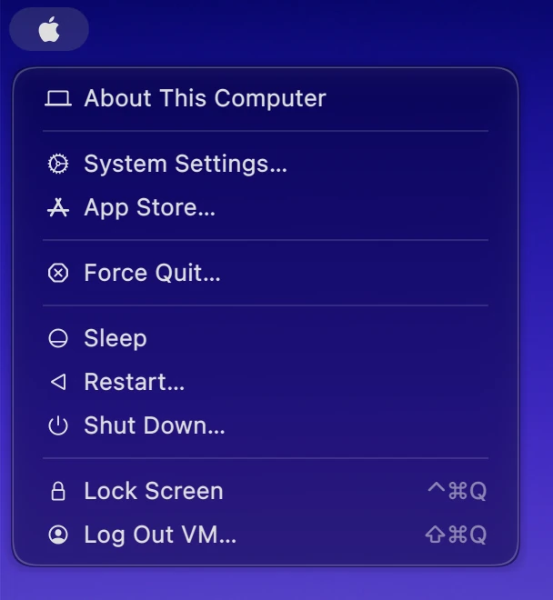
</p>

### Tahoe Centre de contrôle (Alpha)

Wi-Fi, son, luminosité et notifications dans un menu en verre.

<p align="center">
  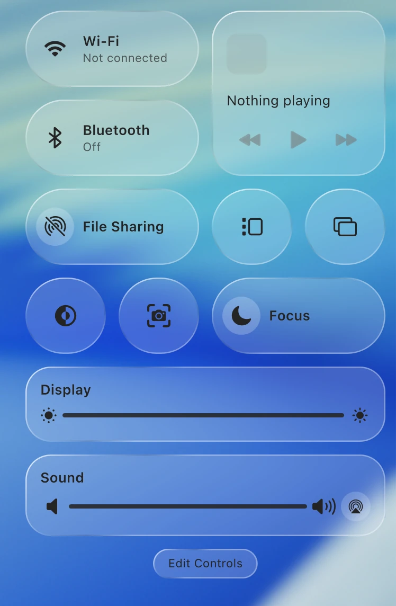
  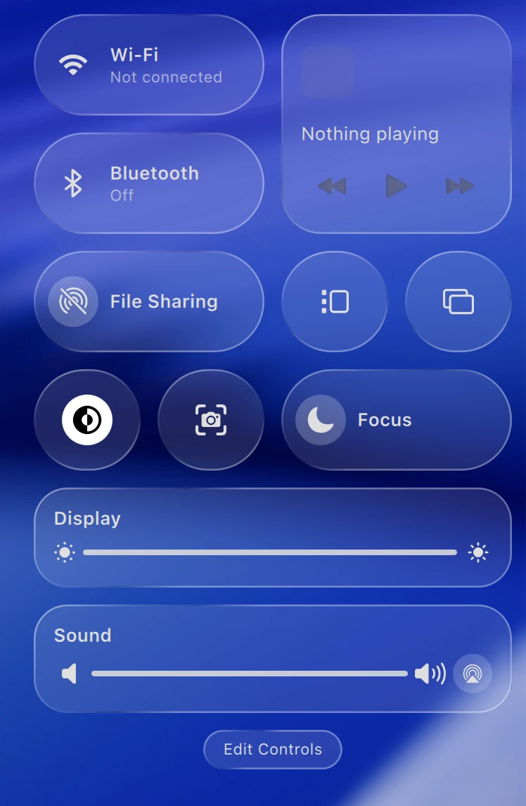
</p>

### Tahoe Historique du presse-papiers (Alpha)

Retrouvez et réutilisez le texte et les images copiés depuis Launchpad.

<p align="center">
  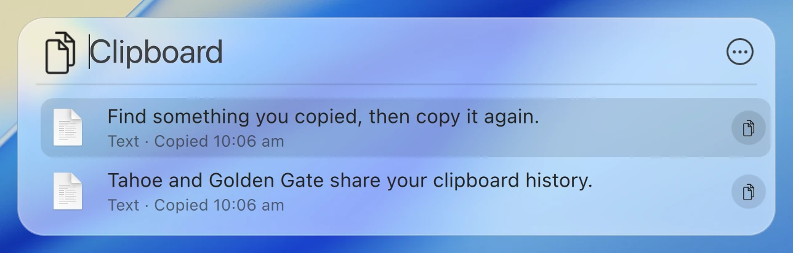
  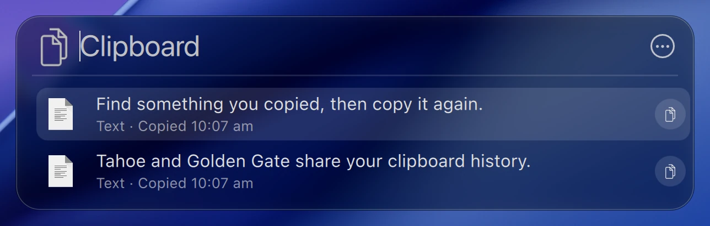
</p>

### Tahoe Informations système

Informations sur votre matériel, vos logiciels et votre thème.

<p align="center">
  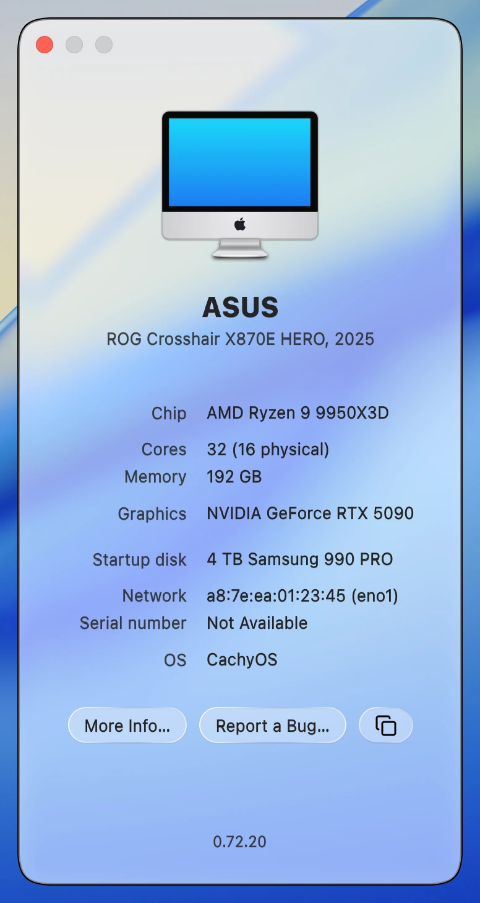
  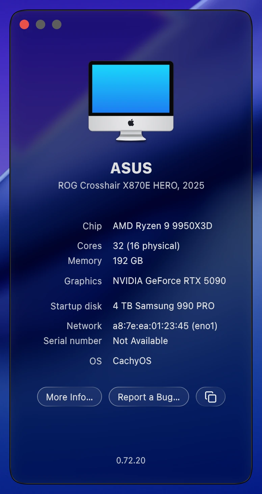
</p>

### Tahoe Thème Plasma (Alpha)

Menus et fenêtres contextuelles translucides avec des couleurs claires et sombres coordonnées.

<p align="center">
  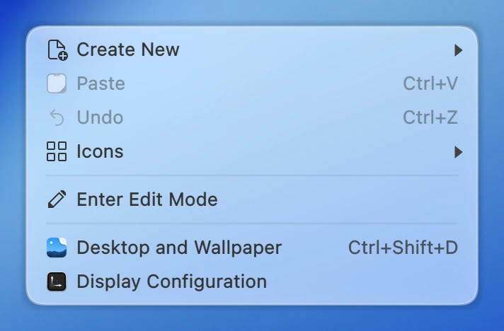
  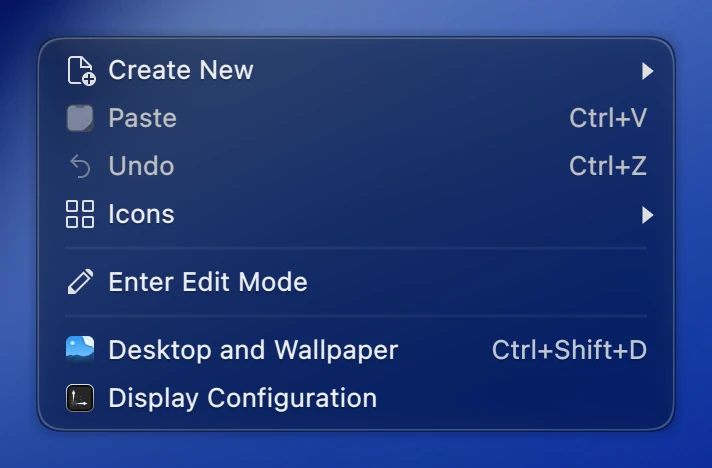
</p>

### Tahoe Écran de démarrage (Alpha)

Écran de démarrage avec déverrouillage intégré des disques chiffrés LUKS2.

<p align="center">
  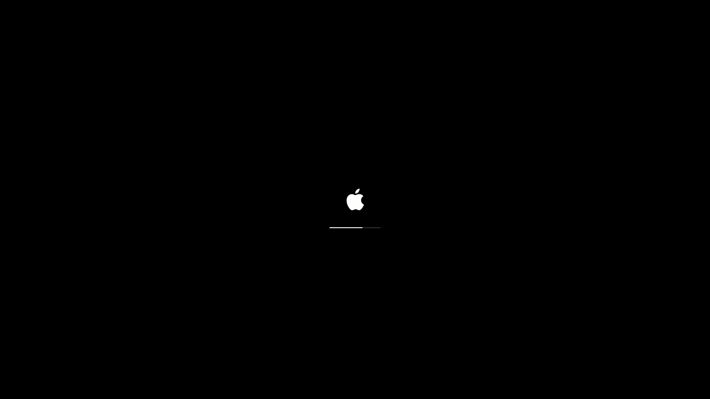
</p>

## Options et outils

L’assistant permet de choisir les composants, icônes, fonds d’écran, boutons et ombres des fenêtres. La réinstallation conserve la personnalisation du Dock sauf si vous demandez sa réinitialisation. Le thème synchronise l’apparence claire/sombre, intègre les menus globaux et les styles GTK/Qt et sauvegarde les profils Firefox avant de les modifier.

La protection OLED est facultative et désactivée par défaut. Activez-la dans l’assistant et choisissez l’intervalle et le décalage maximal. Commandes manuelles :

```bash
mac-tahoe-oled-care shift
mac-tahoe-oled-care restore
mac-tahoe-oled-care status
```

Pour tester dans un bureau isolé, utilisez `./vm <os>`. Consultez le [guide des machines virtuelles](tests/vm/README.md). La validation complète de Kubuntu reste en attente. NixOS et Home Manager sont expérimentaux : utilisez les modules flake, pas l’installateur graphique ; consultez la [configuration détaillée en anglais](README.md).

Le [guide de contribution](CONTRIBUTING.md) décrit la configuration avancée et le générateur d’icônes partagé. Lancez `./icon-toolset` depuis Tahoe pour générer, prévisualiser et vérifier les icônes des deux éditions sans appliquer le thème au bureau. Pour libérer de l’espace Git en conservant le travail local : `./installer --free-space`.

Consultez les [résultats et limites des tests](tests/vm/PROOF.md) et les [photographies de l’installateur](TESTING.md). Les photographies conservent leur provenance originale ; elles ne constituent pas une nouvelle validation de chaque version.

[Référence technique complète et état des composants (anglais)](README.md)

## Contributions et bogues

[Signalez les bogues](https://github.com/lestercorderomurillo/macos-tahoe-liquid-kde/issues/new) en indiquant la version de Plasma (`plasmashell --version`), la distribution, la version du thème et une capture ou vidéo pour les problèmes visuels. Consultez le [guide de contribution](CONTRIBUTING.md).

Contributeurs au code et personnes ayant signalé des bogues dans Tahoe et Golden Gate :

<p>
  <a href="https://github.com/lestercorderomurillo"></a>
  <a href="https://github.com/yanhenrique-dev"></a>
  <a href="https://github.com/naevui"></a>
  <a href="https://github.com/caioniehues"></a>
  <a href="https://github.com/404-not-found129"></a>
  <a href="https://github.com/myakupozluk"></a>
  <a href="https://github.com/EMS1998"></a>
  <a href="https://github.com/allfritz"></a>
  <a href="https://github.com/elegos"></a>
  <a href="https://github.com/kozeki-uii"></a>
  <a href="https://github.com/imightbelosthere"></a>
  <a href="https://github.com/evaildev"></a>
  <a href="https://github.com/xarblu"></a>
  <a href="https://github.com/PKMNPlatin"></a>
  <a href="https://github.com/matinlotfali"></a>
  <a href="https://github.com/luisbocanegra"></a>
  <a href="https://github.com/OliverChase2003"></a>
  <a href="https://github.com/RoxasYTB"></a>
  <a href="https://github.com/Flagwill"></a>
  <a href="https://github.com/4l3j0Ok"></a>
  <a href="https://github.com/0xrushi"></a>
  <a href="https://github.com/aenriii"></a>
  <a href="https://github.com/andreas399"></a>
  <a href="https://github.com/Andrew-Sor"></a>
  <a href="https://github.com/ardashir77"></a>
  <a href="https://github.com/azizaktas"></a>
  <a href="https://github.com/binary-pleb"></a>
  <a href="https://github.com/bneils"></a>
  <a href="https://github.com/FAYZER77"></a>
  <a href="https://github.com/fxrncyyisingithub"></a>
  <a href="https://github.com/germanbagutteorsomething"></a>
  <a href="https://github.com/iNarrow12"></a>
  <a href="https://github.com/IsaiahSHanson"></a>
  <a href="https://github.com/kuau"></a>
  <a href="https://github.com/Lando0007"></a>
  <a href="https://github.com/LilT59"></a>
  <a href="https://github.com/marcosfantonio"></a>
  <a href="https://github.com/moulikanand12345-lang"></a>
  <a href="https://github.com/nanechi"></a>
  <a href="https://github.com/nousernameget"></a>
  <a href="https://github.com/OpalSand"></a>
  <a href="https://github.com/P0sixSplo1t-2"></a>
  <a href="https://github.com/rokan00"></a>
  <a href="https://github.com/RussH"></a>
  <a href="https://github.com/Salkio"></a>
  <a href="https://github.com/Shivamingale3"></a>
  <a href="https://github.com/shoko3756"></a>
  <a href="https://github.com/Sonicx9876"></a>
  <a href="https://github.com/Tias-dev"></a>
  <a href="https://github.com/txhammer68"></a>
  <a href="https://github.com/vanshdev0101"></a>
  <a href="https://github.com/vialolis"></a>
  <a href="https://github.com/Whiddu"></a>
  <a href="https://github.com/yingmanwumen"></a>
  <a href="https://github.com/yofriendfromschool1"></a>
  <a href="https://github.com/zhaokelei"></a>
</p>

## Licence et crédits

Projet indépendant inspiré de macOS, sans affiliation ni approbation d’Apple ou de KDE. L’ensemble est distribué sous [GPL-3.0](LICENSE) ; les licences de chaque composant et les droits des tiers restent applicables. L’emblème, les fonds d’écran, les sons et les polices SF d’Apple ne sont pas couverts par la licence du projet. Consultez [NOTICE](NOTICE), [LICENSING.md](LICENSING.md) et [THIRD_PARTY_NOTICES.md](THIRD_PARTY_NOTICES.md).

<details>
<summary>Crédits et avis originaux (anglais)</summary>

This is an independent reimplementation inspired by the macOS aesthetic. It is not affiliated with or endorsed by Apple or KDE. "macOS" and "Apple" are trademarks of Apple Inc.

The macOS emblem, bundled wallpapers, system sounds, and SF Pro / SF Mono fonts remain Apple's property and are not covered by this project's license. Other components retain their own licenses and copyright notices; see the third-party notice index below for scope and known provenance gaps.

Licensed [GPL-3.0](LICENSE) as a whole; individual component licenses and third-party rights remain applicable. See [copyright notices](NOTICE), [licensing and project identity](LICENSING.md), and [third-party notices](THIRD_PARTY_NOTICES.md).


Project references and third-party components:

- **[EliverLara](https://github.com/EliverLara/TahoeLauncher)**: `TahoeLauncher`: Launchpad design reference.
- **[vinceliuice](https://github.com/vinceliuice)**: `MacTahoe-icon-theme`: base icons and cursors; GTK design reference. [`MacTahoe-gtk-theme` Firefox CSS/SVG](https://github.com/vinceliuice/MacTahoe-gtk-theme/tree/main/other/firefox) is maintained here as an MIT-licensed fork with profile backup and restore support.
- **[taj-ny](https://github.com/taj-ny/kwin-effects-forceblur)** and **[4v3ngR](https://github.com/4v3ngR/kwin-effects-glass)**: Better Blur and its glass fork: upstream code used by Acrylic Glass (the KWin blur authors stay credited in the source headers).
- **[luisbocanegra](https://github.com/luisbocanegra/plasma-panel-colorizer)**: `plasma-panel-colorizer` v7.3.0, bundled offline and installed by the layout step to tint the panels (GPL-3.0, license shipped alongside).
- **[Matin Lotfaliei / KDE-Rounded-Corners](https://github.com/matinlotfali/KDE-Rounded-Corners)**: the GPL-3.0 KWin rounded-window effect, fetched from the pinned v0.9.0 release and built online against the host KWin SDK (license installed alongside).
- **[ful1e5](https://github.com/ful1e5)**: `apple_cursor`: alternate cursor design reference.
- **[sahibjotsaggu](https://github.com/sahibjotsaggu)**: `San-Francisco-Pro-Fonts`: source of the SF Pro / SF Mono bundle.
- **[Lucide](https://github.com/lucide-icons/lucide)**: copy icons bundled in the global menu (ISC, © Lucide Contributors).
- **[512pixels.net](https://512pixels.net/projects/default-mac-wallpapers-in-5k/)**: high-resolution macOS wallpaper archive.

If a credit is missing, please [open an issue](https://github.com/lestercorderomurillo/macos-tahoe-liquid-kde/issues/new).

</details>
