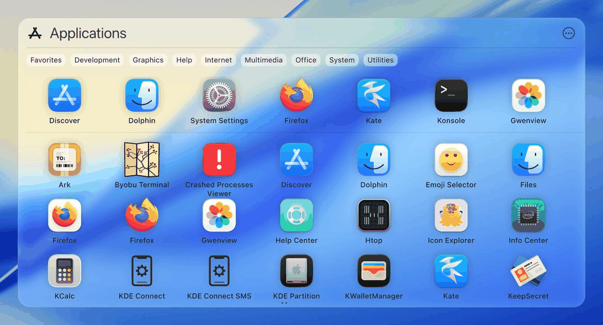
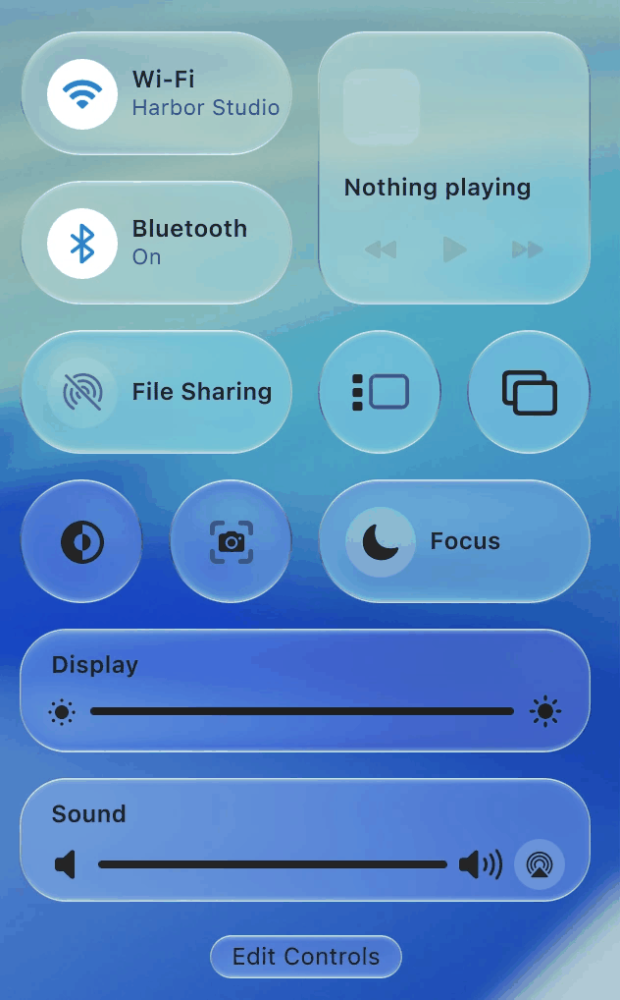
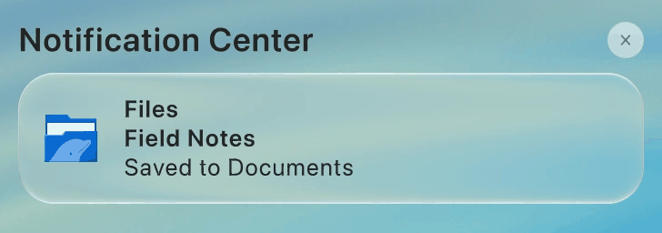
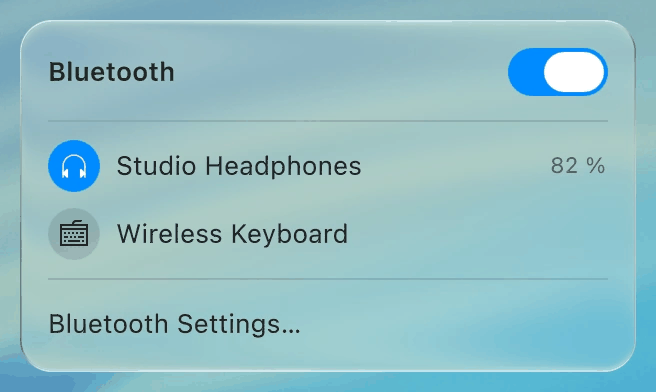
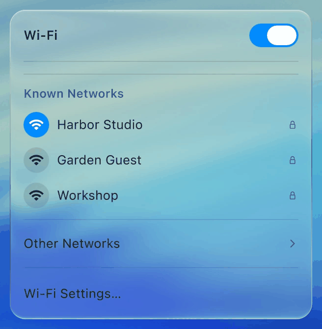
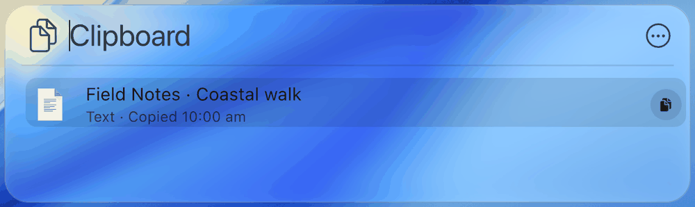
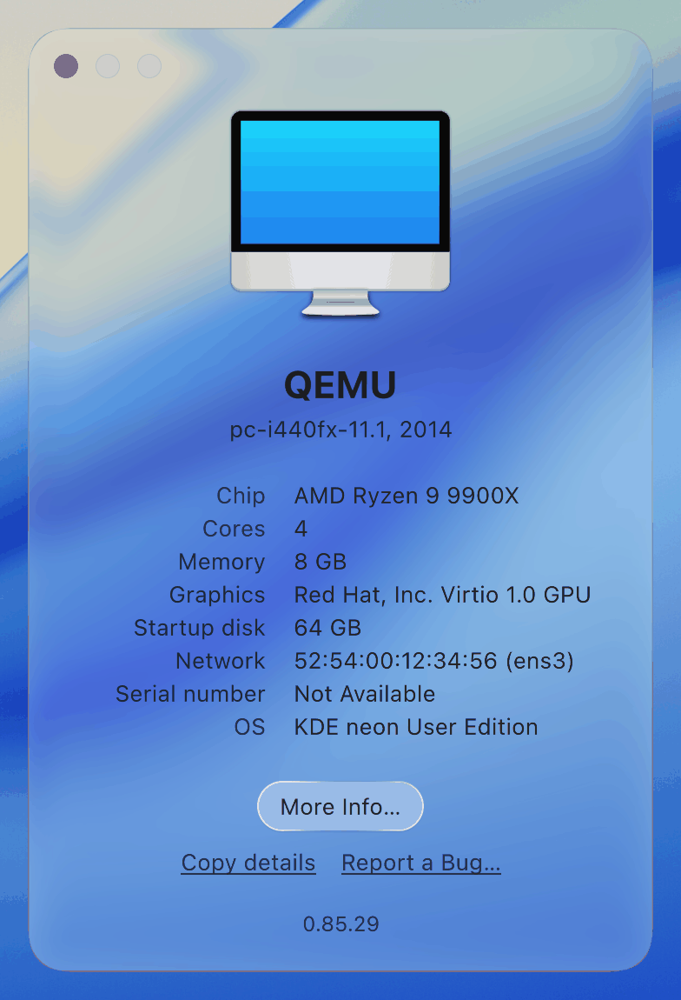

<p align="center">
  <!-- Adapted with ImageGen from artwork by Apple: https://developer.apple.com/assets/elements/icons/macos-26/macos-26-128x128_2x.png. Tux design by Larry Ewing. -->
  
</p>

<h1 align="center">macOS Tahoe Shell for KDE Linux</h1>

<p align="center">
  <a href="README.md" lang="en" hreflang="en">🇺🇸 English</a> ·
  <a href="README.es.md" lang="es" hreflang="es">🇪🇸 Español</a> ·
  <a href="README.zh-CN.md" lang="zh-CN" hreflang="zh-CN">🇨🇳 简体中文</a> ·
  <a href="README.pt-BR.md" lang="pt-BR" hreflang="pt-BR">🇧🇷 Português (Brasil)</a> ·
  <a href="README.de.md" lang="de" hreflang="de">🇩🇪 Deutsch</a> ·
  <a href="README.fr.md" lang="fr" hreflang="fr">🇫🇷 Français</a> ·
  <a href="README.it.md" lang="it" hreflang="it">🇮🇹 Italiano</a> ·
  <a href="README.ja.md" lang="ja" hreflang="ja">🇯🇵 日本語</a> ·
  <a href="README.ko.md" lang="ko" hreflang="ko">🇰🇷 한국어</a> ·
  <a href="README.ru.md" lang="ru" hreflang="ru">🇷🇺 Русский</a> ·
  <a href="README.ar.md" lang="ar" hreflang="ar">🇸🇦 العربية</a> ·
  <a href="README.hi.md" lang="hi" hreflang="hi" aria-current="page">🇮🇳 हिन्दी</a> ·
  <a href="README.nl.md" lang="nl" hreflang="nl">🇳🇱 Nederlands</a> ·
  <a href="README.pl.md" lang="pl" hreflang="pl">🇵🇱 Polski</a> ·
  <a href="README.tr.md" lang="tr" hreflang="tr">🇹🇷 Türkçe</a>
</p>

<p align="center">
  <a href="https://github.com/lestercorderomurillo/macos-tahoe-liquid-kde/releases"></a>
  <a href="https://github.com/lestercorderomurillo/macos-tahoe-liquid-kde/actions/workflows/test.yml"></a>
  <a href="https://kde.org/plasma-desktop/"></a>
  <a href="LICENSE"></a>
  <a href="https://github.com/lestercorderomurillo/macos-tahoe-liquid-kde/issues/new"></a>
</p>


<p align="center">
  <sub>परीक्षण की स्थिति देखने के लिए एक डिस्ट्रो का चयन करें।</sub>
</p>

<p align="center">
  <a href="tests/vm/PROOF.md#cachyos" title="CachyOS"></a>
  <a href="tests/vm/PROOF.md#arch" title="Arch Linux"></a>
  <a href="tests/vm/PROOF.md#endeavouros" title="EndeavourOS"></a>
  <a href="tests/vm/PROOF.md#fedora" title="Fedora"></a>
  <a href="tests/vm/PROOF.md#manjaro" title="Manjaro"></a>
  <a href="tests/vm/PROOF.md#artix" title="Artix Linux (OpenRC)"></a>
  <a href="tests/vm/PROOF.md#garuda" title="Garuda Linux"></a>
  <a href="tests/vm/PROOF.md#nobara" title="Nobara Linux"></a>
  <a href="tests/vm/PROOF.md#opensuse" title="openSUSE Tumbleweed"></a>
  <a href="tests/vm/PROOF.md#neon" title="KDE neon"></a>
  <a href="tests/vm/PROOF.md#debian" title="Debian testing / sid (Plasma 6.6+)"></a>
  <a href="tests/vm/PROOF.md#nixos" title="NixOS (experimental)"></a>
</p>

यह परियोजना लिनक्स पर आपके KDE डेस्कटॉप के रूप और महसूस को अनुकूलित करती है। इसमें एप्पल सेवाओं को शामिल नहीं किया गया है और न ही उनसे जुड़ना पड़ा है। अगर आपको एप्पल की सेवाओं की जरूरत है, [सीधे Apple के साथ दुकान](https://www.apple.com/store).

> [!CAUTION]
> **रोलिंग रिलीज़ नीति**
> प्रयोगात्मक। दैनिक अपडेट प्राप्त करता है। अद्यतन संगतता को तोड़ सकते हैं। उत्पादन प्रणालियों से बचना; [यहाँ समस्या की रिपोर्ट करें](https://github.com/lestercorderomurillo/macos-tahoe-liquid-kde/issues/new).

> [!NOTE]
> 0.8x श्रृंखला के लिए सुविधा फ्रीज प्रभावी है, जिसमें 0.90 तक बग फिक्स पर केंद्रित रिलीज़ हैं।

> [!WARNING]
> **पेवॉल रिपैकर से सावधान रहेंः यह थीम मुफ्त है।**
>
> यदि आपको यह विषय किसी तृतीय-पक्ष चैनल के माध्यम से मिला है, तो आपको इसे प्राप्त करने के लिए भुगतान करने की आवश्यकता नहीं हैः इसे सीधे इस रिपॉजिटरी से डाउनलोड करें। हम इस परियोजना को मुफ्त में रखते हैं ताकि हर कोई इसे बिना भुगतान के आनंद ले सके। कोई खरीद या सदस्यता की आवश्यकता नहीं है।

<br>


बग रिपोर्ट, सुधार, परीक्षण और प्रलेखनः देखें [योगदान गाइड](CONTRIBUTING.md).

ताहो और गोल्डन गेट के कोड योगदानकर्ताओं और रिपोर्टरों को जारी करनाः

<p>
  <a href="https://github.com/lestercorderomurillo"></a>
  <a href="https://github.com/yanhenrique-dev"></a>
  <a href="https://github.com/naevui"></a>
  <a href="https://github.com/caioniehues"></a>
  <a href="https://github.com/404-not-found129"></a>
  <a href="https://github.com/myakupozluk"></a>
  <a href="https://github.com/EMS1998"></a>
  <a href="https://github.com/allfritz"></a>
  <a href="https://github.com/elegos"></a>
  <a href="https://github.com/kozeki-uii"></a>
  <a href="https://github.com/imightbelosthere"></a>
  <a href="https://github.com/evaildev"></a>
  <a href="https://github.com/xarblu"></a>
  <a href="https://github.com/PKMNPlatin"></a>
  <a href="https://github.com/matinlotfali"></a>
  <a href="https://github.com/luisbocanegra"></a>
  <a href="https://github.com/OliverChase2003"></a>
  <a href="https://github.com/RoxasYTB"></a>
  <a href="https://github.com/Flagwill"></a>
  <a href="https://github.com/4l3j0Ok"></a>
  <a href="https://github.com/0xrushi"></a>
  <a href="https://github.com/aenriii"></a>
  <a href="https://github.com/andreas399"></a>
  <a href="https://github.com/Andrew-Sor"></a>
  <a href="https://github.com/ardashir77"></a>
  <a href="https://github.com/azizaktas"></a>
  <a href="https://github.com/binary-pleb"></a>
  <a href="https://github.com/bneils"></a>
  <a href="https://github.com/FAYZER77"></a>
  <a href="https://github.com/fxrncyyisingithub"></a>
  <a href="https://github.com/germanbagutteorsomething"></a>
  <a href="https://github.com/iNarrow12"></a>
  <a href="https://github.com/IsaiahSHanson"></a>
  <a href="https://github.com/kuau"></a>
  <a href="https://github.com/Lando0007"></a>
  <a href="https://github.com/LilT59"></a>
  <a href="https://github.com/marcosfantonio"></a>
  <a href="https://github.com/moulikanand12345-lang"></a>
  <a href="https://github.com/nanechi"></a>
  <a href="https://github.com/nousernameget"></a>
  <a href="https://github.com/OpalSand"></a>
  <a href="https://github.com/P0sixSplo1t-2"></a>
  <a href="https://github.com/rokan00"></a>
  <a href="https://github.com/RussH"></a>
  <a href="https://github.com/Salkio"></a>
  <a href="https://github.com/Shivamingale3"></a>
  <a href="https://github.com/shoko3756"></a>
  <a href="https://github.com/Sonicx9876"></a>
  <a href="https://github.com/Tias-dev"></a>
  <a href="https://github.com/txhammer68"></a>
  <a href="https://github.com/vanshdev0101"></a>
  <a href="https://github.com/vialolis"></a>
  <a href="https://github.com/Whiddu"></a>
  <a href="https://github.com/yingmanwumen"></a>
  <a href="https://github.com/yofriendfromschool1"></a>
  <a href="https://github.com/zhaokelei"></a>
  <a href="https://github.com/blaykelarue"></a>
  <a href="https://github.com/JacobJS34"></a>
  <a href="https://github.com/Leon-Swains"></a>
  <a href="https://github.com/LucipurrsDad"></a>
  <a href="https://github.com/SinglerGold2"></a>
  <a href="https://github.com/CiderGuru"></a>
  <a href="https://github.com/soumyadeep70"></a>
</p>

<br>


### बहुरंगी डॉक

Dock के आइकन का रंग अपने डेस्कटॉप से मिलाएँ।

<p align="center">
  
</p>

<br>

### Quickbar

ऊपरी पट्टी से सक्रिय ऐप के मेन्यू खोलें।

<p align="center">
  
</p>

<br>

### Launchpad

नाम से खोजने, कोई पसंदीदा ऐप खोलने या श्रेणियों को ग्रिड या सूची में देखने के लिए Dock से Apps खोलें।

<p align="center">
  
</p>

<br>

### नियंत्रण केंद्र

एक ही मेन्यू से वाई-फ़ाई, आवाज़ और चमक नियंत्रित करें।

<p align="center">
  
</p>

<br>

### सूचनाएं

हाल की सूचनाएँ ऐप के अनुसार समूहों में देखें।

<p align="center">
  
</p>

<br>

### Finder

Finder जैसी विंडो में अपनी फ़ाइलें देखें।

<p align="center">
  <a href="src/screenshots/previews/tahoe-finder-light-dark-21d755ca3c50.gif"></a>
</p>

<br>

### कैलेंडर

महीने का कैलेंडर देखने के लिए घड़ी खोलें।

<p align="center">
  
</p>

<br>

### Bluetooth

पेयर किए गए डिवाइस जोड़ें और उनकी बैटरी का स्तर देखें।

<p align="center">
  
</p>

### Wi-Fi

उपलब्ध नेटवर्क और कनेक्शन की स्थिति देखें।

<p align="center">
  
</p>

<br>

### बैटरी

बैटरी का स्तर और चार्जिंग की स्थिति जाँचें।

<p align="center">
  
</p>

<br>

### क्लिपबोर्ड इतिहास

पहले कॉपी किए गए टेक्स्ट और चित्रों का फिर से उपयोग करें।

<p align="center">
  
</p>

<br>

### सिस्टम सूचना

हार्डवेयर, सॉफ़्टवेयर और थीम का विवरण देखें।

<p align="center">
  
</p>

<br>

### Plasma थीम

मेन्यू और पॉप-अप चुनी हुई लाइट या डार्क थीम अपनाते हैं।

<p align="center">
  
</p>

<br>

### बूट स्क्रीन

सिस्टम शुरू होने पर थीम से मेल खाती स्क्रीन दिखती है।

<p align="center">
  
</p>

<br>

### अनुकूली कंट्रास्ट

पृष्ठभूमि के अनुसार अक्षरों का रंग बदलता है ताकि लेबल पढ़ने में आसान रहें।

<p align="center">
  
</p>

<br>


- **उपस्थिति:** डेस्कटॉप, ऐप्स, आइकन और विंडो सजावट के लिए समन्वयित प्रकाश और अंधेरे विषयों, स्वचालित स्विचिंग और प्रति मॉनिटर वॉलपेपर के साथ। [एप्लिकेशन विशिष्ट विंडो सजावट सेटिंग्स](docs/app-window-decorations.md)
- **ग्लास प्रभावः** समायोज्य धुंधलापन, प्रक्षेप और रंग, पाठ के साथ जो समर्थित मेनू में पृष्ठभूमि के अनुकूल है।
- **डॉक:** पिन किए गए ऐप्स, होवर ज़ूम, अधिसूचना बैज और कॉन्फ़िगर करने योग्य छिपाने। डॉक प्रदर्शनों के बीच आपका अनुसरण करता है।
- **मेनू बार और नियंत्रण केंद्रः** वैश्विक ऐप मेनू और त्वरित सिस्टम नियंत्रण, डिस्प्ले पर साझा मेनू बार सेटिंग्स के साथ।
- **प्रक्षेपण पैड:** ऐप्स खोजें, श्रेणियों को ब्राउज़ करें और पसंदीदा सहेजें।
- **डेस्कटॉप विजेटः** अपने डेस्कटॉप पर बंडल किए गए Liquid Glass विजेट जोड़ें और व्यवस्थित करें।
- **सूचनाएंः** ग्लास बैनर और समूहबद्ध इतिहास, त्वरित क्रियाओं और जवाबों के साथ जहां ऐप्स उन्हें समर्थन करते हैं।
- **क्लिपबोर्ड इतिहासः** कॉपी किए गए पाठ और छवियों को ढूंढें और उनका पुनः उपयोग करें, और उन वस्तुओं को पिन करें जिन्हें आप रखना चाहते हैं।
- **एप्लिकेशन इंटीग्रेशनः** Nautilus में खोजकर्ता शैली ब्राउज़िंग, GTK मेनू एकीकरण और प्रोफ़ाइल बैकअप के साथ फ़ायरफ़ॉक्स थीम।
- **सिस्टम की जानकारी और प्रारंभः** एक थीम प्रणाली सूचना विंडो और एक वैकल्पिक मिलान बूट स्प्लैश।
- **सेटअप और रिकवरीः** एक ग्राफिकल इंस्टॉलर जिसमें बंडल थीम संपत्ति, अपडेट और सेटिंग्स बैकअप हैं जिन्हें अनइंस्टॉल करने पर बहाल किया जा सकता है।
- **भाषाएँः** सेटिंग्स में इंस्टॉलर भाषा चुनें. प्लाज्मा विजेट डेस्कटॉप भाषा का अनुसरण करते हैं।
- **संगतताः** आर्च और फेडोरा आधारित प्रणालियों, ओपनस्यूज़, डेबियन और केडीई नियोन पर प्लाज्मा 6.6 ⁇ 6.8।
- **वैकल्पिक विशेषताएंः** ओएलईडी पैनल संरक्षण और प्रयोगात्मक NixOS और होम मैनेजर समर्थन।

<br>


**अपने पीसी पर इंस्टॉलर चलाने से पहले उसे उसी वितरण और Plasma संस्करण वाली वर्चुअल मशीन में जाँचें।**

```bash
git clone --filter=blob:none https://github.com/lestercorderomurillo/macos-tahoe-liquid-kde.git
cd macos-tahoe-liquid-kde
./installer
```

स्थापित करने के लिए **Express** चुनें। अपडेट करने या हटाने के लिए `./installer` फिर से चलाएँ।

Git की कार्यशील प्रति और अपने स्थानीय बदलाव सुरक्षित रखते हुए डिस्क स्थान खाली करने के लिए:

```bash
./installer --free-space
```

| इंस्टॉलर भाषा | स्थिति |
| --- | --- |
| 🇺🇸 English |  |
| 🇪🇸 Español |  |
| 🇨🇳 简体中文 |  |
| 🇧🇷 Português (Brasil) |  |
| 🇩🇪 Deutsch |  |
| 🇫🇷 Français |  |
| 🇮🇹 Italiano |  |
| 🇷🇺 Русский |  |
| 🇯🇵 日本語 |  |
| 🇰🇷 한국어 |  |
| 🇸🇦 العربية |  |
| 🇮🇳 हिन्दी |  |
| 🇳🇱 Nederlands |  |
| 🇵🇱 Polski |  |
| 🇹🇷 Türkçe |  |

<details>
<summary><b>आवश्यकताएँ</b></summary>

आवश्यक डेस्कटॉप, निर्माण उपकरण और सिस्टम पैकेज।

- KDE Plasma 6.6+
- पायथन 3.10+ और PyQt6
- `sudo`
- Qt 6 विकास उपकरण
- कम्पाइल किए गए प्लाज्माइड्स और KWin प्रभावों के लिए KDE और Qt 6 विकास पैकेज
- `cmake`, `g++`और `pkg-config` जब संकलित सुविधाओं को चुना जाता है
- `dbus-send`
- `systemctl` या `crontab` अनुसूचित सुविधाओं के लिए

**dinit:** इंस्टॉलर डिनेट का पता लगाता है और स्वचालित प्रकाश/अंधेरा स्विचिंग और ओएलईडी देखभाल के लिए प्रति उपयोगकर्ता क्रॉन प्रविष्टियों का उपयोग करता है। एक चल रही cron डेमोन की आवश्यकता है स्थापित करना `crontab` अकेले इसे शुरू नहीं करता है। Artix/dinit पर इसे तैयार करेंः

```bash
sudo pacman -S --needed cronie cronie-dinit
sudo dinitctl --system enable cronie
```

लॉग इन करते समय 06:00 और 18:00 पर स्वचालित स्विच चलते हैं क्रोन बैकेंड में लॉगिन समय की कोई पकड़ नहीं है। मैन्युअल प्रकाश/अंधेरा स्विचिंग क्रॉन से स्वतंत्र रूप से काम करता है. मौजूदा आर्टिक्स स्क्रीनशॉट ओपनआरसी को कवर करते हैं।

संपत्ति बंडल की गई है। अनुपस्थित निर्भरताएं और वैकल्पिक KDE गोल कोनों के लिए इंटरनेट एक्सेस की आवश्यकता होती है। सत्यापित गोल कोनों अपडेट पुराने डाउनलोड किए गए स्रोतों और अभिलेखागार को हटा देता है। पुनर्स्थापना प्रबंधित संपत्ति के स्थानों को प्रतिस्थापित करती है सफल प्रतियां अपने अस्थायी डेटा को हटाने, और बाद में प्रतियां साफ बाधित disposable स्टेजिंग। पुनर्प्राप्ति बैकअप, ब्राउज़र प्रोफ़ाइल बैकअप और उपयोगकर्ता वरीयताओं को बनाए रखा जाता है। डेवलपर वीएम चित्र और कैप्चर बंडल इंस्टॉलर कैश नहीं हैं और कभी भी स्वचालित रूप से हटाए नहीं जाते हैं।

| डिस्ट्रो | Qt 6 उपकरण | KDE प्लाज्मा 6 विकास पैकेज |
|--------|------------|-----------------------------------|
| आर्क परिवार | `pacman -S qt6-tools` | `pacman -S extra-cmake-modules plasma-workspace kdecoration libplasma libnotificationmanager libksysguard plasma-activities-stats` |
| फेडोरा परिवार | `dnf install qt6-qttools-devel` | `dnf install extra-cmake-modules plasma-workspace-devel kdecoration-devel libplasma-devel knotifications-devel libksysguard-devel kf6-plasma-activities-devel` |
| openSUSE Tumbleweed | `zypper install qt6-tools-devel` | `zypper install extra-cmake-modules plasma6-workspace-devel kdecoration-devel libKF6Plasma-devel libnotificationmanager6-devel libksysguard6-devel libKF6PlasmaActivitiesStats6-devel` |

Fedora पर, इंस्टॉलर Fedora  ⁇ s GTK 3 वैश्विक मेनू निर्यातक स्थापित करता है, `unity-gtk3-module`, और GTK 3 अनुप्रयोगों के लिए लॉगिन पर लोड करता है.

</details>

<details>
<summary><b>ओएलईडी देखभाल</b></summary>

वैकल्पिक पैनल शिफ्ट डिफ़ॉल्ट रूप से अक्षम।

इसे सक्रिय करें **ओएलईडी सुरक्षा** पृष्ठ। शिफ्ट अंतराल और वहाँ अधिकतम पिक्सेल विस्थापन चुनें यह डिफ़ॉल्ट रूप से अक्षम है।

**मैनुअल नियंत्रण**

```bash
mac-tahoe-oled-care shift
mac-tahoe-oled-care restore
mac-tahoe-oled-care status
```

</details>

<br>


अपने वितरण, init प्रणाली और प्लाज्मा संस्करण के लिए समर्थन की जाँच करें।

<details>
<summary><b>डिस्ट्रो परीक्षण</b></summary>

एक अलग प्लाज्मा डेस्कटॉप में विषय का प्रयास करें।

```bash
./vm <os>
```

**OS:** `cachyos` · `arch` · `manjaro` · `endeavouros` · `garuda` · `fedora` · `nobara` · `opensuse` · `neon` · `debian` · `artix` · `kubuntu`

`all` प्रत्येक डिस्ट्रीब्यूशन लॉन्च करता है। क्लाउड लक्षित प्रावधान स्वचालित रूप से अन्य लक्ष्य अपने चेकसम पेन किए गए आधिकारिक आईएसओ इंस्टॉलर का उपयोग करते हैं। का पालन करें [वीएम सेटअप और योग्यता गाइड](tests/vm/README.md).

`./vm kubuntu` आधिकारिक कुबंटू 26.04.1 LTS आईएसओ को SHA-256 सत्यापन (SSH पोर्ट) के साथ बूट करता है `2234` अतिथि सेटअप के बाद) । इस नए लांचर रिग्रेशन लक्ष्य पूर्ण लाइव योग्यता का इंतजार कर रहा है।

`./vm debian` आधिकारिक डेबियन परीक्षण (फोर्की) क्लाउड छवि का उपयोग करता है, अपने SHA-512 चेकसम को सत्यापित करता है, और एक प्लाज्मा डेस्कटॉप प्रदान करता है। लॉग इन करें `tester` पासवर्ड के साथ `tester`(स) SSH पर उपलब्ध है `127.0.0.1:2232`. . इंस्टॉलर एक लिखित अतिथि प्रतिलिपि से खुलता है `/home/tester/macos-tahoe-liquid-kde`(स) मेजबान रिपॉजिटरी केवल पढ़ने के लिए स्थापित है। उपयोग `./vm debian --clean` एक बार में पाहुन को खरोंच से पुनर्निर्माण करने के लिए।

इस तालिका में सभी 11 वितरणों ने लाइव वीएम योग्यता उत्तीर्ण की। समीक्षा किए गए स्क्रीनशॉट और परीक्षण परिणामों के लिए एक स्थिति बैज चुनें।

| | नाम | स्थिति |
|:--:|------|---------|
|  | CachyOS | [](tests/vm/PROOF.md#cachyos) |
|  | Arch Linux | [](tests/vm/PROOF.md#arch) |
|  | EndeavourOS | [](tests/vm/PROOF.md#endeavouros) |
|  | Fedora | [](tests/vm/PROOF.md#fedora) |
|  | Manjaro | [](tests/vm/PROOF.md#manjaro) |
|  | Artix Linux (OpenRC) | [](tests/vm/PROOF.md#artix) |
|  | Garuda Linux | [](tests/vm/PROOF.md#garuda) |
|  | Nobara | [](tests/vm/PROOF.md#nobara) |
|  | openSUSE Tumbleweed | [](tests/vm/PROOF.md#opensuse) |
|  | KDE neon | [](tests/vm/PROOF.md#neon) |
|  | डेबियन परीक्षण / सिड (प्लाज्मा 6.6+) | [](tests/vm/PROOF.md#debian) |

**निक्सोस और होम मैनेजर (परीक्षण)**

फ्लेक मॉड्यूल का उपयोग करें, **ग्राफिक इंस्टॉलर नहीं**. . लाइव डेस्कटॉप सत्यापन लंबित है।

**फ्लेक इनपुट** (निक्सपग्स और होम मैनेजर की आवश्यकता होती है):

```nix
inputs.mac-tahoe = {
  url = "github:lestercorderomurillo/macos-tahoe-liquid-kde/v0.55.2";
  inputs.nixpkgs.follows = "nixpkgs";
  inputs.home-manager.follows = "home-manager";
};
```

**NixOS:** आयात `inputs.mac-tahoe.nixosModules.default`.

```nix
services.desktopManager.plasma6.enable = true;
services.mac-tahoe.enable = true;
# services.mac-tahoe.plymouth.enable = true; # optional boot splash
```

**Home Manager:** आयात `inputs.mac-tahoe.homeManagerModules.default`.

```nix
programs.mac-tahoe = {
  enable = true;
  mode = "auto"; # or "light" / "dark"
  # appleAssets = true;
  # oledCare.enable = true;
};
```

**एप्पल की संपत्तिः** वैकल्पिक गैर-मुक्त फ़ॉन्ट, वॉलपेपर और ध्वनि। सक्षम करना `appleAssets` इसके अलावा यह आवश्यक हैः

```nix
nixpkgs.config.allowUnfreePredicate = pkg:
  builtins.elem (lib.getName pkg) [ "mac-tahoe-apple-assets" ];
```

**पैनल:** अपने स्वयं के प्लाज्मा-प्रबंधक मॉड्यूल का आयात भी करें और `inputs.mac-tahoe.homeManagerModules.plasma-manager`. . सक्षम करें `programs.mac-tahoe.panels.enable` और सेट `programs.mac-tahoe.panels.launchers`, उदाहरण के लिए `[ "applications:org.kde.dolphin.desktop" ]`. . यह मौजूदा पिन आयात किए बिना लेआउट की जगह लेता है।

**लिखना योग्य सेटिंग्सः** रखो `kdeglobals`, `kwinrc`, `plasmarc`, `plasmashellrc`, `kcminputrc`, `plasma-org.kde.plasma.desktop-appletsrc`, `Kvantum/kvantum.kvconfig` और जीटीके कॉन्फ़िगरेशन लाइव लिखने योग्य. थीम स्विच द्वारा प्रबंधित अपरिवर्तनीय प्लाज्मा प्रबंधक कुंजी से बचें।

सक्रियण के बाद लॉग आउट और वापस प्रवेश करें। फ़ायरफ़ॉक्स प्रोफाइल, GTK बुकमार्क और SDDM कॉन्फ़िगर नहीं किए गए हैं। होम मैनेजर में सेट `programs.mac-tahoe.gtkAppmenuModule` लॉगिन पर लोड करने के लिए स्थापित GTK 3 एप्लिकेशन मेनू मॉड्यूल लाइब्रेरी के पूर्ण पथ पर। OLED देखभाल को निष्क्रिय करने से पहले, चलाएं `mac-tahoe-oled-care restore`(स) मॉड्यूल को हटाने से पहले Breeze का चयन करें। हटाने से उपयोगकर्ता सेटिंग्स जगह पर छोड़ देता है।

</details>

<details>
<summary><b>आरंभिक प्रणाली</b></summary>

स्वचालित थीम स्विचिंग और OLED देखभाल निम्नलिखित शेड्यूलिंग बैकेंड का उपयोग करती हैः

| आरंभिक प्रणाली | अनुसूची | रिकॉर्ड किए गए परीक्षण |
| --- | --- | --- |
| systemd | उपयोगकर्ता टाइमर |  |
| OpenRC | प्रति उपयोगकर्ता क्रॉन |  |
| dinit | प्रति उपयोगकर्ता क्रॉन |   |

ओपनआरसी और डिनिट को चल रहे cron डेमोन की आवश्यकता होती है। [डेस्कटॉप परीक्षण परिणाम](tests/vm/PROOF.md) · [दिनित अनुसूची जांच](CONTRIBUTING.md#setup).

</details>

<details>
<summary><b>प्लाज्मा संस्करण</b></summary>

प्लाज्मा 6.6 ⁇ 6.8 समर्थित है संकलित प्रभाव मेजबान एसडीके का उपयोग करते हैं।

| Plasma | सहायता | जब से |
|--------|---------|-------|
| 6.5 और पुराने संस्करण |  | लागू नहीं |
| 6.6 |  | v0.1.0 |
| 6.7 |  | v0.19.0 |
| 6.8 |  | v0.54.1 |

</details>

<br>


यह macOS की डिज़ाइन से प्रेरित एक स्वतंत्र कार्यान्वयन है। इसका Apple या KDE से कोई संबंध नहीं है और न ही उन्होंने इसका समर्थन किया है। “macOS” और “Apple”, Apple Inc. के ट्रेडमार्क हैं।

macOS का चिह्न, शामिल वॉलपेपर, सिस्टम ध्वनियाँ और SF Pro तथा SF Mono फ़ॉन्ट Apple की संपत्ति हैं और इस परियोजना के लाइसेंस में शामिल नहीं हैं। अन्य घटकों के अपने लाइसेंस और कॉपीराइट नोटिस लागू रहते हैं। उनके दायरे और स्रोत संबंधी जानकारी में ज्ञात कमियों के लिए तृतीय-पक्ष नोटिस देखें।

पूरी परियोजना पर [GPL-3.0](LICENSE) लागू है। अलग-अलग घटकों के लाइसेंस और तृतीय पक्षों के अधिकार भी लागू रहते हैं। [कॉपीराइट नोटिस](NOTICE), [लाइसेंस और परियोजना की पहचान](LICENSING.md) और [तृतीय-पक्ष नोटिस](THIRD_PARTY_NOTICES.md) देखें।

<br>


<details>
<summary><b>परियोजनाएं, संपत्ति और प्रतिवेदन</b></summary>

परियोजना संदर्भ और तृतीय पक्ष घटकः

- **[EliverLara](https://github.com/EliverLara/TahoeLauncher)**: `TahoeLauncher`: लॉन्चपैड डिजाइन संदर्भ।
- **[vinceliuice](https://github.com/vinceliuice)**: `MacTahoe-icon-theme`: आधार आइकन और कर्सर जीटीके डिजाइन संदर्भ। [`MacTahoe-gtk-theme` फ़ायरफ़ॉक्स CSS/SVG](https://github.com/vinceliuice/MacTahoe-gtk-theme/tree/main/other/firefox) प्रोफ़ाइल बैकअप और पुनर्स्थापना समर्थन के साथ MIT लाइसेंस के रूप में यहां बनाए रखा गया है।
- **[taj-ny](https://github.com/taj-ny/kwin-effects-forceblur)** और **[4v3ngR](https://github.com/4v3ngR/kwin-effects-glass)**: बेटर ब्लर और इसके ग्लास फोर्कः अपस्ट्रीम कोड जो एक्रिलिक ग्लास द्वारा उपयोग किया जाता है (केडब्ल्यूइन ब्लर के लेखक स्रोत हेडर में क्रेडिट रहते हैं) ।
- **[luisbocanegra](https://github.com/luisbocanegra/plasma-panel-colorizer)**: `plasma-panel-colorizer` v7.3.0, ऑफ़लाइन बंडल और पैनलों को रंग देने के लिए लेआउट चरण द्वारा स्थापित (GPL-3.0, लाइसेंस के साथ शिप किया गया) ।
- **[jaxparrow07](https://github.com/jaxparrow07/liquidglass-kde-widgets)**: `liquidglass-kde-widgets` लिक्विड ग्लास डेस्कटॉप विजेट (जीपीएल-3.0 लाइसेंस सहित) का बंडल संग्रह प्रदान करता है।
- **[RoxasYTB](https://github.com/RoxasYTB)**: [फ़ोटो विजेट](https://github.com/jaxparrow07/liquidglass-kde-widgets/pull/41) डेस्कटॉप पर तस्वीरें प्रदर्शित करता है। [ठोस/ग्लास स्विच स्वचालित](https://github.com/jaxparrow07/liquidglass-kde-widgets/pull/40) स्क्रीन पर एक खिड़की खुली है जब विगेट्स को ग्लास पर स्विच करता है।
- **[मटिन लोटफलेई / KDE-राउंड-कोर्नर्स](https://github.com/matinlotfali/KDE-Rounded-Corners)**: GPL-3.0 KWin गोल खिड़की प्रभाव, pinned v0.9.0 रिलीज से प्राप्त और होस्ट KWin SDK (लिसेन्स के साथ स्थापित) के खिलाफ ऑनलाइन बनाया गया।
- **[ful1e5](https://github.com/ful1e5)**: `apple_cursor`: वैकल्पिक कर्सर डिजाइन संदर्भ।
- **[sahibjotsaggu](https://github.com/sahibjotsaggu)**: `San-Francisco-Pro-Fonts`: SF प्रो / SF मोनो बंडल का स्रोत।
- **[Lucide](https://github.com/lucide-icons/lucide)**: वैश्विक मेनू में बंडल किए गए आइकनों की प्रतिलिपि (ISC, © Lucide Contributors) ।
- **[512pixels.net](https://512pixels.net/projects/default-mac-wallpapers-in-5k/)**: उच्च संकल्प macOS वॉलपेपर संग्रह।

यदि कोई क्रेडिट गायब है, तो कृपया [एक इश्यू खोलें](https://github.com/lestercorderomurillo/macos-tahoe-liquid-kde/issues/new).

</details>


[इंस्टॉलर स्क्रीनशॉट और परीक्षण](TESTING.md).
