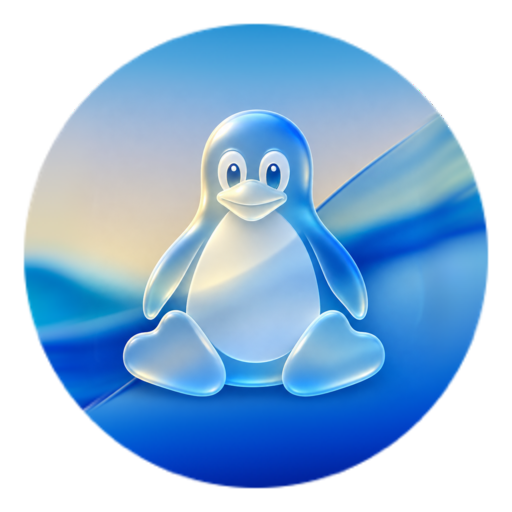
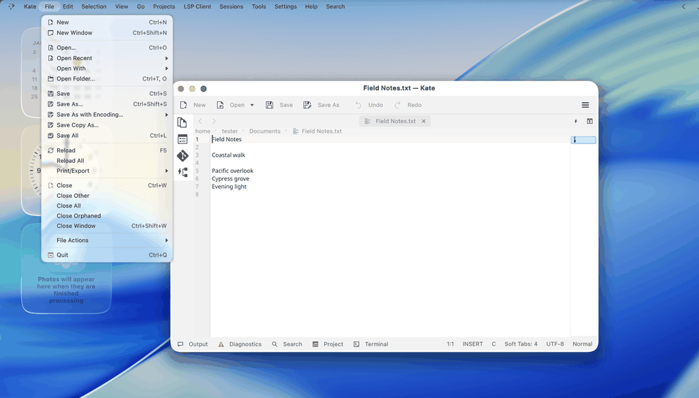
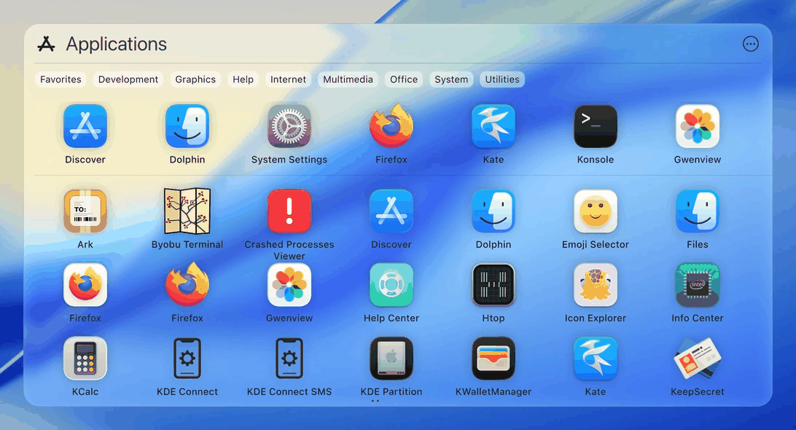
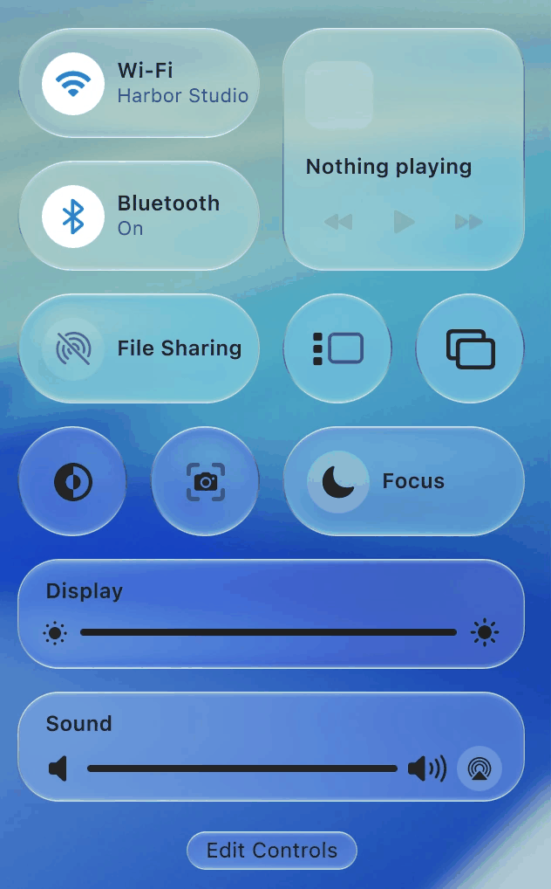
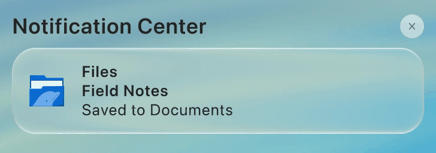
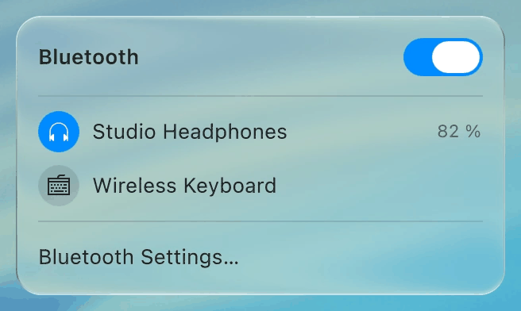
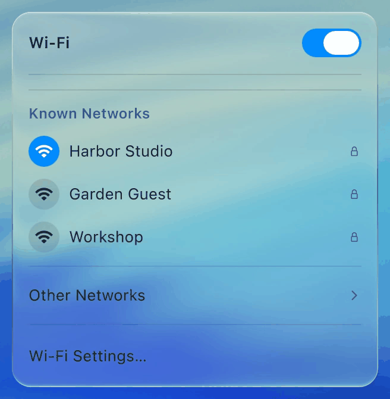
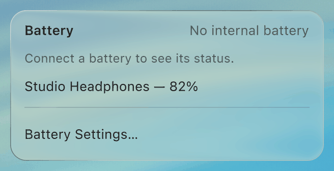
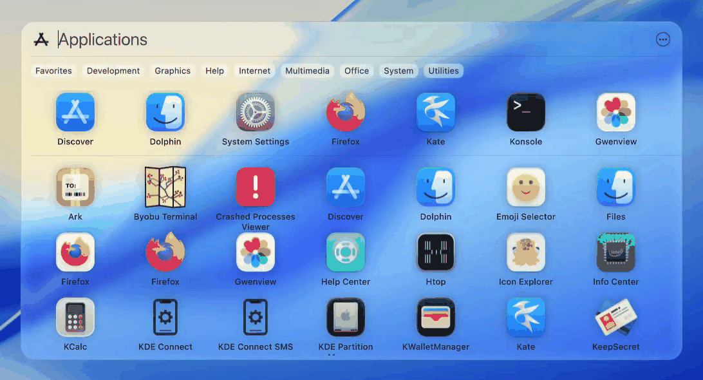
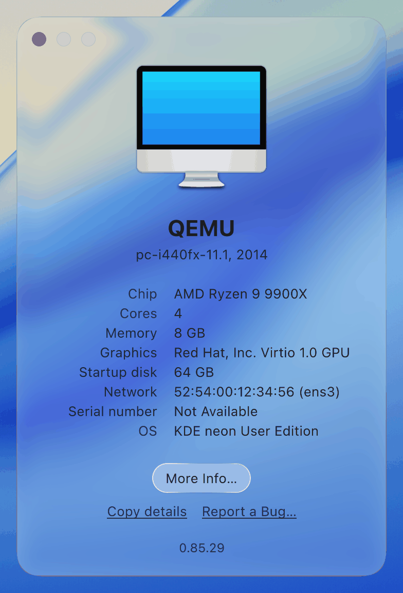

<p align="center">
  <!-- Adapted with ImageGen from artwork by Apple: https://developer.apple.com/assets/elements/icons/macos-26/macos-26-128x128_2x.png. Tux design by Larry Ewing. -->
  
</p>

<h1 align="center">macOS Tahoe Shell for KDE Linux</h1>

<p align="center">
  <a href="README.md" lang="en" hreflang="en">🇺🇸 English</a> ·
  <a href="README.es.md" lang="es" hreflang="es">🇪🇸 Español</a> ·
  <a href="README.zh-CN.md" lang="zh-CN" hreflang="zh-CN">🇨🇳 简体中文</a> ·
  <a href="README.pt-BR.md" lang="pt-BR" hreflang="pt-BR">🇧🇷 Português (Brasil)</a> ·
  <a href="README.de.md" lang="de" hreflang="de">🇩🇪 Deutsch</a> ·
  <a href="README.fr.md" lang="fr" hreflang="fr">🇫🇷 Français</a> ·
  <a href="README.it.md" lang="it" hreflang="it">🇮🇹 Italiano</a> ·
  <a href="README.ja.md" lang="ja" hreflang="ja" aria-current="page">🇯🇵 日本語</a> ·
  <a href="README.ko.md" lang="ko" hreflang="ko">🇰🇷 한국어</a> ·
  <a href="README.ru.md" lang="ru" hreflang="ru">🇷🇺 Русский</a> ·
  <a href="README.ar.md" lang="ar" hreflang="ar">🇸🇦 العربية</a> ·
  <a href="README.hi.md" lang="hi" hreflang="hi">🇮🇳 हिन्दी</a> ·
  <a href="README.nl.md" lang="nl" hreflang="nl">🇳🇱 Nederlands</a> ·
  <a href="README.pl.md" lang="pl" hreflang="pl">🇵🇱 Polski</a> ·
  <a href="README.tr.md" lang="tr" hreflang="tr">🇹🇷 Türkçe</a>
</p>

<p align="center">
  <a href="https://github.com/lestercorderomurillo/macos-tahoe-liquid-kde/releases"></a>
  <a href="https://github.com/lestercorderomurillo/macos-tahoe-liquid-kde/actions/workflows/test.yml"></a>
  <a href="https://kde.org/plasma-desktop/"></a>
  <a href="LICENSE"></a>
  <a href="https://github.com/lestercorderomurillo/macos-tahoe-liquid-kde/issues/new"></a>
</p>


<p align="center">
  <sub>テスト状態を表示するためにディストロを選択します.</sub>
</p>

<p align="center">
  <a href="tests/vm/PROOF.md#cachyos" title="CachyOS"></a>
  <a href="tests/vm/PROOF.md#arch" title="Arch Linux"></a>
  <a href="tests/vm/PROOF.md#endeavouros" title="EndeavourOS"></a>
  <a href="tests/vm/PROOF.md#fedora" title="Fedora"></a>
  <a href="tests/vm/PROOF.md#manjaro" title="Manjaro"></a>
  <a href="tests/vm/PROOF.md#artix" title="Artix Linux (OpenRC)"></a>
  <a href="tests/vm/PROOF.md#garuda" title="Garuda Linux"></a>
  <a href="tests/vm/PROOF.md#nobara" title="Nobara Linux"></a>
  <a href="tests/vm/PROOF.md#opensuse" title="openSUSE Tumbleweed"></a>
  <a href="tests/vm/PROOF.md#neon" title="KDE neon"></a>
  <a href="tests/vm/PROOF.md#debian" title="Debian testing / sid (Plasma 6.6+)"></a>
  <a href="tests/vm/PROOF.md#nixos" title="NixOS (experimental)"></a>
</p>

このプロジェクトは,Linuxで KDE デスクトップの外観と感覚をカスタマイズします. アップルのサービスには含まれていません. アップルのサービスを必要とするなら [アップルで直接買い物](https://www.apple.com/store).

> [!CAUTION]
> **ローリングリリースについて**
> 実験的な 日常の更新を受けています 更新は互換性を損なう可能性があります. 生産システムを避けること [こちらで不具合を報告](https://github.com/lestercorderomurillo/macos-tahoe-liquid-kde/issues/new).

> [!NOTE]
> 機能凍結は0.8xシリーズで有効で,バグ修正を0.90まで中心としたリリースがあります.

> [!WARNING]
> **壁のリパッキングに注意してください このテーマは無料です**
>
> このテーマを第三者のチャンネルで検索した場合は,購入費を支払わなく,このリポジトリから直接ダウンロードします. 私たちはこのプロジェクトを無料にして お金を払わずに 誰もが楽しめるようにしています 購入や購読は必要ありません.

<br>


虫の報告,修正,テストおよびドキュメント: [貢献ガイド](CONTRIBUTING.md).

タホーとゴールデンゲートで 代码提供者や 発行記者が

<p>
  <a href="https://github.com/lestercorderomurillo"></a>
  <a href="https://github.com/yanhenrique-dev"></a>
  <a href="https://github.com/naevui"></a>
  <a href="https://github.com/caioniehues"></a>
  <a href="https://github.com/404-not-found129"></a>
  <a href="https://github.com/myakupozluk"></a>
  <a href="https://github.com/EMS1998"></a>
  <a href="https://github.com/allfritz"></a>
  <a href="https://github.com/elegos"></a>
  <a href="https://github.com/kozeki-uii"></a>
  <a href="https://github.com/imightbelosthere"></a>
  <a href="https://github.com/evaildev"></a>
  <a href="https://github.com/xarblu"></a>
  <a href="https://github.com/PKMNPlatin"></a>
  <a href="https://github.com/matinlotfali"></a>
  <a href="https://github.com/luisbocanegra"></a>
  <a href="https://github.com/OliverChase2003"></a>
  <a href="https://github.com/RoxasYTB"></a>
  <a href="https://github.com/Flagwill"></a>
  <a href="https://github.com/4l3j0Ok"></a>
  <a href="https://github.com/0xrushi"></a>
  <a href="https://github.com/aenriii"></a>
  <a href="https://github.com/andreas399"></a>
  <a href="https://github.com/Andrew-Sor"></a>
  <a href="https://github.com/ardashir77"></a>
  <a href="https://github.com/azizaktas"></a>
  <a href="https://github.com/binary-pleb"></a>
  <a href="https://github.com/bneils"></a>
  <a href="https://github.com/FAYZER77"></a>
  <a href="https://github.com/fxrncyyisingithub"></a>
  <a href="https://github.com/germanbagutteorsomething"></a>
  <a href="https://github.com/iNarrow12"></a>
  <a href="https://github.com/IsaiahSHanson"></a>
  <a href="https://github.com/kuau"></a>
  <a href="https://github.com/Lando0007"></a>
  <a href="https://github.com/LilT59"></a>
  <a href="https://github.com/marcosfantonio"></a>
  <a href="https://github.com/moulikanand12345-lang"></a>
  <a href="https://github.com/nanechi"></a>
  <a href="https://github.com/nousernameget"></a>
  <a href="https://github.com/OpalSand"></a>
  <a href="https://github.com/P0sixSplo1t-2"></a>
  <a href="https://github.com/rokan00"></a>
  <a href="https://github.com/RussH"></a>
  <a href="https://github.com/Salkio"></a>
  <a href="https://github.com/Shivamingale3"></a>
  <a href="https://github.com/shoko3756"></a>
  <a href="https://github.com/Sonicx9876"></a>
  <a href="https://github.com/Tias-dev"></a>
  <a href="https://github.com/txhammer68"></a>
  <a href="https://github.com/vanshdev0101"></a>
  <a href="https://github.com/vialolis"></a>
  <a href="https://github.com/Whiddu"></a>
  <a href="https://github.com/yingmanwumen"></a>
  <a href="https://github.com/yofriendfromschool1"></a>
  <a href="https://github.com/zhaokelei"></a>
  <a href="https://github.com/blaykelarue"></a>
  <a href="https://github.com/JacobJS34"></a>
  <a href="https://github.com/Leon-Swains"></a>
  <a href="https://github.com/LucipurrsDad"></a>
  <a href="https://github.com/SinglerGold2"></a>
  <a href="https://github.com/CiderGuru"></a>
  <a href="https://github.com/soumyadeep70"></a>
</p>

<br>


### マルチカラードック

Dock のアイコンをデスクトップに合う色に変更できます。

<p align="center">
  
</p>

<br>

### Quickbar

上部のバーから使用中のアプリのメニューを開けます。

<p align="center">
  
</p>

<br>

### Launchpad

Dock から「Apps」を開くと、名前で検索したり、お気に入りのアプリを起動したり、カテゴリをグリッドやリストで表示したりできます。

<p align="center">
  
</p>

<br>

### 制御センター

Wi-Fi、音量、明るさをひとつのメニューで調整できます。

<p align="center">
  
</p>

<br>

### 通知

最近の通知をアプリごとにまとめて確認できます。

<p align="center">
  
</p>

<br>

### Finder

Finder 風のウィンドウでファイルを閲覧できます。

<p align="center">
  <a href="src/screenshots/previews/tahoe-finder-light-dark-21d755ca3c50.gif"></a>
</p>

<br>

### カレンダー

時計を開くと月間カレンダーが表示されます。

<p align="center">
  
</p>

<br>

### Bluetooth

ペアリング済みの機器を接続し、電池残量を確認できます。

<p align="center">
  
</p>

### Wi-Fi

利用可能なネットワークと接続状態を確認できます。

<p align="center">
  
</p>

<br>

### バッテリー

バッテリー残量と充電状態を確認できます。

<p align="center">
  
</p>

<br>

### クリップボード履歴

同じメニューでアプリからクリップボードに切り替え、コピーしたテキストや画像を探して再利用できます。

<p align="center">
  
</p>

<br>

### システム情報

ハードウェア、ソフトウェア、テーマの詳細を確認できます。

<p align="center">
  
</p>

<br>

### Plasma テーマ

メニューやポップアップはライトテーマとダークテーマに対応します。

<p align="center">
  
</p>

<br>

### 起動画面

起動時にテーマに合わせた画面が表示されます。

<p align="center">
  
</p>

<br>

### 適応コントラスト

背景に合わせて文字色が変わり、ラベルが読みやすくなります。

<p align="center">
  
</p>

<br>


- **顔:** デスクトップ,アプリ,アイコン,ウィンドウ装飾のための調整された光と暗いテーマ,自動切り替えとモニターごとに壁紙. [アプリの特定で窓飾り設定](docs/app-window-decorations.md)
- **ガラス効果:** 調整可能な模糊,折りたみ,色彩,サポートされたメニューの背景に適応するテキスト.
- **港湾:** ピンアップ,ホーバーズーム,通知バッジ,設定可能な隠蔽 ドックが君を追いかける
- **メニューバーとコントロールセンター:** グローバルアプリメニューとシステム制御が,ディスプレイに共有されたメニューバー設定で
- **打ち上げパッド:** アプリを検索し,カテゴリーを閲覧し,好きなものを保存します.
- **デスクトップウィジェット:** テーブルの上にLiquid Glass ウィジェットを追加して並べます.
- **通知:** グラスバナーとグループ化された履歴, アプリがサポートする瞬時に迅速なアクションと応答を表示します
- **クリップボードの歴史:** コピーされたテキストや画像を 見つけ,再利用し,保存したいアイテムをピンで押します
- **アプリの統合:** Nautilus でFinder スタイルのブラウジング,GTK メニュー統合,プロフィールバックアップ付きの Firefox テーマ.
- **システム情報と起動:** テーマシステム情報ウィンドウとオプションの対応ブートスプラッシュ
- **設定と復元:** ダウンロード時に復元できる,テーマ資産,更新および設定バックアップをまとめたグラフィックインストーラ.
- **言語:** 設定からインストーラ言語を選択します. プラズマウィジェットはデスクトップ言語に従います
- **互換性:** プラズマ 6.6 ⁇ 6.8は,アーチとフェドラベースのシステム, openSUSE, Debian, KDEのネオンで.
- **選択的機能:** OLEDパネル保護と実験的な NixOSとホームマネージャーのサポート

<br>


**お使いの PC でインストーラーを実行する前に、同じディストリビューションと Plasma バージョンの仮想マシンでテストしてください。**

```bash
git clone --filter=blob:none https://github.com/lestercorderomurillo/macos-tahoe-liquid-kde.git
cd macos-tahoe-liquid-kde
./installer
```

インストールするには **Express** を選択します。更新またはアンインストールするには `./installer` をもう一度開きます。

Git の作業コピーとローカルの変更を残したままディスク容量を解放するには、次を実行します。

```bash
./installer --free-space
```

| インストーラー言語 | 状態 |
| --- | --- |
| 🇺🇸 English |  |
| 🇪🇸 Español |  |
| 🇨🇳 简体中文 |  |
| 🇧🇷 Português (Brasil) |  |
| 🇩🇪 Deutsch |  |
| 🇫🇷 Français |  |
| 🇮🇹 Italiano |  |
| 🇷🇺 Русский |  |
| 🇯🇵 日本語 |  |
| 🇰🇷 한국어 |  |
| 🇸🇦 العربية |  |
| 🇮🇳 हिन्दी |  |
| 🇳🇱 Nederlands |  |
| 🇵🇱 Polski |  |
| 🇹🇷 Türkçe |  |

<details>
<summary><b>要求</b></summary>

デスクトップ,ツールやシステムパッケージを構築する必要性

- KDE Plasma 6.6+
- Python 3.10+と PyQt6
- `sudo`
- Qt 6 開発ツール
- 編成されたプラズモイドとKWin効果のための KDE と Qt 6 の開発パッケージ
- `cmake`, `g++`及び `pkg-config` 構成された機能が選択される時
- `dbus-send`
- `systemctl` 及び `crontab` 予定されている特色について

**dinit:** インストーラはdinitを検出し,自動ライト/ダークスイッチとOLEDケアのためにユーザーごとにクロンエントリを使用します. 実行するクロンデモンが必要です 設置 `crontab` 一人では始まらない Artix/dinit において,以下で準備する.

```bash
sudo pacman -S --needed cronie cronie-dinit
sudo dinitctl --system enable cronie
```

自動スイッチはログインしている間に 06:00と 18:00で動作します クロンのバックエンドはログイン時間追いつきがない. 手動のライト/ダークスイッチはクロンから独立して動作します 既存のArtixスクリーンショットは OpenRCをカバーしている.

資産は束縛されています 欠落する依存関係とオプションのKDEラウンドコーナーにはインターネットアクセスが必要です. Verified Rounded Corners の更新は,古いダウンロードされたソースとアーカイブを削除します. 再インストールにより管理された資産木が置き換えられる 失敗したコピーは一時的なデータを削除し,後にコピーは断片された使い捨てステージをクリーンにします. 復元バックアップ,ブラウザプロフィールバックアップ,ユーザー選択が保存されます. 開発者VMの画像とキャプチャバンドルはインストーラキャッシュではなく,自動的に削除されません.

| ダイストロ | Qt 6 道具 | KDE Plasma 6開発パッケージ |
|--------|------------|-----------------------------------|
| アーチ家族 | `pacman -S qt6-tools` | `pacman -S extra-cmake-modules plasma-workspace kdecoration libplasma libnotificationmanager libksysguard plasma-activities-stats` |
| フェドラ家族 | `dnf install qt6-qttools-devel` | `dnf install extra-cmake-modules plasma-workspace-devel kdecoration-devel libplasma-devel knotifications-devel libksysguard-devel kf6-plasma-activities-devel` |
| openSUSE Tumbleweed | `zypper install qt6-tools-devel` | `zypper install extra-cmake-modules plasma6-workspace-devel kdecoration-devel libKF6Plasma-devel libnotificationmanager6-devel libksysguard6-devel libKF6PlasmaActivitiesStats6-devel` |

Fedoraでは,インストールがFedora ⁇ s GTK 3のグローバルメニューエクスポートをインストールします. `unity-gtk3-module`GTK 3 アプリケーションのログイン時に読み込みます

</details>

<details>
<summary><b>OLEDケア</b></summary>

オプションパネルシフト デフォルトで無効です

オンに有効にする **OLED保護** ページ シフト間隔と最大ピクセル移動を選択します デフォルトで無効になっている.

**手動制御**

```bash
mac-tahoe-oled-care shift
mac-tahoe-oled-care restore
mac-tahoe-oled-care status
```

</details>

<br>


配送, initシステム,プラズマバージョンのサポートを確認します

<details>
<summary><b>ディストリビューションのテスト</b></summary>

プラズマのデスクトップで試してください

```bash
./vm <os>
```

**OS:** `cachyos` · `arch` · `manjaro` · `endeavouros` · `garuda` · `fedora` · `nobara` · `opensuse` · `neon` · `debian` · `artix` · `kubuntu`

`all` すべてのディストリビューションを起動します クラウドターゲットの自動提供 他の標的は,チェックサムに固定された公式のISOインストーラーを使用します. フォローする [VMの設定と資格ガイド](tests/vm/README.md).

`./vm kubuntu` 公式のKubuntu 26.04.1 LTS ISOを SHA-256 検証 (SSHポート) と起動する `2234` ゲストの設定後) この新しい発射機の回帰目標は 完全なライブ資格を待っています

`./vm debian` 公式の Debian テスト (Forky) クラウドイメージを使用し,SHA-512 チェックサムを確認し,Plasma デスクトップを用意します. ログインする `tester` パスワード `tester`について SSH は `127.0.0.1:2232`やってみよう インストーラが書き込み可能なゲストコピーから開きます `/home/tester/macos-tahoe-liquid-kde`について ホストリポジトリは読み込みのみに搭載されている. 使用 `./vm debian --clean` 捨て客をゼロから再構築する

この表の11つの配分は全て VM資格を通過した. レビューされたスクリーンショットとテスト結果のためのステータスバッジを選択します.

| | 名前 | 状態 |
|:--:|------|---------|
|  | CachyOS | [](tests/vm/PROOF.md#cachyos) |
|  | Arch Linux | [](tests/vm/PROOF.md#arch) |
|  | EndeavourOS | [](tests/vm/PROOF.md#endeavouros) |
|  | Fedora | [](tests/vm/PROOF.md#fedora) |
|  | Manjaro | [](tests/vm/PROOF.md#manjaro) |
|  | Artix Linux (OpenRC) | [](tests/vm/PROOF.md#artix) |
|  | Garuda Linux | [](tests/vm/PROOF.md#garuda) |
|  | Nobara | [](tests/vm/PROOF.md#nobara) |
|  | openSUSE Tumbleweed | [](tests/vm/PROOF.md#opensuse) |
|  | KDE neon | [](tests/vm/PROOF.md#neon) |
|  | デビアンテスト/sid (Plasma 6.6+) | [](tests/vm/PROOF.md#debian) |

**NixOSとホームマネージャー (テスト)**

フレークモジュールを使う **グラフィックインストーラではない**やってみよう ライブデスクトップの検証が待っています

**フレーク入力** (Nixpkgsとホームマネージャーを要求する):

```nix
inputs.mac-tahoe = {
  url = "github:lestercorderomurillo/macos-tahoe-liquid-kde/v0.55.2";
  inputs.nixpkgs.follows = "nixpkgs";
  inputs.home-manager.follows = "home-manager";
};
```

**NixOS:** 輸入 `inputs.mac-tahoe.nixosModules.default`.

```nix
services.desktopManager.plasma6.enable = true;
services.mac-tahoe.enable = true;
# services.mac-tahoe.plymouth.enable = true; # optional boot splash
```

**Home Manager:** 輸入 `inputs.mac-tahoe.homeManagerModules.default`.

```nix
programs.mac-tahoe = {
  enable = true;
  mode = "auto"; # or "light" / "dark"
  # appleAssets = true;
  # oledCare.enable = true;
};
```

**Appleの資産:** 選択的非自由なフォント,壁紙,音声 許可する `appleAssets` また,次のことを要求する.

```nix
nixpkgs.config.allowUnfreePredicate = pkg:
  builtins.elem (lib.getName pkg) [ "mac-tahoe-apple-assets" ];
```

**パネル:** また,自分のプラズマ管理モジュールを輸入し `inputs.mac-tahoe.homeManagerModules.plasma-manager`やってみよう 有効にする `programs.mac-tahoe.panels.enable` セット `programs.mac-tahoe.panels.launchers`⁇  ( ⁇ ) について `[ "applications:org.kde.dolphin.desktop" ]`やってみよう これは既存のピンを輸入せずにレイアウトを置き換える.

**書き込み可能の設定:** 保持する `kdeglobals`, `kwinrc`, `plasmarc`, `plasmashellrc`, `kcminputrc`, `plasma-org.kde.plasma.desktop-appletsrc`, `Kvantum/kvantum.kvconfig` GTKの設定を書き直すことができます テーマスイッチによって管理される不変なプラズマ管理鍵を避ける.

起動後 ログアウトして戻る Firefox プロフィール,GTKブックマーク,SDDMは設定されていません. Home Manager でセット `programs.mac-tahoe.gtkAppmenuModule` ログイン時にアップロードするには,インストールされた GTK 3 アプリメニューモジュールライブラリの完全なパスへ. OLEDケアを無効にする前に実行する `mac-tahoe-oled-care restore`について モジュールを取り除く前に,Breezeを選択してください. 削除すると,ユーザの設定が設定されます.

</details>

<details>
<summary><b>初期システム</b></summary>

自動テーマスイッチングとOLEDケアは,次のスケジュールバックエンドを使用します.

| 初期システム | 予定表 | 記録された試験 |
| --- | --- | --- |
| systemd | ユーザータイム |  |
| OpenRC | ユーザーごとにクロン |  |
| dinit | ユーザーごとにクロン |   |

OpenRCとdinitには実行可能なcronデモンが必要です [デスクトップテストの結果](tests/vm/PROOF.md) · [ダイニットスケジュール探査機](CONTRIBUTING.md#setup).

</details>

<details>
<summary><b>プラズマ版</b></summary>

プラズマ6.6 ⁇ 6.8がサポートされています ホストSDKを使用する.

| Plasma | 支援 | 経緯 |
|--------|---------|-------|
| 6.5 以前 |  | 適用されない |
| 6.6 |  | v0.1.0 |
| 6.7 |  | v0.19.0 |
| 6.8 |  | v0.54.1 |

</details>

<br>


本プロジェクトは macOS のデザインに着想を得た独立した再実装です。Apple および KDE との提携関係はなく、両者の推奨を受けたものでもありません。「macOS」と「Apple」は Apple Inc. の商標です。

macOS のエンブレム、同梱の壁紙、システムサウンド、SF Pro および SF Mono フォントは Apple の所有物であり、本プロジェクトのライセンスの対象外です。その他のコンポーネントには個別のライセンスと著作権表示が適用されます。対象範囲と出所が十分に確認されていない箇所については、第三者に関する表示を参照してください。

プロジェクト全体のライセンスは [GPL-3.0](LICENSE) です。個別のライセンスおよび第三者の権利も引き続き適用されます。[著作権表示](NOTICE)、[ライセンスとプロジェクトの名称](LICENSING.md)、[第三者に関する表示](THIRD_PARTY_NOTICES.md)を参照してください。

<br>


<details>
<summary><b>プロジェクト,資産及び承認</b></summary>

プロジェクト参照および第三者の構成要素:

- **[EliverLara](https://github.com/EliverLara/TahoeLauncher)**: `TahoeLauncher`: 打ち上げ台設計参照
- **[vinceliuice](https://github.com/vinceliuice)**: `MacTahoe-icon-theme`: ベースアイコンとカーサー GTKデザイン参照 [`MacTahoe-gtk-theme` Firefox CSS/SVG](https://github.com/vinceliuice/MacTahoe-gtk-theme/tree/main/other/firefox) ファイルバックアップと復元サポートを備えた MITライセンスフォークとして維持されています
- **[taj-ny](https://github.com/taj-ny/kwin-effects-forceblur)** 及び **[4v3ngR](https://github.com/4v3ngR/kwin-effects-glass)**: Better Blur and its glass fork: アクリルガラスによって使用される上流コード (KWin blurの著者はソースヘッダーでクレジットされます).
- **[luisbocanegra](https://github.com/luisbocanegra/plasma-panel-colorizer)**: `plasma-panel-colorizer` v7.3.0,オフラインでパッケージ化され,レイアウトステップで設置され,パネルを染める (GPL-3.0,ライセンス付属).
- **[jaxparrow07](https://github.com/jaxparrow07/liquidglass-kde-widgets)**: `liquidglass-kde-widgets` 液体グラスのデスクトップウィジェットのバンドコレクション (GPL-3.0ライセンスを含む) を提供しています.
- **[RoxasYTB](https://github.com/RoxasYTB)**: [写真ウィジェット](https://github.com/jaxparrow07/liquidglass-kde-widgets/pull/41) 画面に写真を表示します [自動固体/ガラス切り替え](https://github.com/jaxparrow07/liquidglass-kde-widgets/pull/40) 画面上の窓が開いているときに ウィジェットをグラスに切り替えます
- **[マティン・ロットファリー / KDE-ラウンドコーナー](https://github.com/matinlotfali/KDE-Rounded-Corners)**: GPL-3.0 KWin 丸窓効果,ピニングされた v0.9.0 リリースから取得され,ホスト KWin SDK (隣にインストールされているライセンス) にオンラインで構築されています.
- **[ful1e5](https://github.com/ful1e5)**: `apple_cursor`: カーソルの設計参照
- **[sahibjotsaggu](https://github.com/sahibjotsaggu)**: `San-Francisco-Pro-Fonts`: SF Pro/ SF Mono バンドルのソース
- **[Lucide](https://github.com/lucide-icons/lucide)**:グローバルメニューにまとめたコピーアイコン (ISC, © Lucide Contributors).
- **[512pixels.net](https://512pixels.net/projects/default-mac-wallpapers-in-5k/)**:高解像度マコス壁紙アーカイブ

信用が欠けている場合は, [Issue を作成](https://github.com/lestercorderomurillo/macos-tahoe-liquid-kde/issues/new).

</details>


[インストーラースクリーンショットとテスト](TESTING.md).
