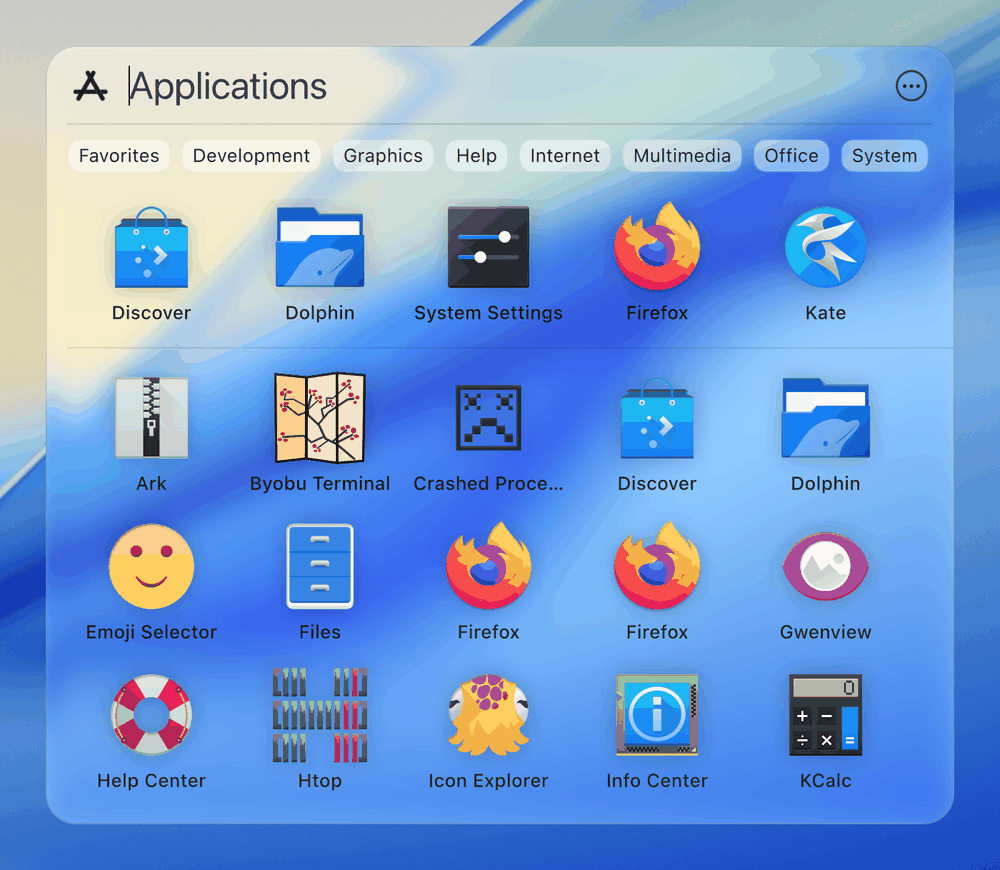
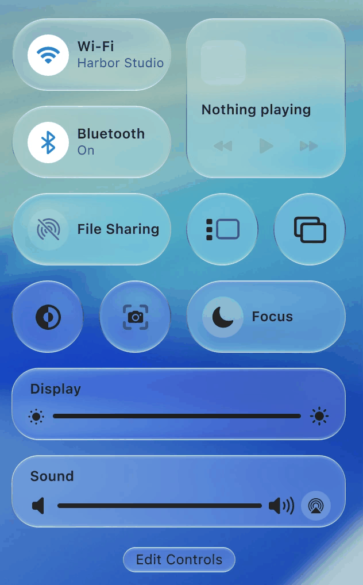
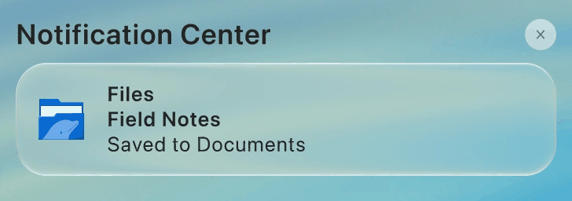
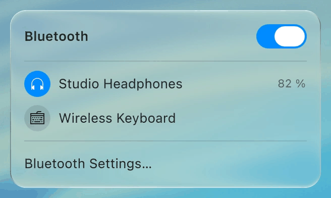
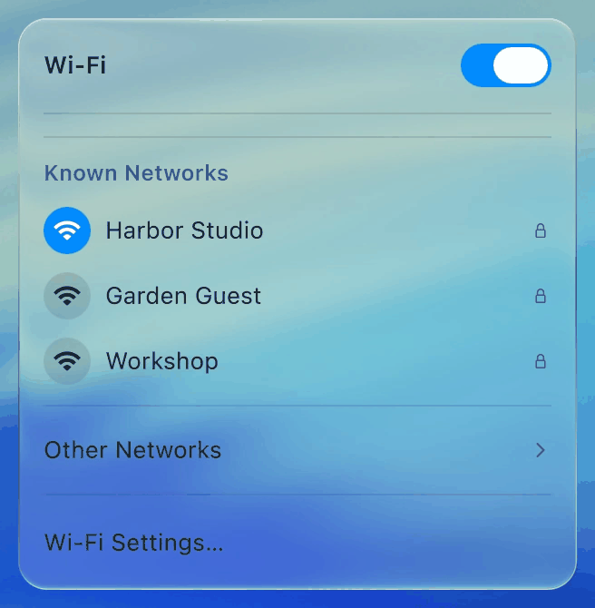
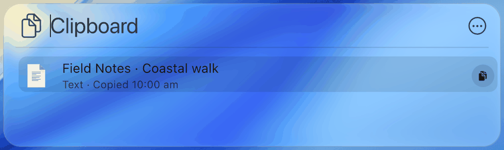
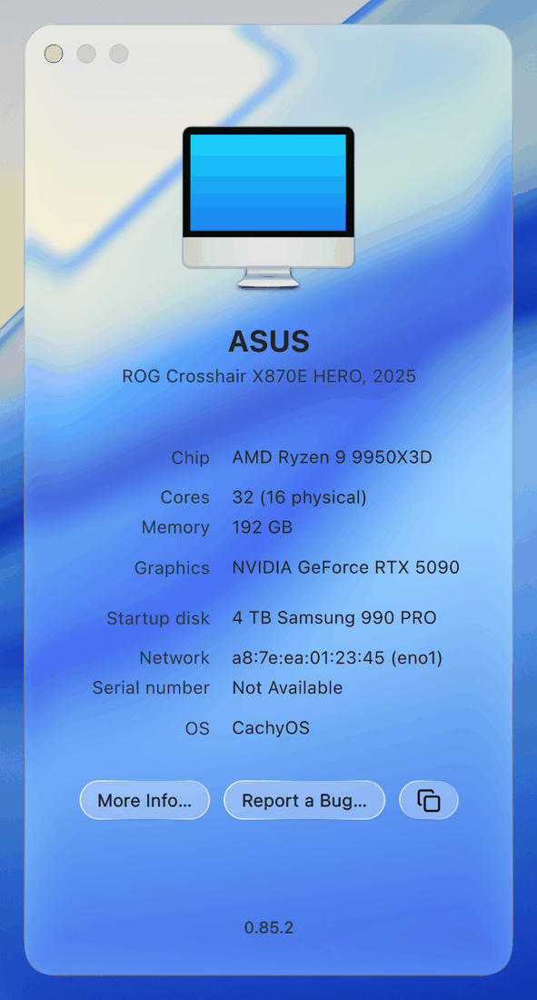
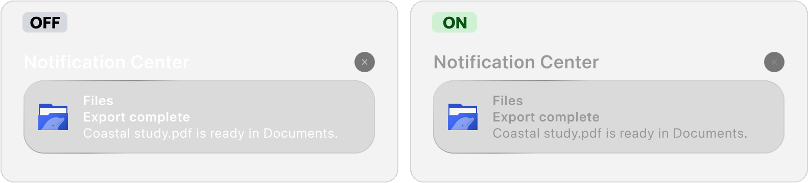

<p align="center">
  <!-- Adapted with ImageGen from artwork by Apple: https://developer.apple.com/assets/elements/icons/macos-26/macos-26-128x128_2x.png. Tux design by Larry Ewing. -->
  
</p>

<h1 align="center">macOS Tahoe Shell for KDE Linux</h1>

<p align="center">
  <a href="README.md" lang="en" hreflang="en">🇺🇸 English</a> ·
  <a href="README.es.md" lang="es" hreflang="es">🇪🇸 Español</a> ·
  <a href="README.zh-CN.md" lang="zh-CN" hreflang="zh-CN">🇨🇳 简体中文</a> ·
  <a href="README.pt-BR.md" lang="pt-BR" hreflang="pt-BR">🇧🇷 Português (Brasil)</a> ·
  <a href="README.de.md" lang="de" hreflang="de">🇩🇪 Deutsch</a> ·
  <a href="README.fr.md" lang="fr" hreflang="fr">🇫🇷 Français</a> ·
  <a href="README.it.md" lang="it" hreflang="it">🇮🇹 Italiano</a> ·
  <a href="README.ja.md" lang="ja" hreflang="ja">🇯🇵 日本語</a> ·
  <a href="README.ko.md" lang="ko" hreflang="ko" aria-current="page">🇰🇷 한국어</a> ·
  <a href="README.ru.md" lang="ru" hreflang="ru">🇷🇺 Русский</a> ·
  <a href="README.ar.md" lang="ar" hreflang="ar">🇸🇦 العربية</a> ·
  <a href="README.hi.md" lang="hi" hreflang="hi">🇮🇳 हिन्दी</a> ·
  <a href="README.nl.md" lang="nl" hreflang="nl">🇳🇱 Nederlands</a> ·
  <a href="README.pl.md" lang="pl" hreflang="pl">🇵🇱 Polski</a> ·
  <a href="README.tr.md" lang="tr" hreflang="tr">🇹🇷 Türkçe</a>
</p>

<p align="center">
  <a href="https://github.com/lestercorderomurillo/macos-tahoe-liquid-kde/releases"></a>
  <a href="https://github.com/lestercorderomurillo/macos-tahoe-liquid-kde/actions/workflows/test.yml"></a>
  <a href="https://kde.org/plasma-desktop/"></a>
  <a href="LICENSE"></a>
  <a href="https://github.com/lestercorderomurillo/macos-tahoe-liquid-kde/issues/new"></a>
</p>


<p align="center">
  <sub>디스트로를 선택하여 테스트 상태를 확인합니다.</sub>
</p>

<p align="center">
  <a href="tests/vm/PROOF.md#cachyos" title="CachyOS"></a>
  <a href="tests/vm/PROOF.md#arch" title="Arch Linux"></a>
  <a href="tests/vm/PROOF.md#endeavouros" title="EndeavourOS"></a>
  <a href="tests/vm/PROOF.md#fedora" title="Fedora"></a>
  <a href="tests/vm/PROOF.md#manjaro" title="Manjaro"></a>
  <a href="tests/vm/PROOF.md#artix" title="Artix Linux (OpenRC)"></a>
  <a href="tests/vm/PROOF.md#garuda" title="Garuda Linux"></a>
  <a href="tests/vm/PROOF.md#nobara" title="Nobara Linux"></a>
  <a href="tests/vm/PROOF.md#opensuse" title="openSUSE Tumbleweed"></a>
  <a href="tests/vm/PROOF.md#neon" title="KDE neon"></a>
  <a href="tests/vm/PROOF.md#debian" title="Debian testing / sid (Plasma 6.6+)"></a>
  <a href="tests/vm/PROOF.md#nixos" title="NixOS (experimental)"></a>
</p>

이 프로젝트는 리눅스에서 KDE 데스크톱의 모습과 느낌을 사용자 정의합니다. 그것은 애플 서비스와 연결되지 않습니다. 애플의 서비스가 필요하다면 [애플과 직접 쇼핑](https://www.apple.com/store).

> [!CAUTION]
> **롤링 릴리스 정책**
> 실험적 매일 업데이트를 받습니다. 업데이트는 호환성을 깨뜨릴 수 있습니다. 생산시스템을 피한다. [여기에 문제를 신고하세요](https://github.com/lestercorderomurillo/macos-tahoe-liquid-kde/issues/new).

> [!NOTE]
> 기능 얼음은 0.8x 시리즈에 적용되며, 0.90까지 버그 수정에 초점을 맞추는 출시가 있습니다.

> [!WARNING]
> **보급형 벽돌 재 포장자에 주의하세요. 이 테마는 무료입니다.**
>
> 이 테마를 제3자 채널에서 발견한 경우, 구매하기 위해 돈을 지불할 필요가 없습니다. 이 저장소에서 직접 다운로드 합니다. 우리는 이 프로젝트를 무료로 유지합니다. 그래서 모든 사람들이 돈을 지불하지 않고 즐길 수 있습니다. 구매나 가입이 필요하지 않습니다.

<br>


버그 보고, 수정, 테스트 및 문서: [기여 안내서](CONTRIBUTING.md).

타호와 골든게이트에서 코드 기자와 기자를 발행합니다.

<p>
  <a href="https://github.com/lestercorderomurillo"></a>
  <a href="https://github.com/yanhenrique-dev"></a>
  <a href="https://github.com/naevui"></a>
  <a href="https://github.com/caioniehues"></a>
  <a href="https://github.com/404-not-found129"></a>
  <a href="https://github.com/myakupozluk"></a>
  <a href="https://github.com/EMS1998"></a>
  <a href="https://github.com/allfritz"></a>
  <a href="https://github.com/elegos"></a>
  <a href="https://github.com/kozeki-uii"></a>
  <a href="https://github.com/imightbelosthere"></a>
  <a href="https://github.com/evaildev"></a>
  <a href="https://github.com/xarblu"></a>
  <a href="https://github.com/PKMNPlatin"></a>
  <a href="https://github.com/matinlotfali"></a>
  <a href="https://github.com/luisbocanegra"></a>
  <a href="https://github.com/OliverChase2003"></a>
  <a href="https://github.com/RoxasYTB"></a>
  <a href="https://github.com/Flagwill"></a>
  <a href="https://github.com/4l3j0Ok"></a>
  <a href="https://github.com/0xrushi"></a>
  <a href="https://github.com/aenriii"></a>
  <a href="https://github.com/andreas399"></a>
  <a href="https://github.com/Andrew-Sor"></a>
  <a href="https://github.com/ardashir77"></a>
  <a href="https://github.com/azizaktas"></a>
  <a href="https://github.com/binary-pleb"></a>
  <a href="https://github.com/bneils"></a>
  <a href="https://github.com/FAYZER77"></a>
  <a href="https://github.com/fxrncyyisingithub"></a>
  <a href="https://github.com/germanbagutteorsomething"></a>
  <a href="https://github.com/iNarrow12"></a>
  <a href="https://github.com/IsaiahSHanson"></a>
  <a href="https://github.com/kuau"></a>
  <a href="https://github.com/Lando0007"></a>
  <a href="https://github.com/LilT59"></a>
  <a href="https://github.com/marcosfantonio"></a>
  <a href="https://github.com/moulikanand12345-lang"></a>
  <a href="https://github.com/nanechi"></a>
  <a href="https://github.com/nousernameget"></a>
  <a href="https://github.com/OpalSand"></a>
  <a href="https://github.com/P0sixSplo1t-2"></a>
  <a href="https://github.com/rokan00"></a>
  <a href="https://github.com/RussH"></a>
  <a href="https://github.com/Salkio"></a>
  <a href="https://github.com/Shivamingale3"></a>
  <a href="https://github.com/shoko3756"></a>
  <a href="https://github.com/Sonicx9876"></a>
  <a href="https://github.com/Tias-dev"></a>
  <a href="https://github.com/txhammer68"></a>
  <a href="https://github.com/vanshdev0101"></a>
  <a href="https://github.com/vialolis"></a>
  <a href="https://github.com/Whiddu"></a>
  <a href="https://github.com/yingmanwumen"></a>
  <a href="https://github.com/yofriendfromschool1"></a>
  <a href="https://github.com/zhaokelei"></a>
  <a href="https://github.com/blaykelarue"></a>
  <a href="https://github.com/JacobJS34"></a>
  <a href="https://github.com/Leon-Swains"></a>
  <a href="https://github.com/LucipurrsDad"></a>
  <a href="https://github.com/SinglerGold2"></a>
  <a href="https://github.com/CiderGuru"></a>
  <a href="https://github.com/soumyadeep70"></a>
</p>

<br>


### 멀티컬러 Dock

Dock 아이콘 색상을 바탕 화면에 맞춰 바꿀 수 있습니다.

<p align="center">
  
</p>

<br>

### Quickbar

상단 막대에서 현재 앱의 메뉴를 열 수 있습니다.

<p align="center">
  
</p>

<br>

### Launchpad

앱을 검색하거나 카테고리별로 찾아볼 수 있습니다.

<p align="center">
  
</p>

<br>

### 제어 센터

한 메뉴에서 Wi-Fi, 음량, 밝기를 조절할 수 있습니다.

<p align="center">
  
</p>

<br>

### 통지

최근 알림을 앱별로 모아 볼 수 있습니다.

<p align="center">
  
</p>

<br>

### Finder

Finder 스타일의 창에서 파일을 탐색할 수 있습니다.

<p align="center">
  <a href="src/screenshots/previews/tahoe-finder-light-dark-21d755ca3c50.gif"></a>
</p>

<br>

### 달력

시계를 열면 월간 달력이 표시됩니다.

<p align="center">
  
</p>

<br>

### Bluetooth

페어링된 기기를 연결하고 배터리 잔량을 확인할 수 있습니다.

<p align="center">
  
</p>

### Wi-Fi

사용 가능한 네트워크와 연결 상태를 확인할 수 있습니다.

<p align="center">
  
</p>

<br>

### 배터리

배터리 잔량과 충전 상태를 확인할 수 있습니다.

<p align="center">
  
</p>

<br>

### 클립보드 기록

복사한 텍스트와 이미지를 다시 사용할 수 있습니다.

<p align="center">
  
</p>

<br>

### 시스템 정보

하드웨어, 소프트웨어 및 테마 정보를 확인할 수 있습니다.

<p align="center">
  
</p>

<br>

### Plasma 테마

메뉴와 팝업에 밝은 테마 또는 어두운 테마가 적용됩니다.

<p align="center">
  
</p>

<br>

### 부팅 화면

시작할 때 테마에 어울리는 화면이 표시됩니다.

<p align="center">
  
</p>

<br>

### 적응형 대비

글자색이 배경에 맞춰 바뀌어 레이블을 읽기 쉽습니다.

<p align="center">
  
</p>

<br>


- **외모:** 자동 스위치 및 모니터 벽화로 데스크톱, 앱, 아이콘 및 창 장식용 조율된 빛과 어두운 테마 [응용 프로그램별 창 창 장식 설정](docs/app-window-decorations.md)
- **유리 효과:** 조정 가능한 흐릿함, 굴절 및 색채, 지원 메뉴의 배경에 적응하는 텍스트
- **- 아, 아, 아.** 핀된 앱, 헤버 줌, 알림 배지 및 구성 가능한 숨기기 도크는 디스플레이 사이를 따라갑니다.
- **메뉴 바와 제어 센터:** 글로벌 앱 메뉴와 빠른 시스템 컨트롤, 디스플레이에서 공유된 메뉴 바 설정을 통해
- **발사 패드:** 앱 검색, 카테고리를 탐색하고 두 레이아웃 중 어느 하나에서 좋아하는 것을 저장합니다.
- **데스크톱 위젯:** 데스크톱에 묶인 액체 유리 위젯을 추가하고 정리하십시오.
- **통지:** 유리판과 그룹화된 역사, 앱이 지원하는 빠른 행동과 응답을 제공합니다.
- **클리프보드 역사:** 복사된 텍스트와 이미지들을 찾아서 재사용하고, 보관하고 싶은 항목을 핑링하세요.
- **응용 프로그램 통합:** 나우틸루스에서 검색어 스타일의 브라우징, GTK 메뉴 통합 및 프로필 백업으로 파이어폭스 테마
- **시스템 정보 및 시작:** 테마 시스템 정보 창과 선택적으로 일치하는 부트 스프래시
- **설치 및 복구:** 설치 중지 시 복원될 수 있는 템스 자산, 업데이트 및 설정 백업을 묶어있는 그래픽 설치 프로그램
- **언어:** 설정에서 설치 언어를 선택하십시오. 플라즈마 위젯은 데스크톱 언어를 따라합니다.
- **호환성:** 플라즈마 6.6 ⁇ 6.8는 아치 및 페도라 기반 시스템, openSUSE, 데비안 및 KDE 네온에 있습니다.
- **선택 사항:** OLED 패널 보호 및 실험적인 NixOS 및 홈 관리자 지원

<br>


**PC에서 설치 프로그램을 실행하기 전에 같은 배포판과 Plasma 버전을 사용하는 가상 머신에서 먼저 테스트하세요.**

```bash
git clone --filter=blob:none https://github.com/lestercorderomurillo/macos-tahoe-liquid-kde.git
cd macos-tahoe-liquid-kde
./installer
```

설치하려면 **Express**를 선택하세요. 업데이트하거나 제거하려면 `./installer`를 다시 실행하세요.

Git 작업 사본과 로컬 변경 사항을 유지하면서 디스크 공간을 확보하려면 다음을 실행하세요.

```bash
./installer --free-space
```

| 설치자 언어 | 상태 |
| --- | --- |
| 🇺🇸 English |  |
| 🇪🇸 Español |  |
| 🇨🇳 简体中文 |  |
| 🇧🇷 Português (Brasil) |  |
| 🇩🇪 Deutsch |  |
| 🇫🇷 Français |  |
| 🇮🇹 Italiano |  |
| 🇷🇺 Русский |  |
| 🇯🇵 日本語 |  |
| 🇰🇷 한국어 |  |
| 🇸🇦 العربية |  |
| 🇮🇳 हिन्दी |  |
| 🇳🇱 Nederlands |  |
| 🇵🇱 Polski |  |
| 🇹🇷 Türkçe |  |

<details>
<summary><b>요구 사항</b></summary>

데스크톱, 도구 및 시스템 패키지를 구축하는 데 필요한

- KDE Plasma 6.6+
- 파이썬 3.10+ 및 PyQt6
- `sudo`
- Qt 6 개발 도구
- 컴파일된 플라즈마이드 및 KWin 효과에 대한 KDE 및 Qt 6 개발 패키지
- `cmake`, `g++`, 그리고 `pkg-config` 컴파일된 기능이 선택될 때
- `dbus-send`
- `systemctl` 또는 `crontab` 일정한 기능

**dinit:** 설치업체는 dinit을 감지하고 자동으로 빛/아름의 전환 및 OLED 관리에 사용자 당 크론 항목을 사용합니다. 실행되는 크론 데이몬이 필요합니다 설치 `crontab` 혼자서는 시작이 되지 않습니다. Artix/dinit에 대해 다음과 같이 준비하십시오.

```bash
sudo pacman -S --needed cronie cronie-dinit
sudo dinitctl --system enable cronie
```

로그인 중 자동 스위치는 06:00와 18:00에 실행됩니다 크론 백엔드는 로그인 시간을 추적하지 않습니다. 수동 빛/암 스위치는 크론과 독립적으로 작동합니다. 기존의 Artix 스크린샷은 OpenRC를 다루고 있습니다.

자산은 묶여 있습니다. 실종된 의존성 및 선택적 KDE 둥근 코너는 인터넷 접속이 필요합니다. 검증된 둥근 코너 업데이트는 이전 다운로드된 소스와 아카이브를 제거합니다. 재설정으로 관리된 자산 나무가 교체됩니다. 성공한 복사본은 일시적인 데이터를 제거하고, 나중에 복사본은 중단된 일회용 스테이징을 청소합니다. 복구 백업, 브라우저 프로파일 백업 및 사용자 선호도는 유지됩니다. 개발자 VM 이미지 및 캡처 패키지는 설치 캐시가 아니며 자동으로 제거되지 않습니다.

| 디스트로 | Qt 6 도구 | KDE 플라즈마 6 개발 패키지 |
|--------|------------|-----------------------------------|
| 아치 가족 | `pacman -S qt6-tools` | `pacman -S extra-cmake-modules plasma-workspace kdecoration libplasma libnotificationmanager libksysguard plasma-activities-stats` |
| 페도라 가족 | `dnf install qt6-qttools-devel` | `dnf install extra-cmake-modules plasma-workspace-devel kdecoration-devel libplasma-devel knotifications-devel libksysguard-devel kf6-plasma-activities-devel` |
| openSUSE Tumbleweed | `zypper install qt6-tools-devel` | `zypper install extra-cmake-modules plasma6-workspace-devel kdecoration-devel libKF6Plasma-devel libnotificationmanager6-devel libksysguard6-devel libKF6PlasmaActivitiesStats6-devel` |

Fedora에서 설치자는 Fedora GTK 3 글로벌 메뉴 수출자를 설치합니다. `unity-gtk3-module`, 그리고 GTK 3 애플리케이션에 로그인하면 로드 됩니다.

</details>

<details>
<summary><b>OLED 관리</b></summary>

선택적 패널 이동 기본으로 비활성화

이 기능을 **OLED 보호** 페이지 시차 간격과 최대 픽셀 이동을 선택하세요 그것은 기본적으로 비활성화되어 있습니다.

**수동 제어**

```bash
mac-tahoe-oled-care shift
mac-tahoe-oled-care restore
mac-tahoe-oled-care status
```

</details>

<br>


배포, init 시스템 및 플라즈마 버전의 지원을 확인하세요.

<details>
<summary><b>배포판 테스트</b></summary>

테마를 분리된 플라즈마 데스크톱에서 시도해보세요.

```bash
./vm <os>
```

**OS:** `cachyos` · `arch` · `manjaro` · `endeavouros` · `garuda` · `fedora` · `nobara` · `opensuse` · `neon` · `debian` · `artix` · `kubuntu`

`all` 모든 디스트로를 출시합니다. 클라우드 타깃 제공 자동 다른 타겟은 체크섬으로 정해진 공식적인 ISO 설치 장치를 사용합니다. 그 다음으로 [VM 설정 및 자격 안내서](tests/vm/README.md).

`./vm kubuntu` 공식 Kubuntu 26.04.1 LTS ISO를 SHA-256 검증 (SSH 포트) `2234` 손님 설정 후). 이 새로운 발사체 회귀 목표물은 완전한 라이브 자격을 기다리고 있습니다.

`./vm debian` 공식적인 데비안 테스트 (포키) 클라우드 이미지를 사용하고, SHA-512 체크섬을 확인하고, 플라즈마 데스크톱을 제공합니다. 로그인 `tester` 비밀번호 `tester`[중고] SSH는 `127.0.0.1:2232`. 설치 프로그램은 글쓰기 가능한 게스트 복사본에서 열립니다 `/home/tester/macos-tahoe-liquid-kde`[중고] 호스트 저장소는 읽기 전용으로 설치되어 있습니다. 사용 `./vm debian --clean` 일회용 손님을 처음부터 다시 만들 수 있게 해주는 거죠.

이 테이블의 11개의 배포 모두 실시간 VM 자격증을 통과했습니다. 검토된 스크린샷과 테스트 결과를 위한 상태 배지를 선택하십시오.

| | 이름 | 상태 |
|:--:|------|---------|
|  | CachyOS | [](tests/vm/PROOF.md#cachyos) |
|  | Arch Linux | [](tests/vm/PROOF.md#arch) |
|  | EndeavourOS | [](tests/vm/PROOF.md#endeavouros) |
|  | Fedora | [](tests/vm/PROOF.md#fedora) |
|  | Manjaro | [](tests/vm/PROOF.md#manjaro) |
|  | Artix Linux (OpenRC) | [](tests/vm/PROOF.md#artix) |
|  | Garuda Linux | [](tests/vm/PROOF.md#garuda) |
|  | Nobara | [](tests/vm/PROOF.md#nobara) |
|  | openSUSE Tumbleweed | [](tests/vm/PROOF.md#opensuse) |
|  | KDE neon | [](tests/vm/PROOF.md#neon) |
|  | 데비안 테스트 / sid (플라즈마 6.6+) | [](tests/vm/PROOF.md#debian) |

**NixOS 및 홈 매니저 (실험)**

플레크 모듈을 사용하세요 **그래픽 설치 장치가 아닙니다**. 라이브 데스크톱 검증이 기다리고 있습니다.

**플레이크 입력** (Nixpkgs 및 홈 매니저를 필요로 한다):

```nix
inputs.mac-tahoe = {
  url = "github:lestercorderomurillo/macos-tahoe-liquid-kde/v0.55.2";
  inputs.nixpkgs.follows = "nixpkgs";
  inputs.home-manager.follows = "home-manager";
};
```

**NixOS:** 수입 `inputs.mac-tahoe.nixosModules.default`.

```nix
services.desktopManager.plasma6.enable = true;
services.mac-tahoe.enable = true;
# services.mac-tahoe.plymouth.enable = true; # optional boot splash
```

**Home Manager:** 수입 `inputs.mac-tahoe.homeManagerModules.default`.

```nix
programs.mac-tahoe = {
  enable = true;
  mode = "auto"; # or "light" / "dark"
  # appleAssets = true;
  # oledCare.enable = true;
};
```

**애플 자산:** 자발적인 비자유 글꼴, 벽화 및 사운드 가능하게 하는 것 `appleAssets` 또한 다음과 같이 요구합니다.

```nix
nixpkgs.config.allowUnfreePredicate = pkg:
  builtins.elem (lib.getName pkg) [ "mac-tahoe-apple-assets" ];
```

**패널:** 또한 자신의 플라즈마 관리 모듈을 수입하고 `inputs.mac-tahoe.homeManagerModules.plasma-manager`. 활성화 `programs.mac-tahoe.panels.enable` 그리고 세트 `programs.mac-tahoe.panels.launchers`예를 들어 `[ "applications:org.kde.dolphin.desktop" ]`. 이것은 기존 핀을 수입하지 않고 레이아웃을 대체합니다.

**쓰기 가능한 설정:** 계속 `kdeglobals`, `kwinrc`, `plasmarc`, `plasmashellrc`, `kcminputrc`, `plasma-org.kde.plasma.desktop-appletsrc`, `Kvantum/kvantum.kvconfig` 그리고 라이브 GTK 구성을 작성할 수 있습니다. 테마 스위치에 의해 관리되는 변함없는 플라즈마 관리자 키를 피하십시오.

활성화 후 로그아웃하고 다시 로그아웃. 파이어폭스 프로파일, GTK 북마크 및 SDDM는 구성되지 않습니다. 홈 매니저에서 설정 `programs.mac-tahoe.gtkAppmenuModule` 설치된 GTK 3 앱 메뉴 모듈 라이브러리의 전체 경로로 로그인 시 로드합니다. OLED 관리를 비활성화하기 전에 실행 `mac-tahoe-oled-care restore`[중고] 모듈을 제거하기 전에 Breeze를 선택하십시오. 삭제하면 사용자 설정이 그대로 유지됩니다.

</details>

<details>
<summary><b>시립 시스템</b></summary>

자동 테마 스위치 및 OLED 관리는 다음과 같은 스케줄링 백엔드를 사용합니다.

| 시범 시스템 | 일정을 | 기록된 시험 |
| --- | --- | --- |
| systemd | 사용자 타이머 |  |
| OpenRC | 사용자당 크론 |  |
| dinit | 사용자당 크론 |   |

OpenRC와 dinit는 실행되는 크론 데이몬이 필요합니다. [데스크톱 테스트 결과](tests/vm/PROOF.md) · [디니트 스케줄링 탐사선](CONTRIBUTING.md#setup).

</details>

<details>
<summary><b>플라즈마 버전</b></summary>

플라즈마 6.6 ⁇  6.8가 지원됩니다 컴파일된 효과는 호스트 SDK를 사용합니다.

| Plasma | 지원 | 그 이후로 |
|--------|---------|-------|
| 6.5 이하 |  | 적용되지 않습니다 |
| 6.6 |  | v0.1.0 |
| 6.7 |  | v0.19.0 |
| 6.8 |  | v0.54.1 |

</details>

<br>


이 프로젝트는 macOS의 디자인에서 영감을 받아 독립적으로 재구현했습니다. Apple이나 KDE와 제휴 관계가 없으며 양측의 공식 승인을 받지 않았습니다. macOS와 Apple은 Apple Inc.의 상표입니다.

macOS 엠블럼과 함께 제공되는 배경 화면, 시스템 사운드, SF Pro 및 SF Mono 글꼴은 Apple의 소유이며 이 프로젝트의 라이선스 대상에서 제외됩니다. 다른 구성 요소에는 각각의 라이선스와 저작권 고지가 적용됩니다. 적용 범위와 출처 확인이 불완전한 항목은 제3자 고지 목록을 참고하세요.

프로젝트 전체에는 [GPL-3.0](LICENSE)이 적용됩니다. 개별 구성 요소의 라이선스와 제3자의 권리도 유효합니다. [저작권 고지](NOTICE), [라이선스 및 프로젝트 명칭](LICENSING.md), [제3자 고지](THIRD_PARTY_NOTICES.md)를 참고하세요.

<br>


<details>
<summary><b>프로젝트, 자산 및 인증을</b></summary>

프로젝트 참조 및 제3자 구성요소:

- **[EliverLara](https://github.com/EliverLara/TahoeLauncher)**: `TahoeLauncher`: 발사판 설계 참조
- **[vinceliuice](https://github.com/vinceliuice)**: `MacTahoe-icon-theme`: 기본 아이콘과 커서 GTK 디자인 참조 [`MacTahoe-gtk-theme` 파이어폭스 CSS/SVG](https://github.com/vinceliuice/MacTahoe-gtk-theme/tree/main/other/firefox) 여기서는 프로파일 백업 및 복원 지원이 있는 MIT 라이선스 있는 포크로 유지됩니다.
- **[taj-ny](https://github.com/taj-ny/kwin-effects-forceblur)** 그리고 **[4v3ngR](https://github.com/4v3ngR/kwin-effects-glass)**: 더 나은 블러와 그 유리 포크: 아크릴 글래스에서 사용되는 상류 코드 (KWin blur의 저자는 소스 헤더에 적혀 있습니다).
- **[luisbocanegra](https://github.com/luisbocanegra/plasma-panel-colorizer)**: `plasma-panel-colorizer` v7.3.0, 오프라인에서 묶여서 레이아웃 단계로 설치하여 패널을 색칠합니다 (GPL-3.0, 라이선스와 함께 배송됩니다).
- **[jaxparrow07](https://github.com/jaxparrow07/liquidglass-kde-widgets)**: `liquidglass-kde-widgets` 액체 글래스 데스크톱 위젯의 뭉친 컬렉션을 제공합니다 (GPL-3.0 라이선스를 포함합니다).
- **[RoxasYTB](https://github.com/RoxasYTB)**: [사진 위젯](https://github.com/jaxparrow07/liquidglass-kde-widgets/pull/41) 데스크톱에 사진을 표시합니다. [자동 고체/ 유리 스위치](https://github.com/jaxparrow07/liquidglass-kde-widgets/pull/40) 화면에 창이 열려 있을 때 위젯을 유리로 전환합니다.
- **[마틴 로트파일리 / KDE- 라운드드 코너](https://github.com/matinlotfali/KDE-Rounded-Corners)**: GPL-3.0 KWin 주둥이 창 효과,  ⁇  v0.9.0 버전에서 가져와 호스트 KWin SDK (사면에 설치된 라이센스) 에 대한 온라인 구축.
- **[ful1e5](https://github.com/ful1e5)**: `apple_cursor`: 대체 커서 설계 참조
- **[sahibjotsaggu](https://github.com/sahibjotsaggu)**: `San-Francisco-Pro-Fonts`: SF Pro/ SF Mono 팩의 출처
- **[Lucide](https://github.com/lucide-icons/lucide)**: 글로벌 메뉴에 묶여 있는 아이콘을 복사합니다 (ISC, © Lucide Contributors).
- **[512pixels.net](https://512pixels.net/projects/default-mac-wallpapers-in-5k/)**: 고 해상도 macOS 벽화 아카이브.

신용이 부족하다면, [이슈를 등록하세요](https://github.com/lestercorderomurillo/macos-tahoe-liquid-kde/issues/new).

</details>


[설치자 스크린샷 및 테스트](TESTING.md).
