<p align="center">
  <!-- Artwork: https://developer.apple.com/assets/elements/icons/macos-26/macos-26-128x128_2x.png -->
  
</p>

<h1 align="center">macOS Tahoe for KDE Plasma</h1>

<p align="center">
  <a href="https://github.com/lestercorderomurillo/macos-tahoe-liquid-kde/releases"></a>
  <a href="https://github.com/lestercorderomurillo/macos-tahoe-liquid-kde/releases/tag/v0.61.0"></a>
  <a href="https://github.com/lestercorderomurillo/macos-tahoe-liquid-kde/actions/workflows/test.yml"></a>
  <a href="https://kde.org/plasma-desktop/"></a>
  <a href="LICENSE"></a>
  <a href="https://github.com/lestercorderomurillo/macos-tahoe-liquid-kde/issues/new"></a>
</p>

<p align="center">
  The ultimate macOS Tahoe experience, reimagined for Linux. Immersive glass, an iconic Dock and a complete desktop transformation for KDE Plasma 6.6, 6.7 and 6.8+.
</p>

<p align="center">
  <a href="tests/vm/PROOF.md#cachyos" title="CachyOS"></a>
  <a href="tests/vm/PROOF.md#arch" title="Arch Linux"></a>
  <a href="tests/vm/PROOF.md#endeavouros" title="EndeavourOS"></a>
  <a href="tests/vm/PROOF.md#fedora" title="Fedora"></a>
  <a href="tests/vm/PROOF.md#manjaro" title="Manjaro"></a>
  <a href="tests/vm/PROOF.md#artix" title="Artix Linux (OpenRC)"></a>
  <a href="tests/vm/PROOF.md#garuda" title="Garuda Linux"></a>
  <a href="tests/vm/PROOF.md#nobara" title="Nobara Linux"></a>
  <a href="tests/vm/PROOF.md#opensuse" title="openSUSE Tumbleweed"></a>
  <a href="tests/vm/PROOF.md#neon" title="KDE neon"></a>
  <a href="tests/vm/PROOF.md#debian" title="Debian testing / sid (Plasma 6.6+)"></a>
  <a href="tests/vm/PROOF.md#nixos" title="NixOS (experimental)"></a>
</p>

> [!CAUTION]
> Experimental. Desktop updates may break compatibility. Avoid production systems; [report issues here](https://github.com/lestercorderomurillo/macos-tahoe-liquid-kde/issues/new).

<br>


Help with bug reports, fixes, testing and documentation.

Thanks to the people who contribute to Tahoe and Golden Gate:

<p>
  <a href="https://github.com/lestercorderomurillo"></a>
  <a href="https://github.com/yanhenrique-dev"></a>
  <a href="https://github.com/tuxkt"></a>
  <a href="https://github.com/caioniehues"></a>
  <a href="https://github.com/404-not-found129"></a>
  <a href="https://github.com/myakupozluk"></a>
  <a href="https://github.com/EMS1998"></a>
  <a href="https://github.com/allfritz"></a>
  <a href="https://github.com/elegos"></a>
  <a href="https://github.com/kozeki-uii"></a>
  <a href="https://github.com/imightbelosthere"></a>
  <a href="https://github.com/evaildev"></a>
  <a href="https://github.com/xarblu"></a>
  <a href="https://github.com/PKMNPlatin"></a>
  <a href="https://github.com/matinlotfali"></a>
  <a href="https://github.com/luisbocanegra"></a>
  <a href="https://github.com/OliverChase2003"></a>
  <a href="https://github.com/RoxasYTB"></a>
</p>

<br>


The desktop and its apps in light and dark mode.

### Tahoe desktop

The Tahoe desktop in light and dark mode.

<p align="center">
  <a href="src/screenshots/showcase_light_4k-1beae3ccfce7.png">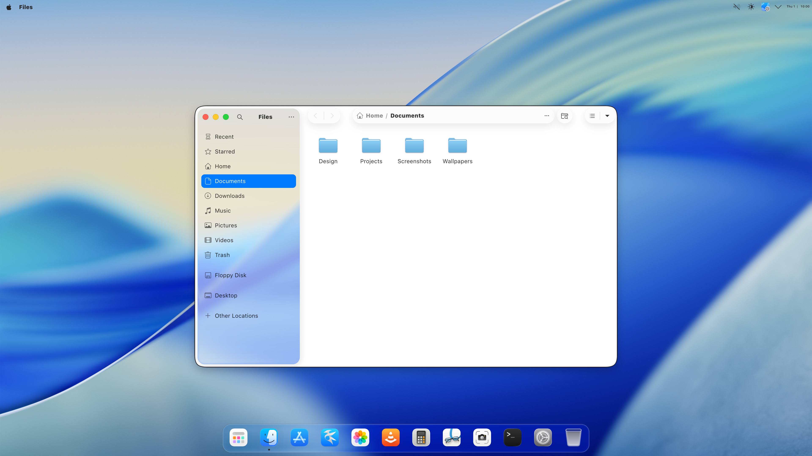</a>
  <a href="src/screenshots/desktop_about_light_4k-c502a643af9f.png">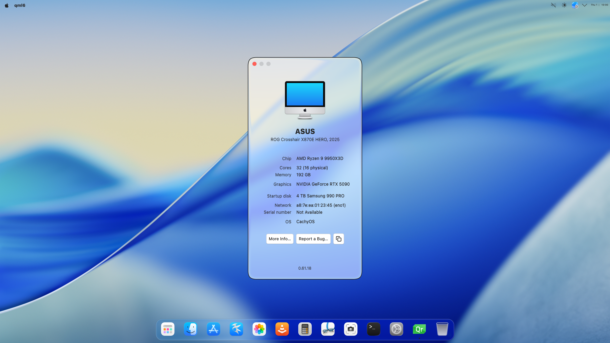</a>
</p>

<p align="center">
  <a href="src/screenshots/showcase_dark_4k-542a682e7951.png">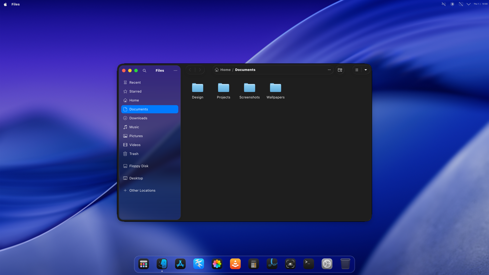</a>
  <a href="src/screenshots/desktop_about_dark_4k-f5389621ec72.png">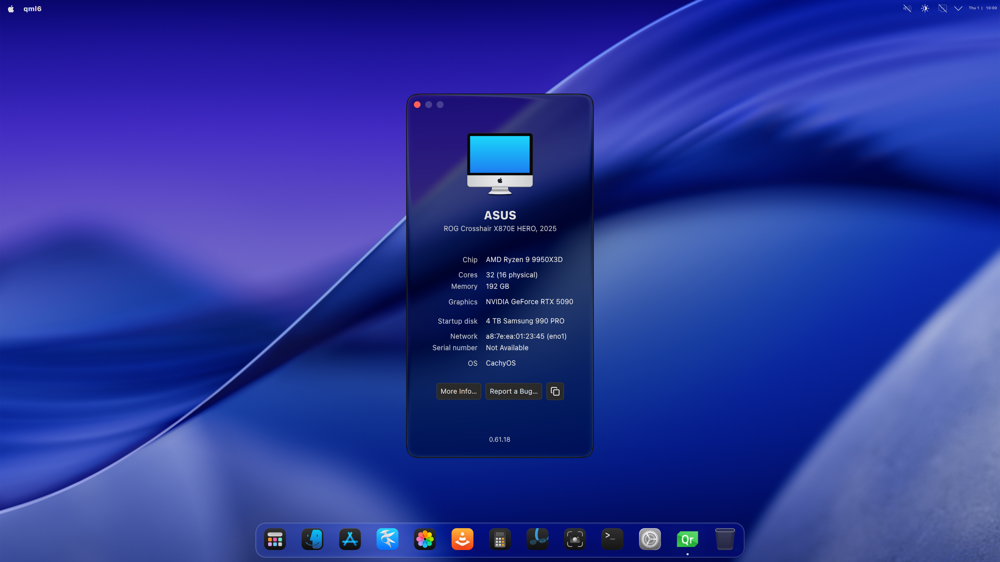</a>
</p>

<br>

### Acrylic Glass Tahoe Launcher

App search, favorites and categories with blurred glass and edge refraction. [Material settings](docs/glass-materials.md).

<p align="center">
  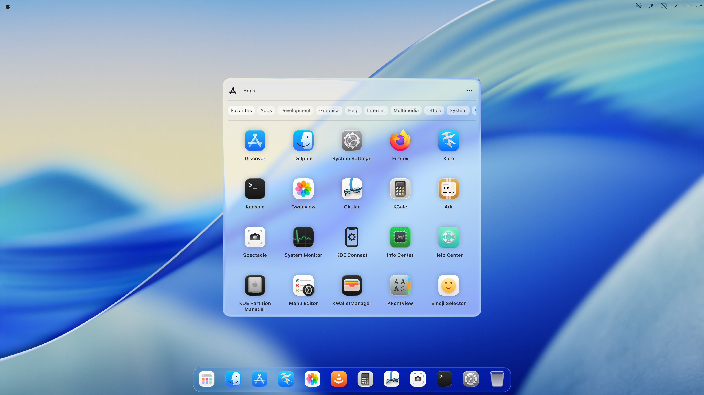
  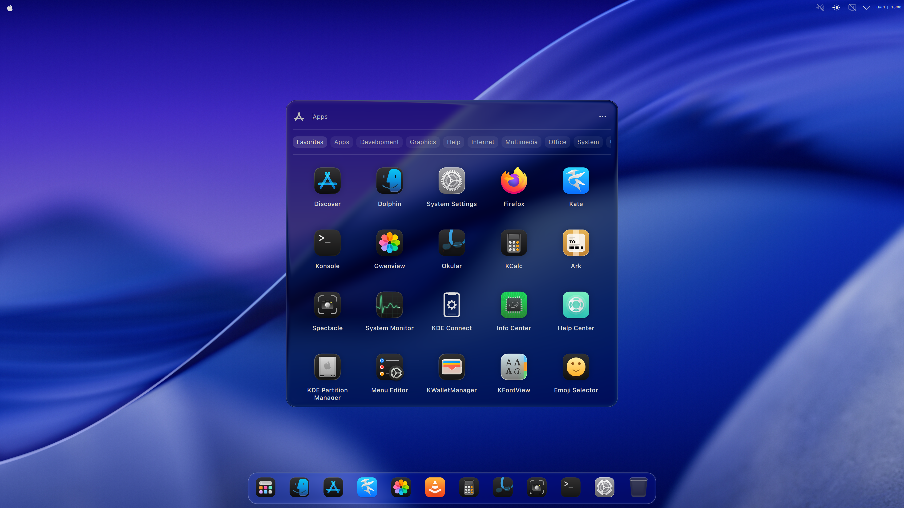
</p>

<br>

### Acrylic Glass Tahoe Dock

Glass refraction, hover zoom, notification badges and auto-hide.

<p align="center">
  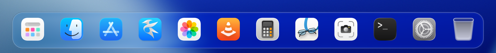
  <br>
  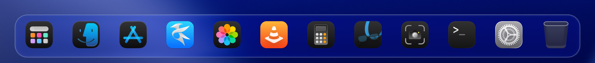
</p>

<br>

### Acrylic Glass Tahoe Finder

Finder-style Nautilus in light and dark.

<p align="center">
  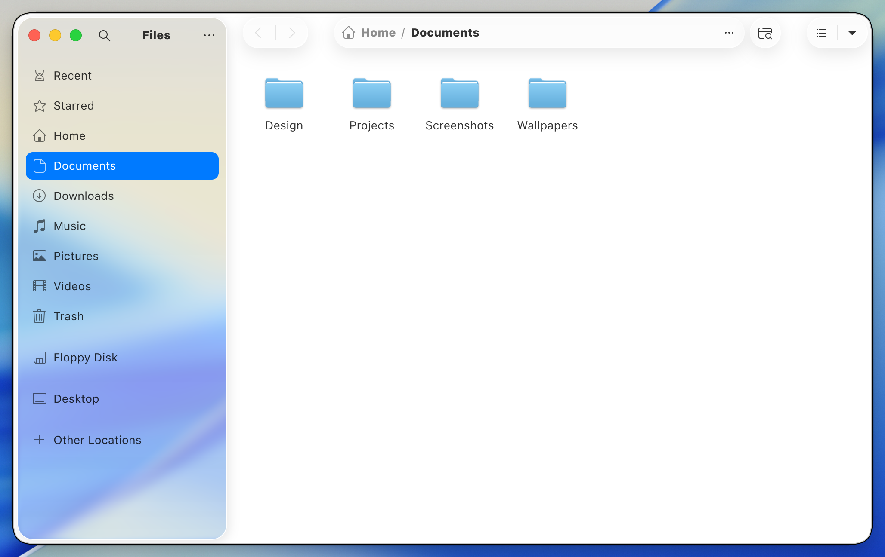
  
</p>

<br>

### Acrylic Glass Tahoe Menu

System controls and global menus for compatible apps.

<p align="center">
  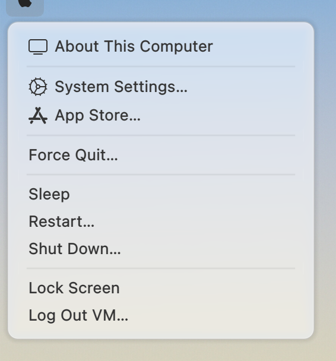
  
</p>

<br>

### System Information

Hardware, software and theme details in About This Computer.

<p align="center">
  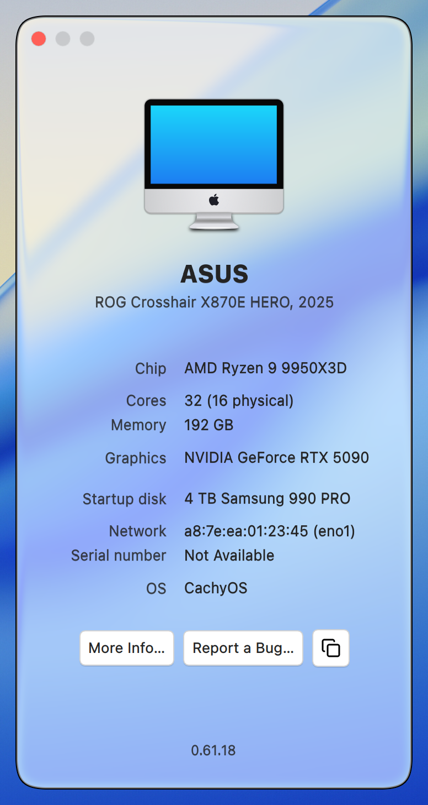
  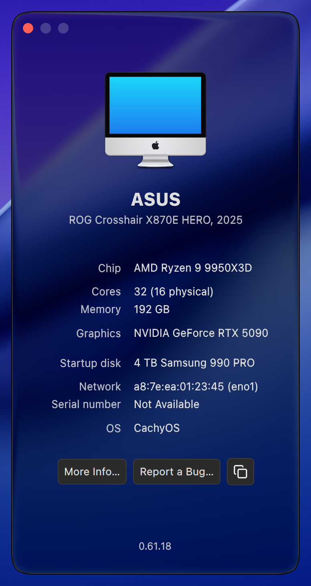
</p>

<br>

### Plasma Theme

Translucent menus and popups with matching light and dark colors.

<p align="center">
  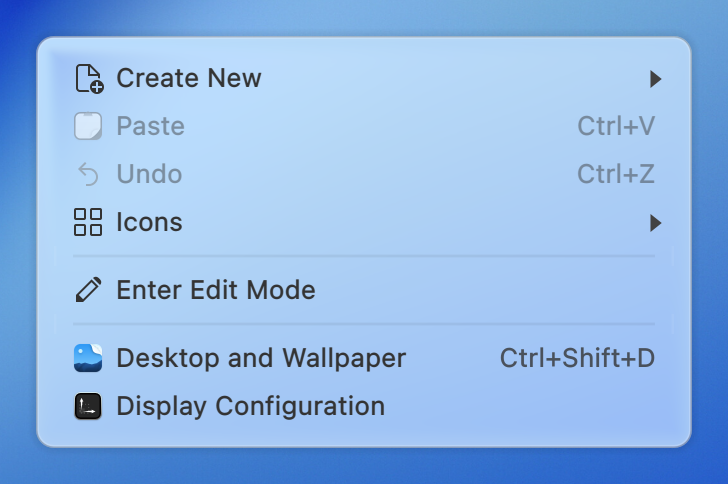
  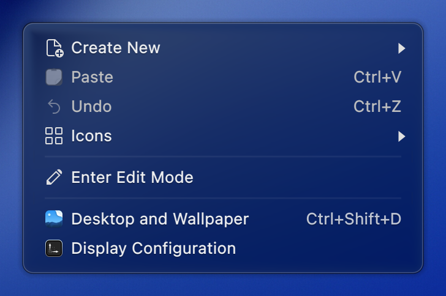
</p>

<br>

### Boot Splash

Plymouth startup and shutdown theme with LUKS2 unlock support.

<p align="center">
  
  
</p>

<br>


Here is what we added or improved in the components we ship.

- **Multilanguage support:** English, Spanish, Simplified Chinese, Brazilian Portuguese and German in the graphical installer, plus translated Plasma widgets.
- **Installation and packaging:** graphical install/uninstall wizard, selectable components, bundled theme assets and release updates.
- **Multiple distributions:** dependency detection and package mappings for Arch-based, Fedora-based, openSUSE, Debian and KDE neon systems.
- **systemd and OpenRC:** scheduled theme switching and OLED care through user timers or cron.
- **Glass improvements:** configurable blur, edge refraction, opacity and gradients; Tahoe and Golden Gate materials with consistent light/dark surfaces and paired edge highlights.
- **Plasma compatibility:** rendering and build fixes for Plasma 6.6–6.8, with effects compiled against the installed Qt and KWin SDKs.
- **Launcher improvements:** two selectable layouts, integrated or detached search, favorites, app categories and drag/wheel category scrolling.
- **Dock improvements:** glass surfaces, hover zoom, notification badges and auto-hide. Reinstalling keeps your pinned apps.
- **Theme switching:** changes Plasma, Kvantum, GTK, icons and window decorations together. Keeps wallpapers you choose for each monitor, with an option to reset them.
- **App integration:** global menus, a fix for GTK menu crashes, Finder-style Nautilus and Firefox theming with profile backups.
- **Install and uninstall:** checks requirements, finds your desktop session, backs up settings and restores changes on removal.
- **Optional features:** OLED panel shifts and experimental NixOS/Home Manager modules.
- **Testing:** regression tests, container checks across distributions and Plasma VMs for checking desktop behavior and appearance.

<br>


To avoid downloading historical screenshots, start with a shallow checkout:

```bash
git clone --depth 1 --single-branch https://github.com/lestercorderomurillo/macos-tahoe-liquid-kde.git
cd macos-tahoe-liquid-kde
./installer
```

Run `./installer` again to update. Uncheck **Reset Dock and panel customization** to keep your layout.
Run `./installer --free-space` to free storage while preserving `.git` and local work.
ZIP/tar downloads omit the gallery; view screenshots on GitHub or use a Git checkout.

Install and uninstall through one graphical wizard:

```bash
./installer
```

| Installer language | Status |
| --- | --- |
| 🇺🇸 English | Available |
| 🇪🇸 Spanish | Available |
| 🇨🇳 Simplified Chinese | Available |
| 🇧🇷 Brazilian Portuguese | Available |
| 🇩🇪 German | Available |
| 🇫🇷 French | Planned |
| 🇮🇹 Italian | Planned |
| 🇯🇵 Japanese | Planned |
| 🇰🇷 Korean | Planned |
| 🇷🇺 Russian | Planned |
| 🇸🇦 Arabic | Planned |
| 🇮🇳 Hindi | Planned |
| 🇳🇱 Dutch | Planned |
| 🇵🇱 Polish | Planned |
| 🇹🇷 Turkish | Planned |

<details>
<summary><b>Requirements</b></summary>

Required desktop, build tools and system packages.

- KDE Plasma 6.6+
- Python 3.10+ and PyQt6
- `sudo`
- Qt 6 development tools
- KDE and Qt 6 development packages for the compiled plasmoids and KWin effects
- `cmake`, `g++`, and `pkg-config` when compiled features are selected
- `dbus-send`
- `systemctl` or `crontab` for scheduled features

**dinit:** the installer detects dinit and uses per-user cron entries for
automatic light/dark switching and OLED care. A running cron daemon is required;
installing `crontab` alone does not start it. On Artix/dinit, prepare it with:

```bash
sudo pacman -S --needed cronie cronie-dinit
sudo dinitctl --system enable cronie
```

Automatic switches run at 06:00 and 18:00 while logged in; the cron backend has
no login-time catch-up. Manual light/dark switching works independently of cron.
dinit desktop qualification is pending; the existing Artix screenshots cover OpenRC.

Assets are bundled. Missing dependencies and optional KDE Rounded Corners require internet access.
Verified Rounded Corners updates remove older downloaded sources and archives.
Reinstalling replaces the managed asset trees in place; successful copies remove
their temporary data, and later copies clean interrupted disposable staging.
Recovery backups, browser-profile backups and user preferences are retained.
Developer VM images and capture bundles are not installer caches and are never
removed automatically.

| Distro | Qt 6 tools | KDE Plasma 6 development packages |
|--------|------------|-----------------------------------|
| Arch family | `pacman -S qt6-tools` | `pacman -S extra-cmake-modules plasma-workspace kdecoration libplasma libnotificationmanager libksysguard plasma-activities-stats` |
| Fedora family | `dnf install qt6-qttools-devel` | `dnf install extra-cmake-modules plasma-workspace-devel kdecoration-devel libplasma-devel knotifications-devel libksysguard-devel kf6-plasma-activities-devel` |
| openSUSE Tumbleweed | `zypper install qt6-tools-devel` | `zypper install extra-cmake-modules plasma6-workspace-devel kdecoration-devel libKF6Plasma-devel libnotificationmanager6-devel libksysguard6-devel libKF6PlasmaActivitiesStats6-devel` |

</details>

<details>
<summary><b>Choose features and theme mode</b></summary>

The wizard offers appearance (automatic, light or dark), regular or tinted glass
icons, theme color, wallpaper, launcher, top bar and Dock, effects, fonts,
Firefox, file manager, boot animation and optional OLED care. Review your choices
before installing; each summary row can be edited.

Choose **Flat** or **Glassy** window controls in the wizard, with close-up Nautilus previews. Tahoe starts with Flat; Golden Gate starts with Glassy. Your choice applies to window decorations and GTK title bars, including later light/dark switches.

The default option is always first and selected. Opening the other edition starts
with that repository's defaults, including its wallpaper and launcher. Choosing
**Keep my icons**, **Keep my wallpaper** or **Keep my fonts** preserves those choices.

**Reset Dock and panel customization** is checked by default. Reinstalling
rebuilds the selected top bar and Dock while carrying pinned apps across.
Uncheck it to preserve the current layout, sizes, autohide and widgets. A first
installation creates the selected layout automatically.

The Window shadows page compares **no, soft, medium or hard window shadows**
with Nautilus screenshots. The choice applies to the theme's Aurorae
decorations and GTK windows. Medium is the default. The chosen
level applies in light and dark mode; applications that draw their own
decorations may use their own shadows.

Golden Gate includes reflective window controls in both Aurorae and GTK title bars.

The file-manager step explicitly offers **Install Nautilus**, **Use Dolphin**,
or **Skip Nautilus and keep my file manager**. The latter preserves the current
file associations and skips the Nautilus package and setup. These choices apply
to the current installation; already-installed applications are not removed.

The global menu, window theme, cursors, sounds, Qt/GTK styles and file dialogs are
included. The theme is applied immediately after installation.

Automatic appearance changes at 06:00 and 18:00. Manual switching remains available:

```bash
mac-tahoe-theme-switch light
mac-tahoe-theme-switch dark
mac-tahoe-theme-switch auto
```

Both launcher presets remain available from the Launcher's **…** menu.

</details>

<details>
<summary><b>Glass and rounded-corner troubleshooting</b></summary>

Fixes and known limitations for blur, refraction and window corners.

- **Plasma 6.8:** reinstall to rebuild the effects and install the shader fixes, then log out and back in. An enabled checkbox alone does not confirm Acrylic Glass is rendering; the installer warns when activation cannot be verified.
- **Corner artifacts:** Acrylic Glass follows the active Rounded Corners cutout and clips both glass and grain to it ([#89](https://github.com/lestercorderomurillo/macos-tahoe-liquid-kde/issues/89)). Independent radii remain available when Rounded Corners does not affect a surface; reinstall preserves custom values.
- **Desktop-edit overlay:** Rounded Corners excludes desktop surfaces before offscreen redirection, even with explicit inclusion rules ([#77](https://github.com/lestercorderomurillo/macos-tahoe-liquid-kde/issues/77)). The guard is verified in an isolated compositor; the originally reported NVIDIA desktop-edit session still needs confirmation.
- VirtualBox VM windows are excluded from glass to preserve seamless cutouts ([#90](https://github.com/lestercorderomurillo/macos-tahoe-liquid-kde/issues/90)). The manager is unaffected.

</details>

<details>
<summary><b>Global Menu compatibility</b></summary>

Global Menu displays menus exported by the focused application. The installer
includes the D-Bus menu runtime, installs the GTK3 exporter on Arch/Debian-family
systems, and activates KDE's registrar. Log out and back in after installation
to load the GTK startup integration. Applications must still support menu
export: custom Electron/Wayland menus are not automatically transferable, and
Flatpak/Snap isolation can restrict the connection. A visible application name
alone does not mean its menus were exported.

</details>

<details>
<summary><b>Firefox theme</b></summary>

Supports Firefox profiles from native, Flatpak and Snap installations. Zen and
other Firefox-derived browsers keep their own interface and are not themed.
Reinstalling this component removes its earlier theme additions from those
browsers, with a fresh UI backup and customizations preserved. Restart the
affected browsers after installation.
Browser data and customizations are preserved; uninstall removes the theme's additions. UI backups: `~/.local/state/mac-tahoe-liquid-kde/firefox/snapshots/`.

</details>

<details>
<summary><b>OLED care</b></summary>

Optional panel shifts; disabled by default.

Enable it on the **OLED protection** page. Choose the shift interval and maximum
pixel displacement there; it is disabled by default.

**Manual controls**

```bash
mac-tahoe-oled-care shift
mac-tahoe-oled-care restore
mac-tahoe-oled-care status
```

</details>

<details>
<summary><b>Test in a virtual machine</b></summary>

Try the theme in an isolated Plasma desktop.

```bash
./vm <os>
```

**OS:** `cachyos` · `arch` · `manjaro` · `endeavouros` · `garuda` · `fedora` · `nobara` · `opensuse` · `neon` · `debian` · `artix` · `kubuntu`

`all` launches every distro. Cloud targets provision automatically; the other
targets use their checksum-pinned official ISO installers. Follow the
[VM setup and qualification guide](tests/vm/README.md).

`./vm kubuntu` boots the official Kubuntu 26.04.1 LTS ISO with SHA-256
verification (SSH port `2234` after guest setup). This new launcher regression
target is pending full live qualification.

`./vm debian` uses the official Debian testing
(Forky) cloud image, verifies its SHA-512 checksum, and provisions a Plasma
desktop. Log in as `tester` with password `tester`; SSH is available on
`127.0.0.1:2232`. The installer opens from a writable guest copy at
`/home/tester/macos-tahoe-liquid-kde`; the host repository is mounted read-only.
Use `./vm debian --clean` to rebuild the disposable guest from scratch.

</details>

<details>
<summary><b>NixOS and Home Manager (testing)</b></summary>

Use the flake modules, **not the graphical installer**. Live desktop validation is pending.

**Flake input** (requires Nixpkgs and Home Manager):

```nix
inputs.mac-tahoe = {
  url = "github:lestercorderomurillo/macos-tahoe-liquid-kde/v0.55.2";
  inputs.nixpkgs.follows = "nixpkgs";
  inputs.home-manager.follows = "home-manager";
};
```

**NixOS:** import `inputs.mac-tahoe.nixosModules.default`.

```nix
services.desktopManager.plasma6.enable = true;
services.mac-tahoe.enable = true;
# services.mac-tahoe.plymouth.enable = true; # optional boot splash
```

**Home Manager:** import `inputs.mac-tahoe.homeManagerModules.default`.

```nix
programs.mac-tahoe = {
  enable = true;
  mode = "auto"; # or "light" / "dark"
  # appleAssets = true;
  # oledCare.enable = true;
};
```

**Apple assets:** optional non-free fonts, wallpapers and sounds. Enabling
`appleAssets` also requires:

```nix
nixpkgs.config.allowUnfreePredicate = pkg:
  builtins.elem (lib.getName pkg) [ "mac-tahoe-apple-assets" ];
```

**Panels:** also import your own plasma-manager module and
`inputs.mac-tahoe.homeManagerModules.plasma-manager`. Enable
`programs.mac-tahoe.panels.enable` and set `programs.mac-tahoe.panels.launchers`,
e.g. `[ "applications:org.kde.dolphin.desktop" ]`. This replaces the layout
without importing existing pins.

**Writable settings:** keep `kdeglobals`, `kwinrc`, `plasmarc`, `plasmashellrc`,
`kcminputrc`, `plasma-org.kde.plasma.desktop-appletsrc`,
`Kvantum/kvantum.kvconfig` and live GTK configuration writable. Avoid immutable
plasma-manager keys managed by the theme switcher.

Log out and back in after activation. Firefox profiles, GTK bookmarks and SDDM
are not configured. GTK global menus need `programs.mac-tahoe.gtkAppmenuModule`.
Before disabling OLED care, run `mac-tahoe-oled-care restore`; before removing
the modules, select Breeze. Removal leaves user settings in place.

</details>

<br>


Check support for your distribution, init system and Plasma version.

<details>
<summary><b>Distributions</b></summary>

All 11 distributions in this table passed live VM qualification. Select a status badge for reviewed 4K screenshots and test results.

| | Name | Status |
|:--:|------|---------|
|  | CachyOS | [](tests/vm/PROOF.md#cachyos) |
|  | Arch Linux | [](tests/vm/PROOF.md#arch) |
|  | EndeavourOS | [](tests/vm/PROOF.md#endeavouros) |
|  | Fedora | [](tests/vm/PROOF.md#fedora) |
|  | Manjaro | [](tests/vm/PROOF.md#manjaro) |
|  | Artix Linux (OpenRC) | [](tests/vm/PROOF.md#artix) |
|  | Garuda Linux | [](tests/vm/PROOF.md#garuda) |
|  | Nobara | [](tests/vm/PROOF.md#nobara) |
|  | openSUSE Tumbleweed | [](tests/vm/PROOF.md#opensuse) |
|  | KDE neon | [](tests/vm/PROOF.md#neon) |
|  | Debian testing / sid (Plasma 6.6+) | [](tests/vm/PROOF.md#debian) |

</details>

<details>
<summary><b>Init systems</b></summary>

Scheduled features use systemd user timers or per-user cron on OpenRC and dinit.

| Init system | Support | Testing |
|-------------|---------|---------|
| systemd | Supported | Completed |
| OpenRC | Supported | Completed |
| dinit | Cron backend | Scheduling verified; desktop qualification pending |

OpenRC and dinit scheduled features require a running cron daemon.
[Artix/OpenRC desktop evidence](tests/vm/PROOF.md#artix) is separate from the
[dinit scheduling probe](CONTRIBUTING.md#setup).

</details>

<details>
<summary><b>Plasma versions</b></summary>

Plasma 6.6–6.8 is supported; compiled effects use the host SDK.

| Plasma | Support | Since |
|--------|---------|-------|
| 6.5 and older | Not supported | Not applicable |
| 6.6 | Supported | v0.1.0 |
| 6.7 | Supported | v0.19.0 |
| 6.8 | Supported | v0.54.1 |

</details>

<br>


What works now and what we plan to add.

<details>
<summary><b>Component status</b></summary>

The current status of each component.

| Component | Status |
|-----------|--------|
| Color Schemes | Available |
| Wallpapers | Available |
| Fonts | Available |
| Cursors | Available |
| Plasma Theme | Available |
| Kvantum Theme | Available |
| GTK Theme | Available |
| Acrylic Glass | Available |
| KDE Rounded Corners | Available |
| Auto Theme Switcher | Available |
| OLED Care | Available |
| Installer UI | Available |
| Localization | Available |
| Aurorae Decorations | Available |
| Global Menu | Available |
| Dock Task Manager | Available |
| Nautilus | Available |
| Launcher | Available |
| Trash | Available |
| Sounds | Available |
| Boot Screen | Available |
| Shutdown Screen | Available |
| Firefox Theme | Available |
| Icons | In progress |
| Multi-Distro Support | In progress |
| OpenRC Testing | In progress |
| Konsole Theme | Planned |
| Kate Theme | Planned |
| SDDM Theme | Planned |
| Calendar | Planned |
| Control Center | Planned |
| System Preferences | Planned |
| OS Selector | Planned |

</details>

<br>

**[Report a bug](https://github.com/lestercorderomurillo/macos-tahoe-liquid-kde/issues/new)** or use **Apple menu → About This Computer → Report a Bug…**.

Include:

- Your Plasma version: `plasmashell --version`
- Your distro: `grep PRETTY_NAME /etc/os-release`
- The theme version: `cat VERSION`
- A screenshot or recording for visual issues

Keep pull requests focused and validate with `./vm`. See [CONTRIBUTING.md](CONTRIBUTING.md).

The shared [icon generation toolset](CONTRIBUTING.md#icon-generation-toolset)
creates light, dark, monochrome and translucent glass appearances from our
bundled icons, with any RGB tint. It builds, previews, verifies and packages
icons offline for both editions without applying a desktop theme.

<br>


This is an independent reimplementation inspired by the macOS aesthetic. It is not affiliated with or endorsed by Apple or KDE. "macOS" and "Apple" are trademarks of Apple Inc.

The macOS emblem, bundled wallpapers, system sounds, and SF Pro / SF Mono fonts remain Apple's property and are not covered by this project's license. Other components retain their own licenses and copyright notices; see the third-party notice index below for scope and known provenance gaps.

Licensed [GPL-3.0](LICENSE) as a whole; individual component licenses and third-party rights remain applicable. See [copyright notices](NOTICE), [licensing and project identity](LICENSING.md), and [third-party notices](THIRD_PARTY_NOTICES.md).

<br>


<details>
<summary><b>Projects, assets and acknowledgements</b></summary>

Thanks to the open-source projects that inspired this one or fed assets into it. Everything here is maintained independently:

- **[EliverLara](https://github.com/EliverLara/TahoeLauncher)**: `TahoeLauncher`, the inspiration for the Launcher plasmoid.
- **[vinceliuice](https://github.com/vinceliuice)**: `MacTahoe-icon-theme` for the icons, cursors, and GTK inspiration; and the [`MacTahoe-gtk-theme` Firefox CSS/SVG](https://github.com/vinceliuice/MacTahoe-gtk-theme/tree/main/other/firefox), maintained here as an MIT-licensed fork and integrated with this project's profile backup and restore system.
- **[taj-ny](https://github.com/taj-ny/kwin-effects-forceblur)** and **[4v3ngR](https://github.com/4v3ngR/kwin-effects-glass)**: Better Blur and its glass fork, the starting point of the Acrylic Glass effect (the KWin blur authors stay credited in the source headers).
- **[luisbocanegra](https://github.com/luisbocanegra/plasma-panel-colorizer)**: `plasma-panel-colorizer` v7.3.0, bundled offline and installed by the layout step to tint the panels (GPL-3.0, license shipped alongside).
- **[Matin Lotfaliei / KDE-Rounded-Corners](https://github.com/matinlotfali/KDE-Rounded-Corners)**: the GPL-3.0 KWin rounded-window effect, fetched from the pinned v0.9.0 release and built online against the host KWin SDK (license installed alongside).
- **[ful1e5](https://github.com/ful1e5)**: `apple_cursor`, inspiration for an alternate macOS-style cursor.
- **[sahibjotsaggu](https://github.com/sahibjotsaggu)**: `San-Francisco-Pro-Fonts`, where the SF Pro / SF Mono bundle comes from.
- **[Lucide](https://github.com/lucide-icons/lucide)**: copy icons bundled in the global menu (ISC, © Lucide Contributors).
- **[512pixels.net](https://512pixels.net/projects/default-mac-wallpapers-in-5k/)**: high-resolution macOS wallpaper archive.

Please support their efforts too: star their repos, report bugs upstream, and contribute back when you can.

If a credit is missing, please [open an issue](https://github.com/lestercorderomurillo/macos-tahoe-liquid-kde/issues/new).

</details>


[Installer screenshots and testing](TESTING.md).
