<p align="center">
  <!-- Adapted with ImageGen from artwork by Apple: https://developer.apple.com/assets/elements/icons/macos-26/macos-26-128x128_2x.png. Tux design by Larry Ewing. -->
  
</p>

<h1 align="center">macOS Tahoe Shell for KDE Linux</h1>

<p align="center">
  <a href="README.md" lang="en" hreflang="en">🇺🇸 English</a> ·
  <a href="README.es.md" lang="es" hreflang="es">🇪🇸 Español</a> ·
  <a href="README.zh-CN.md" lang="zh-CN" hreflang="zh-CN">🇨🇳 简体中文</a> ·
  <a href="README.pt-BR.md" lang="pt-BR" hreflang="pt-BR">🇧🇷 Português (Brasil)</a> ·
  <a href="README.de.md" lang="de" hreflang="de">🇩🇪 Deutsch</a> ·
  <a href="README.fr.md" lang="fr" hreflang="fr">🇫🇷 Français</a> ·
  <a href="README.it.md" lang="it" hreflang="it">🇮🇹 Italiano</a> ·
  <a href="README.ja.md" lang="ja" hreflang="ja">🇯🇵 日本語</a> ·
  <a href="README.ko.md" lang="ko" hreflang="ko">🇰🇷 한국어</a> ·
  <a href="README.ru.md" lang="ru" hreflang="ru">🇷🇺 Русский</a> ·
  <a href="README.ar.md" lang="ar" hreflang="ar">🇸🇦 العربية</a> ·
  <a href="README.hi.md" lang="hi" hreflang="hi">🇮🇳 हिन्दी</a> ·
  <a href="README.nl.md" lang="nl" hreflang="nl" aria-current="page">🇳🇱 Nederlands</a> ·
  <a href="README.pl.md" lang="pl" hreflang="pl">🇵🇱 Polski</a> ·
  <a href="README.tr.md" lang="tr" hreflang="tr">🇹🇷 Türkçe</a>
</p>

<p align="center">
  <a href="https://github.com/lestercorderomurillo/macos-tahoe-liquid-kde/releases"></a>
  <a href="https://github.com/lestercorderomurillo/macos-tahoe-liquid-kde/actions/workflows/test.yml"></a>
  <a href="https://kde.org/plasma-desktop/"></a>
  <a href="LICENSE"></a>
  <a href="https://github.com/lestercorderomurillo/macos-tahoe-liquid-kde/issues/new"></a>
</p>


<p align="center">
  <sub>Selecteer een distributie om de teststatus te bekijken.</sub>
</p>

<p align="center">
  <a href="tests/vm/PROOF.md#cachyos" title="CachyOS"></a>
  <a href="tests/vm/PROOF.md#arch" title="Arch Linux"></a>
  <a href="tests/vm/PROOF.md#endeavouros" title="EndeavourOS"></a>
  <a href="tests/vm/PROOF.md#fedora" title="Fedora"></a>
  <a href="tests/vm/PROOF.md#manjaro" title="Manjaro"></a>
  <a href="tests/vm/PROOF.md#artix" title="Artix Linux (OpenRC)"></a>
  <a href="tests/vm/PROOF.md#garuda" title="Garuda Linux"></a>
  <a href="tests/vm/PROOF.md#nobara" title="Nobara Linux"></a>
  <a href="tests/vm/PROOF.md#opensuse" title="openSUSE Tumbleweed"></a>
  <a href="tests/vm/PROOF.md#neon" title="KDE neon"></a>
  <a href="tests/vm/PROOF.md#debian" title="Debian testing / sid (Plasma 6.6+)"></a>
  <a href="tests/vm/PROOF.md#nixos" title="NixOS (experimental)"></a>
</p>

Dit project past het uiterlijk en het gevoel van uw KDE-desktop op Linux aan. Het omvat of verbindt zich niet met Apple-diensten. Als je Apple-diensten nodig hebt, [rechtstreeks winkelen bij Apple](https://www.apple.com/store).

> [!CAUTION]
> **Doorlopende updates**
> Experimenteel. Ontvang dagelijks updates. Updates kunnen de compatibiliteit verbreken. Vermijd productiesystemen; [meld problemen hier](https://github.com/lestercorderomurillo/macos-tahoe-liquid-kde/issues/new).

> [!NOTE]
> De bevriezing van de functie is in werking voor de 0.8x-serie, met releases gericht op bugfixes tot 0.90.

> [!WARNING]
> **Pas op voor de paywall repackers: dit thema is GRATIS.**
>
> Als u dit thema hebt gevonden via een channel van derden, hoeft u het niet te betalen om het te verkrijgen: u kunt het rechtstreeks downloaden van dit archief. We houden dit project vrij zodat iedereen het kan genieten zonder een betaalmuur. Er is geen aankoop of abonnement vereist.

<br>


Bug-rapporten, correcties, testen en documentatie: zie de [bijdragehandleiding](CONTRIBUTING.md).

Code-medewerkers en journalisten in Tahoe en Golden Gate:

<p>
  <a href="https://github.com/lestercorderomurillo"></a>
  <a href="https://github.com/yanhenrique-dev"></a>
  <a href="https://github.com/naevui"></a>
  <a href="https://github.com/caioniehues"></a>
  <a href="https://github.com/404-not-found129"></a>
  <a href="https://github.com/myakupozluk"></a>
  <a href="https://github.com/EMS1998"></a>
  <a href="https://github.com/allfritz"></a>
  <a href="https://github.com/elegos"></a>
  <a href="https://github.com/kozeki-uii"></a>
  <a href="https://github.com/imightbelosthere"></a>
  <a href="https://github.com/evaildev"></a>
  <a href="https://github.com/xarblu"></a>
  <a href="https://github.com/PKMNPlatin"></a>
  <a href="https://github.com/matinlotfali"></a>
  <a href="https://github.com/luisbocanegra"></a>
  <a href="https://github.com/OliverChase2003"></a>
  <a href="https://github.com/RoxasYTB"></a>
  <a href="https://github.com/Flagwill"></a>
  <a href="https://github.com/4l3j0Ok"></a>
  <a href="https://github.com/0xrushi"></a>
  <a href="https://github.com/aenriii"></a>
  <a href="https://github.com/andreas399"></a>
  <a href="https://github.com/Andrew-Sor"></a>
  <a href="https://github.com/ardashir77"></a>
  <a href="https://github.com/azizaktas"></a>
  <a href="https://github.com/binary-pleb"></a>
  <a href="https://github.com/bneils"></a>
  <a href="https://github.com/FAYZER77"></a>
  <a href="https://github.com/fxrncyyisingithub"></a>
  <a href="https://github.com/germanbagutteorsomething"></a>
  <a href="https://github.com/iNarrow12"></a>
  <a href="https://github.com/IsaiahSHanson"></a>
  <a href="https://github.com/kuau"></a>
  <a href="https://github.com/Lando0007"></a>
  <a href="https://github.com/LilT59"></a>
  <a href="https://github.com/marcosfantonio"></a>
  <a href="https://github.com/moulikanand12345-lang"></a>
  <a href="https://github.com/nanechi"></a>
  <a href="https://github.com/nousernameget"></a>
  <a href="https://github.com/OpalSand"></a>
  <a href="https://github.com/P0sixSplo1t-2"></a>
  <a href="https://github.com/rokan00"></a>
  <a href="https://github.com/RussH"></a>
  <a href="https://github.com/Salkio"></a>
  <a href="https://github.com/Shivamingale3"></a>
  <a href="https://github.com/shoko3756"></a>
  <a href="https://github.com/Sonicx9876"></a>
  <a href="https://github.com/Tias-dev"></a>
  <a href="https://github.com/txhammer68"></a>
  <a href="https://github.com/vanshdev0101"></a>
  <a href="https://github.com/vialolis"></a>
  <a href="https://github.com/Whiddu"></a>
  <a href="https://github.com/yingmanwumen"></a>
  <a href="https://github.com/yofriendfromschool1"></a>
  <a href="https://github.com/zhaokelei"></a>
  <a href="https://github.com/blaykelarue"></a>
  <a href="https://github.com/JacobJS34"></a>
  <a href="https://github.com/Leon-Swains"></a>
  <a href="https://github.com/LucipurrsDad"></a>
  <a href="https://github.com/SinglerGold2"></a>
</p>

<br>


### Veelkleurig Dock

Stem de kleur van de Dock-pictogrammen af op je bureaublad.

<p align="center">
  
</p>

<br>

### Quickbar

Open de menu’s van de actieve app via de bovenbalk.

<p align="center">
  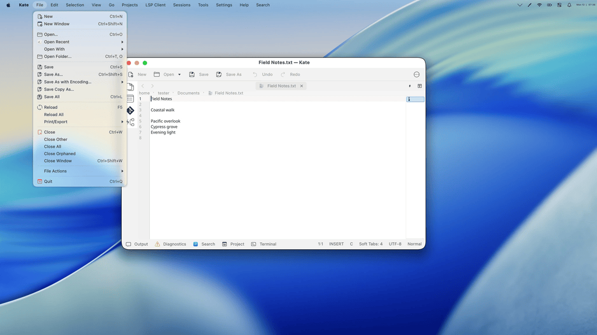
</p>

<br>

### Adaptief contrast

De tekstkleur past zich aan de achtergrond aan zodat labels leesbaar blijven.

<p align="center">
  
</p>

<br>

### Launchpad

Zoek apps of blader per categorie.

<p align="center">
  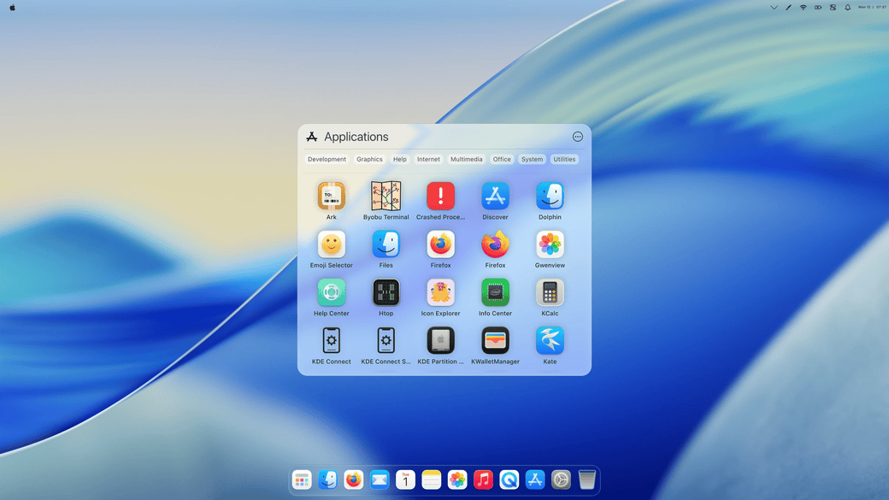
</p>

<br>

### Control Center

Regel wifi, geluid en helderheid in één menu.

<p align="center">
  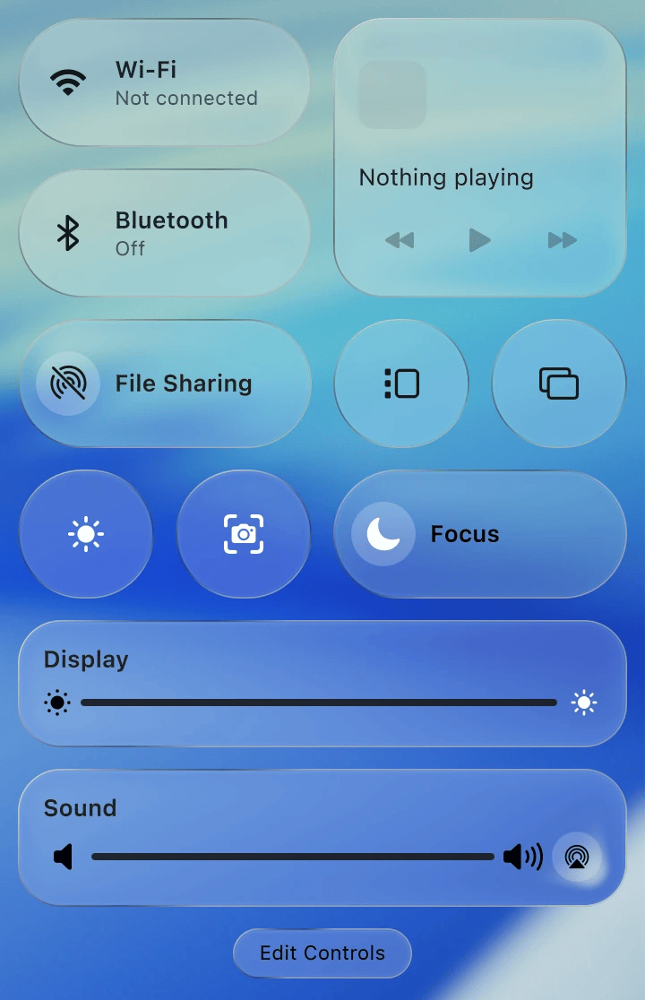
</p>

<br>

### Meldingen

Bekijk recente meldingen gegroepeerd per app.

<p align="center">
  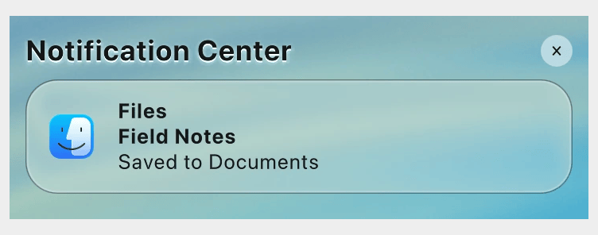
</p>

<br>

### Finder

Blader door bestanden in een venster in Finder-stijl.

<p align="center">
  <a href="src/screenshots/previews/tahoe-finder-light-dark-cc3aa8aa5673.gif">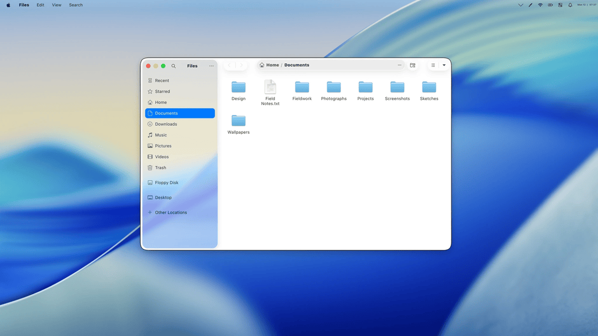</a>
</p>

<br>

### Kalender

Open de klok om de maandkalender te bekijken.

<p align="center">
  
</p>

<br>

### Bluetooth

Verbind gekoppelde apparaten en bekijk hun batterijniveau.

<p align="center">
  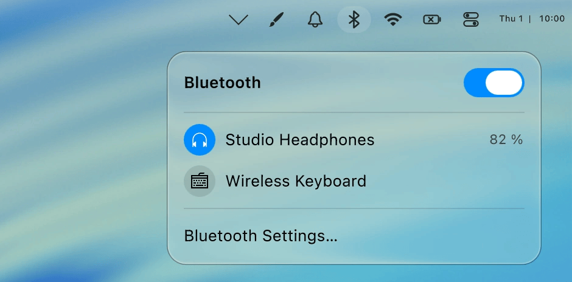
</p>

### Wi-Fi

Bekijk beschikbare netwerken en de verbindingsstatus.

<p align="center">
  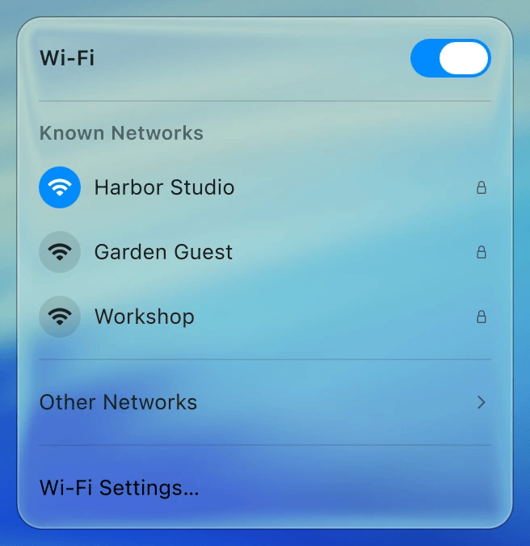
</p>

<br>

### Batterij

Controleer het batterijniveau en de laadstatus.

<p align="center">
  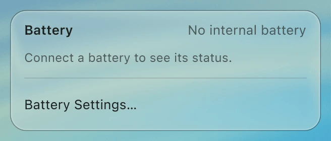
</p>

<br>

### Klembordgeschiedenis

Gebruik eerder gekopieerde tekst en afbeeldingen opnieuw.

<p align="center">
  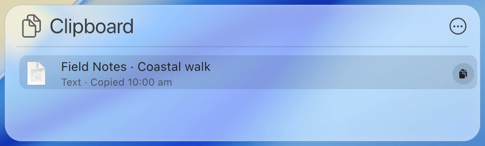
</p>

<br>

### Systeminformatie

Bekijk details over hardware, software en het thema.

<p align="center">
  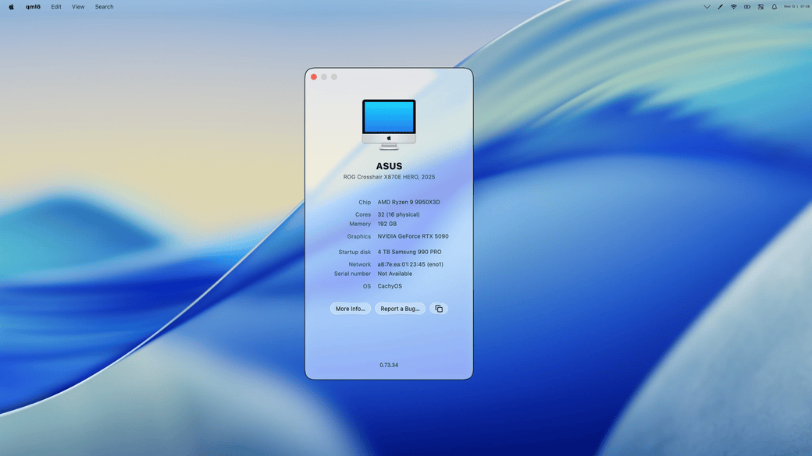
</p>

<br>

### Plasma-thema

Menu’s en pop-ups volgen het lichte of donkere thema.

<p align="center">
  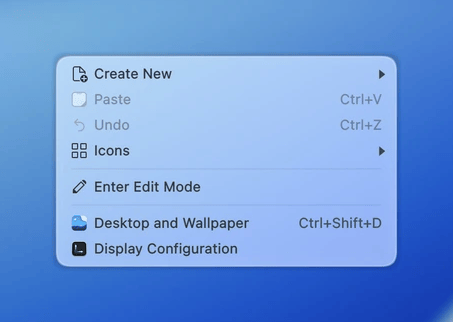
</p>

<br>

### Opstartscherm

Bij het opstarten verschijnt een scherm dat past bij het thema.

<p align="center">
  
</p>

<br>


- **Uiterlijk:** Gecoördineerde licht- en donkere thema's voor de desktop, apps, icoons en vensterdekoratie, met automatische schakeling en behangpapers per monitor. [App-specifieke ingestelde vensterdekoratie](docs/app-window-decorations.md)
- **Glas effecten:** Verstelbare vervaagbaarheid, breuk en tinting, met tekst die zich aanpast aan de achtergrond in ondersteunde menu's.
- **- Ik ben er niet .** Pinned apps, hover zoom, kennisgeving badges en configureerbare verstoppen. De Dock volgt je tussen de schijven.
- **Menubar en Centrum van besturing:** Globale appmenüs en snelle systeemcontroles, met gedeelde menubalkeninstellingen op verschillende displays.
- **Startpad:** Zoek apps, blader categorieën en bewaren favorieten in een van de twee lay-outs.
- **Desktop widgets:** Voeg de bundelde Liquid Glass-widgets toe en regel ze op je desktop.
- **Meldingen:** Glasbanner en geaggregeerde geschiedenis, met snelle acties en antwoorden waar apps ze ondersteunen.
- **Verleden van het clipboard:** Zoek en gebruik gekopieerde tekst en afbeeldingen opnieuw en pin items die je wilt bewaren.
- **App-integratie:** Browsing in de stijl van Finder in Nautilus, GTK-menu-integratie en Firefox-thema met profielbackups.
- **Systeminformatie en opstart:** Een thematisch systeeminformatievenster en een optionele matchende bootsplash.
- **Installatie en herstel:** Een grafische installatie met bundelde thema-acties, updates en settings back-ups die bij het verwijderen van de installatie kunnen worden hersteld.
- **Taal:** Kies de installatiel in Instellingen. Plasma widgets volgen de desktop taal.
- **Compatibiliteit:** Plasma 6.6 ⁇ 6.8 op Arch- en Fedora-gebaseerde systemen, openSUSE, Debian en KDE neon.
- **Facultatieve functies:** OLED-paneelbescherming en experimentele ondersteuning voor NixOS en Home Manager.

<br>


Download en open de installatie:

```bash
git clone --filter=blob:none https://github.com/lestercorderomurillo/macos-tahoe-liquid-kde.git
cd macos-tahoe-liquid-kde
./installer
```

Kies **Express** om te installeren. Open `./installer` opnieuw om bij te werken of te verwijderen.

Zo maak je schijfruimte vrij met behoud van je Git-werkkopie en lokale wijzigingen:

```bash
./installer --free-space
```

| Installaattaal | Status |
| --- | --- |
| 🇺🇸 English |  |
| 🇪🇸 Español |  |
| 🇨🇳 简体中文 |  |
| 🇧🇷 Português (Brasil) |  |
| 🇩🇪 Deutsch |  |
| 🇫🇷 Français |  |
| 🇮🇹 Italiano |  |
| 🇷🇺 Русский |  |
| 🇯🇵 日本語 |  |
| 🇰🇷 한국어 |  |
| 🇸🇦 العربية |  |
| 🇮🇳 हिन्दी |  |
| 🇳🇱 Nederlands |  |
| 🇵🇱 Polski |  |
| 🇹🇷 Türkçe |  |

<details>
<summary><b>Verplichtingen</b></summary>

Vervolgens wordt de werkplek, de bouwwerktuigen en de systeempakketten vereist.

- KDE Plasma 6.6+
- Python 3.10+ en PyQt6
- `sudo`
- Qt 6 ontwikkelingsinstrumenten
- KDE en Qt 6 ontwikkelpakketten voor de gecompileerde plasmoïden en KWin-effecten
- `cmake`, `g++`, en `pkg-config` wanneer gecompileerde functies worden geselecteerd
- `dbus-send`
- `systemctl` of `crontab` voor geplande functies

**dinit:** de installateur detecteert dinit en maakt gebruik van cron-inscripties per gebruiker voor automatische licht-/donkeruitwisseling en OLED-verzorging. Een running cron daemon is vereist installatie `crontab` Alleen begint het niet. Op Artix/dinit bereiden:

```bash
sudo pacman -S --needed cronie cronie-dinit
sudo dinitctl --system enable cronie
```

Automatische schakelaars werken om 06:00 en 18:00 uur tijdens het inloggen de cron backend heeft geen log-time ophalen. Handmatig licht/donker schakelen werkt onafhankelijk van cron. De bestaande screenshots van Artix bestrijken OpenRC.

De activa zijn gebundeld. Ontbrekende afhankelijkheden en optionele KDE Rounded Corners vereisen internettoegang. Geverifieerde Rounded Corners updates verwijderen oudere gedownload bronnen en archieven. De herinstalling vervangt de beheerde assetbomen op hun plaats. Succesvolle kopieën verwijderen hun tijdelijke gegevens, en later kopieën schone onderbroken wegwerpstaging. Er worden back-ups van het herstel, back-ups van het browserprofiel en gebruikersvoorkeuren bewaard. Ontwikkelaars VM-afbeeldingen en opnamebundels zijn geen installatie-caches en worden nooit automatisch verwijderd.

| Distro | Qt 6 Werktuigen | KDE Plasma 6 ontwikkelpakketten |
|--------|------------|-----------------------------------|
| Arch familie | `pacman -S qt6-tools` | `pacman -S extra-cmake-modules plasma-workspace kdecoration libplasma libnotificationmanager libksysguard plasma-activities-stats` |
| Familie Fedora | `dnf install qt6-qttools-devel` | `dnf install extra-cmake-modules plasma-workspace-devel kdecoration-devel libplasma-devel knotifications-devel libksysguard-devel kf6-plasma-activities-devel` |
| openSUSE Tumbleweed | `zypper install qt6-tools-devel` | `zypper install extra-cmake-modules plasma6-workspace-devel kdecoration-devel libKF6Plasma-devel libnotificationmanager6-devel libksysguard6-devel libKF6PlasmaActivitiesStats6-devel` |

Op Fedora installeert de installateur Fedora  ⁇ s GTK 3 wereldwijde menu-exporteur, `unity-gtk3-module`, en laadt het bij login voor GTK 3 applicaties.

</details>

<details>
<summary><b>OLED-verzorging</b></summary>

Optioneel schakelen van panelen standaard uitgeschakeld.

De **OLED-bescherming** pagina. Kies het verschuivingsinterval en de maximale pixelverplaatsing daar Het is standaard uitgeschakeld.

**Handmatige bediening**

```bash
mac-tahoe-oled-care shift
mac-tahoe-oled-care restore
mac-tahoe-oled-care status
```

</details>

<br>


Controleer de ondersteuning voor uw distributie, init systeem en Plasma versie.

<details>
<summary><b>Distributietests</b></summary>

Probeer het thema in een geïsoleerde Plasma desktop.

```bash
./vm <os>
```

**OS:** `cachyos` · `arch` · `manjaro` · `endeavouros` · `garuda` · `fedora` · `nobara` · `opensuse` · `neon` · `debian` · `artix` · `kubuntu`

`all` Elke distributie wordt gelanceerd. Automatische levering van clouddoelstellingen de andere doelstellingen gebruiken hun officiële ISO-installaties met een controle-som. Volg de [VM-instelling en kwalificatiehandleiding](tests/vm/README.md).

`./vm kubuntu` opstart van de officiële Kubuntu 26.04.1 LTS ISO met SHA-256 verificatie (SSH-poort) `2234` na de opstelling van de gasten). Het nieuwe doel van de regressie van de lancer is in afwachting van volledige live kwalificatie.

`./vm debian` gebruikt de officiële Debian-testing (Forky) cloud-image, verifieert zijn SHA-512 checksum en beschikt over een Plasma desktop. Log in als `tester` met wachtwoord `tester`Het gaat om SSH is beschikbaar op: `127.0.0.1:2232`- Ik heb het niet gedaan . De installatie wordt geopend vanaf een schrijfbare gast kopie op `/home/tester/macos-tahoe-liquid-kde`Het gaat om de host-repository is alleen voor lezen bevestigd. Gebruik `./vm debian --clean` om de wegwerpgasten opnieuw te bouwen.

Alle 11 distributies in deze tabel hebben de live VM-kwalificatie geslaagd. Selecteer een status badge voor herzien screenshots en testresultaten.

| | Naam | Status |
|:--:|------|---------|
|  | CachyOS | [](tests/vm/PROOF.md#cachyos) |
|  | Arch Linux | [](tests/vm/PROOF.md#arch) |
|  | EndeavourOS | [](tests/vm/PROOF.md#endeavouros) |
|  | Fedora | [](tests/vm/PROOF.md#fedora) |
|  | Manjaro | [](tests/vm/PROOF.md#manjaro) |
|  | Artix Linux (OpenRC) | [](tests/vm/PROOF.md#artix) |
|  | Garuda Linux | [](tests/vm/PROOF.md#garuda) |
|  | Nobara | [](tests/vm/PROOF.md#nobara) |
|  | openSUSE Tumbleweed | [](tests/vm/PROOF.md#opensuse) |
|  | KDE neon | [](tests/vm/PROOF.md#neon) |
|  | Debian-testing / sid (Plasma 6.6+) | [](tests/vm/PROOF.md#debian) |

**NixOS en Home Manager (testing)**

Gebruik de flake modules. **niet de grafische installateur**- Ik heb het niet gedaan . Live desktop validatie is in afwachting.

**Invoer van vlekken** (vervolgt Nixpkgs en Home Manager):

```nix
inputs.mac-tahoe = {
  url = "github:lestercorderomurillo/macos-tahoe-liquid-kde/v0.55.2";
  inputs.nixpkgs.follows = "nixpkgs";
  inputs.home-manager.follows = "home-manager";
};
```

**NixOS:** invoer `inputs.mac-tahoe.nixosModules.default`.

```nix
services.desktopManager.plasma6.enable = true;
services.mac-tahoe.enable = true;
# services.mac-tahoe.plymouth.enable = true; # optional boot splash
```

**Home Manager:** invoer `inputs.mac-tahoe.homeManagerModules.default`.

```nix
programs.mac-tahoe = {
  enable = true;
  mode = "auto"; # or "light" / "dark"
  # appleAssets = true;
  # oledCare.enable = true;
};
```

**Apple-activa:** optionele niet-vrije lettertypen, behangpapieren en geluiden. Het mogelijk maken `appleAssets` vereist ook:

```nix
nixpkgs.config.allowUnfreePredicate = pkg:
  builtins.elem (lib.getName pkg) [ "mac-tahoe-apple-assets" ];
```

**Panelen:** ook uw eigen plasma-manager module importeren en `inputs.mac-tahoe.homeManagerModules.plasma-manager`- Ik heb het niet gedaan . In staat stellen `programs.mac-tahoe.panels.enable` en set `programs.mac-tahoe.panels.launchers`, bv. `[ "applications:org.kde.dolphin.desktop" ]`- Ik heb het niet gedaan . Dit vervangt de lay-out zonder het importeren van bestaande pins.

**Schrijfbare instellingen:** - Hou `kdeglobals`, `kwinrc`, `plasmarc`, `plasmashellrc`, `kcminputrc`, `plasma-org.kde.plasma.desktop-appletsrc`, `Kvantum/kvantum.kvconfig` en live GTK-configuratie schrijfbaar. Vermijd onveranderlijke plasma-manager-sleutels die worden beheerd door de thema-schakelaar.

Log uit en terug na activering. Firefox profielen, GTK boekmerken en SDDM zijn niet geconfigureerd. In Home Manager ingesteld `programs.mac-tahoe.gtkAppmenuModule` naar het volledige pad van een geïnstalleerde GTK 3-appmenu-modulebibliotheek om het bij login te laden. Voordat de OLED-verzorging wordt uitgeschakeld, loop `mac-tahoe-oled-care restore`Het gaat om Selecteer Breeze voordat u de modules verwijdert. Het verwijderen laat de gebruikersinstellingen op hun plaats.

</details>

<details>
<summary><b>Init-systemen</b></summary>

Automatische thema-switching en OLED-verzorging maken gebruik van de volgende backends voor het schedelen:

| Init-systeem | Schema | Opgetekende testen |
| --- | --- | --- |
| systemd | Gebruikerstimers |  |
| OpenRC | Per gebruiker cron |  |
| dinit | Per gebruiker cron |   |

OpenRC en dinit hebben een running cron daemon nodig. [Resultaten van de test op desktop](tests/vm/PROOF.md) · [dinit-planning sonde](CONTRIBUTING.md#setup).

</details>

<details>
<summary><b>Plasma-versie</b></summary>

Plasma 6.6 ⁇ 6.8 wordt ondersteund gecompileerde effecten gebruiken de host SDK.

| Plasma | Ondersteuning | Sinds |
|--------|---------|-------|
| 6.5 en ouder |  | Niet van toepassing |
| 6.6 |  | v0.1.0 |
| 6.7 |  | v0.19.0 |
| 6.8 |  | v0.54.1 |

</details>

<br>


Dit is een onafhankelijke herimplementatie, geïnspireerd op de vormgeving van macOS. Het project is niet verbonden aan Apple of KDE en wordt door geen van beide onderschreven. ‘macOS’ en ‘Apple’ zijn handelsmerken van Apple Inc.

Het macOS-embleem, de meegeleverde achtergronden en systeemgeluiden en de lettertypen SF Pro en SF Mono zijn eigendom van Apple en vallen buiten de projectlicentie. Voor andere onderdelen blijven hun eigen licenties en auteursrechtvermeldingen van kracht. De lijst met vermeldingen van derden beschrijft de reikwijdte en bekende hiaten in de herkomstgegevens.

Het project als geheel valt onder de [GPL-3.0](LICENSE). De licenties van de afzonderlijke onderdelen en de rechten van derden blijven gelden. Zie de [auteursrechtvermeldingen](NOTICE), [licenties en projectidentiteit](LICENSING.md) en [vermeldingen van derden](THIRD_PARTY_NOTICES.md).

<br>


<details>
<summary><b>Projecten, activa en erkenningen</b></summary>

Projectreferenties en componenten van derden:

- **[EliverLara](https://github.com/EliverLara/TahoeLauncher)**: `TahoeLauncher`: Verwijzing voor het ontwerp van de lanceringspad.
- **[vinceliuice](https://github.com/vinceliuice)**: `MacTahoe-icon-theme`: basisiconen en cursoren GTK-ontwerpreferentie. [`MacTahoe-gtk-theme` Firefox CSS/SVG](https://github.com/vinceliuice/MacTahoe-gtk-theme/tree/main/other/firefox) wordt hier als een MIT-licentie gewaarborgd fork met profiel back-up en herstel ondersteuning.
- **[taj-ny](https://github.com/taj-ny/kwin-effects-forceblur)** en **[4v3ngR](https://github.com/4v3ngR/kwin-effects-glass)**: Better Blur en zijn glasvork: upstream code gebruikt door Acrylic Glass (de auteurs van KWin blur blijven in de bronopschriften vermeld).
- **[luisbocanegra](https://github.com/luisbocanegra/plasma-panel-colorizer)**: `plasma-panel-colorizer` V7.3.0, offline gebundeld en geïnstalleerd via de lay-out stap om de panelen te tinten (GPL-3.0, licentie geleverd naast).
- **[jaxparrow07](https://github.com/jaxparrow07/liquidglass-kde-widgets)**: `liquidglass-kde-widgets` biedt de bundelde collectie van Liquid Glass desktop widgets (GPL-3.0, licentie inbegrepen).
- **[RoxasYTB](https://github.com/RoxasYTB)**: [Widget foto ' s](https://github.com/jaxparrow07/liquidglass-kde-widgets/pull/41) Foto's op het bureau weergeven. [Automatische wisseling van vaste/glas](https://github.com/jaxparrow07/liquidglass-kde-widgets/pull/40) schakelt de widgets naar Glass wanneer een venster op het scherm is geopend.
- **[Matin Lotfaliei / KDE-Rounded-Corners](https://github.com/matinlotfali/KDE-Rounded-Corners)**: het GPL-3.0 KWin afgeronde venster-effect, ontleend uit de gepinned v0.9.0 release en online gebouwd tegen de host KWin SDK (licentie geïnstalleerd naast).
- **[ful1e5](https://github.com/ful1e5)**: `apple_cursor`: alternatieve cursorontwerpreferentie.
- **[sahibjotsaggu](https://github.com/sahibjotsaggu)**: `San-Francisco-Pro-Fonts`: bron van de SF Pro/SF Mono bundel.
- **[Lucide](https://github.com/lucide-icons/lucide)**: kopieër iconen in het wereldwijde menu (ISC, © Lucide Contributors).
- **[512pixels.net](https://512pixels.net/projects/default-mac-wallpapers-in-5k/)**: een archief met hoge resolutie voor macOS behang.

Als er een krediet ontbreekt, alsjeblieft. [open een issue](https://github.com/lestercorderomurillo/macos-tahoe-liquid-kde/issues/new).

</details>


[Installatie screenshots en testen](TESTING.md).
