<p align="center">
  <!-- Adapted with ImageGen from artwork by Apple: https://developer.apple.com/assets/elements/icons/macos-26/macos-26-128x128_2x.png. Tux design by Larry Ewing. -->
  
</p>

<h1 align="center">macOS Tahoe Shell for KDE Linux</h1>

<p align="center">
  <a href="README.md" lang="en" hreflang="en">🇺🇸 English</a> ·
  <a href="README.es.md" lang="es" hreflang="es">🇪🇸 Español</a> ·
  <a href="README.zh-CN.md" lang="zh-CN" hreflang="zh-CN">🇨🇳 简体中文</a> ·
  <a href="README.pt-BR.md" lang="pt-BR" hreflang="pt-BR">🇧🇷 Português (Brasil)</a> ·
  <a href="README.de.md" lang="de" hreflang="de">🇩🇪 Deutsch</a> ·
  <a href="README.fr.md" lang="fr" hreflang="fr">🇫🇷 Français</a> ·
  <a href="README.it.md" lang="it" hreflang="it">🇮🇹 Italiano</a> ·
  <a href="README.ja.md" lang="ja" hreflang="ja">🇯🇵 日本語</a> ·
  <a href="README.ko.md" lang="ko" hreflang="ko">🇰🇷 한국어</a> ·
  <a href="README.ru.md" lang="ru" hreflang="ru">🇷🇺 Русский</a> ·
  <a href="README.ar.md" lang="ar" hreflang="ar">🇸🇦 العربية</a> ·
  <a href="README.hi.md" lang="hi" hreflang="hi">🇮🇳 हिन्दी</a> ·
  <a href="README.nl.md" lang="nl" hreflang="nl">🇳🇱 Nederlands</a> ·
  <a href="README.pl.md" lang="pl" hreflang="pl" aria-current="page">🇵🇱 Polski</a> ·
  <a href="README.tr.md" lang="tr" hreflang="tr">🇹🇷 Türkçe</a>
</p>

<p align="center">
  <a href="https://github.com/lestercorderomurillo/macos-tahoe-liquid-kde/releases"></a>
  <a href="https://github.com/lestercorderomurillo/macos-tahoe-liquid-kde/actions/workflows/test.yml"></a>
  <a href="https://kde.org/plasma-desktop/"></a>
  <a href="LICENSE"></a>
  <a href="https://github.com/lestercorderomurillo/macos-tahoe-liquid-kde/issues/new"></a>
</p>


<p align="center">
  <sub>Wybierz dystrybutor, aby zobaczyć jego status testowy.</sub>
</p>

<p align="center">
  <a href="tests/vm/PROOF.md#cachyos" title="CachyOS"></a>
  <a href="tests/vm/PROOF.md#arch" title="Arch Linux"></a>
  <a href="tests/vm/PROOF.md#endeavouros" title="EndeavourOS"></a>
  <a href="tests/vm/PROOF.md#fedora" title="Fedora"></a>
  <a href="tests/vm/PROOF.md#manjaro" title="Manjaro"></a>
  <a href="tests/vm/PROOF.md#artix" title="Artix Linux (OpenRC)"></a>
  <a href="tests/vm/PROOF.md#garuda" title="Garuda Linux"></a>
  <a href="tests/vm/PROOF.md#nobara" title="Nobara Linux"></a>
  <a href="tests/vm/PROOF.md#opensuse" title="openSUSE Tumbleweed"></a>
  <a href="tests/vm/PROOF.md#neon" title="KDE neon"></a>
  <a href="tests/vm/PROOF.md#debian" title="Debian testing / sid (Plasma 6.6+)"></a>
  <a href="tests/vm/PROOF.md#nixos" title="NixOS (experimental)"></a>
</p>

Ten projekt dostosowuje wygląd i wrażenie Twojego desktopu KDE na Linuxie. Nie obejmuje ani nie łączy się z usługami Apple. Jeśli potrzebujesz usług Apple, [zakupy bezpośrednio z Apple](https://www.apple.com/store).

> [!CAUTION]
> **Aktualizacje ciągłe**
> Eksperymentalny. Otrzymuje codzienne informacje. Aktualizacje mogą zakłócić zgodność. Unikać systemów produkcyjnych; [zgłoś problem tutaj](https://github.com/lestercorderomurillo/macos-tahoe-liquid-kde/issues/new).

> [!NOTE]
> Zamarzenie funkcji jest w mocy dla serii 0.8x, z wydawnictwami koncentrującymi się na naprawach błędów do 0.90.

> [!WARNING]
> **Uważaj na przepakowy płatnych ścian: ten temat jest bezpłatny.**
>
> Jeśli znalazłeś ten temat za pośrednictwem kanału zewnętrznego, nie musisz płacić, aby go zdobyć: pobierz go bezpośrednio z tego repozytorium. Trzymamy ten projekt za darmo, żeby wszyscy mogli go cieszyć bez płatności. Nie wymagane jest zakup lub subskrypcja.

<br>


Raporty o błędach, naprawy, badania i dokumentacja: zobacz [Przewodnik wkładu](CONTRIBUTING.md).

Współpracownicy kodów i reporterzy w Tahoe i Golden Gate:

<p>
  <a href="https://github.com/lestercorderomurillo"></a>
  <a href="https://github.com/yanhenrique-dev"></a>
  <a href="https://github.com/naevui"></a>
  <a href="https://github.com/caioniehues"></a>
  <a href="https://github.com/404-not-found129"></a>
  <a href="https://github.com/myakupozluk"></a>
  <a href="https://github.com/EMS1998"></a>
  <a href="https://github.com/allfritz"></a>
  <a href="https://github.com/elegos"></a>
  <a href="https://github.com/kozeki-uii"></a>
  <a href="https://github.com/imightbelosthere"></a>
  <a href="https://github.com/evaildev"></a>
  <a href="https://github.com/xarblu"></a>
  <a href="https://github.com/PKMNPlatin"></a>
  <a href="https://github.com/matinlotfali"></a>
  <a href="https://github.com/luisbocanegra"></a>
  <a href="https://github.com/OliverChase2003"></a>
  <a href="https://github.com/RoxasYTB"></a>
  <a href="https://github.com/Flagwill"></a>
  <a href="https://github.com/4l3j0Ok"></a>
  <a href="https://github.com/0xrushi"></a>
  <a href="https://github.com/aenriii"></a>
  <a href="https://github.com/andreas399"></a>
  <a href="https://github.com/Andrew-Sor"></a>
  <a href="https://github.com/ardashir77"></a>
  <a href="https://github.com/azizaktas"></a>
  <a href="https://github.com/binary-pleb"></a>
  <a href="https://github.com/bneils"></a>
  <a href="https://github.com/FAYZER77"></a>
  <a href="https://github.com/fxrncyyisingithub"></a>
  <a href="https://github.com/germanbagutteorsomething"></a>
  <a href="https://github.com/iNarrow12"></a>
  <a href="https://github.com/IsaiahSHanson"></a>
  <a href="https://github.com/kuau"></a>
  <a href="https://github.com/Lando0007"></a>
  <a href="https://github.com/LilT59"></a>
  <a href="https://github.com/marcosfantonio"></a>
  <a href="https://github.com/moulikanand12345-lang"></a>
  <a href="https://github.com/nanechi"></a>
  <a href="https://github.com/nousernameget"></a>
  <a href="https://github.com/OpalSand"></a>
  <a href="https://github.com/P0sixSplo1t-2"></a>
  <a href="https://github.com/rokan00"></a>
  <a href="https://github.com/RussH"></a>
  <a href="https://github.com/Salkio"></a>
  <a href="https://github.com/Shivamingale3"></a>
  <a href="https://github.com/shoko3756"></a>
  <a href="https://github.com/Sonicx9876"></a>
  <a href="https://github.com/Tias-dev"></a>
  <a href="https://github.com/txhammer68"></a>
  <a href="https://github.com/vanshdev0101"></a>
  <a href="https://github.com/vialolis"></a>
  <a href="https://github.com/Whiddu"></a>
  <a href="https://github.com/yingmanwumen"></a>
  <a href="https://github.com/yofriendfromschool1"></a>
  <a href="https://github.com/zhaokelei"></a>
  <a href="https://github.com/blaykelarue"></a>
  <a href="https://github.com/JacobJS34"></a>
  <a href="https://github.com/Leon-Swains"></a>
  <a href="https://github.com/LucipurrsDad"></a>
  <a href="https://github.com/SinglerGold2"></a>
</p>

<br>


### Dock z wielofarewnym wsparciem (Alfa)

Szklana refrakcja, zwiększenie przesuwania, czerwone informacje o liczbie pęcherzy i automatyczne ukrywanie.

<p align="center">
  
</p>

<br>

### Shell (Alpha)

Pliki, edycja i inne menu aplikacji podążają za oknem aktywnym. Otwórz menu systemu do ustawień i kontroli sesji.

<p align="center">
  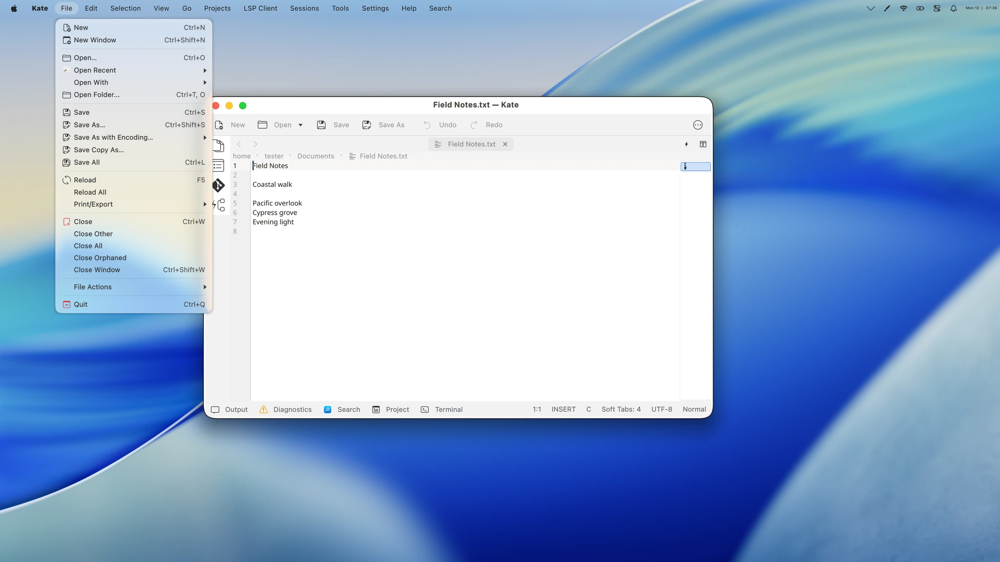
  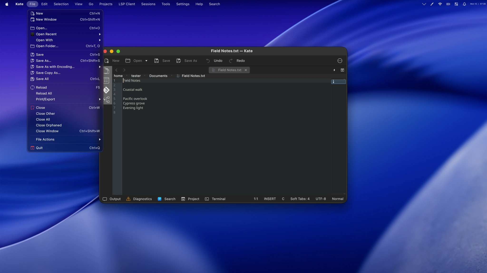
</p>

<br>

### Szklane akrylowe 2.0 z adaptacyjnym kontrastem

Adaptive Contrast próbuje tła za każdym etykietą. Utrzymuje kolor tematu, gdy różnica wynosi co najmniej 33 punktów jasności postrzegania. Pod tym celem, stosuje najmniejszą korektę, jaką może, do 40% skali RGB, zachowując jednocześnie jasny tekst jasny i ciemny tekst ciemny. Wyłączenie używa koloru tematu.

<br>

### Launchpad (Alpha)

Znajdź aplikacje, przeglądaj kategorie i trzymaj ulubione w zasięgu.

<p align="center">
  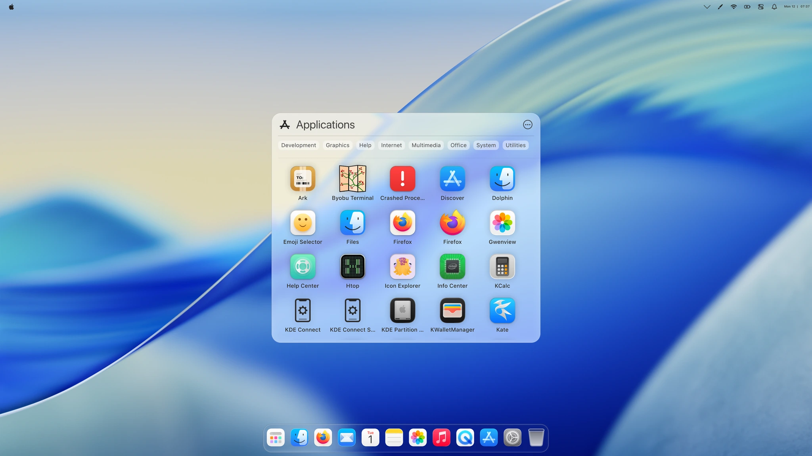
  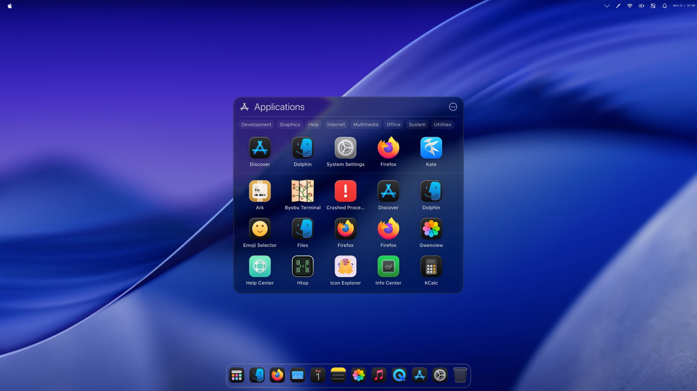
</p>

<br>

### Centrum sterowania (Alfa)

Wi-Fi, Bluetooth, dźwięk, jasność i powiadomienia w jednym szklanym menu. Przycisk widoczny pokazuje słońce dla Światła, księżyc dla Ciemności i podzielone koło dla Automatyki.

<p align="center">
  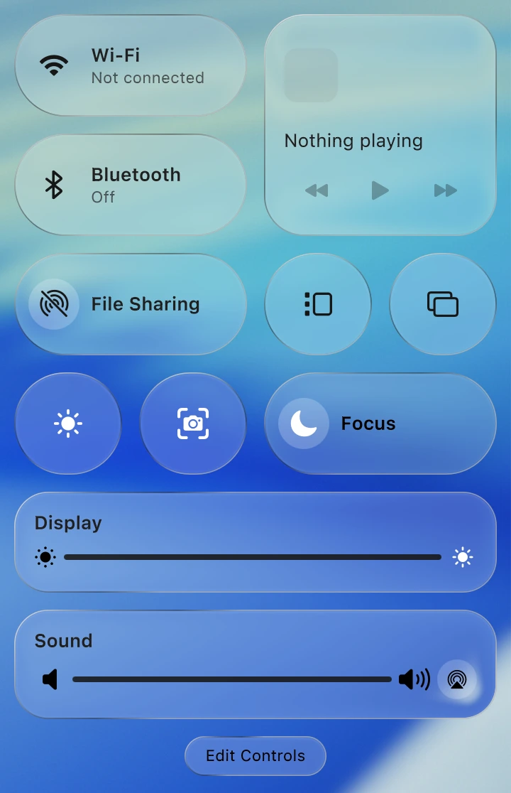
  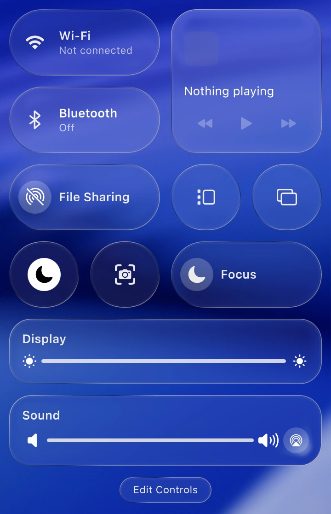
</p>

<br>

### Powiadomienia (Alfa)

Szklane banery powiadomienia i zgrupowana historia z działaniami aplikacji i wsparciem odpowiedzi.

<p align="center">
  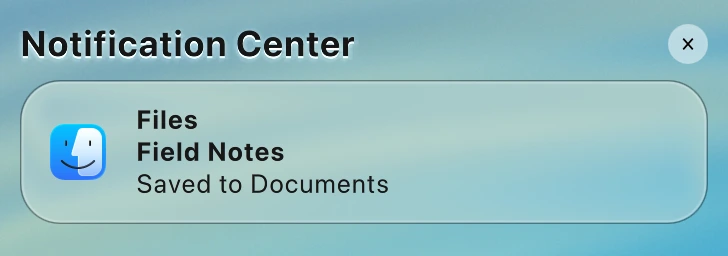
  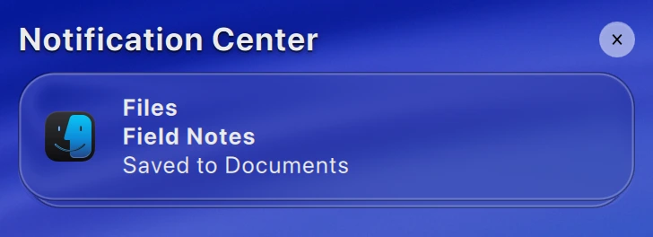
</p>

<p align="center">
  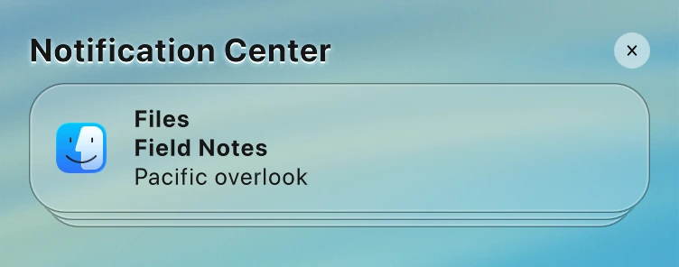
  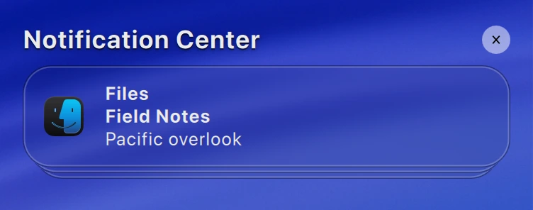
</p>

<br>

### Finder (Alpha)

Przeglądanie plików w stylu Finder z szkłem Tahoe.

<p align="center">
  <a href="src/screenshots/previews/readme-tahoe-light-finder-8b64ba8e3a8b.webp">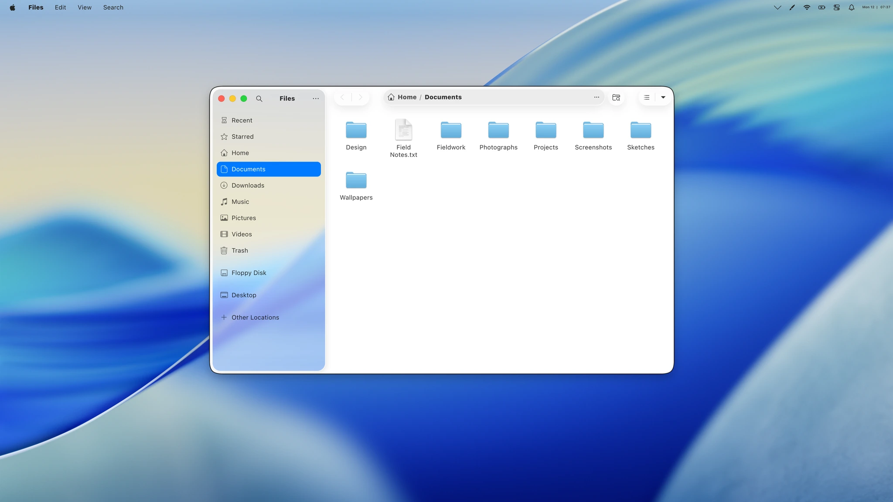</a>
  <a href="src/screenshots/previews/readme-tahoe-dark-finder-dd8777a43699.webp">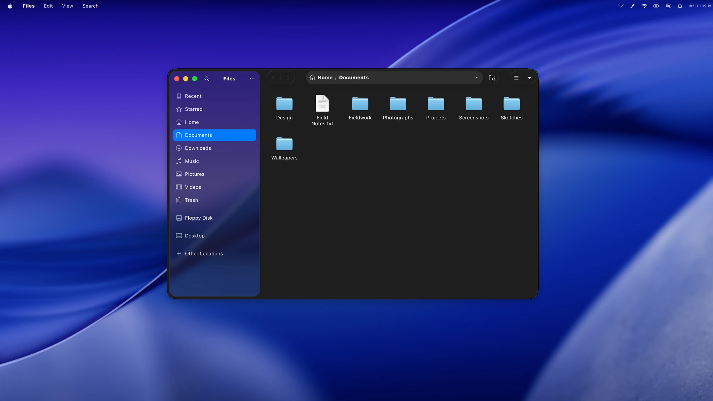</a>
</p>

<br>

### Kalendarz (Alfa)

Otwórz zegarek, aby zobaczyć miesiąc na szkle. Prześwietlać lub użyć klawiszy strzał, aby przeglądać miesiące. Naciskaj Home, aby wrócić do bieżącego miesiąca.

<p align="center">
  
  
</p>

<br>

### Bluetooth (Alpha)

Złącz pary urządzeń i sprawdź poziom baterii z pasku menu.

<p align="center">
  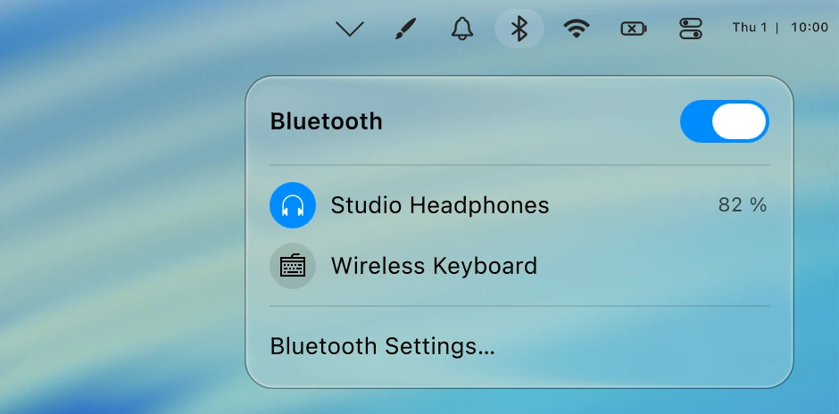
  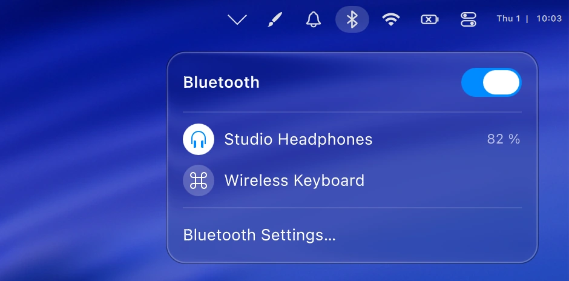
</p>

### Wi-Fi (Alpha)

Otwórz menu Wi-Fi, aby zobaczyć dostępne sieci bezprzewodowe. Bez adaptera Wi-Fi lub z wyłączeniem Wi-Fi menu zawiera listę połączeń przewodowych, a następnie pojedynczy podział i link ustawień Wi-Fi.

<p align="center">
  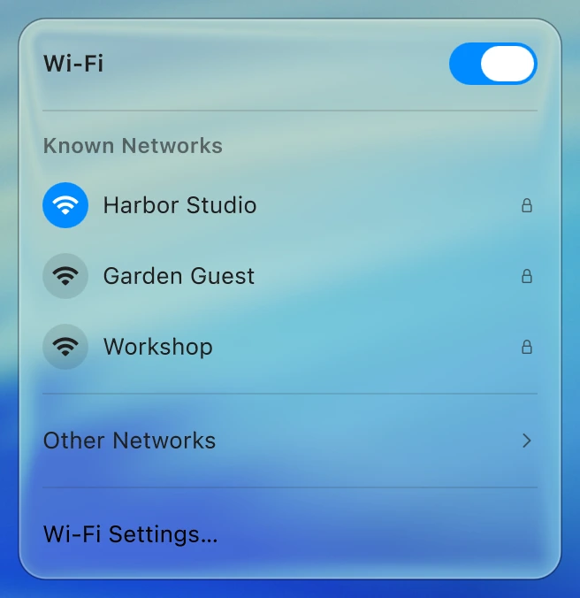
  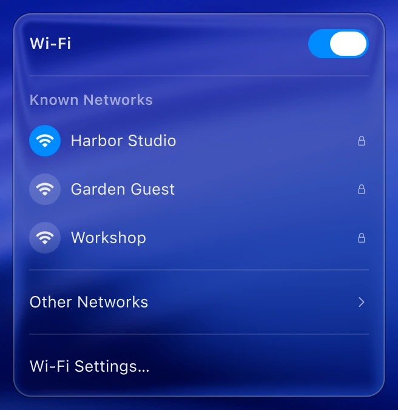
</p>

<br>

### Bateria (Alfa)

Otwórz menu baterii, aby sprawdzić poziom ładowania i stan mocy.

<p align="center">
  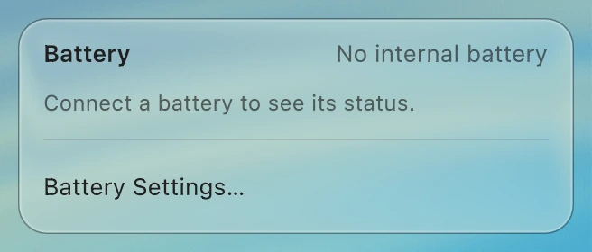
  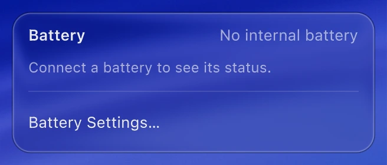
</p>

<br>

### Historia schowka (Alpha)

Znajdź i ponownie użyj kopiowanego tekstu i obrazów bezpośrednio z Launchpad.

<p align="center">
  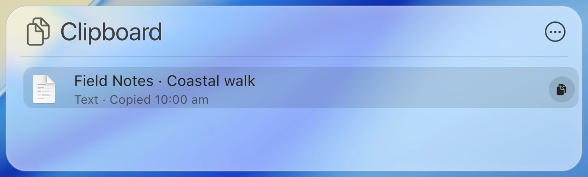
  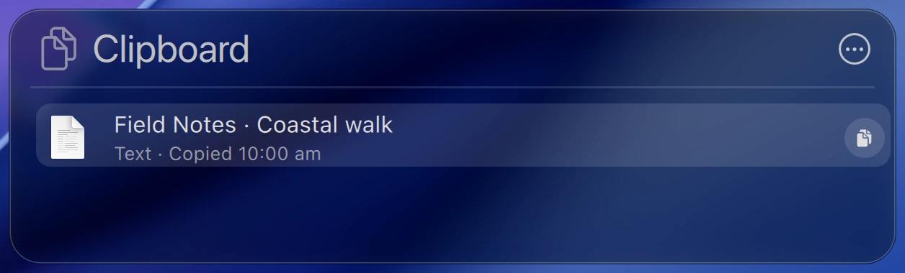
</p>

<br>

### Informacje o systemie (Alfa)

Hardwar, oprogramowanie i szczegóły tematyczne z adaptacyjnym kontrastem.

<p align="center">
  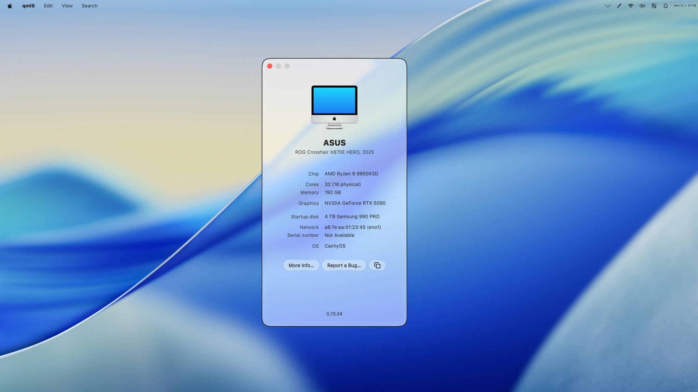
  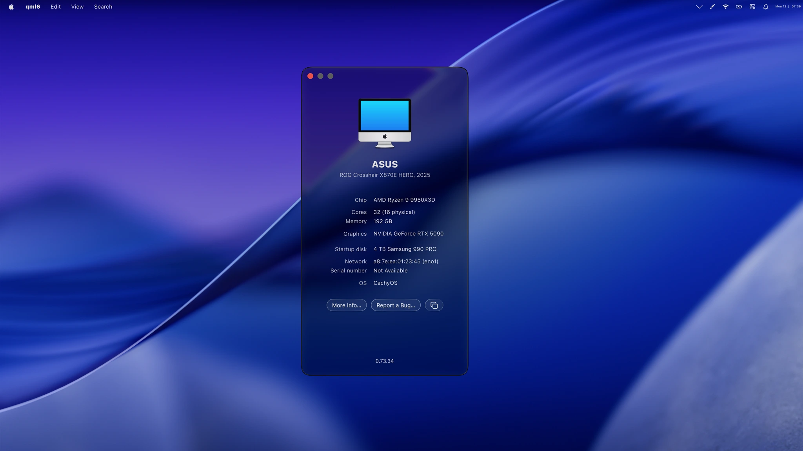
</p>

<br>

### Motyw Plasma (Alpha)

Przejrzysty menu i pop-ups z dopasowaniem jasnych i ciemnych kolorów.

<p align="center">
  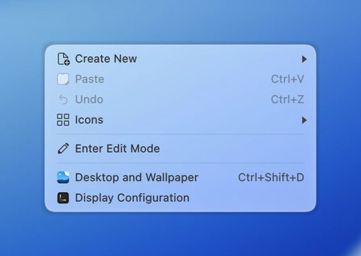
  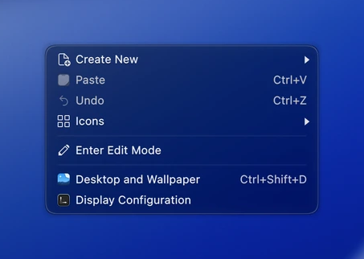
</p>

<br>

### Ekran rozruchowy (Alpha)

Od startu do wyłączania, z wbudowanym odblokowaniem dla dysków szyfrowanych LUKS2.

<p align="center">
  
</p>

<br>


- **Wygląd:** Koordynowane tematy światła i ciemności dla komputera, aplikacji, ikon i dekoracji okna, z automatycznym przełączeniem i tapetami monitorów. [Ustawienia dekoracji okna dla aplikacji](docs/app-window-decorations.md)
- **Efekty szkła:** Ustawiona rozmycie, odbicie i odbarwienie, z tekstem dostosowanym do tła w obsługiwanych menu.
- **- Wydarzenie:** Aplikacje wpisane, hover zoom, odznaki powiadomienia i konfigurowalne ukrywanie. Dock śledzi cię między wyświetlaczami.
- **Pętli menu i centrum sterowania:** Globalne menu aplikacji i szybkie sterowanie systemem, z udostępnieniem ustawień pasma menu na wyświetlaczach.
- **- Wyrzut:** Poszukaj aplikacji, przeglądaj kategorie i zapisz ulubione w jednym z dwóch układów.
- **Widgety do pracy:** Dodaj i zorganizuj pakiety widżetów Liquid Glass na komputerze.
- **Powiadomienia:** Szklane banery i zgrupowana historia, z szybkimi działaniami i odpowiedziami, gdzie aplikacje je wspierają.
- **Historia płyty:** Znajdź i ponownie użyj kopiowanego tekstu i obrazów oraz przyciskaj elementy, które chcesz zachować.
- **Integracja aplikacji:** Browsing w stylu Finder w Nautilus, integracja menu GTK i Firefox tematyczne z kopii zapasowych profilu.
- **Informacje o systemie i uruchomienie:** Tematyczne okno informacyjne systemu i opcjonalny dopasowany rozbłysk.
- **Wykład i odzyskanie:** Graficzny instalator z zestawionymi zasobami tematycznymi, aktualizacjami i kopii zapasowymi ustawień, które można przywrócić po odinstalowaniu.
- **Języki:** Wybierz język instalacji w ustawieniach. Widgety plasmowe śledzą język desktopa.
- **Kompatybilność:** Plasma 6.6 ⁇ 6.8 na systemach opartych na Arch i Fedora, openSUSE, Debian i KDE neon.
- **Funkcje opcjonalne:** Ochrona paneli OLED oraz eksperymentalne wsparcie dla systemów NixOS i Home Manager.

<br>


Zabierz i otwórz instalator:

```bash
git clone --filter=blob:none https://github.com/lestercorderomurillo/macos-tahoe-liquid-kde.git
cd macos-tahoe-liquid-kde
./installer
```

Wybierz **Express**, aby zainstalować. Aby zaktualizować lub odinstalować, ponownie uruchom `./installer`.

Aby zwolnić miejsce na dysku i zachować kopię roboczą Git oraz zmiany lokalne:

```bash
./installer --free-space
```

| Język instalatora | Stan |
| --- | --- |
| 🇺🇸 English |  |
| 🇪🇸 Español |  |
| 🇨🇳 简体中文 |  |
| 🇧🇷 Português (Brasil) |  |
| 🇩🇪 Deutsch |  |
| 🇫🇷 Français |  |
| 🇮🇹 Italiano |  |
| 🇷🇺 Русский |  |
| 🇯🇵 日本語 |  |
| 🇰🇷 한국어 |  |
| 🇸🇦 العربية |  |
| 🇮🇳 हिन्दी |  |
| 🇳🇱 Nederlands |  |
| 🇵🇱 Polski |  |
| 🇹🇷 Türkçe |  |

<details>
<summary><b>Wymogi</b></summary>

Wymagane komputery stacjonarne, narzędzia do budowy i pakiety systemowe.

- KDE Plasma 6.6+
- Python 3.10+ i PyQt6
- `sudo`
- Qt 6 Narzędzia do rozwoju
- Pakiety KDE i Qt 6 do opracowywania skompilowanych plasmoidów i efektów KWin
- `cmake`, `g++`, oraz `pkg-config` w przypadku wyboru skompilowanych funkcji
- `dbus-send`
- `systemctl` lub `crontab` w przypadku funkcji zaplanowanych

**dinit:** instalator wykrywa dynit i wykorzystuje wpisy cron na użytkownika do automatycznego przełączania światła/ciemności oraz obsługi OLED. Wymaga się bieżącego demona cron zainstalowanie `crontab` Sam to nie zaczyna. Na Artix/dinit przygotować z:

```bash
sudo pacman -S --needed cronie cronie-dinit
sudo dinitctl --system enable cronie
```

Automatyczne przełączniki działają o godzinie 06:00 i 18:00 podczas logowania cron backend nie ma czasu logowania. Manualne przełączanie światła / ciemności działa niezależnie od cron. istniejące zdjęcia ekranu Artix obejmują OpenRC.

Aktywa są zestawione. Brakujące zależności i opcjonalne KDE Rounded Corners wymagają dostępu do Internetu. Aktualizacje Verified Rounded Corners usuwają starsze pobrane źródła i archiwa. Znowu zainstalowanie zastępuje zarządzane drzewa aktywów na miejscu Użytkownicy mogą wykorzystać te dane, a następnie wykorzystać te dane w sposób wyczerpujący. Zachowają się kopie zapasowe odzyskiwania, kopie zapasowe profilu przeglądarki oraz preferencje użytkownika. Obrazy VM i pakiety do przechwytywania programistów nie są pamiętnikami pamięci pobieranymi do instalacji i nigdy nie są usunięte automatycznie.

| Distro | Qt 6 Narzędzia | Pakiety rozwoju KDE Plasma 6 |
|--------|------------|-----------------------------------|
| Rodzina Arch | `pacman -S qt6-tools` | `pacman -S extra-cmake-modules plasma-workspace kdecoration libplasma libnotificationmanager libksysguard plasma-activities-stats` |
| Rodzina Fedora | `dnf install qt6-qttools-devel` | `dnf install extra-cmake-modules plasma-workspace-devel kdecoration-devel libplasma-devel knotifications-devel libksysguard-devel kf6-plasma-activities-devel` |
| openSUSE Tumbleweed | `zypper install qt6-tools-devel` | `zypper install extra-cmake-modules plasma6-workspace-devel kdecoration-devel libKF6Plasma-devel libnotificationmanager6-devel libksysguard6-devel libKF6PlasmaActivitiesStats6-devel` |

Na Fedora instalator instaluje globalny eksporter menu Fedora GTK 3, `unity-gtk3-module`, i załaduje go przy logowaniu dla aplikacji GTK 3.

</details>

<details>
<summary><b>Opieka OLED</b></summary>

Opcjonalne zmiany paneli wyłączone domyślnie.

Włącz to w **Ochrona OLED** Strona. Wybierz interwał zmiany i maksymalny przemieszczanie pikseli tam jest domyślnie wyłączona.

**Wykonawcy**

```bash
mac-tahoe-oled-care shift
mac-tahoe-oled-care restore
mac-tahoe-oled-care status
```

</details>

<br>


Sprawdź obsługę systemu dystrybucji, systemu init i wersji Plasmy.

<details>
<summary><b>Testy dystrybucji</b></summary>

Spróbuj tematu w izolowanym komputerze z Plasmą.

```bash
./vm <os>
```

**OS:** `cachyos` · `arch` · `manjaro` · `endeavouros` · `garuda` · `fedora` · `nobara` · `opensuse` · `neon` · `debian` · `artix` · `kubuntu`

`all` uruchamia każdą dystrybucję. Automatyczne zapewnienie celów w chmurze pozostałe cele korzystają ze swoich oficjalnych instalatorów ISO, które są podłączone do sumy kontrolnej. /Prześlij [Przewodnik w zakresie ustawienia i kwalifikacji systemów automatycznych](tests/vm/README.md).

`./vm kubuntu` uruchamia oficjalną Kubuntu 26.04.1 LTS ISO z weryfikacją SHA-256 (port SSH) `2234` po ustawieniu gości). Ten nowy cel regresji startu czeka na pełną kwalifikację.

`./vm debian` Korzysta z oficjalnego obrazu chmury testowania Debian (Forky), weryfikuje sumę sprawdzania SHA-512 i zapewnia biurko Plasma. Zapisać się jako `tester` z hasłem `tester`Wydarzenie SSH jest dostępny w: `127.0.0.1:2232`- Nie , nie . Instalator otwiera się z zapisywalnej kopii gościa w `/home/tester/macos-tahoe-liquid-kde`Wydarzenie repozytorium hostingu jest zamontowane wyłącznie do odczytu. Wykorzystanie `./vm debian --clean` Aby odbudować gościa z jednego miejsca.

Wszystkie 11 dystrybucji w tej tabeli przeszły kwalifikację VM. Wybierz odznakę statusu dla przeglądanych zdjęć ekranu i wyników testów.

| | Nazwa | Stan |
|:--:|------|---------|
|  | CachyOS | [](tests/vm/PROOF.md#cachyos) |
|  | Arch Linux | [](tests/vm/PROOF.md#arch) |
|  | EndeavourOS | [](tests/vm/PROOF.md#endeavouros) |
|  | Fedora | [](tests/vm/PROOF.md#fedora) |
|  | Manjaro | [](tests/vm/PROOF.md#manjaro) |
|  | Artix Linux (OpenRC) | [](tests/vm/PROOF.md#artix) |
|  | Garuda Linux | [](tests/vm/PROOF.md#garuda) |
|  | Nobara | [](tests/vm/PROOF.md#nobara) |
|  | openSUSE Tumbleweed | [](tests/vm/PROOF.md#opensuse) |
|  | KDE neon | [](tests/vm/PROOF.md#neon) |
|  | Testy Debian / sid (Plasma 6.6+) | [](tests/vm/PROOF.md#debian) |

**NixOS i Home Manager (test)**

Używaj modułów flake, **nie graficzny instalator**- Nie , nie . Wydłużne jest zatwierdzenie na żywo.

**Wpływ płyt** (pracuje w Nixpkgs i Home Manager):

```nix
inputs.mac-tahoe = {
  url = "github:lestercorderomurillo/macos-tahoe-liquid-kde/v0.55.2";
  inputs.nixpkgs.follows = "nixpkgs";
  inputs.home-manager.follows = "home-manager";
};
```

**NixOS:** przywóz `inputs.mac-tahoe.nixosModules.default`.

```nix
services.desktopManager.plasma6.enable = true;
services.mac-tahoe.enable = true;
# services.mac-tahoe.plymouth.enable = true; # optional boot splash
```

**Home Manager:** przywóz `inputs.mac-tahoe.homeManagerModules.default`.

```nix
programs.mac-tahoe = {
  enable = true;
  mode = "auto"; # or "light" / "dark"
  # appleAssets = true;
  # oledCare.enable = true;
};
```

**Aktywa Apple:** opcjonalne niewolne czcionki, tapety i dźwięki. Umożliwienie `appleAssets` wymaga również:

```nix
nixpkgs.config.allowUnfreePredicate = pkg:
  builtins.elem (lib.getName pkg) [ "mac-tahoe-apple-assets" ];
```

**Panele:** wprowadzenie własnego modułu zarządzania plazmy i `inputs.mac-tahoe.homeManagerModules.plasma-manager`- Nie , nie . Umożliwienie `programs.mac-tahoe.panels.enable` i zestaw `programs.mac-tahoe.panels.launchers`, np. `[ "applications:org.kde.dolphin.desktop" ]`- Nie , nie . Zastępuje to układ bez importowania istniejących pinów.

**Ustawienia do pisania:** trzymać `kdeglobals`, `kwinrc`, `plasmarc`, `plasmashellrc`, `kcminputrc`, `plasma-org.kde.plasma.desktop-appletsrc`, `Kvantum/kvantum.kvconfig` i konfiguracja GTK jest wpisana. Unikaj niezmienionych kluczy zarządzających plazmą zarządzanych przez przełącznik tematyczny.

Włącz się i wracaj po aktywacji. Profile Firefox, znaki zapisy GTK i SDDM nie są skonfigurowane. W Home Manager, ustawione `programs.mac-tahoe.gtkAppmenuModule` do pełnej ścieżki zainstalowanej biblioteki modułów menu aplikacji GTK 3 do ładowania przy logowaniu. Przed wyłączeniem obsługi OLED uruchomić `mac-tahoe-oled-care restore`Wydarzenie przed usunięciem modułów wybierz Breeze. Usunięcie pozostawia ustawienia użytkownika na miejscu.

</details>

<details>
<summary><b>Systemy inicjowe</b></summary>

Automatyczne przełączanie tematu i obsługa OLED wykorzystują następujące elementy planowania:

| System inicjatywy | Wydanie harmonogramów | Wykrycie |
| --- | --- | --- |
| systemd | Czas użytkownika |  |
| OpenRC | Cron na użytkownika |  |
| dinit | Cron na użytkownika |   |

OpenRC i dinit wymagają uruchomienia demona cron. [Wyniki testów na komputerze](tests/vm/PROOF.md) · [sonda planowania](CONTRIBUTING.md#setup).

</details>

<details>
<summary><b>Wersje w postaci plazmy</b></summary>

Podtrzymywana jest plazma 6.6 ⁇ 6.8 Efekty kompilizowane wykorzystują host SDK.

| Plasma | Wsparcie | Od czasu |
|--------|---------|-------|
| 6.5 i starsze |  | Nie ma zastosowania |
| 6.6 |  | v0.1.0 |
| 6.7 |  | v0.19.0 |
| 6.8 |  | v0.54.1 |

</details>

<br>


Projekt jest niezależną implementacją inspirowaną wyglądem macOS. Nie jest powiązany z Apple ani KDE i nie ma ich oficjalnego poparcia. „macOS” i „Apple” to znaki towarowe Apple Inc.

Emblemat macOS, dołączone tapety i dźwięki systemowe oraz fonty SF Pro i SF Mono pozostają własnością Apple i nie podlegają licencji projektu. Pozostałe składniki zachowują własne licencje i informacje o prawach autorskich. Wykaz informacji o składnikach zewnętrznych określa ich zakres i wskazuje znane luki w dokumentacji pochodzenia.

Projekt jako całość jest dostępny na licencji [GPL-3.0](LICENSE). Nadal obowiązują licencje poszczególnych składników i prawa osób trzecich. Zobacz [informacje o prawach autorskich](NOTICE), [licencje i tożsamość projektu](LICENSING.md) oraz [informacje o składnikach zewnętrznych](THIRD_PARTY_NOTICES.md).

<br>


<details>
<summary><b>Projekty, aktywa i uznanie</b></summary>

Referencje projektów i składniki stron trzecich:

- **[EliverLara](https://github.com/EliverLara/TahoeLauncher)**: `TahoeLauncher`: Odniesienie do projektu płyty startowej.
- **[vinceliuice](https://github.com/vinceliuice)**: `MacTahoe-icon-theme`: ikony bazowe i kursory Referencja do projektu GTK. [`MacTahoe-gtk-theme` Firefox CSS/SVG](https://github.com/vinceliuice/MacTahoe-gtk-theme/tree/main/other/firefox) jest utrzymywana tutaj jako MIT licencjonowany widel z profilem backup i przywrócić wsparcie.
- **[taj-ny](https://github.com/taj-ny/kwin-effects-forceblur)** i **[4v3ngR](https://github.com/4v3ngR/kwin-effects-glass)**: Better Blur i jego szklany widel: kod upstream używany przez akrylowe szkło (autory KWin blur pozostają przypisane w nagłówkach źródła).
- **[luisbocanegra](https://github.com/luisbocanegra/plasma-panel-colorizer)**: `plasma-panel-colorizer` V7.3.0, zestawiony w trybie offline i zainstalowany w stopniu rozmiaru, aby odtwarzać panele (licencja GPL-3.0, dostarczona obok).
- **[jaxparrow07](https://github.com/jaxparrow07/liquidglass-kde-widgets)**: `liquidglass-kde-widgets` dostarcza zbiór pakietowych widżetów do obsługi desktopowej Liquid Glass (wliczona licencja GPL-3.0).
- **[RoxasYTB](https://github.com/RoxasYTB)**: [Widget zdjęć](https://github.com/jaxparrow07/liquidglass-kde-widgets/pull/41) wyświetla zdjęcia na biurku. [Automatyczne przełączanie stałych/szklanych](https://github.com/jaxparrow07/liquidglass-kde-widgets/pull/40) /przesłania widgety na szkło, gdy okno jest otwarte na ekranie.
- **[Matin Lotfaliei / KDE-Rounded-Corners](https://github.com/matinlotfali/KDE-Rounded-Corners)**: efekt o okrągłym oknie GPL-3.0 KWin, wyciągnięty z przypisanego wersji v0.9.0 i zbudowany w sieci przeciwko host KWin SDK (licencja zainstalowana obok).
- **[ful1e5](https://github.com/ful1e5)**: `apple_cursor`: odniesienie do projektu alternatywnego kursorza.
- **[sahibjotsaggu](https://github.com/sahibjotsaggu)**: `San-Francisco-Pro-Fonts`: źródło pakietu SF Pro / SF Mono.
- **[Lucide](https://github.com/lucide-icons/lucide)**: kopiowanie ikon w globalnym menu (ISC, © Lucide Contributors).
- **[512pixels.net](https://512pixels.net/projects/default-mac-wallpapers-in-5k/)**: archiwum tapety macOS o wysokiej rozdzielczości.

Jeśli brakuje kredytów, proszę. [otwórz zgłoszenie](https://github.com/lestercorderomurillo/macos-tahoe-liquid-kde/issues/new).

</details>


[Zdjęcia ekranu i badania instalatora](TESTING.md).
