<p align="center">
  <!-- Artwork: https://developer.apple.com/assets/elements/icons/macos-26/macos-26-128x128_2x.png -->
  
</p>

<h1 align="center">macOS Tahoe for KDE Plasma</h1>

<p align="center">
  <a href="README.md" lang="en" hreflang="en">🇺🇸 English</a> ·
  <a href="README.es.md" lang="es" hreflang="es">🇪🇸 Español</a> ·
  <a href="README.zh-CN.md" lang="zh-CN" hreflang="zh-CN">🇨🇳 简体中文</a> ·
  <a href="README.pt-BR.md" lang="pt-BR" hreflang="pt-BR" aria-current="page">🇧🇷 Português (Brasil)</a> ·
  <a href="README.de.md" lang="de" hreflang="de">🇩🇪 Deutsch</a> ·
  <a href="README.fr.md" lang="fr" hreflang="fr">🇫🇷 Français</a>
</p>

<p align="center">
  <a href="https://github.com/lestercorderomurillo/macos-tahoe-liquid-kde/releases"></a>
  <a href="https://github.com/lestercorderomurillo/macos-tahoe-liquid-kde/actions/workflows/test.yml"></a>
  <a href="https://kde.org/plasma-desktop/"></a>
  <a href="LICENSE"></a>
  <a href="https://github.com/lestercorderomurillo/macos-tahoe-liquid-kde/issues/new"></a>
</p>

<p align="center">Estilo macOS Tahoe para KDE Plasma 6.6, 6.7 e 6.8+.</p>

> [!CAUTION]
> Projeto experimental com atualizações frequentes que podem quebrar a compatibilidade. Evite sistemas de produção. Este projeto é gratuito: não exige compra nem assinatura.

<p align="center"><sub>Selecione uma distribuição para consultar seus testes.</sub></p>

<p align="center">
  <a href="tests/vm/PROOF.md#cachyos" title="CachyOS"></a>
  <a href="tests/vm/PROOF.md#arch" title="Arch Linux"></a>
  <a href="tests/vm/PROOF.md#endeavouros" title="EndeavourOS"></a>
  <a href="tests/vm/PROOF.md#fedora" title="Fedora"></a>
  <a href="tests/vm/PROOF.md#manjaro" title="Manjaro"></a>
  <a href="tests/vm/PROOF.md#artix" title="Artix Linux (OpenRC)"></a>
  <a href="tests/vm/PROOF.md#garuda" title="Garuda Linux"></a>
  <a href="tests/vm/PROOF.md#nobara" title="Nobara Linux"></a>
  <a href="tests/vm/PROOF.md#opensuse" title="openSUSE Tumbleweed"></a>
  <a href="tests/vm/PROOF.md#neon" title="KDE neon"></a>
  <a href="tests/vm/PROOF.md#debian" title="Debian testing / sid (Plasma 6.6+)"></a>
  <a href="tests/vm/PROOF.md#nixos" title="NixOS (experimental)"></a>
</p>

## Instalação e atualizações

Baixe o repositório e abra o instalador:

```bash
git clone --filter=blob:none https://github.com/lestercorderomurillo/macos-tahoe-liquid-kde.git
cd macos-tahoe-liquid-kde
./installer
```

Escolha **Express** para instalar. Abra `./installer` novamente para atualizar ou desinstalar.

Esta edição usa Tahoe, seu papel de parede e o preajuste 1 do lançador. Você pode alterar as opções no assistente.

O instalador está disponível em inglês, espanhol, chinês simplificado, português do Brasil, alemão e francês. Os idiomas planejados aparecem no [estado completo](README.md).

## Requisitos e compatibilidade

São necessários KDE Plasma 6.6 ou superior, Python 3.10+, PyQt6, `sudo` e ferramentas de desenvolvimento Qt 6/KDE. Os componentes compilados precisam de `cmake`, `g++` e `pkg-config`. Downloads, dependências ausentes e KDE Rounded Corners exigem internet.

Plasma 6.6–6.8 é compatível; versões 6.5 e anteriores não são. Os efeitos nativos são compilados com o Qt e KWin do sistema. Onze distribuições passaram por testes em máquinas virtuais: CachyOS, Arch, EndeavourOS, Fedora, Manjaro, Artix/OpenRC, Garuda, Nobara, openSUSE Tumbleweed, KDE neon e Debian testing/sid. Isso não cobre todas as configurações.

A troca automática claro/escuro e a proteção OLED usam temporizadores de usuário systemd ou cron por usuário com OpenRC/dinit. OpenRC e dinit precisam de um daemon cron ativo. A validação do ambiente dinit e do Kubuntu continua pendente; as fotografias do Artix correspondem ao OpenRC.

## Recursos e fotografias

### Tahoe Finder (Alpha)

Navegação de arquivos no estilo Finder com o vidro Tahoe.

<p align="center">
  <a href="src/screenshots/previews/readme-tahoe-light-finder-4203d60bcd59.webp"></a>
  <a href="src/screenshots/previews/readme-tahoe-dark-finder-3fba4166a2d8.webp">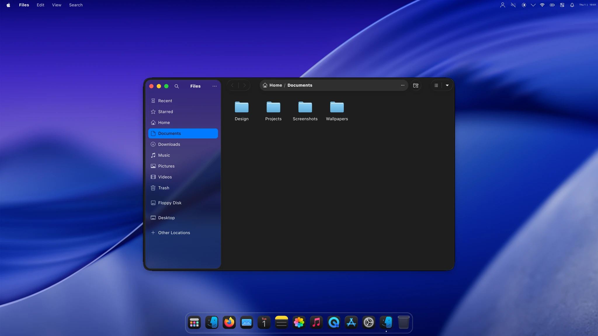</a>
</p>

<details>
<summary>Destaques vermelhos e azuis nos modos claro e escuro</summary>

<table>
<tr><th>Destaque</th><th>Claro</th><th>Escuro</th></tr>
<tr><td>Vermelho</td><td><a href="src/screenshots/previews/readme-tahoe-light-finder-red-cf60519353bc.webp">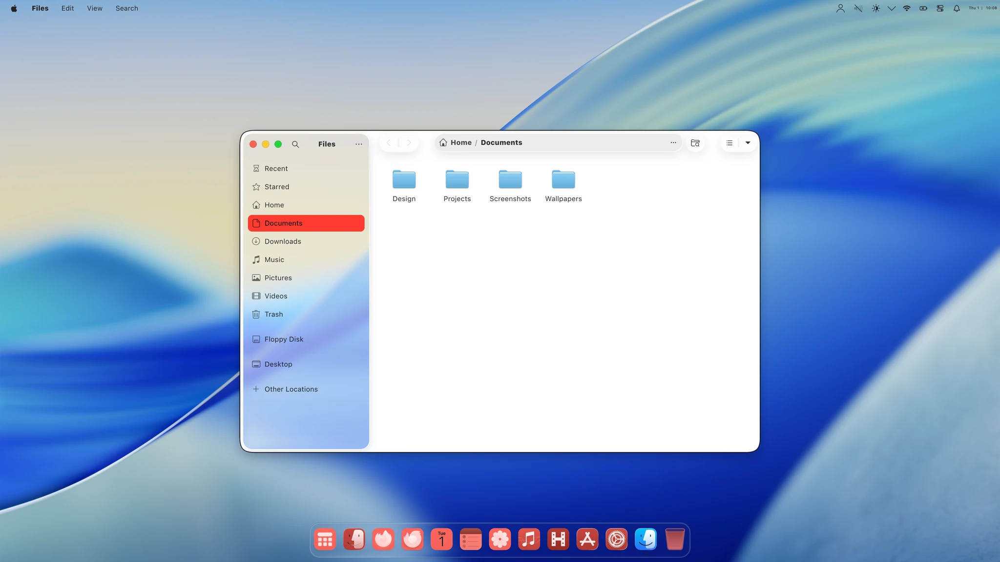</a></td><td><a href="src/screenshots/previews/readme-tahoe-dark-finder-red-a5d3144faf0f.webp">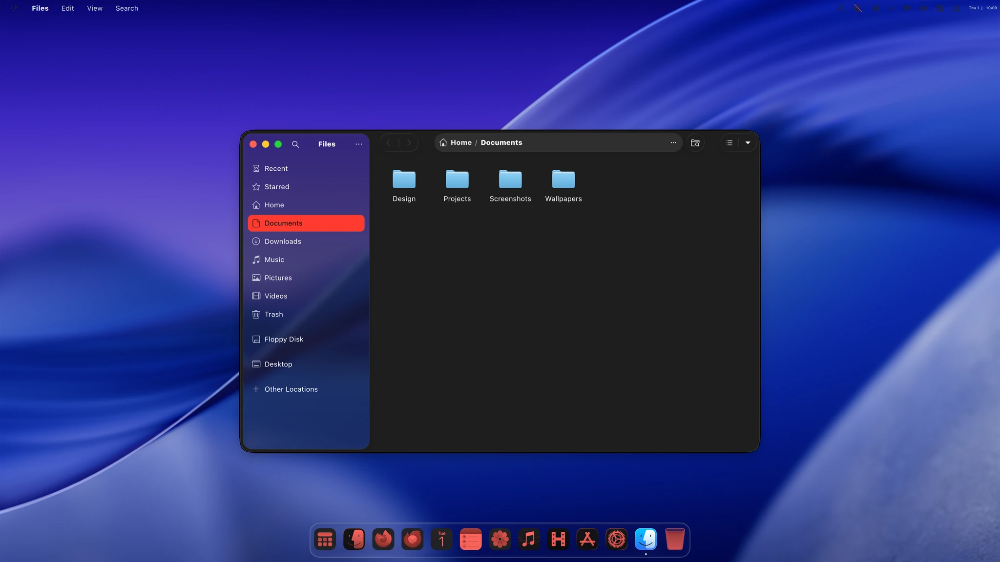</a></td></tr>
<tr><td>Azul</td><td><a href="src/screenshots/previews/readme-tahoe-light-finder-blue-ad74eeb6e7a1.webp">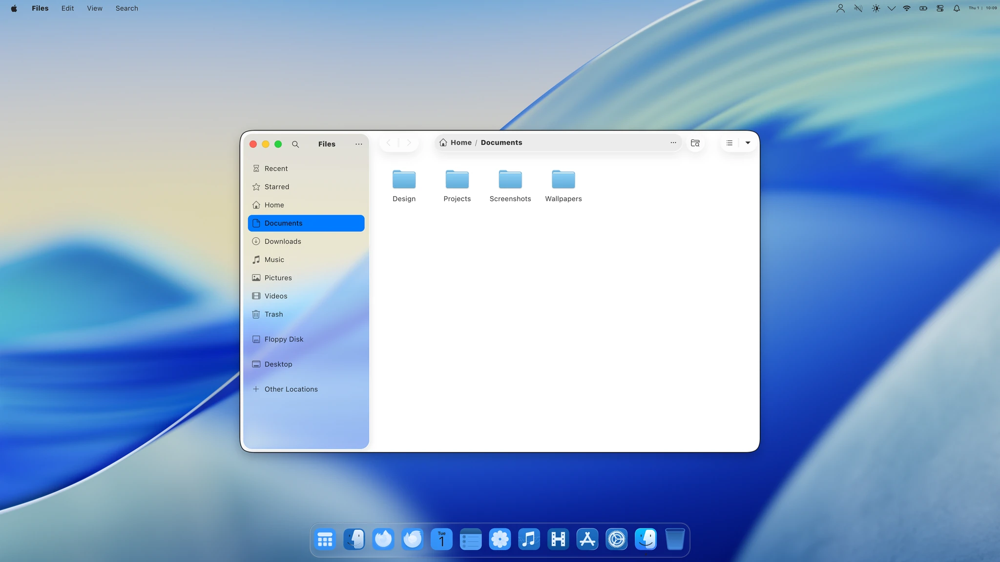</a></td><td><a href="src/screenshots/previews/readme-tahoe-dark-finder-blue-2a9bacc3b9a9.webp"></a></td></tr>
</table>

</details>

### Tahoe Launchpad (Alpha)

Encontre aplicativos, navegue pelas categorias e mantenha seus favoritos. Há dois preajustes disponíveis.

<p align="center">
  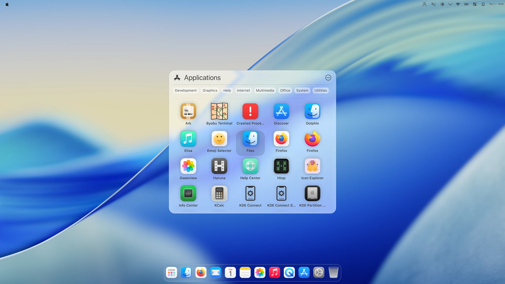
  
</p>

### Tahoe Dock (Alpha)

Refração do vidro, ampliação ao passar o cursor, contadores de notificações e ocultação automática.

<p align="center"><a href="src/screenshots/previews/readme-tahoe-light-dock-regular-6d506b3465fd.webp">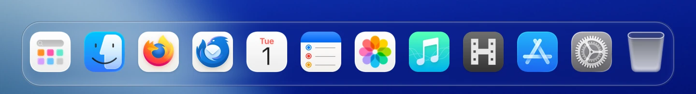</a><br>Padrão · Claro</p>

<p align="center"><a href="src/screenshots/previews/readme-tahoe-dark-dock-regular-9254e2db86a7.webp">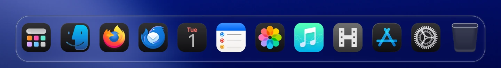</a><br>Padrão · Escuro</p>

<p align="center"><a href="src/screenshots/previews/readme-tahoe-light-dock-clear-843c40a052a7.webp">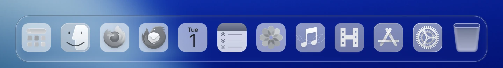</a><br>Transparente · Claro</p>

<p align="center"><a href="src/screenshots/previews/readme-tahoe-dark-dock-clear-58edd6d52e38.webp">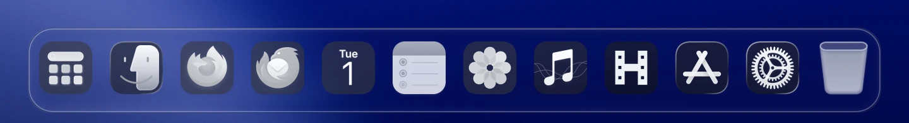</a><br>Transparente · Escuro</p>

<p align="center"><a href="src/screenshots/previews/readme-tahoe-light-dock-blue-d39bb78e2f1d.webp">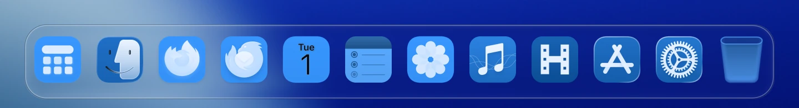</a><br>Azul · Claro</p>

<p align="center"><a href="src/screenshots/previews/readme-tahoe-dark-dock-blue-a292ebe93f08.webp">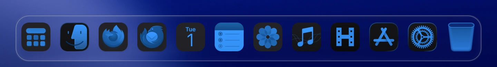</a><br>Azul · Escuro</p>

<p align="center"><a href="src/screenshots/previews/readme-tahoe-light-dock-purple-b8d6d4a59d58.webp">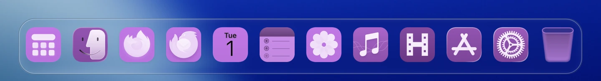</a><br>Roxo · Claro</p>

<p align="center"><a href="src/screenshots/previews/readme-tahoe-dark-dock-purple-090970372f80.webp">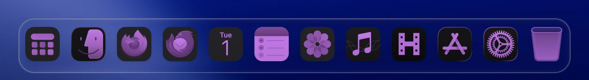</a><br>Roxo · Escuro</p>

<p align="center"><a href="src/screenshots/previews/readme-tahoe-light-dock-pink-c0b0ba00ddeb.webp">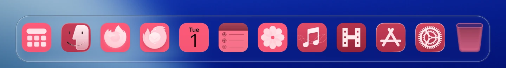</a><br>Rosa · Claro</p>

<p align="center"><a href="src/screenshots/previews/readme-tahoe-dark-dock-pink-ba6941817529.webp"></a><br>Rosa · Escuro</p>

<p align="center"><a href="src/screenshots/previews/readme-tahoe-light-dock-red-19adb9d798fd.webp"></a><br>Vermelho · Claro</p>

<p align="center"><a href="src/screenshots/previews/readme-tahoe-dark-dock-red-379c09615f96.webp">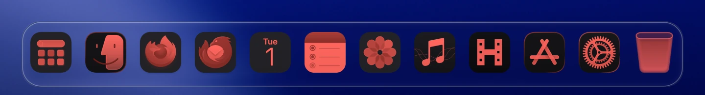</a><br>Vermelho · Escuro</p>

<p align="center"><a href="src/screenshots/previews/readme-tahoe-light-dock-orange-18c4663ce547.webp">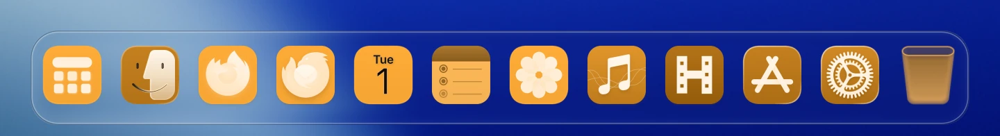</a><br>Laranja · Claro</p>

<p align="center"><a href="src/screenshots/previews/readme-tahoe-dark-dock-orange-5079b478c649.webp">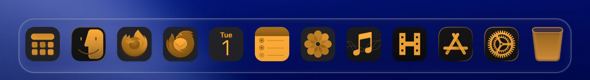</a><br>Laranja · Escuro</p>

<p align="center"><a href="src/screenshots/previews/readme-tahoe-light-dock-yellow-c7656eaf2b61.webp"></a><br>Amarelo · Claro</p>

<p align="center"><a href="src/screenshots/previews/readme-tahoe-dark-dock-yellow-c1945efddc21.webp">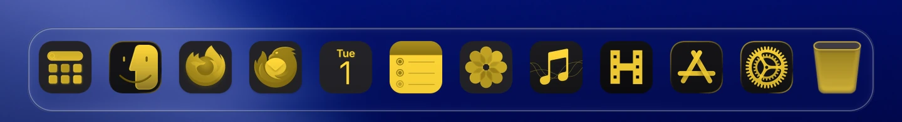</a><br>Amarelo · Escuro</p>

<p align="center"><a href="src/screenshots/previews/readme-tahoe-light-dock-green-ac9611249165.webp">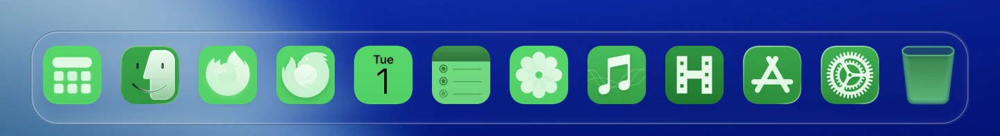</a><br>Verde · Claro</p>

<p align="center"><a href="src/screenshots/previews/readme-tahoe-dark-dock-green-84eab2e65cf2.webp">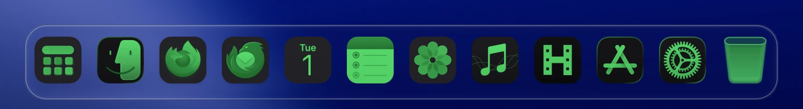</a><br>Verde · Escuro</p>

<p align="center"><a href="src/screenshots/previews/readme-tahoe-light-dock-gray-18617e5c0df8.webp">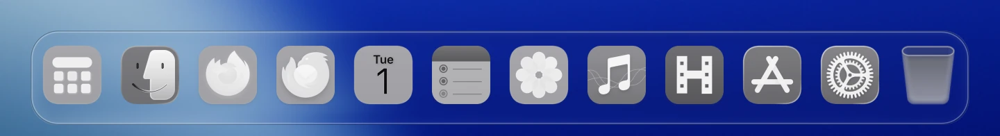</a><br>Cinza · Claro</p>

<p align="center"><a href="src/screenshots/previews/readme-tahoe-dark-dock-gray-e7baf051c7cb.webp">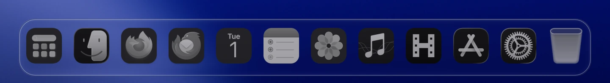</a><br>Cinza · Escuro</p>

### Tahoe Shell (Alpha)

Acesso às configurações do sistema, aplicativos e controles de sessão.

<p align="center">
  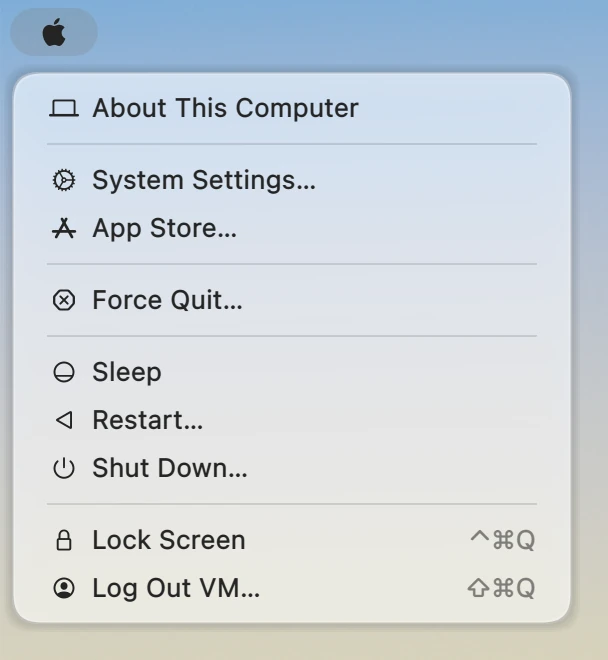
  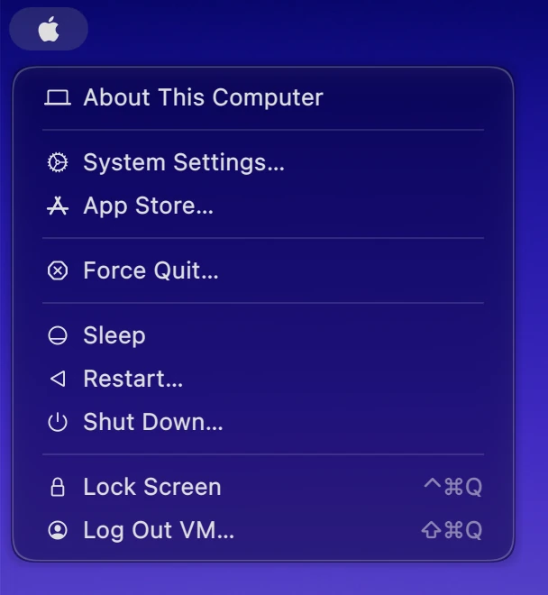
</p>

### Tahoe Central de Controle (Alpha)

Wi-Fi, som, brilho e notificações em um menu de vidro.

<p align="center">
  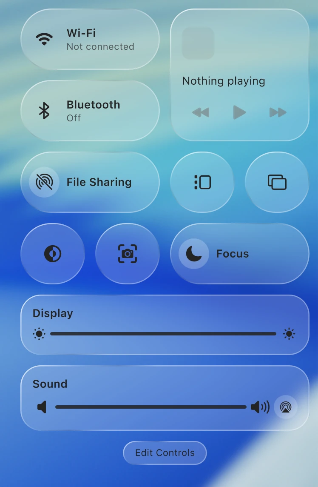
  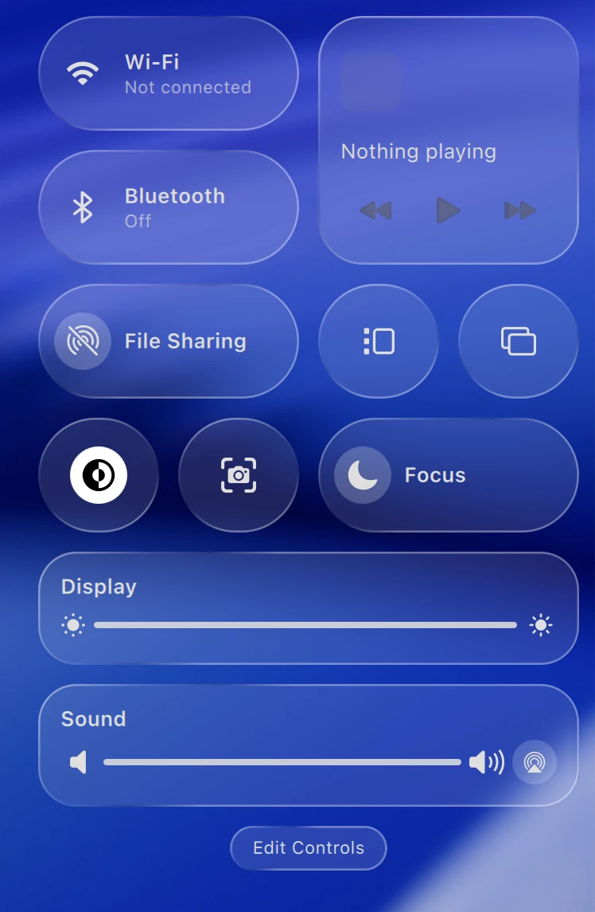
</p>

### Tahoe Histórico da área de transferência (Alpha)

Encontre e reutilize textos e imagens copiados diretamente pelo Launchpad.

<p align="center">
  
  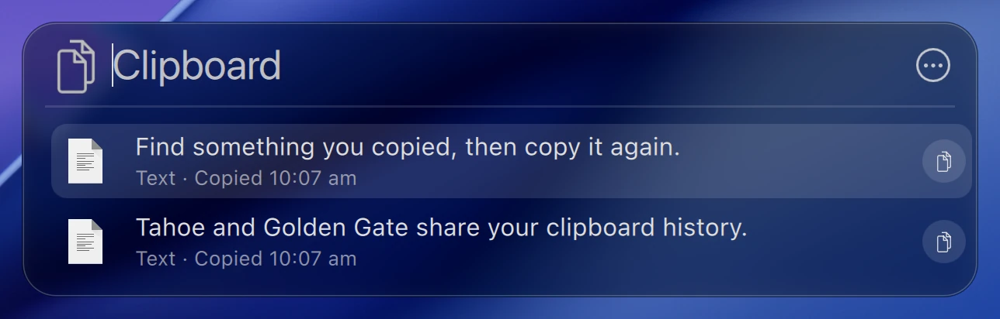
</p>

### Tahoe Informações do sistema

Informações sobre hardware, software e tema.

<p align="center">
  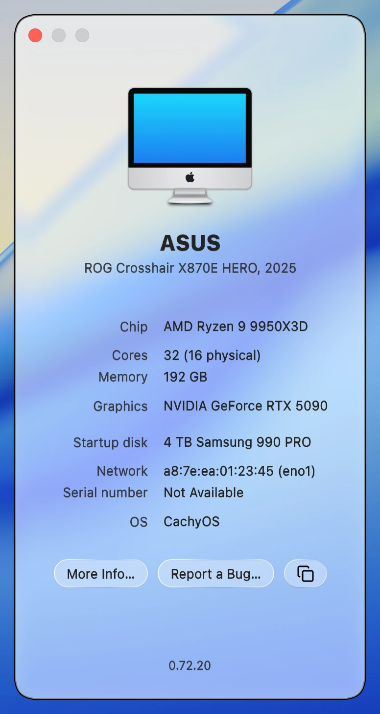
  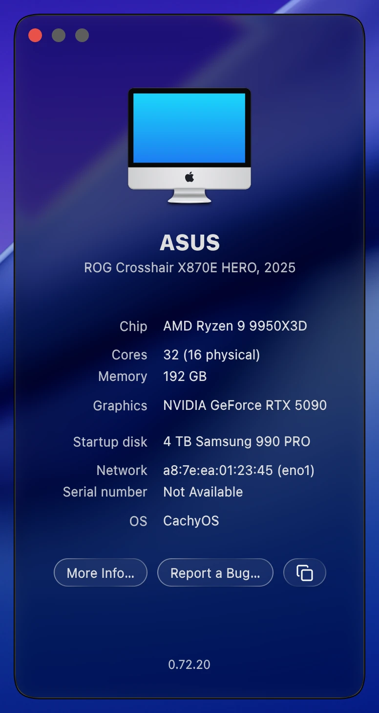
</p>

### Tahoe Tema Plasma (Alpha)

Menus e janelas pop-up translúcidos com cores claras e escuras coordenadas.

<p align="center">
  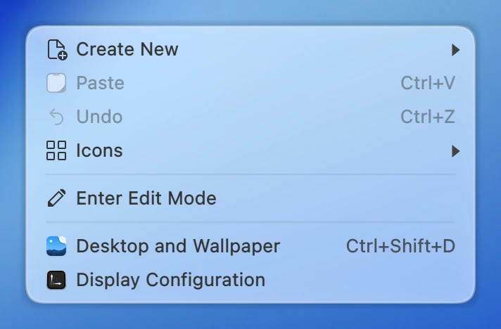
  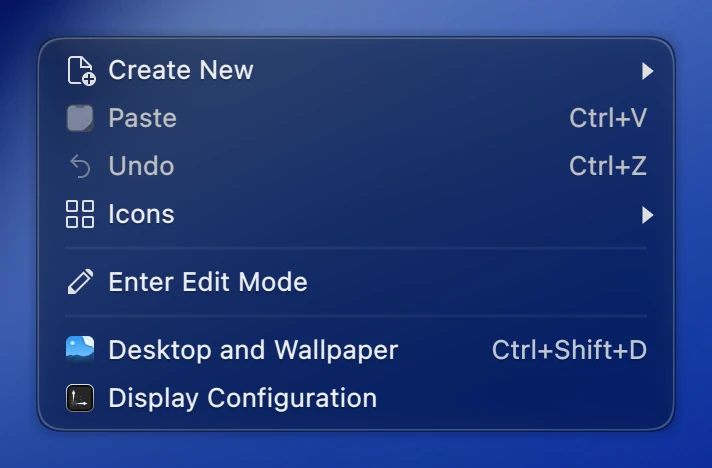
</p>

### Tahoe Tela de inicialização (Alpha)

Tela de inicialização com desbloqueio integrado de unidades criptografadas com LUKS2.

<p align="center">
  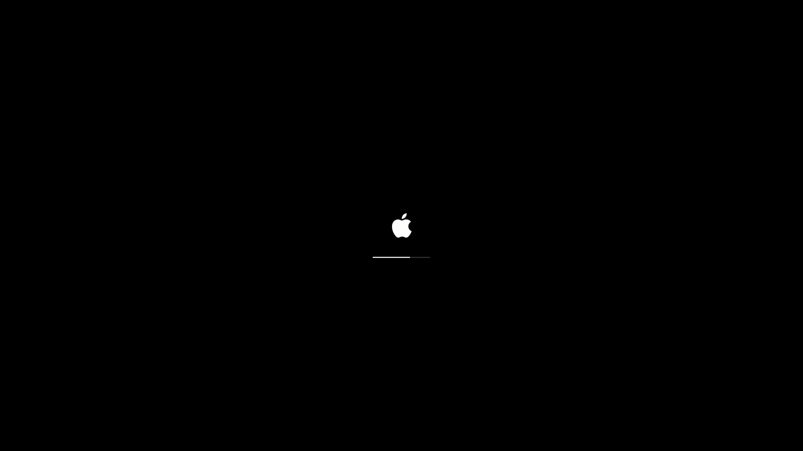
</p>

## Opções e ferramentas

O assistente permite escolher componentes, ícones, papéis de parede, botões e sombras das janelas. A reinstalação mantém a personalização do Dock, salvo quando você escolhe redefini-la. O tema sincroniza a aparência clara/escura, integra menus globais e estilos GTK/Qt e faz backup dos perfis do Firefox antes de alterá-los.

A proteção OLED é opcional e vem desativada. Ative-a no assistente e escolha o intervalo e deslocamento máximo. Controles manuais:

```bash
mac-tahoe-oled-care shift
mac-tahoe-oled-care restore
mac-tahoe-oled-care status
```

Para testar em um ambiente isolado, use `./vm <os>`. Consulte o [guia de máquinas virtuais](tests/vm/README.md). A validação completa do Kubuntu continua pendente. NixOS e Home Manager são experimentais: use os módulos flake, não o instalador gráfico; consulte a [configuração detalhada em inglês](README.md).

O [guia de contribuição](CONTRIBUTING.md) documenta configurações avançadas e o gerador compartilhado de ícones. Execute `./icon-toolset` no Tahoe para gerar, visualizar e verificar ícones das duas edições sem aplicar o tema ao ambiente. Para liberar espaço do Git preservando o trabalho local: `./installer --free-space`.

Consulte os [resultados e limites dos testes](tests/vm/PROOF.md) e as [fotografias do instalador](TESTING.md). As fotografias mantêm sua procedência original; não representam uma nova validação de cada versão.

[Referência técnica completa e estado dos componentes (inglês)](README.md)

## Contribuições e problemas

[Relate problemas](https://github.com/lestercorderomurillo/macos-tahoe-liquid-kde/issues/new) incluindo a versão do Plasma (`plasmashell --version`), a distribuição, a versão do tema e uma captura ou gravação para problemas visuais. Consulte o [guia de contribuição](CONTRIBUTING.md).

Colaboradores de código e pessoas que relataram problemas no Tahoe e Golden Gate:

<p>
  <a href="https://github.com/lestercorderomurillo"></a>
  <a href="https://github.com/yanhenrique-dev"></a>
  <a href="https://github.com/naevui"></a>
  <a href="https://github.com/caioniehues"></a>
  <a href="https://github.com/404-not-found129"></a>
  <a href="https://github.com/myakupozluk"></a>
  <a href="https://github.com/EMS1998"></a>
  <a href="https://github.com/allfritz"></a>
  <a href="https://github.com/elegos"></a>
  <a href="https://github.com/kozeki-uii"></a>
  <a href="https://github.com/imightbelosthere"></a>
  <a href="https://github.com/evaildev"></a>
  <a href="https://github.com/xarblu"></a>
  <a href="https://github.com/PKMNPlatin"></a>
  <a href="https://github.com/matinlotfali"></a>
  <a href="https://github.com/luisbocanegra"></a>
  <a href="https://github.com/OliverChase2003"></a>
  <a href="https://github.com/RoxasYTB"></a>
  <a href="https://github.com/Flagwill"></a>
  <a href="https://github.com/4l3j0Ok"></a>
  <a href="https://github.com/0xrushi"></a>
  <a href="https://github.com/aenriii"></a>
  <a href="https://github.com/andreas399"></a>
  <a href="https://github.com/Andrew-Sor"></a>
  <a href="https://github.com/ardashir77"></a>
  <a href="https://github.com/azizaktas"></a>
  <a href="https://github.com/binary-pleb"></a>
  <a href="https://github.com/bneils"></a>
  <a href="https://github.com/FAYZER77"></a>
  <a href="https://github.com/fxrncyyisingithub"></a>
  <a href="https://github.com/germanbagutteorsomething"></a>
  <a href="https://github.com/iNarrow12"></a>
  <a href="https://github.com/IsaiahSHanson"></a>
  <a href="https://github.com/kuau"></a>
  <a href="https://github.com/Lando0007"></a>
  <a href="https://github.com/LilT59"></a>
  <a href="https://github.com/marcosfantonio"></a>
  <a href="https://github.com/moulikanand12345-lang"></a>
  <a href="https://github.com/nanechi"></a>
  <a href="https://github.com/nousernameget"></a>
  <a href="https://github.com/OpalSand"></a>
  <a href="https://github.com/P0sixSplo1t-2"></a>
  <a href="https://github.com/rokan00"></a>
  <a href="https://github.com/RussH"></a>
  <a href="https://github.com/Salkio"></a>
  <a href="https://github.com/Shivamingale3"></a>
  <a href="https://github.com/shoko3756"></a>
  <a href="https://github.com/Sonicx9876"></a>
  <a href="https://github.com/Tias-dev"></a>
  <a href="https://github.com/txhammer68"></a>
  <a href="https://github.com/vanshdev0101"></a>
  <a href="https://github.com/vialolis"></a>
  <a href="https://github.com/Whiddu"></a>
  <a href="https://github.com/yingmanwumen"></a>
  <a href="https://github.com/yofriendfromschool1"></a>
  <a href="https://github.com/zhaokelei"></a>
</p>

## Licença e créditos

Projeto independente inspirado no macOS, sem afiliação ou endosso da Apple ou do KDE. O conjunto é distribuído sob [GPL-3.0](LICENSE); as licenças de cada componente e os direitos de terceiros continuam válidos. O emblema, papéis de parede, sons e fontes SF da Apple não são cobertos pela licença do projeto. Consulte [NOTICE](NOTICE), [LICENSING.md](LICENSING.md) e [THIRD_PARTY_NOTICES.md](THIRD_PARTY_NOTICES.md).

<details>
<summary>Créditos e avisos originais (inglês)</summary>

This is an independent reimplementation inspired by the macOS aesthetic. It is not affiliated with or endorsed by Apple or KDE. "macOS" and "Apple" are trademarks of Apple Inc.

The macOS emblem, bundled wallpapers, system sounds, and SF Pro / SF Mono fonts remain Apple's property and are not covered by this project's license. Other components retain their own licenses and copyright notices; see the third-party notice index below for scope and known provenance gaps.

Licensed [GPL-3.0](LICENSE) as a whole; individual component licenses and third-party rights remain applicable. See [copyright notices](NOTICE), [licensing and project identity](LICENSING.md), and [third-party notices](THIRD_PARTY_NOTICES.md).


Project references and third-party components:

- **[EliverLara](https://github.com/EliverLara/TahoeLauncher)**: `TahoeLauncher`: Launchpad design reference.
- **[vinceliuice](https://github.com/vinceliuice)**: `MacTahoe-icon-theme`: base icons and cursors; GTK design reference. [`MacTahoe-gtk-theme` Firefox CSS/SVG](https://github.com/vinceliuice/MacTahoe-gtk-theme/tree/main/other/firefox) is maintained here as an MIT-licensed fork with profile backup and restore support.
- **[taj-ny](https://github.com/taj-ny/kwin-effects-forceblur)** and **[4v3ngR](https://github.com/4v3ngR/kwin-effects-glass)**: Better Blur and its glass fork: upstream code used by Acrylic Glass (the KWin blur authors stay credited in the source headers).
- **[luisbocanegra](https://github.com/luisbocanegra/plasma-panel-colorizer)**: `plasma-panel-colorizer` v7.3.0, bundled offline and installed by the layout step to tint the panels (GPL-3.0, license shipped alongside).
- **[Matin Lotfaliei / KDE-Rounded-Corners](https://github.com/matinlotfali/KDE-Rounded-Corners)**: the GPL-3.0 KWin rounded-window effect, fetched from the pinned v0.9.0 release and built online against the host KWin SDK (license installed alongside).
- **[ful1e5](https://github.com/ful1e5)**: `apple_cursor`: alternate cursor design reference.
- **[sahibjotsaggu](https://github.com/sahibjotsaggu)**: `San-Francisco-Pro-Fonts`: source of the SF Pro / SF Mono bundle.
- **[Lucide](https://github.com/lucide-icons/lucide)**: copy icons bundled in the global menu (ISC, © Lucide Contributors).
- **[512pixels.net](https://512pixels.net/projects/default-mac-wallpapers-in-5k/)**: high-resolution macOS wallpaper archive.

If a credit is missing, please [open an issue](https://github.com/lestercorderomurillo/macos-tahoe-liquid-kde/issues/new).

</details>
