<p align="center">
  <!-- Adapted with ImageGen from artwork by Apple: https://developer.apple.com/assets/elements/icons/macos-26/macos-26-128x128_2x.png -->
  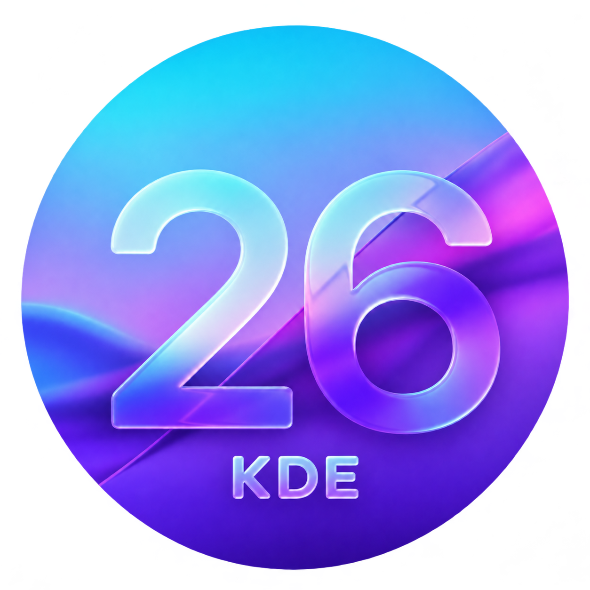
</p>

<h1 align="center">macOS Tahoe para KDE Plasma</h1>

<p align="center">
  <a href="README.md" lang="en" hreflang="en">🇺🇸 English</a> ·
  <a href="README.es.md" lang="es" hreflang="es">🇪🇸 Español</a> ·
  <a href="README.zh-CN.md" lang="zh-CN" hreflang="zh-CN">🇨🇳 简体中文</a> ·
  <a href="README.pt-BR.md" lang="pt-BR" hreflang="pt-BR" aria-current="page">🇧🇷 Português (Brasil)</a> ·
  <a href="README.de.md" lang="de" hreflang="de">🇩🇪 Deutsch</a> ·
  <a href="README.fr.md" lang="fr" hreflang="fr">🇫🇷 Français</a>
</p>

<p align="center">
  <a href="https://github.com/lestercorderomurillo/macos-tahoe-liquid-kde/releases"></a>
  <a href="https://github.com/lestercorderomurillo/macos-tahoe-liquid-kde/actions/workflows/test.yml"></a>
  <a href="https://kde.org/plasma-desktop/"></a>
  <a href="LICENSE"></a>
  <a href="https://github.com/lestercorderomurillo/macos-tahoe-liquid-kde/issues/new"></a>
</p>


<p align="center">
  macOS Tahoe estilo para KDE Plasma 6.6, 6.7 e 6.8+.
</p>

<p align="center">
  <sub>Selecione uma distribuição para ver o estado dos testes.</sub>
</p>

<p align="center">
  <a href="tests/vm/PROOF.md#cachyos" title="CachyOS"></a>
  <a href="tests/vm/PROOF.md#arch" title="Arch Linux"></a>
  <a href="tests/vm/PROOF.md#endeavouros" title="EndeavourOS"></a>
  <a href="tests/vm/PROOF.md#fedora" title="Fedora"></a>
  <a href="tests/vm/PROOF.md#manjaro" title="Manjaro"></a>
  <a href="tests/vm/PROOF.md#artix" title="Artix Linux (OpenRC)"></a>
  <a href="tests/vm/PROOF.md#garuda" title="Garuda Linux"></a>
  <a href="tests/vm/PROOF.md#nobara" title="Nobara Linux"></a>
  <a href="tests/vm/PROOF.md#opensuse" title="openSUSE Tumbleweed"></a>
  <a href="tests/vm/PROOF.md#neon" title="KDE neon"></a>
  <a href="tests/vm/PROOF.md#debian" title="Debian testing / sid (Plasma 6.6+)"></a>
  <a href="tests/vm/PROOF.md#nixos" title="NixOS (experimental)"></a>
</p>

> [!CAUTION]
> **Filosofia de atualização contínua**
> Experimental. Recebe atualizações diárias. As atualizações podem quebrar a compatibilidade. Evite sistemas de produção; [relate problemas aqui](https://github.com/lestercorderomurillo/macos-tahoe-liquid-kde/issues/new).

> [!WARNING]
> **Cuidado com redistribuições pagas: este tema é GRATUITO.**
>
> Se você encontrou este tema por um canal de terceiros, não precisa pagar para obtê-lo: baixe diretamente deste repositório. Mantemos este projeto gratuito para que todos possam aproveitá-lo sem barreiras de pagamento. Não é necessária compra nem assinatura.

<br>


Relatos de problemas, correções, testes e documentação: consulte o [guia de contribuição](CONTRIBUTING.md).

Colaboradores de código e pessoas que relatam problemas no Tahoe e Golden Gate:

<p>
  <a href="https://github.com/lestercorderomurillo"></a>
  <a href="https://github.com/yanhenrique-dev"></a>
  <a href="https://github.com/naevui"></a>
  <a href="https://github.com/caioniehues"></a>
  <a href="https://github.com/404-not-found129"></a>
  <a href="https://github.com/myakupozluk"></a>
  <a href="https://github.com/EMS1998"></a>
  <a href="https://github.com/allfritz"></a>
  <a href="https://github.com/elegos"></a>
  <a href="https://github.com/kozeki-uii"></a>
  <a href="https://github.com/imightbelosthere"></a>
  <a href="https://github.com/evaildev"></a>
  <a href="https://github.com/xarblu"></a>
  <a href="https://github.com/PKMNPlatin"></a>
  <a href="https://github.com/matinlotfali"></a>
  <a href="https://github.com/luisbocanegra"></a>
  <a href="https://github.com/OliverChase2003"></a>
  <a href="https://github.com/RoxasYTB"></a>
  <a href="https://github.com/Flagwill"></a>
  <a href="https://github.com/4l3j0Ok"></a>
  <a href="https://github.com/0xrushi"></a>
  <a href="https://github.com/aenriii"></a>
  <a href="https://github.com/andreas399"></a>
  <a href="https://github.com/Andrew-Sor"></a>
  <a href="https://github.com/ardashir77"></a>
  <a href="https://github.com/azizaktas"></a>
  <a href="https://github.com/binary-pleb"></a>
  <a href="https://github.com/bneils"></a>
  <a href="https://github.com/FAYZER77"></a>
  <a href="https://github.com/fxrncyyisingithub"></a>
  <a href="https://github.com/germanbagutteorsomething"></a>
  <a href="https://github.com/iNarrow12"></a>
  <a href="https://github.com/IsaiahSHanson"></a>
  <a href="https://github.com/kuau"></a>
  <a href="https://github.com/Lando0007"></a>
  <a href="https://github.com/LilT59"></a>
  <a href="https://github.com/marcosfantonio"></a>
  <a href="https://github.com/moulikanand12345-lang"></a>
  <a href="https://github.com/nanechi"></a>
  <a href="https://github.com/nousernameget"></a>
  <a href="https://github.com/OpalSand"></a>
  <a href="https://github.com/P0sixSplo1t-2"></a>
  <a href="https://github.com/rokan00"></a>
  <a href="https://github.com/RussH"></a>
  <a href="https://github.com/Salkio"></a>
  <a href="https://github.com/Shivamingale3"></a>
  <a href="https://github.com/shoko3756"></a>
  <a href="https://github.com/Sonicx9876"></a>
  <a href="https://github.com/Tias-dev"></a>
  <a href="https://github.com/txhammer68"></a>
  <a href="https://github.com/vanshdev0101"></a>
  <a href="https://github.com/vialolis"></a>
  <a href="https://github.com/Whiddu"></a>
  <a href="https://github.com/yingmanwumen"></a>
  <a href="https://github.com/yofriendfromschool1"></a>
  <a href="https://github.com/zhaokelei"></a>
</p>

<br>


### Tahoe Finder (Alpha)

Navegação de arquivos no estilo Finder com o vidro Tahoe.

<p align="center">
  <a href="src/screenshots/previews/readme-tahoe-light-finder-4203d60bcd59.webp"></a>
  <a href="src/screenshots/previews/readme-tahoe-dark-finder-3fba4166a2d8.webp"></a>
</p>

<details>
<summary>Destaques vermelhos e azuis nos modos claro e escuro</summary>

<table>
<tr><th>Destaque</th><th>Claro</th><th>Escuro</th></tr>
<tr><td>Vermelho</td><td><a href="src/screenshots/previews/readme-tahoe-light-finder-red-cf60519353bc.webp"></a></td><td><a href="src/screenshots/previews/readme-tahoe-dark-finder-red-a5d3144faf0f.webp"></a></td></tr>
<tr><td>Azul</td><td><a href="src/screenshots/previews/readme-tahoe-light-finder-blue-ad74eeb6e7a1.webp"></a></td><td><a href="src/screenshots/previews/readme-tahoe-dark-finder-blue-2a9bacc3b9a9.webp"></a></td></tr>
</table>

</details>

<br>

### Tahoe Launchpad (Alpha)

Encontre aplicativos, explore categorias e mantenha seus favoritos ao alcance.

<p align="center">
  
  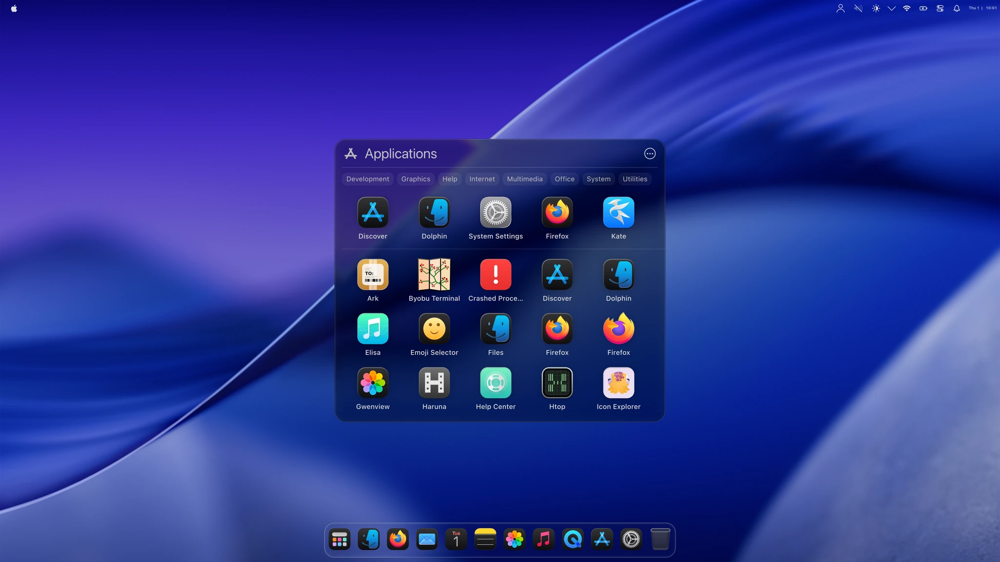
</p>

<br>

### Tahoe Dock (Alpha)

Refração do vidro, ampliação ao passar o cursor, bolhas vermelhas com contagem de notificações e ocultação automática.

<p align="center">
  <strong>Light</strong><br>
  <a href="src/screenshots/previews/readme-tahoe-light-dock-regular-0997fd2f3e46.webp">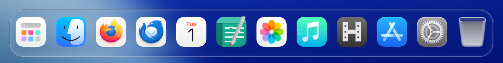</a>
</p>

<p align="center">
  <strong>Dark</strong><br>
  <a href="src/screenshots/previews/readme-tahoe-dark-dock-regular-f6c4b141b09e.webp">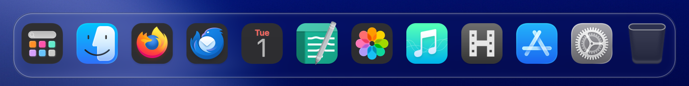</a>
</p>

<p align="center">
  <strong>Clear Light</strong><br>
  <a href="src/screenshots/previews/readme-tahoe-light-dock-clear-3a2ade5c0f60.webp">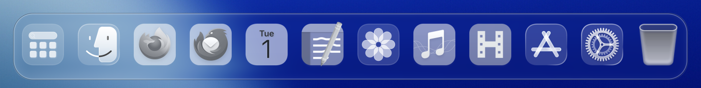</a>
</p>

<p align="center">
  <strong>Clear Dark</strong><br>
  <a href="src/screenshots/previews/readme-tahoe-dark-dock-clear-9cf1f9739dac.webp">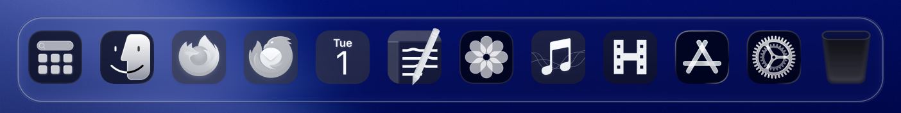</a>
</p>

<p align="center">
  <strong>Blue Light</strong><br>
  <a href="src/screenshots/previews/readme-tahoe-light-dock-blue-dd0eb5c8bff5.webp">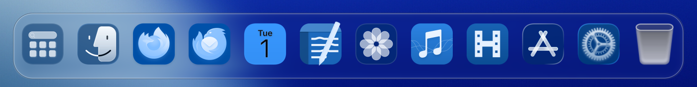</a>
</p>

<p align="center">
  <strong>Blue Dark</strong><br>
  <a href="src/screenshots/previews/readme-tahoe-dark-dock-blue-9acb2689e21d.webp">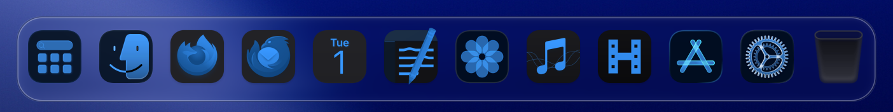</a>
</p>

<p align="center">
  <strong>Purple Light</strong><br>
  <a href="src/screenshots/previews/readme-tahoe-light-dock-purple-91e404540269.webp">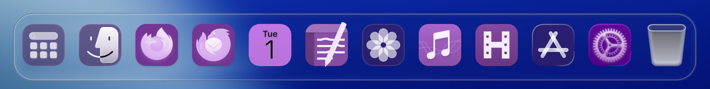</a>
</p>

<p align="center">
  <strong>Purple Dark</strong><br>
  <a href="src/screenshots/previews/readme-tahoe-dark-dock-purple-c2f4a4493b4b.webp">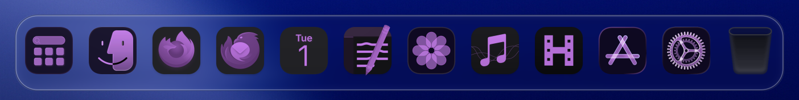</a>
</p>

<p align="center">
  <strong>Pink Light</strong><br>
  <a href="src/screenshots/previews/readme-tahoe-light-dock-pink-f9a47518554a.webp">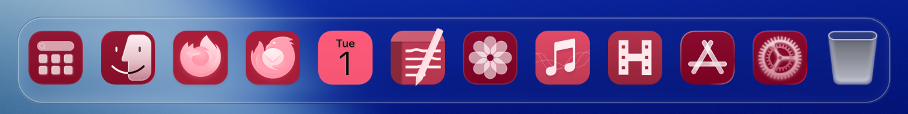</a>
</p>

<p align="center">
  <strong>Pink Dark</strong><br>
  <a href="src/screenshots/previews/readme-tahoe-dark-dock-pink-9a8acd5e420e.webp">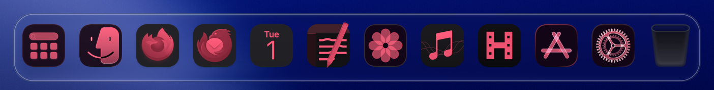</a>
</p>

<p align="center">
  <strong>Red Light</strong><br>
  <a href="src/screenshots/previews/readme-tahoe-light-dock-red-d7227e7a735b.webp"></a>
</p>

<p align="center">
  <strong>Red Dark</strong><br>
  <a href="src/screenshots/previews/readme-tahoe-dark-dock-red-9b053dab4782.webp">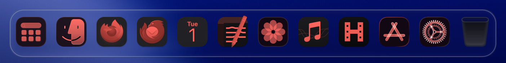</a>
</p>

<p align="center">
  <strong>Orange Light</strong><br>
  <a href="src/screenshots/previews/readme-tahoe-light-dock-orange-df7e33379ecf.webp">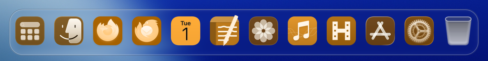</a>
</p>

<p align="center">
  <strong>Orange Dark</strong><br>
  <a href="src/screenshots/previews/readme-tahoe-dark-dock-orange-e2bbb5d97042.webp">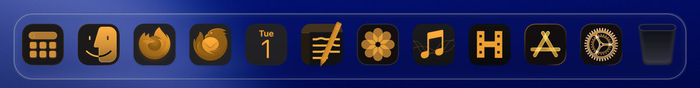</a>
</p>

<p align="center">
  <strong>Yellow Light</strong><br>
  <a href="src/screenshots/previews/readme-tahoe-light-dock-yellow-0cdbbd4a4ca5.webp">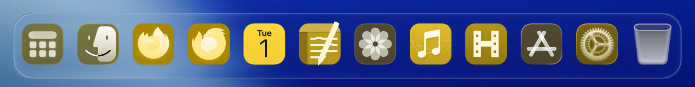</a>
</p>

<p align="center">
  <strong>Yellow Dark</strong><br>
  <a href="src/screenshots/previews/readme-tahoe-dark-dock-yellow-90fd8dfd1060.webp">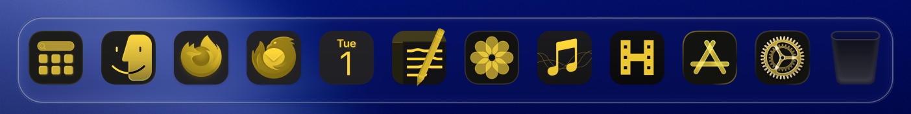</a>
</p>

<p align="center">
  <strong>Green Light</strong><br>
  <a href="src/screenshots/previews/readme-tahoe-light-dock-green-6dd6a05798cf.webp">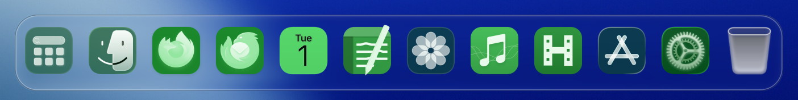</a>
</p>

<p align="center">
  <strong>Green Dark</strong><br>
  <a href="src/screenshots/previews/readme-tahoe-dark-dock-green-ce9afa35c909.webp">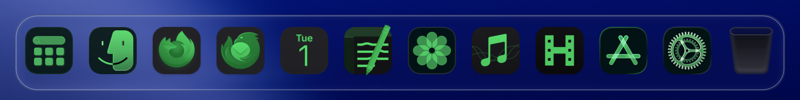</a>
</p>

<p align="center">
  <strong>Gray Light</strong><br>
  <a href="src/screenshots/previews/readme-tahoe-light-dock-gray-efd0f3169e36.webp">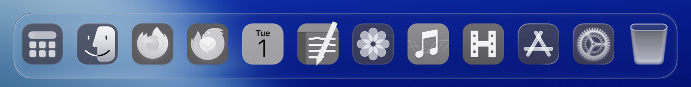</a>
</p>

<p align="center">
  <strong>Gray Dark</strong><br>
  <a href="src/screenshots/previews/readme-tahoe-dark-dock-gray-f5be1bcd7ab5.webp">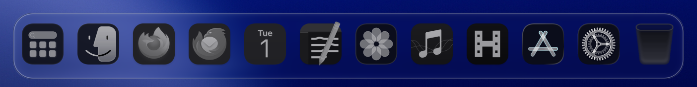</a>
</p>

<br>

### Tahoe Shell (Alpha)

Acesso rápido às configurações do sistema, aplicativos e controles de sessão.

<p align="center">
  
  
</p>

<br>

### Tahoe Central de Controle (Alpha)

Wi-Fi, som, brilho e notificações em um menu de vidro. As atualizações chegarão muito em breve.

<p align="center">
  
  
</p>

<br>

### Tahoe Histórico da área de transferência (Alpha)

Encontre e reutilize textos e imagens copiados diretamente pelo Launchpad.

<p align="center">
  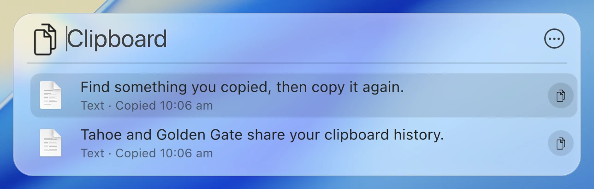
  
</p>

<br>

### Tahoe Informações do sistema (Alpha)

Detalhes do hardware, software e tema em um relance.

<p align="center">
  
  
</p>

<br>

### Tahoe Tema Plasma (Alpha)

Menus e janelas pop-up translúcidos com cores claras e escuras coordenadas.

<p align="center">
  
  
</p>

<br>

### Tahoe Tela de inicialização (Alpha)

Uma aparência coordenada da inicialização ao desligamento, com desbloqueio integrado de unidades criptografadas com LUKS2.

<p align="center">
  
</p>

<br>


- **Idiomas:** instalador em inglês, espanhol, chinês simplificado, português brasileiro, alemão e francês; widgets Plasma traduzidos.
- **Instalador:** seleção gráfica de componentes, recursos do tema incluídos e suporte a atualizações.
- **Distribuições:** instalação de dependências para sistemas baseados em Arch, baseados em Fedora, openSUSE, Debian e KDE neon.
- **Agendamento:** troca automática de tema e proteção OLED por temporizadores de usuário systemd ou cron no OpenRC.
- **Efeitos de vidro:** desfoque, refração e gradientes de três cores ajustáveis para os modos claro e escuro.
- **Compatibilidade:** Plasma 6.6–6.8, com efeitos nativos compilados com as versões instaladas do Qt e KWin.
- **Launchpad:** dois layouts, pesquisa integrada ou separada, favoritos e categorias de aplicativos roláveis.
- **Dock:** ampliação ao passar o cursor, selos de notificação, ocultação automática e itens fixados preservados na reinstalação.
- **Aparência:** estilos claro/escuro sincronizados para o ambiente, aplicativos, ícones e decorações de janelas; papéis de parede por monitor.
- **Integração de aplicativos:** menus globais, correções de menus GTK, Nautilus no estilo Finder e tema do Firefox com backups de perfis.
- **Recuperação:** verificações de requisitos, backups de configurações e restauração na desinstalação.
- **Recursos opcionais:** deslocamentos de painéis OLED, histórico da área de transferência com itens fixados e prévias de imagens, e módulos experimentais NixOS e Home Manager.
- **Testes:** testes de regressão, contêineres de distribuições e VMs Plasma.

<br>


Baixe e abra o instalador:

```bash
git clone --filter=blob:none https://github.com/lestercorderomurillo/macos-tahoe-liquid-kde.git
cd macos-tahoe-liquid-kde
./installer
```

Escolha **Express** para instalar. Abra `./installer` novamente para atualizar ou desinstalar.

Para liberar espaço em disco mantendo sua cópia Git e o trabalho local:

```bash
./installer --free-space
```

| Idioma do instalador | Estado |
| --- | --- |
| 🇺🇸 Inglês |  |
| 🇪🇸 Espanhol |  |
| 🇨🇳 Chinês simplificado |  |
| 🇧🇷 Português brasileiro |  |
| 🇩🇪 Alemão |  |
| 🇫🇷 Francês |  |
| 🇮🇹 Italiano |  |
| 🇯🇵 Japonês |  |
| 🇰🇷 Coreano |  |
| 🇷🇺 Russo |  |
| 🇸🇦 Árabe |  |
| 🇮🇳 Hindi |  |
| 🇳🇱 Holandês |  |
| 🇵🇱 Polonês |  |
| 🇹🇷 Turco |  |

<details>
<summary><b>Requisitos</b></summary>

Ambiente de trabalho, ferramentas de compilação e pacotes do sistema necessários.

- KDE Plasma 6.6+
- Python 3.10+ e PyQt6
- `sudo`
- Ferramentas de desenvolvimento Qt 6
- Pacotes de desenvolvimento KDE e Qt 6 para os plasmoides compilados e efeitos KWin
- `cmake`, `g++`, e `pkg-config` quando recursos compilados são selecionados
- `dbus-send`
- `systemctl` ou `crontab` para recursos agendados

**dinit:** o instalador detecta dinit e usa entradas cron por usuário para a troca automática claro/escuro e a proteção OLED. É necessário um daemon cron ativo; instalar apenas `crontab` não o inicia. No Artix/dinit, prepare com:

```bash
sudo pacman -S --needed cronie cronie-dinit
sudo dinitctl --system enable cronie
```

As trocas automáticas ocorrem às 06:00 e 18:00 enquanto a sessão está aberta; o backend cron não recupera trocas pendentes ao iniciar a sessão. A troca manual claro/escuro funciona independentemente do cron. A validação do ambiente dinit está pendente; as capturas existentes do Artix cobrem OpenRC.

Os recursos estão incluídos. Dependências ausentes e KDE Rounded Corners opcional exigem acesso à internet. Atualizações verificadas do Rounded Corners removem fontes e arquivos baixados antigos. A reinstalação substitui as árvores de recursos gerenciadas no mesmo local; cópias bem-sucedidas removem seus dados temporários, e cópias posteriores limpam a preparação descartável interrompida. Backups de recuperação, de perfis do navegador e preferências do usuário são mantidos. Imagens de VM de desenvolvimento e pacotes de capturas não são caches do instalador e nunca são removidos automaticamente.

| Distribuição | Ferramentas Qt 6 | Pacotes de desenvolvimento KDE Plasma 6 |
|--------|------------|-----------------------------------|
| Família Arch | `pacman -S qt6-tools` | `pacman -S extra-cmake-modules plasma-workspace kdecoration libplasma libnotificationmanager libksysguard plasma-activities-stats` |
| Família Fedora | `dnf install qt6-qttools-devel` | `dnf install extra-cmake-modules plasma-workspace-devel kdecoration-devel libplasma-devel knotifications-devel libksysguard-devel kf6-plasma-activities-devel` |
| openSUSE Tumbleweed | `zypper install qt6-tools-devel` | `zypper install extra-cmake-modules plasma6-workspace-devel kdecoration-devel libKF6Plasma-devel libnotificationmanager6-devel libksysguard6-devel libKF6PlasmaActivitiesStats6-devel` |

</details>

<details>
<summary><b>Proteção OLED</b></summary>

Deslocamentos opcionais dos painéis; desativados por padrão.

Ative na página **Proteção OLED**. Escolha ali o intervalo e o deslocamento máximo em pixels; vem desativado por padrão.

**Controles manuais**

```bash
mac-tahoe-oled-care shift
mac-tahoe-oled-care restore
mac-tahoe-oled-care status
```

</details>

<details>
<summary><b>Testar em uma máquina virtual</b></summary>

Teste o tema em um ambiente Plasma isolado.

```bash
./vm <os>
```

**OS:** `cachyos` · `arch` · `manjaro` · `endeavouros` · `garuda` · `fedora` · `nobara` · `opensuse` · `neon` · `debian` · `artix` · `kubuntu`

`all` inicia todas as distribuições. Os alvos de nuvem são provisionados automaticamente; os demais usam instaladores ISO oficiais fixados por soma de verificação. Siga o [guia de configuração e validação de VM](tests/vm/README.md).

`./vm kubuntu` inicia a ISO oficial do Kubuntu 26.04.1 LTS com verificação SHA-256 (porta SSH `2234` após configurar o convidado). Este novo alvo de regressão do lançador aguarda validação completa em execução.

`./vm debian` usa a imagem de nuvem oficial do Debian testing (Forky), verifica sua soma SHA-512 e configura um ambiente Plasma. Entre como `tester` com a senha `tester`; SSH está disponível em `127.0.0.1:2232`. O instalador abre a partir de uma cópia gravável no convidado em `/home/tester/macos-tahoe-liquid-kde`; o repositório do host é montado somente para leitura. Use `./vm debian --clean` para reconstruir o convidado descartável do zero.

</details>

<details>
<summary><b>NixOS e Home Manager (em testes)</b></summary>

Use os módulos flake, **não o instalador gráfico**. A validação do ambiente em execução está pendente.

**Entrada flake** (requer Nixpkgs e Home Manager):

```nix
inputs.mac-tahoe = {
  url = "github:lestercorderomurillo/macos-tahoe-liquid-kde/v0.55.2";
  inputs.nixpkgs.follows = "nixpkgs";
  inputs.home-manager.follows = "home-manager";
};
```

**NixOS:** importe `inputs.mac-tahoe.nixosModules.default`.

```nix
services.desktopManager.plasma6.enable = true;
services.mac-tahoe.enable = true;
# services.mac-tahoe.plymouth.enable = true; # optional boot splash
```

**Home Manager:** importe `inputs.mac-tahoe.homeManagerModules.default`.

```nix
programs.mac-tahoe = {
  enable = true;
  mode = "auto"; # or "light" / "dark"
  # appleAssets = true;
  # oledCare.enable = true;
};
```

**Recursos da Apple:** fontes, papéis de parede e sons opcionais não livres. Ativar `appleAssets` também exige:

```nix
nixpkgs.config.allowUnfreePredicate = pkg:
  builtins.elem (lib.getName pkg) [ "mac-tahoe-apple-assets" ];
```

**Painéis:** importe também seu próprio módulo plasma-manager e `inputs.mac-tahoe.homeManagerModules.plasma-manager`. Ative `programs.mac-tahoe.panels.enable` e defina `programs.mac-tahoe.panels.launchers`, por exemplo `[ "applications:org.kde.dolphin.desktop" ]`. Isso substitui o layout sem importar os itens fixados existentes.

**Configurações graváveis:** mantenha `kdeglobals`, `kwinrc`, `plasmarc`, `plasmashellrc`, `kcminputrc`, `plasma-org.kde.plasma.desktop-appletsrc`, `Kvantum/kvantum.kvconfig` e a configuração GTK ativa graváveis. Evite chaves imutáveis do plasma-manager gerenciadas pelo alternador de tema.

Saia da sessão e entre novamente após a ativação. Perfis do Firefox, favoritos GTK e SDDM não são configurados. Os menus globais GTK precisam de `programs.mac-tahoe.gtkAppmenuModule`. Antes de desativar a proteção OLED, execute `mac-tahoe-oled-care restore`; antes de remover os módulos, selecione Breeze. A remoção mantém as configurações do usuário.

</details>

<br>


Verifique o suporte à sua distribuição, sistema de inicialização e versão do Plasma.

<details>
<summary><b>Distribuições</b></summary>

Todas as 11 distribuições desta tabela passaram pela validação em VM em execução. Selecione um selo de estado para ver capturas revisadas e resultados dos testes.

| | Nome | Estado |
|:--:|------|---------|
|  | CachyOS | [](tests/vm/PROOF.md#cachyos) |
|  | Arch Linux | [](tests/vm/PROOF.md#arch) |
|  | EndeavourOS | [](tests/vm/PROOF.md#endeavouros) |
|  | Fedora | [](tests/vm/PROOF.md#fedora) |
|  | Manjaro | [](tests/vm/PROOF.md#manjaro) |
|  | Artix Linux (OpenRC) | [](tests/vm/PROOF.md#artix) |
|  | Garuda Linux | [](tests/vm/PROOF.md#garuda) |
|  | Nobara | [](tests/vm/PROOF.md#nobara) |
|  | openSUSE Tumbleweed | [](tests/vm/PROOF.md#opensuse) |
|  | KDE neon | [](tests/vm/PROOF.md#neon) |
|  | Debian testing / sid (Plasma 6.6+) | [](tests/vm/PROOF.md#debian) |

</details>

<details>
<summary><b>Sistemas de inicialização</b></summary>

A troca automática de tema e a proteção OLED usam os seguintes backends de agendamento:

| Sistema de inicialização | Agendamento | Testes registrados |
| --- | --- | --- |
| systemd | Temporizadores de usuário |  |
| OpenRC | Cron por usuário |  |
| dinit | Cron por usuário |   |

OpenRC e dinit exigem um daemon cron ativo.
[Resultados dos testes de ambiente gráfico](tests/vm/PROOF.md) · [Verificação do agendamento dinit](CONTRIBUTING.md#setup).

</details>

<details>
<summary><b>Versões do Plasma</b></summary>

Plasma 6.6–6.8 é suportado; os efeitos compilados usam o SDK do host.

| Plasma | Suporte | Desde |
|--------|---------|-------|
| 6.5 e anteriores |  | Não aplicável |
| 6.6 |  | v0.1.0 |
| 6.7 |  | v0.19.0 |
| 6.8 |  | v0.54.1 |

</details>

<br>


O que funciona agora e o que planejamos adicionar.

<details>
<summary><b>Estado dos componentes</b></summary>

O estado atual de cada componente.

| Componente | Estado |
|-----------|--------|
| Esquemas de cores |  |
| Papéis de parede |  |
| Fontes |  |
| Cursores |  |
| Tema Plasma |  |
| Tema Kvantum |  |
| Tema GTK |  |
| Acrylic Glass |  |
| KDE Rounded Corners |  |
| Alternador automático de tema |  |
| Proteção OLED |  |
| Interface do instalador |  |
| Localização |  |
| Decorações Aurorae |  |
| Menu global |  |
| Dock |  |
| Nautilus no estilo Finder |  |
| Launchpad |  |
| Shell |  |
| Histórico da área de transferência |  |
| Informações do sistema |  |
| Lixeira |  |
| Sons |  |
| Tela de inicialização |  |
| Tela de desligamento |  |
| Tema Firefox |  |
| Ícones |  |
| Suporte a várias distribuições |  |
| Testes OpenRC |  |
| Tema Konsole |  |
| Tema Kate |  |
| Tema SDDM |  |
| Calendário |  |
| Central de Controle, Wi-Fi, bateria e notificações |  |
| Preferências do sistema |  |
| Seletor de sistema operacional |  |

</details>

<br>

**[Relate um problema](https://github.com/lestercorderomurillo/macos-tahoe-liquid-kde/issues/new)** ou use **Menu Apple → Sobre este computador → Relatar um problema…**.

Inclua:

- Sua versão do Plasma: `plasmashell --version`
- Sua distribuição: `grep PRETTY_NAME /etc/os-release`
- A versão do tema: `cat VERSION`
- Uma captura ou gravação para problemas visuais

Mantenha os pull requests focados e valide com `./vm`. Consulte [CONTRIBUTING.md](CONTRIBUTING.md).

O [conjunto compartilhado de ferramentas de geração de ícones](CONTRIBUTING.md#icon-generation-toolset) cria aparências claras, escuras, monocromáticas e de vidro translúcido a partir dos nossos ícones incluídos, com qualquer tonalidade RGB. Ele gera, pré-visualiza, verifica e empacota ícones offline para ambas as edições sem aplicar um tema ao ambiente.

<br>


Esta é uma reimplementação independente inspirada na estética do macOS. Não é afiliada nem endossada pela Apple ou pelo KDE. “macOS” e “Apple” são marcas comerciais da Apple Inc.

O emblema do macOS, os papéis de parede incluídos, os sons do sistema e as fontes SF Pro / SF Mono continuam sendo propriedade da Apple e não são cobertos pela licença deste projeto. Outros componentes mantêm suas licenças e avisos de direitos autorais; consulte o índice de avisos de terceiros abaixo para conhecer o escopo e as lacunas de procedência conhecidas.

Licenciado como um todo sob [GPL-3.0](LICENSE); as licenças individuais dos componentes e os direitos de terceiros continuam aplicáveis. Consulte os [avisos de direitos autorais](NOTICE), [licenciamento e identidade do projeto](LICENSING.md) e [avisos de terceiros](THIRD_PARTY_NOTICES.md).

<br>


<details>
<summary><b>Projetos, recursos e agradecimentos</b></summary>

Referências do projeto e componentes de terceiros:

- **[EliverLara](https://github.com/EliverLara/TahoeLauncher)**: `TahoeLauncher`: Referência de design do Launchpad.
- **[vinceliuice](https://github.com/vinceliuice)**: `MacTahoe-icon-theme`: ícones e cursores base; referência de design GTK. [`MacTahoe-gtk-theme` Firefox CSS/SVG](https://github.com/vinceliuice/MacTahoe-gtk-theme/tree/main/other/firefox) é mantido aqui como um fork sob licença MIT com suporte a backup e restauração de perfis.
- **[taj-ny](https://github.com/taj-ny/kwin-effects-forceblur)** e **[4v3ngR](https://github.com/4v3ngR/kwin-effects-glass)**: Better Blur e seu fork de vidro: código upstream usado pelo Acrylic Glass (os autores do desfoque do KWin continuam creditados nos cabeçalhos do código).
- **[luisbocanegra](https://github.com/luisbocanegra/plasma-panel-colorizer)**: `plasma-panel-colorizer` v7.3.0, incluído offline e instalado pela etapa de layout para colorir os painéis (GPL-3.0, licença incluída).
- **[Matin Lotfaliei / KDE-Rounded-Corners](https://github.com/matinlotfali/KDE-Rounded-Corners)**: o efeito de janelas arredondadas do KWin sob GPL-3.0, obtido da versão fixada v0.9.0 e compilado online com o SDK KWin do host (licença instalada junto).
- **[ful1e5](https://github.com/ful1e5)**: `apple_cursor`: referência alternativa de design de cursores.
- **[sahibjotsaggu](https://github.com/sahibjotsaggu)**: `San-Francisco-Pro-Fonts`: fonte do pacote SF Pro / SF Mono.
- **[Lucide](https://github.com/lucide-icons/lucide)**: ícones de cópia incluídos no menu global (ISC, © Lucide Contributors).
- **[512pixels.net](https://512pixels.net/projects/default-mac-wallpapers-in-5k/)**: arquivo de papéis de parede macOS em alta resolução.

Se faltar algum crédito, [abra uma issue](https://github.com/lestercorderomurillo/macos-tahoe-liquid-kde/issues/new).

</details>


[Capturas do instalador e testes](TESTING.md).
