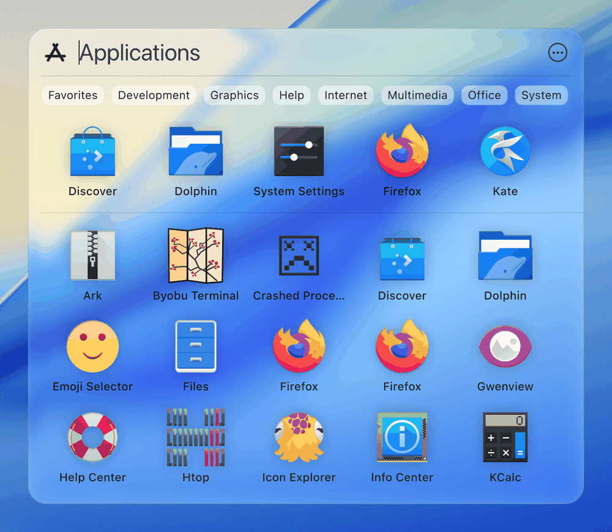
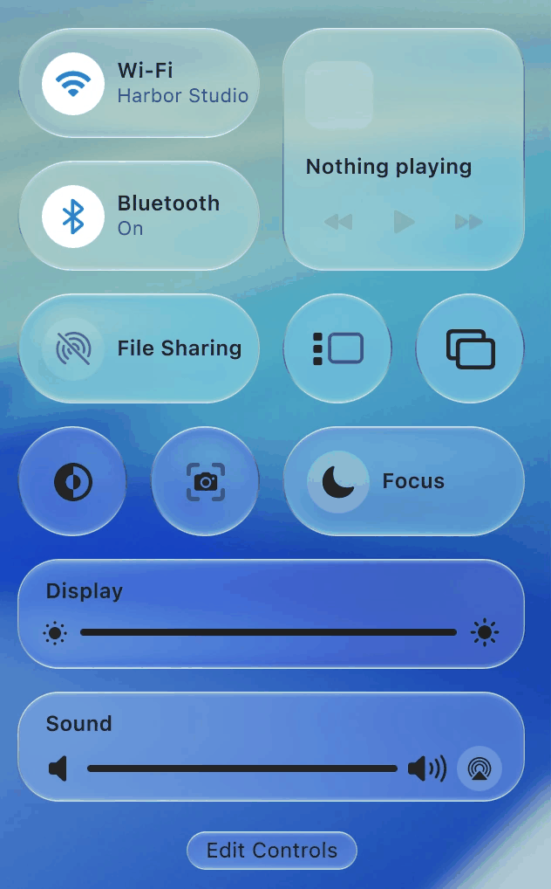
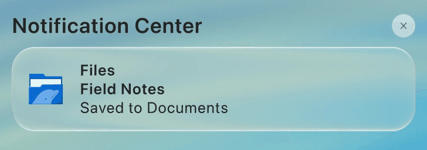
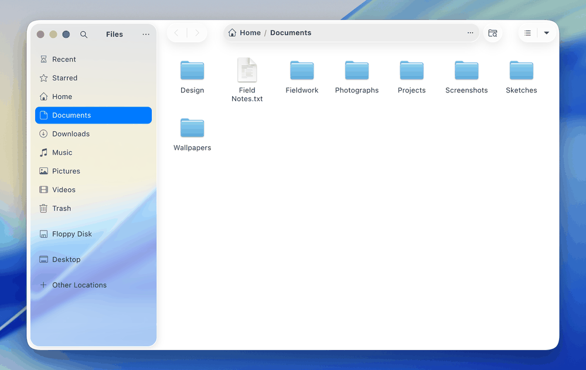
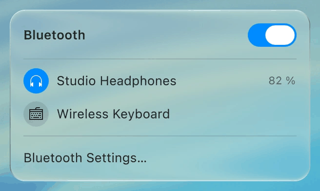
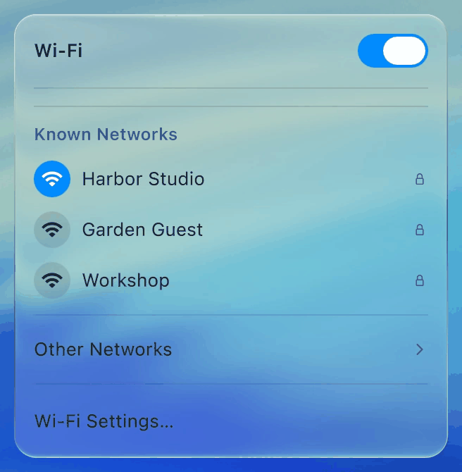
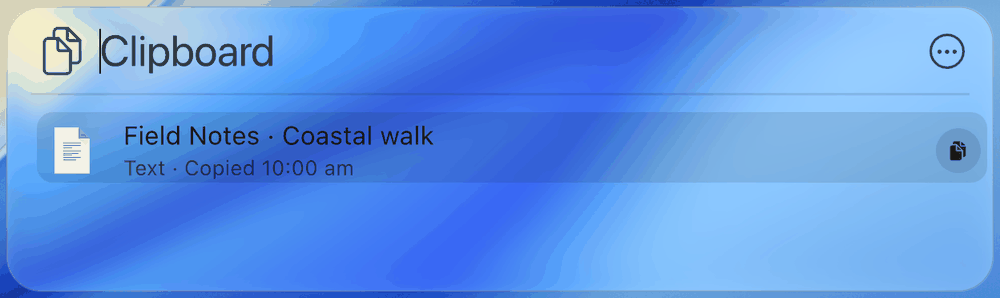
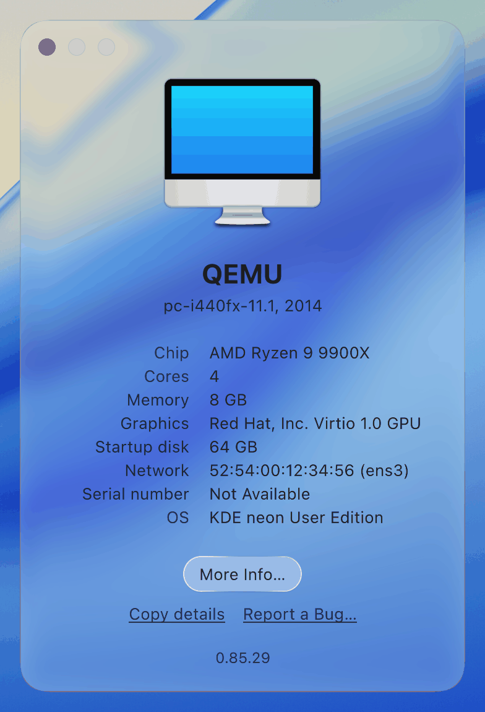

<p align="center">
  <!-- Adapted with ImageGen from artwork by Apple: https://developer.apple.com/assets/elements/icons/macos-26/macos-26-128x128_2x.png. Tux design by Larry Ewing. -->
  
</p>

<h1 align="center">macOS Tahoe: внешний вид и поведение для KDE в Linux</h1>

<p align="center">
  <a href="README.md" lang="en" hreflang="en">🇺🇸 English</a> ·
  <a href="README.es.md" lang="es" hreflang="es">🇪🇸 Español</a> ·
  <a href="README.zh-CN.md" lang="zh-CN" hreflang="zh-CN">🇨🇳 简体中文</a> ·
  <a href="README.pt-BR.md" lang="pt-BR" hreflang="pt-BR">🇧🇷 Português (Brasil)</a> ·
  <a href="README.de.md" lang="de" hreflang="de">🇩🇪 Deutsch</a> ·
  <a href="README.fr.md" lang="fr" hreflang="fr">🇫🇷 Français</a> ·
  <a href="README.it.md" lang="it" hreflang="it">🇮🇹 Italiano</a> ·
  <a href="README.ja.md" lang="ja" hreflang="ja">🇯🇵 日本語</a> ·
  <a href="README.ko.md" lang="ko" hreflang="ko">🇰🇷 한국어</a> ·
  <a href="README.ru.md" lang="ru" hreflang="ru" aria-current="page">🇷🇺 Русский</a> ·
  <a href="README.ar.md" lang="ar" hreflang="ar">🇸🇦 العربية</a> ·
  <a href="README.hi.md" lang="hi" hreflang="hi">🇮🇳 हिन्दी</a> ·
  <a href="README.nl.md" lang="nl" hreflang="nl">🇳🇱 Nederlands</a> ·
  <a href="README.pl.md" lang="pl" hreflang="pl">🇵🇱 Polski</a> ·
  <a href="README.tr.md" lang="tr" hreflang="tr">🇹🇷 Türkçe</a>
</p>

<p align="center">
  <a href="https://github.com/lestercorderomurillo/macos-tahoe-liquid-kde/releases"></a>
  <a href="https://github.com/lestercorderomurillo/macos-tahoe-liquid-kde/actions/workflows/test.yml"></a>
  <a href="https://kde.org/plasma-desktop/"></a>
  <a href="LICENSE"></a>
  <a href="https://github.com/lestercorderomurillo/macos-tahoe-liquid-kde/issues/new"></a>
</p>


<p align="center">
  <sub>Выберите дистрибутив, чтобы посмотреть результаты его проверки.</sub>
</p>

<p align="center">
  <a href="tests/vm/PROOF.md#cachyos" title="CachyOS"></a>
  <a href="tests/vm/PROOF.md#arch" title="Arch Linux"></a>
  <a href="tests/vm/PROOF.md#endeavouros" title="EndeavourOS"></a>
  <a href="tests/vm/PROOF.md#fedora" title="Fedora"></a>
  <a href="tests/vm/PROOF.md#manjaro" title="Manjaro"></a>
  <a href="tests/vm/PROOF.md#artix" title="Artix Linux (OpenRC)"></a>
  <a href="tests/vm/PROOF.md#garuda" title="Garuda Linux"></a>
  <a href="tests/vm/PROOF.md#nobara" title="Nobara Linux"></a>
  <a href="tests/vm/PROOF.md#opensuse" title="openSUSE Tumbleweed"></a>
  <a href="tests/vm/PROOF.md#neon" title="KDE neon"></a>
  <a href="tests/vm/PROOF.md#debian" title="Debian testing / sid (Plasma 6.6+)"></a>
  <a href="tests/vm/PROOF.md#nixos" title="NixOS (experimental)"></a>
</p>

Проект меняет внешний вид рабочего стола KDE в Linux. Он не содержит сервисов Apple и не подключается к ним. Если вам нужны сервисы Apple, [покупайте напрямую у Apple](https://www.apple.com/store).

> [!CAUTION]
> **Непрерывные обновления**
> Экспериментальный проект. Обновляется ежедневно. Обновления могут нарушать совместимость. Не устанавливайте на рабочие системы; [сообщайте о проблемах здесь](https://github.com/lestercorderomurillo/macos-tahoe-liquid-kde/issues/new).

> [!WARNING]
> **Остерегайтесь платных перепаковок: эта тема БЕСПЛАТНА.**
>
> Если вы нашли эту тему у стороннего продавца, платить за неё не нужно: скачайте её напрямую из этого репозитория. Мы сохраняем проект бесплатным, чтобы им мог пользоваться каждый, без платного доступа. Ни покупка, ни подписка не требуются.

<br>


Сообщения об ошибках, исправления, тесты и документация: см. [руководство для участников](CONTRIBUTING.md).

Авторы кода и те, кто сообщал об ошибках в Tahoe и Golden Gate:

<p>
  <a href="https://github.com/lestercorderomurillo"></a>
  <a href="https://github.com/yanhenrique-dev"></a>
  <a href="https://github.com/naevui"></a>
  <a href="https://github.com/caioniehues"></a>
  <a href="https://github.com/404-not-found129"></a>
  <a href="https://github.com/myakupozluk"></a>
  <a href="https://github.com/EMS1998"></a>
  <a href="https://github.com/allfritz"></a>
  <a href="https://github.com/elegos"></a>
  <a href="https://github.com/kozeki-uii"></a>
  <a href="https://github.com/imightbelosthere"></a>
  <a href="https://github.com/evaildev"></a>
  <a href="https://github.com/xarblu"></a>
  <a href="https://github.com/PKMNPlatin"></a>
  <a href="https://github.com/matinlotfali"></a>
  <a href="https://github.com/luisbocanegra"></a>
  <a href="https://github.com/OliverChase2003"></a>
  <a href="https://github.com/RoxasYTB"></a>
  <a href="https://github.com/Flagwill"></a>
  <a href="https://github.com/4l3j0Ok"></a>
  <a href="https://github.com/0xrushi"></a>
  <a href="https://github.com/aenriii"></a>
  <a href="https://github.com/andreas399"></a>
  <a href="https://github.com/Andrew-Sor"></a>
  <a href="https://github.com/ardashir77"></a>
  <a href="https://github.com/azizaktas"></a>
  <a href="https://github.com/binary-pleb"></a>
  <a href="https://github.com/bneils"></a>
  <a href="https://github.com/FAYZER77"></a>
  <a href="https://github.com/fxrncyyisingithub"></a>
  <a href="https://github.com/germanbagutteorsomething"></a>
  <a href="https://github.com/iNarrow12"></a>
  <a href="https://github.com/IsaiahSHanson"></a>
  <a href="https://github.com/kuau"></a>
  <a href="https://github.com/Lando0007"></a>
  <a href="https://github.com/LilT59"></a>
  <a href="https://github.com/marcosfantonio"></a>
  <a href="https://github.com/moulikanand12345-lang"></a>
  <a href="https://github.com/nanechi"></a>
  <a href="https://github.com/nousernameget"></a>
  <a href="https://github.com/OpalSand"></a>
  <a href="https://github.com/P0sixSplo1t-2"></a>
  <a href="https://github.com/rokan00"></a>
  <a href="https://github.com/RussH"></a>
  <a href="https://github.com/Salkio"></a>
  <a href="https://github.com/Shivamingale3"></a>
  <a href="https://github.com/shoko3756"></a>
  <a href="https://github.com/Sonicx9876"></a>
  <a href="https://github.com/Tias-dev"></a>
  <a href="https://github.com/txhammer68"></a>
  <a href="https://github.com/vanshdev0101"></a>
  <a href="https://github.com/vialolis"></a>
  <a href="https://github.com/Whiddu"></a>
  <a href="https://github.com/yingmanwumen"></a>
  <a href="https://github.com/yofriendfromschool1"></a>
  <a href="https://github.com/zhaokelei"></a>
  <a href="https://github.com/blaykelarue"></a>
  <a href="https://github.com/JacobJS34"></a>
  <a href="https://github.com/Leon-Swains"></a>
  <a href="https://github.com/LucipurrsDad"></a>
  <a href="https://github.com/SinglerGold2"></a>
  <a href="https://github.com/CiderGuru"></a>
  <a href="https://github.com/soumyadeep70"></a>
</p>

<br>


### Многоцветная панель Dock

Подберите цвет значков Dock под рабочий стол.

<p align="center">
  
</p>

<br>

### Quickbar

Открывайте меню активного приложения с верхней панели.

<p align="center">
  
</p>

<br>

### Launchpad

Ищите приложения или просматривайте их по категориям.

<p align="center">
  
</p>

<br>

### Центр управления

Настраивайте Wi-Fi, звук и яркость в одном меню.

<p align="center">
  
</p>

<br>

### Уведомления

Просматривайте недавние уведомления, сгруппированные по приложениям.

<p align="center">
  
</p>

<br>

### Finder

Просматривайте файлы в окне в стиле Finder.

<p align="center">
  <a href="src/screenshots/previews/tahoe-finder-light-dark-21d755ca3c50.gif"></a>
</p>

<br>

### Календарь

Нажмите на часы, чтобы открыть календарь на месяц.

<p align="center">
  
</p>

<br>

### Bluetooth

Подключайте сопряжённые устройства и проверяйте их заряд.

<p align="center">
  
</p>

### Wi-Fi

Просматривайте доступные сети и состояние подключения.

<p align="center">
  
</p>

<br>

### Батарея

Проверяйте уровень заряда батареи и состояние зарядки.

<p align="center">
  
</p>

<br>

### История буфера обмена

Повторно используйте скопированные текст и изображения.

<p align="center">
  
</p>

<br>

### Информационная система

Просматривайте сведения об оборудовании, программах и теме оформления.

<p align="center">
  
</p>

<br>

### Тема Plasma

Меню и всплывающие окна используют светлую или тёмную тему.

<p align="center">
  
</p>

<br>

### Загрузочная заставка

При запуске появляется заставка в стиле выбранной темы.

<p align="center">
  
</p>

<br>

### Адаптивный контраст

Цвет текста подстраивается под фон, чтобы надписи оставались разборчивыми.

<p align="center">
  
</p>

<br>


- **Оформление:** согласованные светлые и тёмные темы для рабочего стола, приложений, значков и оформления окон, с автоматическим переключением и отдельными обоями для каждого монитора.
- **Эффекты стекла:** настраиваемые размытие, преломление и оттенок. В поддерживаемых меню текст подстраивается под фон.
- **Dock:** закреплённые приложения, увеличение при наведении, значки уведомлений и настраиваемое скрытие. Dock переходит за вами с экрана на экран.
- **Строка меню и Пункт управления:** глобальные меню приложений и быстрые системные настройки. Настройки строки меню общие для всех экранов.
- **Launchpad:** поиск приложений, просмотр категорий и сохранение избранного.
- **Виджеты рабочего стола:** размещайте виджеты Liquid Glass прямо на рабочем столе.
- **Уведомления:** стеклянные баннеры и сгруппированная история с быстрыми действиями и ответами в поддерживаемых приложениях.
- **История буфера обмена:** находите скопированный текст и изображения, используйте их снова и закрепляйте нужное.
- **Интеграция с приложениями:** просмотр файлов в стиле Finder в Nautilus, интеграция меню GTK и тема Firefox с резервной копией профиля.
- **Информация о системе и загрузка:** окно сведений о системе и необязательная заставка загрузки в том же стиле.
- **Установка и восстановление:** графический установщик со встроенными ресурсами темы, обновлениями и резервными копиями настроек, которые можно восстановить при удалении.
- **Языки:** Язык установщика можно выбрать в настройках. Виджеты Plasma используют язык рабочего стола.
- **Совместимость:** Plasma 6.6–6.8 в системах на основе Arch и Fedora, а также в openSUSE, Debian и KDE neon.
- **Дополнительно:** защита OLED-экранов и экспериментальная поддержка NixOS и Home Manager.

<br>


**Прежде чем запускать установщик на своём ПК, проверьте его в виртуальной машине с тем же дистрибутивом и той же версией Plasma.**

```bash
git clone --filter=blob:none https://github.com/lestercorderomurillo/macos-tahoe-liquid-kde.git
cd macos-tahoe-liquid-kde
./installer
```

Для установки выберите **Express**. Чтобы обновить или удалить тему, снова откройте `./installer`.

Освободить место на диске, сохранив рабочую копию Git и локальные изменения:

```bash
./installer --free-space
```

| Язык установщика | Статус |
| --- | --- |
| 🇺🇸 Английский |  |
| 🇪🇸 Испанский |  |
| 🇨🇳 Упрощённый китайский |  |
| 🇧🇷 Бразильский португальский |  |
| 🇩🇪 Немецкий |  |
| 🇫🇷 Французский |  |
| 🇮🇹 Итальянский |  |
| 🇷🇺 Русский |  |
| 🇯🇵 Японский |  |
| 🇰🇷 Корейский |  |
| 🇸🇦 Арабский |  |
| 🇮🇳 Хинди |  |
| 🇳🇱 Нидерландский |  |
| 🇵🇱 Польский |  |
| 🇹🇷 Турецкий |  |

<details>
<summary><b>Требования</b></summary>

Необходимые рабочий стол, инструменты сборки и системные пакеты.

- KDE Plasma 6.6+
- Python 3.10+ и PyQt6
- `sudo`
- Инструменты разработки Qt 6
- Пакеты разработки KDE и Qt 6 для компилируемых плазмоидов и эффектов KWin
- `cmake`, `g++` и `pkg-config`, если выбраны компилируемые функции
- `dbus-send`
- `systemctl` или `crontab` для функций по расписанию

**dinit:** установщик распознаёт dinit и использует пользовательские задания cron для автоматической смены светлой и тёмной темы и защиты OLED. Нужна запущенная служба cron; установка одного `crontab` её не запускает. В Artix/dinit подготовьте систему так:

```bash
sudo pacman -S --needed cronie cronie-dinit
sudo dinitctl --system enable cronie
```

Автоматическое переключение выполняется в 06:00 и 18:00, пока сеанс открыт; планировщик cron не догоняет пропущенные переключения при входе. Ручная смена светлой и тёмной темы работает независимо от cron. Проверка рабочего стола для dinit ещё не проведена; имеющиеся образы Artix покрывают OpenRC.

Ресурсы входят в комплект. Для недостающих зависимостей и необязательного KDE Rounded Corners нужен доступ в интернет. Проверенные обновления Rounded Corners удаляют ранее скачанные исходники и архивы. Переустановка заменяет управляемые каталоги ресурсов на месте; успешные копии удаляют свои временные данные, а следующие копии убирают прерванные временные заготовки. Резервные копии для восстановления, копии профилей браузера и пользовательские настройки сохраняются. Образы ВМ для разработки и пакеты снимков не считаются кешем установщика и никогда не удаляются автоматически.

| Дистрибутив | Инструменты Qt 6 | Пакеты разработки KDE Plasma 6 |
|--------|------------|-----------------------------------|
| Семейство Arch | `pacman -S qt6-tools` | `pacman -S extra-cmake-modules plasma-workspace kdecoration libplasma libnotificationmanager libksysguard plasma-activities-stats` |
| Семейство Fedora | `dnf install qt6-qttools-devel` | `dnf install extra-cmake-modules plasma-workspace-devel kdecoration-devel libplasma-devel knotifications-devel libksysguard-devel kf6-plasma-activities-devel` |
| openSUSE Tumbleweed | `zypper install qt6-tools-devel` | `zypper install extra-cmake-modules plasma6-workspace-devel kdecoration-devel libKF6Plasma-devel libnotificationmanager6-devel libksysguard6-devel libKF6PlasmaActivitiesStats6-devel` |

</details>

<details>
<summary><b>Защита OLED</b></summary>

Необязательный сдвиг панелей; по умолчанию выключен.

Включается на странице **Защита OLED**. Там же выбираются интервал и максимальный сдвиг в пикселях; по умолчанию выключено.

**Ручное управление**

```bash
mac-tahoe-oled-care shift
mac-tahoe-oled-care restore
mac-tahoe-oled-care status
```

</details>

<br>


Поддержка дистрибутивов, систем инициализации и версий Plasma.

<details>
<summary><b>Тестирование дистрибутивов</b></summary>

Попробуйте тему на изолированном рабочем столе Plasma.

```bash
./vm <os>
```

**ОС:** `cachyos` · `arch` · `manjaro` · `endeavouros` · `garuda` · `fedora` · `nobara` · `opensuse` · `neon` · `debian` · `artix` · `kubuntu`

`all` запускает все дистрибутивы. Облачные цели настраиваются автоматически; остальные используют официальные ISO-установщики с закреплённой контрольной суммой. См. [руководство по настройке и проверке ВМ](tests/vm/README.md).

`./vm kubuntu` запускает официальный ISO Kubuntu 26.04.1 LTS с проверкой SHA-256 (SSH-порт `2234` после настройки гостевой системы). Полная проверка этого нового регрессионного теста запуска ещё не проведена.

`./vm debian` использует официальный облачный образ Debian testing (Forky), проверяет его контрольную сумму SHA-512 и настраивает рабочий стол Plasma. Войдите как `tester` с паролем `tester`; SSH доступен по адресу `127.0.0.1:2232`. Установщик запускается из доступной для записи копии в гостевой системе, `/home/tester/macos-tahoe-liquid-kde`; репозиторий хоста подключается только для чтения. `./vm debian --clean` создаёт временную гостевую систему заново.

Все одиннадцать дистрибутивов из таблицы прошли проверку на живой ВМ. Нажмите на значок статуса, чтобы посмотреть проверенные снимки экрана и результаты тестов.

| | Название | Статус |
|:--:|------|---------|
|  | CachyOS | [](tests/vm/PROOF.md#cachyos) |
|  | Arch Linux | [](tests/vm/PROOF.md#arch) |
|  | EndeavourOS | [](tests/vm/PROOF.md#endeavouros) |
|  | Fedora | [](tests/vm/PROOF.md#fedora) |
|  | Manjaro | [](tests/vm/PROOF.md#manjaro) |
|  | Artix Linux (OpenRC) | [](tests/vm/PROOF.md#artix) |
|  | Garuda Linux | [](tests/vm/PROOF.md#garuda) |
|  | Nobara | [](tests/vm/PROOF.md#nobara) |
|  | openSUSE Tumbleweed | [](tests/vm/PROOF.md#opensuse) |
|  | KDE neon | [](tests/vm/PROOF.md#neon) |
|  | Debian testing / sid (Plasma 6.6+) | [](tests/vm/PROOF.md#debian) |

**NixOS и Home Manager (тестируется)**

Используйте модули flake, **а не графический установщик**. Проверка на живом рабочем столе ещё не проведена.

**Вход flake** (нужны Nixpkgs и Home Manager):

```nix
inputs.mac-tahoe = {
  url = "github:lestercorderomurillo/macos-tahoe-liquid-kde/v0.55.2";
  inputs.nixpkgs.follows = "nixpkgs";
  inputs.home-manager.follows = "home-manager";
};
```

**NixOS:** импортируйте `inputs.mac-tahoe.nixosModules.default`.

```nix
services.desktopManager.plasma6.enable = true;
services.mac-tahoe.enable = true;
# services.mac-tahoe.plymouth.enable = true; # optional boot splash
```

**Home Manager:** импортируйте `inputs.mac-tahoe.homeManagerModules.default`.

```nix
programs.mac-tahoe = {
  enable = true;
  mode = "auto"; # or "light" / "dark"
  # appleAssets = true;
  # oledCare.enable = true;
};
```

**Ресурсы Apple:** необязательные несвободные шрифты, обои и звуки. Для включения `appleAssets` также нужно:

```nix
nixpkgs.config.allowUnfreePredicate = pkg:
  builtins.elem (lib.getName pkg) [ "mac-tahoe-apple-assets" ];
```

**Панели:** дополнительно импортируйте собственный модуль plasma-manager и `inputs.mac-tahoe.homeManagerModules.plasma-manager`. Включите `programs.mac-tahoe.panels.enable` и задайте `programs.mac-tahoe.panels.launchers`, например `[ "applications:org.kde.dolphin.desktop" ]`. Это заменяет расположение панелей без переноса уже закреплённых элементов.

**Изменяемые настройки:** оставьте доступными для записи `kdeglobals`, `kwinrc`, `plasmarc`, `plasmashellrc`, `kcminputrc`, `plasma-org.kde.plasma.desktop-appletsrc`, `Kvantum/kvantum.kvconfig` и активную конфигурацию GTK. Не делайте неизменяемыми ключи plasma-manager, которыми управляет переключатель темы.

После активации выйдите из сеанса и войдите снова. Профили Firefox, закладки GTK и SDDM не настраиваются. Глобальным меню GTK нужен `programs.mac-tahoe.gtkAppmenuModule`. Перед отключением защиты OLED выполните `mac-tahoe-oled-care restore`; перед удалением модулей выберите Breeze. Пользовательские настройки при удалении сохраняются.

</details>

<details>
<summary><b>Системы инициализации</b></summary>

Автоматическая смена темы и защита OLED используют такие планировщики:

| Система инициализации | Планировщик | Задокументированные тесты |
| --- | --- | --- |
| systemd | Пользовательские таймеры |  |
| OpenRC | Пользовательский cron |  |
| dinit | Пользовательский cron |   |

Для OpenRC и dinit нужна запущенная служба cron.
[Результаты проверки рабочего стола](tests/vm/PROOF.md) · [проверка планировщика dinit](CONTRIBUTING.md#setup).

</details>

<details>
<summary><b>Версии Plasma</b></summary>

Поддерживается Plasma 6.6–6.8; компилируемые эффекты используют SDK хоста.

| Plasma | Поддержка | С версии |
|--------|---------|-------|
| 6.5 и старше |  | Не применимо |
| 6.6 |  | v0.1.0 |
| 6.7 |  | v0.19.0 |
| 6.8 |  | v0.54.1 |

</details>

<br>


Это независимая реализация, вдохновлённая эстетикой macOS. Проект не связан с Apple или KDE и не одобрен ими. «macOS» и «Apple» являются товарными знаками Apple Inc.

Эмблема macOS, входящие в комплект обои, системные звуки и шрифты SF Pro и SF Mono остаются собственностью Apple и не подпадают под лицензию проекта. Другие компоненты сохраняют собственные лицензии и уведомления об авторских правах; их охват и известные пробелы в сведениях о происхождении описаны в перечне уведомлений третьих сторон ниже.

Проект в целом распространяется по лицензии [GPL-3.0](LICENSE); лицензии отдельных компонентов и права третьих лиц продолжают действовать. См. [уведомления об авторских правах](NOTICE), [лицензирование и идентичность проекта](LICENSING.md) и [уведомления третьих сторон](THIRD_PARTY_NOTICES.md).

<br>


<details>
<summary><b>Проекты, ресурсы и благодарности</b></summary>

Источники и сторонние компоненты проекта:

- **[EliverLara](https://github.com/EliverLara/TahoeLauncher)**: `TahoeLauncher`: образец дизайна для Launchpad.
- **[vinceliuice](https://github.com/vinceliuice)**: `MacTahoe-icon-theme`: базовые значки и курсоры; образец темы GTK. [`MacTahoe-gtk-theme` Firefox CSS/SVG](https://github.com/vinceliuice/MacTahoe-gtk-theme/tree/main/other/firefox) поддерживается здесь как форк под лицензией MIT с резервным копированием и восстановлением профиля.
- **[taj-ny](https://github.com/taj-ny/kwin-effects-forceblur)** и **[4v3ngR](https://github.com/4v3ngR/kwin-effects-glass)**: Better Blur и его стеклянный форк: исходный код, используемый в Acrylic Glass (авторы эффекта размытия KWin по-прежнему указаны в заголовках исходников).
- **[luisbocanegra](https://github.com/luisbocanegra/plasma-panel-colorizer)**: `plasma-panel-colorizer` v7.3.0, входит в комплект офлайн и устанавливается на шаге настройки расположения для окраски панелей (GPL-3.0, лицензия приложена).
- **[jaxparrow07](https://github.com/jaxparrow07/liquidglass-kde-widgets)**: `liquidglass-kde-widgets`: набор виджетов рабочего стола Liquid Glass, входящий в тему (GPL-3.0, лицензия приложена).
- **[RoxasYTB](https://github.com/RoxasYTB)**: [виджет «Фотографии»](https://github.com/jaxparrow07/liquidglass-kde-widgets/pull/41) показывает фотографии на рабочем столе. [Автоматическое переключение между Solid и Glass](https://github.com/jaxparrow07/liquidglass-kde-widgets/pull/40) включает стиль Glass, когда на экране открыто окно.
- **[Matin Lotfaliei / KDE-Rounded-Corners](https://github.com/matinlotfali/KDE-Rounded-Corners)**: эффект KWin для скругления окон под лицензией GPL-3.0; загружается из закреплённой версии v0.9.0 и собирается онлайн с SDK KWin хоста (лицензия устанавливается вместе с ним).
- **[ful1e5](https://github.com/ful1e5)**: `apple_cursor`: альтернативный образец курсоров.
- **[sahibjotsaggu](https://github.com/sahibjotsaggu)**: `San-Francisco-Pro-Fonts`: источник пакета SF Pro и SF Mono.
- **[Lucide](https://github.com/lucide-icons/lucide)**: значки копирования в глобальном меню (ISC, © Lucide Contributors).
- **[512pixels.net](https://512pixels.net/projects/default-mac-wallpapers-in-5k/)**: архив обоев macOS в высоком разрешении.

Если кого-то забыли поблагодарить, [создайте issue](https://github.com/lestercorderomurillo/macos-tahoe-liquid-kde/issues/new).

</details>


[Снимки экрана установщика и тесты](TESTING.md).
