<p align="center">
  <!-- Adapted with ImageGen from artwork by Apple: https://developer.apple.com/assets/elements/icons/macos-26/macos-26-128x128_2x.png. Tux design by Larry Ewing. -->
  
</p>

<h1 align="center">macOS Tahoe Shell for KDE Linux</h1>

<p align="center">
  <a href="README.md" lang="en" hreflang="en">🇺🇸 English</a> ·
  <a href="README.es.md" lang="es" hreflang="es">🇪🇸 Español</a> ·
  <a href="README.zh-CN.md" lang="zh-CN" hreflang="zh-CN">🇨🇳 简体中文</a> ·
  <a href="README.pt-BR.md" lang="pt-BR" hreflang="pt-BR">🇧🇷 Português (Brasil)</a> ·
  <a href="README.de.md" lang="de" hreflang="de">🇩🇪 Deutsch</a> ·
  <a href="README.fr.md" lang="fr" hreflang="fr">🇫🇷 Français</a> ·
  <a href="README.it.md" lang="it" hreflang="it">🇮🇹 Italiano</a> ·
  <a href="README.ja.md" lang="ja" hreflang="ja">🇯🇵 日本語</a> ·
  <a href="README.ko.md" lang="ko" hreflang="ko">🇰🇷 한국어</a> ·
  <a href="README.ru.md" lang="ru" hreflang="ru">🇷🇺 Русский</a> ·
  <a href="README.ar.md" lang="ar" hreflang="ar">🇸🇦 العربية</a> ·
  <a href="README.hi.md" lang="hi" hreflang="hi">🇮🇳 हिन्दी</a> ·
  <a href="README.nl.md" lang="nl" hreflang="nl">🇳🇱 Nederlands</a> ·
  <a href="README.pl.md" lang="pl" hreflang="pl">🇵🇱 Polski</a> ·
  <a href="README.tr.md" lang="tr" hreflang="tr" aria-current="page">🇹🇷 Türkçe</a>
</p>

<p align="center">
  <a href="https://github.com/lestercorderomurillo/macos-tahoe-liquid-kde/releases"></a>
  <a href="https://github.com/lestercorderomurillo/macos-tahoe-liquid-kde/actions/workflows/test.yml"></a>
  <a href="https://kde.org/plasma-desktop/"></a>
  <a href="LICENSE"></a>
  <a href="https://github.com/lestercorderomurillo/macos-tahoe-liquid-kde/issues/new"></a>
</p>


<p align="center">
  <sub>Test durumunu görüntülemek için bir dağıtım seçin.</sub>
</p>

<p align="center">
  <a href="tests/vm/PROOF.md#cachyos" title="CachyOS"></a>
  <a href="tests/vm/PROOF.md#arch" title="Arch Linux"></a>
  <a href="tests/vm/PROOF.md#endeavouros" title="EndeavourOS"></a>
  <a href="tests/vm/PROOF.md#fedora" title="Fedora"></a>
  <a href="tests/vm/PROOF.md#manjaro" title="Manjaro"></a>
  <a href="tests/vm/PROOF.md#artix" title="Artix Linux (OpenRC)"></a>
  <a href="tests/vm/PROOF.md#garuda" title="Garuda Linux"></a>
  <a href="tests/vm/PROOF.md#nobara" title="Nobara Linux"></a>
  <a href="tests/vm/PROOF.md#opensuse" title="openSUSE Tumbleweed"></a>
  <a href="tests/vm/PROOF.md#neon" title="KDE neon"></a>
  <a href="tests/vm/PROOF.md#debian" title="Debian testing / sid (Plasma 6.6+)"></a>
  <a href="tests/vm/PROOF.md#nixos" title="NixOS (experimental)"></a>
</p>

Bu proje, KDE masaüstü bilgisayarınızın görünümünü ve görünümünü Linux'ta özelleştirir. Apple hizmetlerini içermez veya bağlamamaktadır. Eğer Apple'ın hizmetlerine ihtiyacınız varsa, [Apple ile doğrudan alışveriş yap](https://www.apple.com/store).

> [!CAUTION]
> **Sürekli sürüm politikası**
> Deneysel. Günlük güncellemeler alıyor. Güncelleştirmeler uyumluluğu bozabilir. Üretim sistemlerinden kaçının; [sorunları burada bildirin](https://github.com/lestercorderomurillo/macos-tahoe-liquid-kde/issues/new).

> [!NOTE]
> Özellik dondurması 0.8x serisi için geçerlidir, yayınlar 0.90'a kadar hata düzeltmelerine odaklanmıştır.

> [!WARNING]
> **Paywall repackers'den sakının: Bu tema ücretsizdir.**
>
> Bu temayı herhangi bir üçüncü taraf kanalı üzerinden bulduysanız, onu almak için ödeme yapmanız gerekmez: doğrudan bu depodan indirin. Bu projeyi serbest tutuyoruz, böylece herkes ödeme duvarı olmadan tadını çıkarabilir. Satın alma veya abonelik gerekmez.

<br>


Hata raporları, düzeltmeler, testler ve belgelendirme: [katkı rehberi](CONTRIBUTING.md).

Tahoe ve Golden Gate'daki kod katılımcıları ve gazeteci yayınları:

<p>
  <a href="https://github.com/lestercorderomurillo"></a>
  <a href="https://github.com/yanhenrique-dev"></a>
  <a href="https://github.com/naevui"></a>
  <a href="https://github.com/caioniehues"></a>
  <a href="https://github.com/404-not-found129"></a>
  <a href="https://github.com/myakupozluk"></a>
  <a href="https://github.com/EMS1998"></a>
  <a href="https://github.com/allfritz"></a>
  <a href="https://github.com/elegos"></a>
  <a href="https://github.com/kozeki-uii"></a>
  <a href="https://github.com/imightbelosthere"></a>
  <a href="https://github.com/evaildev"></a>
  <a href="https://github.com/xarblu"></a>
  <a href="https://github.com/PKMNPlatin"></a>
  <a href="https://github.com/matinlotfali"></a>
  <a href="https://github.com/luisbocanegra"></a>
  <a href="https://github.com/OliverChase2003"></a>
  <a href="https://github.com/RoxasYTB"></a>
  <a href="https://github.com/Flagwill"></a>
  <a href="https://github.com/4l3j0Ok"></a>
  <a href="https://github.com/0xrushi"></a>
  <a href="https://github.com/aenriii"></a>
  <a href="https://github.com/andreas399"></a>
  <a href="https://github.com/Andrew-Sor"></a>
  <a href="https://github.com/ardashir77"></a>
  <a href="https://github.com/azizaktas"></a>
  <a href="https://github.com/binary-pleb"></a>
  <a href="https://github.com/bneils"></a>
  <a href="https://github.com/FAYZER77"></a>
  <a href="https://github.com/fxrncyyisingithub"></a>
  <a href="https://github.com/germanbagutteorsomething"></a>
  <a href="https://github.com/iNarrow12"></a>
  <a href="https://github.com/IsaiahSHanson"></a>
  <a href="https://github.com/kuau"></a>
  <a href="https://github.com/Lando0007"></a>
  <a href="https://github.com/LilT59"></a>
  <a href="https://github.com/marcosfantonio"></a>
  <a href="https://github.com/moulikanand12345-lang"></a>
  <a href="https://github.com/nanechi"></a>
  <a href="https://github.com/nousernameget"></a>
  <a href="https://github.com/OpalSand"></a>
  <a href="https://github.com/P0sixSplo1t-2"></a>
  <a href="https://github.com/rokan00"></a>
  <a href="https://github.com/RussH"></a>
  <a href="https://github.com/Salkio"></a>
  <a href="https://github.com/Shivamingale3"></a>
  <a href="https://github.com/shoko3756"></a>
  <a href="https://github.com/Sonicx9876"></a>
  <a href="https://github.com/Tias-dev"></a>
  <a href="https://github.com/txhammer68"></a>
  <a href="https://github.com/vanshdev0101"></a>
  <a href="https://github.com/vialolis"></a>
  <a href="https://github.com/Whiddu"></a>
  <a href="https://github.com/yingmanwumen"></a>
  <a href="https://github.com/yofriendfromschool1"></a>
  <a href="https://github.com/zhaokelei"></a>
  <a href="https://github.com/blaykelarue"></a>
  <a href="https://github.com/JacobJS34"></a>
  <a href="https://github.com/Leon-Swains"></a>
  <a href="https://github.com/LucipurrsDad"></a>
  <a href="https://github.com/SinglerGold2"></a>
</p>

<br>


### Çok renkli destekle dok (Alfa)

Cam kırılma, dalga zoom, kırmızı bildirim sayım baloncukları ve otomatik saklama.

<p align="center">
  
</p>

<br>

### Shell (Alpha)

Dosya, Düzenleme ve diğer uygulama menüleri aktif pencerenin ardından devam eder. Ayarlar ve oturum kontrolleri için sistem menüsünü açın.

<p align="center">
  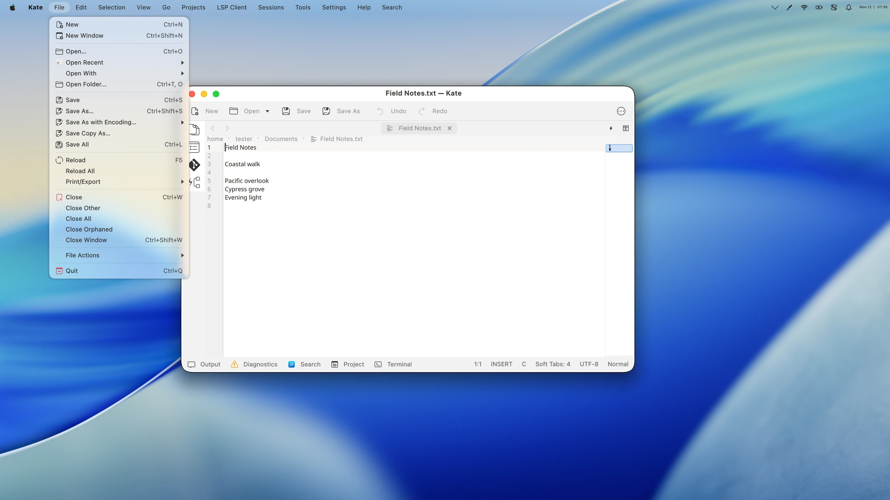
  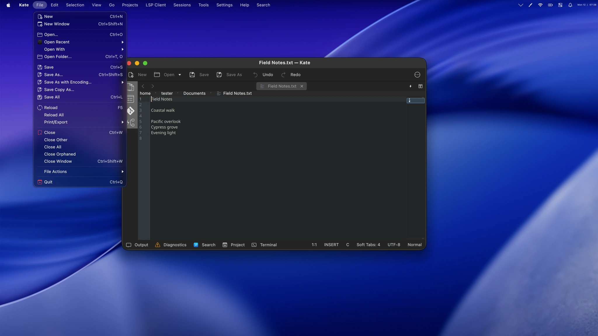
</p>

<br>

### Adaptif Kontrastlı Akrilik Cam 2.0

Adaptive Contrast, her etiketin arkasındaki arka planı örnekler. Fark en az 33 algısal hafiflik noktası olduğunda tema rengini korur. Bu hedefin altında, hafif metni hafif ve karanlık metni karanlık tutarken, RGB ölçeğinin% 40'ına kadar mümkün olan en küçük düzeltmeyi uyguluyor. Onu kapatmak tema rengi kullanıyor.

<br>

### Launchpad (Alpha)

Uygulamaları bul, kategorileri taray ve favorilerinize erişimde tut.

<p align="center">
  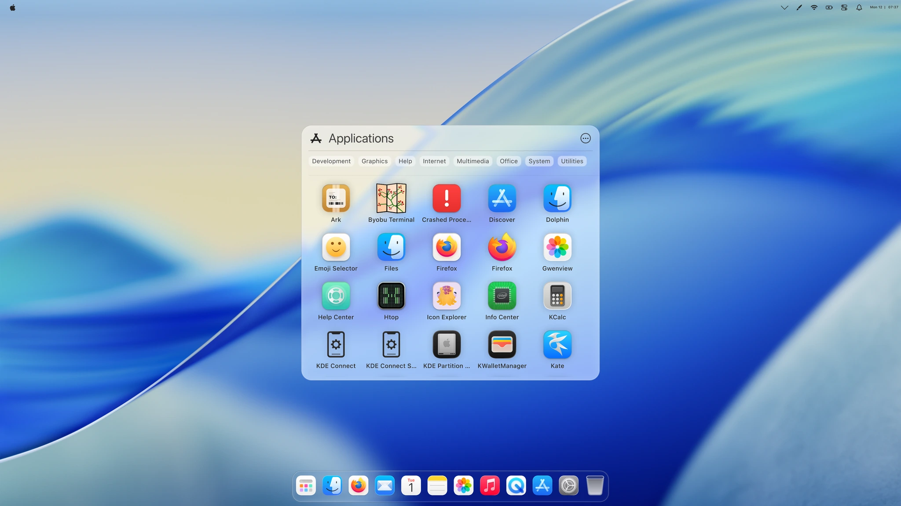
  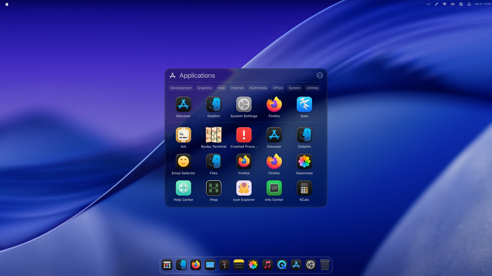
</p>

<br>

### Kontrol Merkezi (Alfa)

Wi-Fi, Bluetooth, ses, parlaklık ve bildirimler bir cam menüde. Görünüm düğmesi Işık için güneş, Karanlık için ay ve Otomatik için bölünmüş bir döngü gösterir.

<p align="center">
  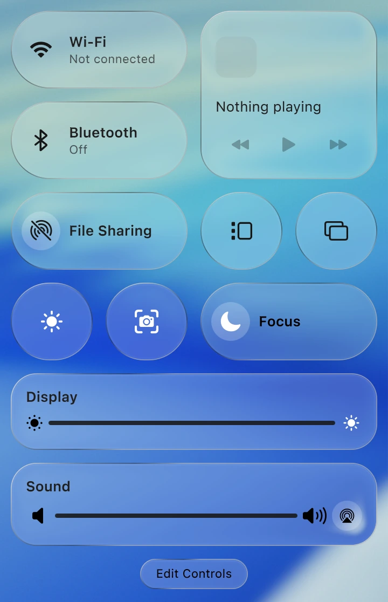
  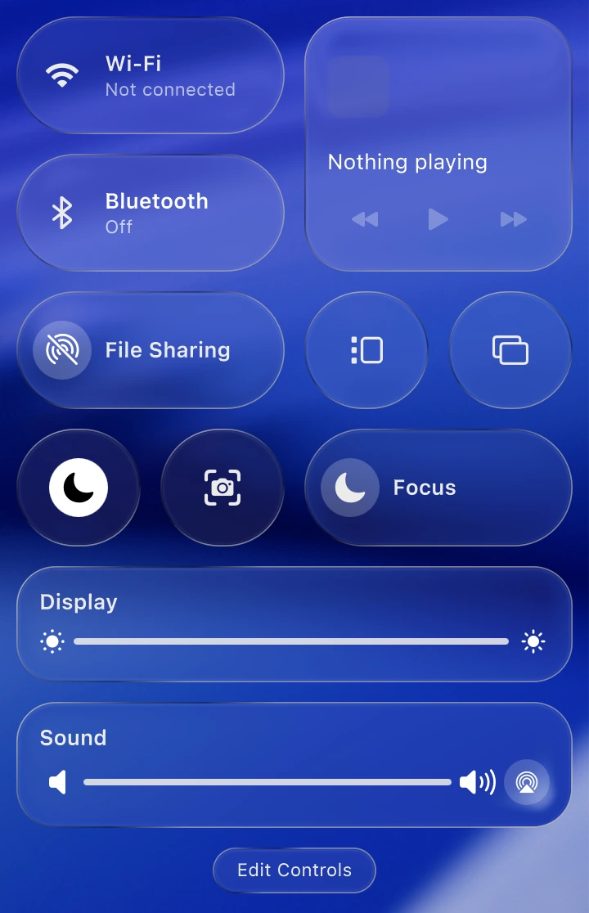
</p>

<br>

### İletişimler (Alfa)

Cam bildirim pankartları ve uygulama eylemleri ve cevap desteği ile gruplanmış geçmiş.

<p align="center">
  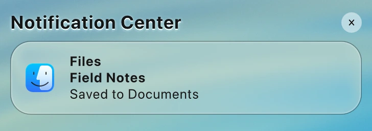
  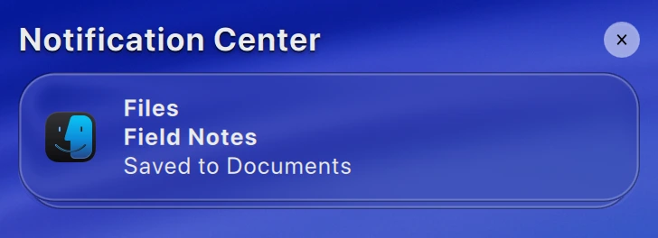
</p>

<p align="center">
  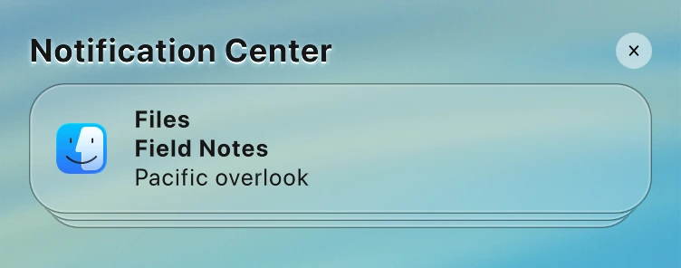
  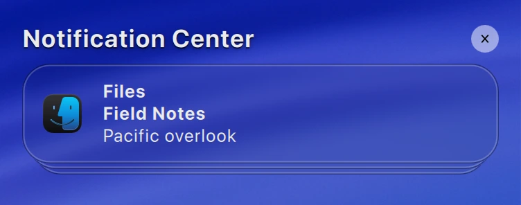
</p>

<br>

### Finder (Alpha)

Tahoe camı ile arşiv tarama biçimi.

<p align="center">
  <a href="src/screenshots/previews/readme-tahoe-light-finder-8b64ba8e3a8b.webp">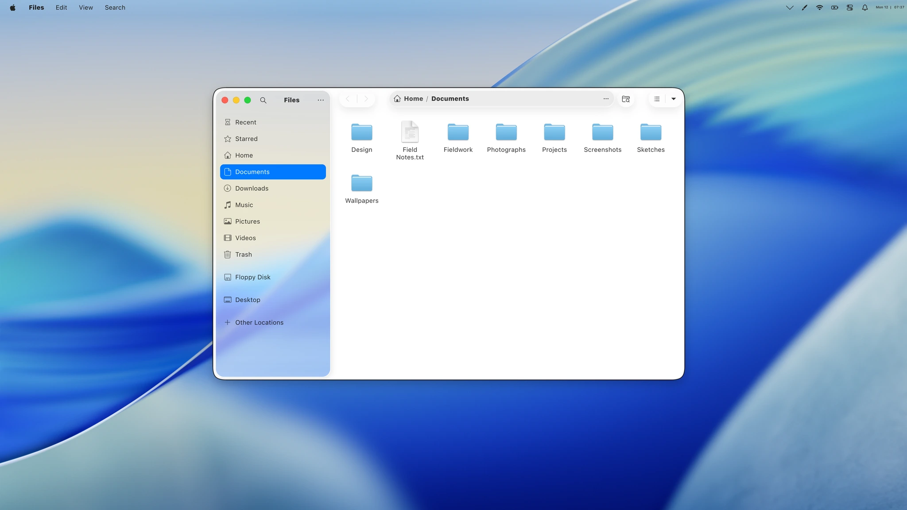</a>
  <a href="src/screenshots/previews/readme-tahoe-dark-finder-dd8777a43699.webp">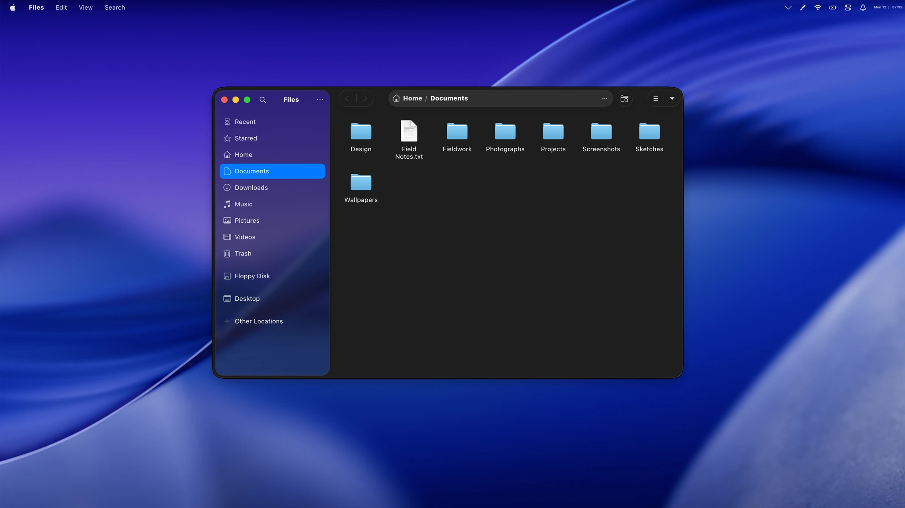</a>
</p>

<br>

### Takvim (Alfa)

Ay'ı camda görmek için panel saatini aç. Ayları taramak için ok tuşlarını kullan. Geçerli aya geri dönmek için Ev basın.

<p align="center">
  
  
</p>

<br>

### Bluetooth (Alpha)

Çift cihazları bağla ve menü çubuğundan pil seviyesini kontrol et.

<p align="center">
  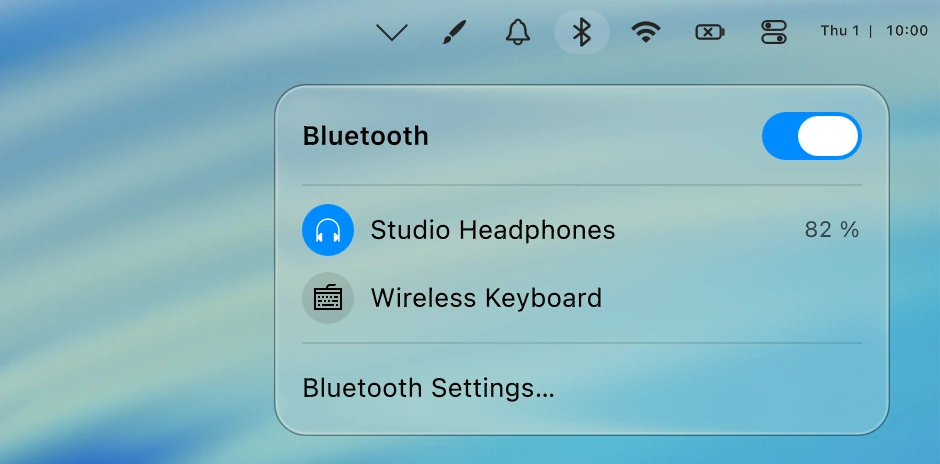
  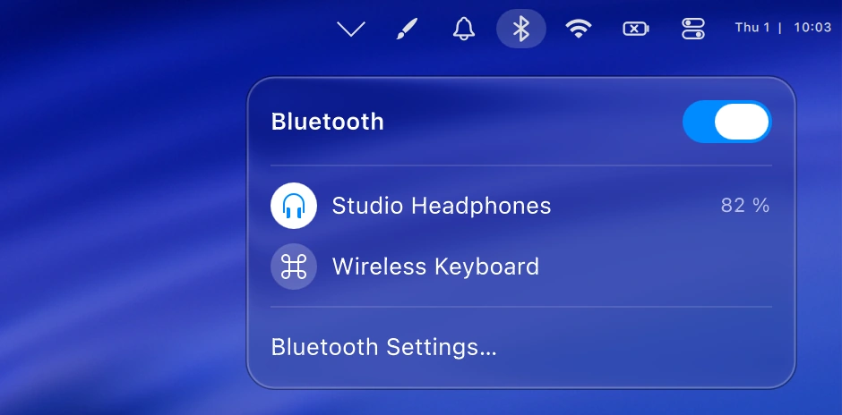
</p>

### Wi-Fi (Alpha)

Wi-Fi menüsünü açın ve mevcut kablosuz ağları görün. Wi-Fi adaptörü olmadan veya Wi-Fi kapalıyken, menü kablosuz bağlantılarınızı listeler ve ardından tek bir bölücü ve Wi-Fi ayarları bağlantısını içerir.

<p align="center">
  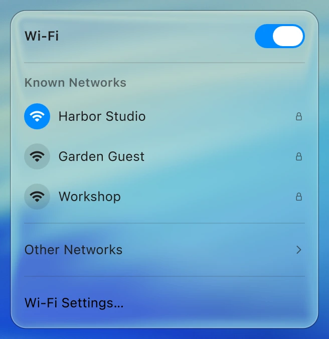
  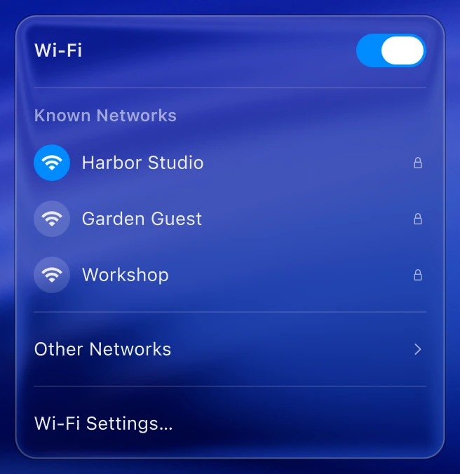
</p>

<br>

### Batarya (Alfa)

Şarj seviyesini ve güç durumunu kontrol etmek için pil menüsünü açın.

<p align="center">
  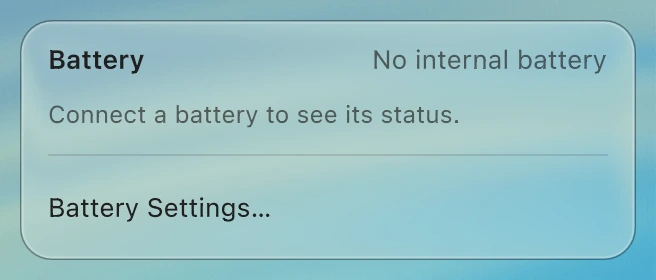
  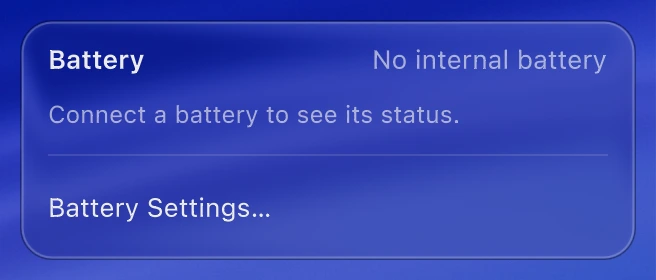
</p>

<br>

### Pano geçmişi (Alfa)

Launchpad'dan doğrudan kopyalanmış metin ve görüntüleri bulun ve tekrar kullanın.

<p align="center">
  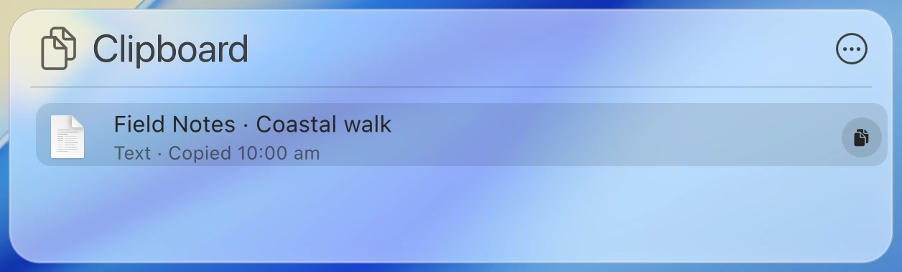
  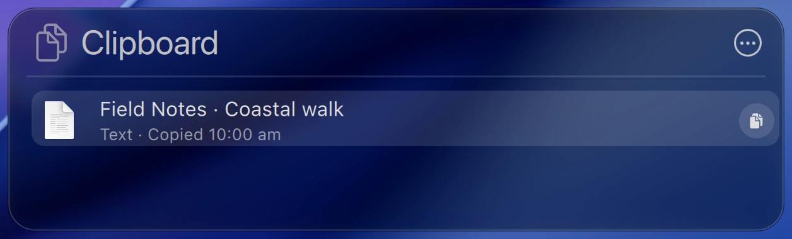
</p>

<br>

### Sistem Bilgisi (Alfa)

Adaptif Kontrast ile donanımlı, yazılımlı ve temalı detaylar.

<p align="center">
  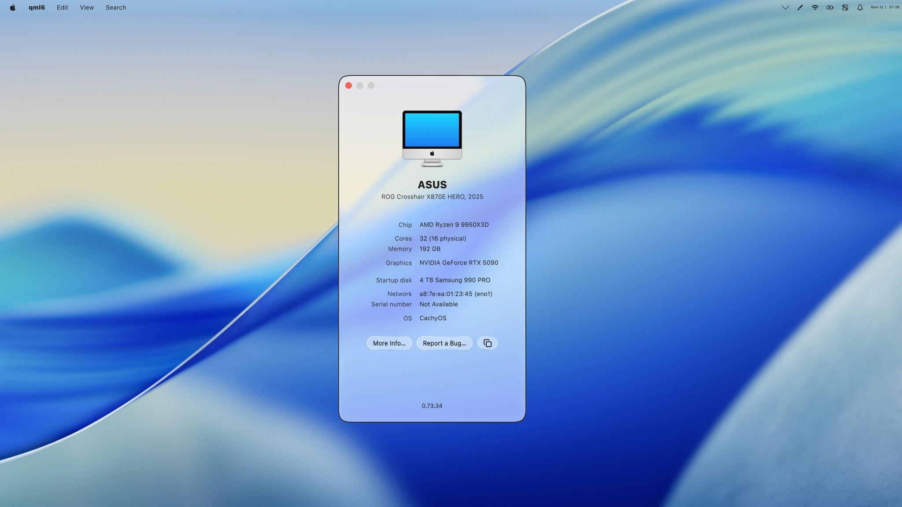
  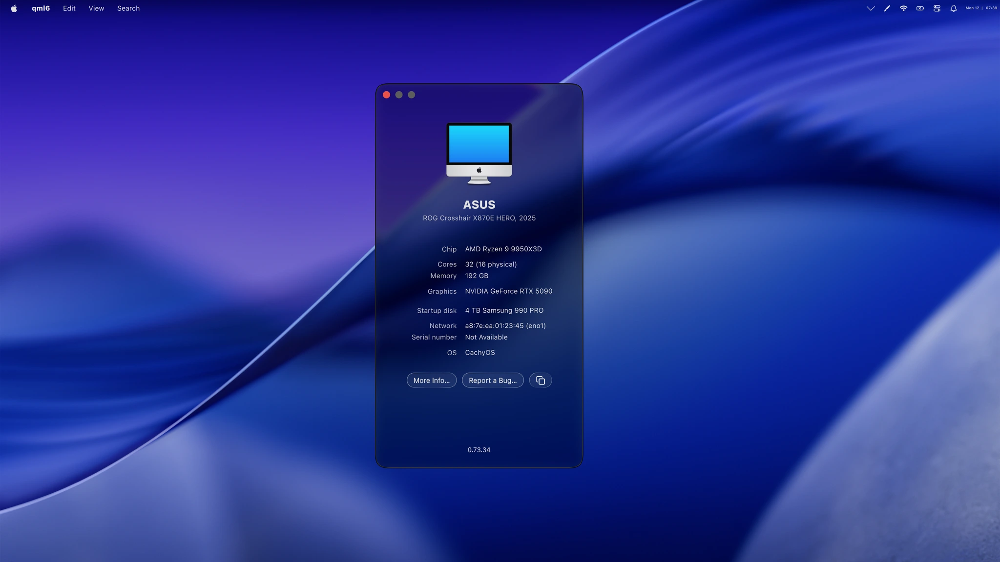
</p>

<br>

### Plasma teması (Alfa)

Açık ve koyu renkleri eşleştiren geçici menüler ve pop-ups.

<p align="center">
  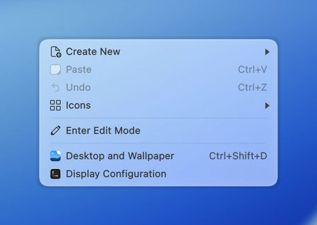
  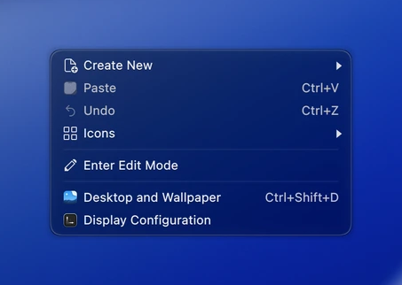
</p>

<br>

### Açılış ekranı (Alfa)

Başlatmadan kapanışa kadar eşleşen bir görünüm, LUKS2 şifreli sürücüleri için yerleşik kilitleme ile.

<p align="center">
  
</p>

<br>


- **Görünüm:** Masaüstü, uygulamalar, simgeler ve pencere dekorasyonları için otomatik olarak değiştirilen ve monitörlük duvar kağıtları ile birlikte koordinasyonlu ışık ve karanlık temeler. [Uygulama özel pencerelerin dekorasyonu ayarları](docs/app-window-decorations.md)
- **Cam etkisi:** Düzenlenebilir bulanıklık, kırılma ve renk, desteklenen menülerdeki arka planda uyum sağlayan metin ile.
- **- Ne ?** Bağlanmış uygulamalar, hover zoom, bildirim rozetleri ve yapılandırılabilir saklanma. Dock sizi göstergeler arasında takip ediyor.
- **Menü çubuğu ve Kontrol Merkezi:** Küresel uygulama menüleri ve hızlı sistem kontrolleri, ekranlardaki paylaşılan menü çubuğu ayarları ile.
- **Başlatma tabanı:** Uygulamaları arayın, kategorileri tarayın ve iki düzenden herhangi birinde favorileri kaydetin.
- **Masaüstü widgetleri:** Masaüstünüzde paketli Liquid Glass widgetlerini ekleyin ve düzenleyin.
- **İletişimler:** Cam pankartlar ve gruplanmış geçmiş, uygulamaların desteklediği hızlı eylemler ve cevaplar ile.
- **Kayıt tablosu geçmişi:** Kopyalandığınız metinleri, resimleri ve saklamak istediğiniz eşyaları bul ve tekrar kullanın.
- **Uygulama entegrasyonu:** Nautilus'ta Finder tarzı tarama, GTK menü entegrasyonu ve profil yedeklemeleri ile Firefox teması.
- **Sistem bilgisi ve başlatma:** Temalı bir sistem bilgi penceresi ve seçeneği eşleşen bir başlangıç sıçrayışı.
- **Kurulum ve kurtarma:** Birleştirilmiş tema varlıkları, güncellemeler ve ayarların yedekleme yapısı ile bir grafik yükleyici, kurulumdan çıkarıldığında geri yüklenebilir.
- **Diller:** Ayarlar'da kurulum dilini seçin. Plasma widgetleri masaüstü dilini izler.
- **Uygunluk:** Plasma 6.6 ⁇ 6.8 Arch ve Fedora tabanlı sistemlerde, openSUSE, Debian ve KDE neon üzerinde.
- **Seçenekler:** OLED panel koruması ve deneysel NixOS ve Home Manager desteği.

<br>


Kurulucu indir ve aç:

```bash
git clone --filter=blob:none https://github.com/lestercorderomurillo/macos-tahoe-liquid-kde.git
cd macos-tahoe-liquid-kde
./installer
```

Kurmak için **Express** seçeneğini seçin. Güncellemek veya kaldırmak için `./installer` komutunu tekrar çalıştırın.

Git çalışma kopyanızı ve yerel değişikliklerinizi koruyarak diskte yer açmak için:

```bash
./installer --free-space
```

| Kurulum dili | Durum |
| --- | --- |
| 🇺🇸 English |  |
| 🇪🇸 Español |  |
| 🇨🇳 简体中文 |  |
| 🇧🇷 Português (Brasil) |  |
| 🇩🇪 Deutsch |  |
| 🇫🇷 Français |  |
| 🇮🇹 Italiano |  |
| 🇷🇺 Русский |  |
| 🇯🇵 日本語 |  |
| 🇰🇷 한국어 |  |
| 🇸🇦 العربية |  |
| 🇮🇳 हिन्दी |  |
| 🇳🇱 Nederlands |  |
| 🇵🇱 Polski |  |
| 🇹🇷 Türkçe |  |

<details>
<summary><b>Gereksinimler</b></summary>

Gerekli masaüstü, araç ve sistem paketleri oluşturmak.

- KDE Plasma 6.6+
- Python 3.10+ ve PyQt6
- `sudo`
- Qt 6 Geliştirme araçları
- Toplanan plasmoidler ve KWin efektleri için KDE ve Qt 6 geliştirme paketleri
- `cmake`, `g++`ve `pkg-config` oluşturulan özellikler seçilirken
- `dbus-send`
- `systemctl` veya `crontab` Geçici özellikler için

**dinit:** yükleyici dinit'i tespit eder ve otomatik ışık/karanlık geçiş ve OLED bakımı için kullanıcı başına kron girişlerini kullanır. Çalışan bir cron demonu gereklidir kurulum `crontab` Tek başına başlamaz. Artix/dinit üzerinde hazırlayın:

```bash
sudo pacman -S --needed cronie cronie-dinit
sudo dinitctl --system enable cronie
```

Otomatik anahtarlar giriş yaparken 06:00 ve 18:00'de çalışır. cron arka uçunun giriş zamanı tespit edilmemektedir. Kılavuz ışık/karanlık anahtarı cron'dan bağımsız olarak çalışır. Dinit masaüstü niteliği bekleniyor mevcut Artix ekran görüntüleri OpenRC'yi kapsar.

Varlıklar toplanmış. Kaybolan bağımlılıklar ve seçeneği KDE Yüklü Köşeleri internet erişimini gerektirir. Verified Rounded Corners güncellemeleri, daha eski indirilmiş kaynakları ve arşivleri kaldırır. Yeniden yerleştirme, yönetilen varlık ağaçlarını değiştirir. Başarılı kopyalar geçici verilerini kaldırır ve daha sonra kopyalar kesilmiş bir kullanım için kullanılabilir aşamalamaları temizler. Tekrarlama yedeklemeleri, tarayıcı profil yedeklemeleri ve kullanıcı tercihleri korunmaktadır. Geliştiriciler için VM görüntüleri ve yakalama paketleri, kurulum önbellekleri değildir ve asla otomatik olarak kaldırılmaz.

| Distro | Qt 6 Araçlar | KDE Plasma 6 geliştirme paketleri |
|--------|------------|-----------------------------------|
| Ark ailesi | `pacman -S qt6-tools` | `pacman -S extra-cmake-modules plasma-workspace kdecoration libplasma libnotificationmanager libksysguard plasma-activities-stats` |
| Fedora ailesi | `dnf install qt6-qttools-devel` | `dnf install extra-cmake-modules plasma-workspace-devel kdecoration-devel libplasma-devel knotifications-devel libksysguard-devel kf6-plasma-activities-devel` |
| openSUSE Tumbleweed | `zypper install qt6-tools-devel` | `zypper install extra-cmake-modules plasma6-workspace-devel kdecoration-devel libKF6Plasma-devel libnotificationmanager6-devel libksysguard6-devel libKF6PlasmaActivitiesStats6-devel` |

Fedora'da, yükleyici Fedora GTK 3 global menü ihracatçısını yükler. `unity-gtk3-module`, ve GTK 3 uygulamaları için giriş noktasında yükler.

</details>

<details>
<summary><b>OLED bakımı</b></summary>

Seçeneğe bağlı paneldeki değişiklikler Öntanımlı olarak devre dışı bırakıldı.

Bu işlemleri etkinleştir **OLED koruma** Sayfa. Değişiklik aralığını ve maksimum piksel kaydırımını seçin Öntanımlı olarak devre dışı bırakılmıştır.

**El kontrolü**

```bash
mac-tahoe-oled-care shift
mac-tahoe-oled-care restore
mac-tahoe-oled-care status
```

</details>

<br>


dağıtım, init sistemi ve Plasma sürümünüz için destek kontrol edin.

<details>
<summary><b>Dağıtım testleri</b></summary>

Temayu izole bir Plasma masaüstü ile deneyin.

```bash
./vm <os>
```

**OS:** `cachyos` · `arch` · `manjaro` · `endeavouros` · `garuda` · `fedora` · `nobara` · `opensuse` · `neon` · `debian` · `artix` · `kubuntu`

`all` her dağıtımını başlatıyor. Bulut hedeflerinin otomatik olarak sağlanması Diğer hedefler, kontrol toplamlarına bağlı resmi ISO yükleyicilerini kullanırlar. İzleyin . [VM kurulum ve yeterlilik rehberi](tests/vm/README.md).

`./vm kubuntu` resmi Kubuntu 26.04.1 LTS ISO'yu SHA-256 doğrulama ile başlatır (SSH portu) `2234` Misafir ayarlamasından sonra). Yeni fırlatıcı geri dönüş hedefi tam canlı kalifikasyon bekleniyor.

`./vm debian` resmi Debian test (Forky) bulut görüntüsünü kullanır, SHA-512 kontrol toplamını doğruluyor ve bir Plasma masaüstü sağlar. Giriş yap . `tester` Parola ile `tester`Dönüşüm SSH: `127.0.0.1:2232`- Hayır , hayır . Kurulucu yazılabilir bir misafir kopyasından açılır `/home/tester/macos-tahoe-liquid-kde`Dönüşüm Host deposu sadece okunur. Kullanım `./vm debian --clean` Bir kenara atılacak misafirleri sıfırdan yeniden inşa etmek için.

Bu tabloda yer alan 11 dağıtım canlı VM kalifikasyonunu geçti. Tekrar gözden geçirilmiş ekran görüntüleri ve test sonuçları için bir durum badge seçin.

| | Adı | Durum |
|:--:|------|---------|
|  | CachyOS | [](tests/vm/PROOF.md#cachyos) |
|  | Arch Linux | [](tests/vm/PROOF.md#arch) |
|  | EndeavourOS | [](tests/vm/PROOF.md#endeavouros) |
|  | Fedora | [](tests/vm/PROOF.md#fedora) |
|  | Manjaro | [](tests/vm/PROOF.md#manjaro) |
|  | Artix Linux (OpenRC) | [](tests/vm/PROOF.md#artix) |
|  | Garuda Linux | [](tests/vm/PROOF.md#garuda) |
|  | Nobara | [](tests/vm/PROOF.md#nobara) |
|  | openSUSE Tumbleweed | [](tests/vm/PROOF.md#opensuse) |
|  | KDE neon | [](tests/vm/PROOF.md#neon) |
|  | Debian test / sid (Plasma 6.6+) | [](tests/vm/PROOF.md#debian) |

**NixOS ve Home Manager (test)**

Flake modüllerini kullan. **Grafikal yüklemeci değil**- Hayır , hayır . Canlı masaüstü doğrulama bekleniyor.

**Flake girişleri** (Nixpkgs ve Home Manager'ı gerektirir):

```nix
inputs.mac-tahoe = {
  url = "github:lestercorderomurillo/macos-tahoe-liquid-kde/v0.55.2";
  inputs.nixpkgs.follows = "nixpkgs";
  inputs.home-manager.follows = "home-manager";
};
```

**NixOS:** ithalat `inputs.mac-tahoe.nixosModules.default`.

```nix
services.desktopManager.plasma6.enable = true;
services.mac-tahoe.enable = true;
# services.mac-tahoe.plymouth.enable = true; # optional boot splash
```

**Home Manager:** ithalat `inputs.mac-tahoe.homeManagerModules.default`.

```nix
programs.mac-tahoe = {
  enable = true;
  mode = "auto"; # or "light" / "dark"
  # appleAssets = true;
  # oledCare.enable = true;
};
```

**Apple'ın varlıkları:** Özgür olmayan şriftler, duvar kağıtları ve sesler. Yapabilirlik `appleAssets` Ayrıca şunları gerektirir:

```nix
nixpkgs.config.allowUnfreePredicate = pkg:
  builtins.elem (lib.getName pkg) [ "mac-tahoe-apple-assets" ];
```

**Paneller:** Ayrıca kendi plazma yöneticisi modülünü de ithal et. `inputs.mac-tahoe.homeManagerModules.plasma-manager`- Hayır , hayır . Uygula `programs.mac-tahoe.panels.enable` ve set `programs.mac-tahoe.panels.launchers`Örneğin: `[ "applications:org.kde.dolphin.desktop" ]`- Hayır , hayır . Bu, mevcut pinleri ithal etmeden düzeni değiştirir.

**Yazılabilir ayarlar:** tut `kdeglobals`, `kwinrc`, `plasmarc`, `plasmashellrc`, `kcminputrc`, `plasma-org.kde.plasma.desktop-appletsrc`, `Kvantum/kvantum.kvconfig` ve canlı GTK yapılandırması yazılabilir. Tema anahtarı tarafından yönetilen değişmez plazma yöneticisi anahtarlarından kaçının.

Aktifleştirildikten sonra çıkıp tekrar içeri gir. Firefox profilleri, GTK kitap işaretleri ve SDDM yapılandırılmamıştır. Ev Yöneticisi'nde, ayar `programs.mac-tahoe.gtkAppmenuModule` Giriş sırasında yüklemek için yüklenen GTK 3 uygulama menü modül kütüphanesinin tam yoluna. OLED bakımını devre dışı bırakmadan önce çalıştır `mac-tahoe-oled-care restore`Dönüşüm Modülleri çıkarmadan önce Breeze seçin. Kaldırma kullanıcı ayarlarını yerinde bırakır.

</details>

<details>
<summary><b>İnit sistemleri</b></summary>

Otomatik tema değiştirme ve OLED bakımı aşağıdaki programlama arka planlarını kullanır:

| İnit sistemi | Programlama | Kayıtlı test |
| --- | --- | --- |
| systemd | Kullanıcı zamanlamaları |  |
| OpenRC | Kullanıcı başına cron |  |
| dinit | Kullanıcı başına cron |   |

OpenRC ve dinit, çalışkan bir cron demonu gerektirir. [Masaüstü test sonuçları](tests/vm/PROOF.md) · [Dinit programlama sondası](CONTRIBUTING.md#setup).

</details>

<details>
<summary><b>Plasma versiyonları</b></summary>

Plasma 6.6 ⁇ 6.8 desteklenir oluşturulan efektler host SDK'yi kullanır.

| Plasma | Destek | - Evet . |
|--------|---------|-------|
| 6.5 ve daha eski sürümler |  | Uygulanmaz |
| 6.6 |  | v0.1.0 |
| 6.7 |  | v0.19.0 |
| 6.8 |  | v0.54.1 |

</details>

<br>


Bu proje, macOS tasarımından esinlenen bağımsız bir uygulamadır. Apple veya KDE ile bağlantılı değildir ve bu kuruluşlar tarafından onaylanmamıştır. “macOS” ve “Apple”, Apple Inc. şirketinin ticari markalarıdır.

macOS amblemi, paketle gelen duvar kâğıtları, sistem sesleri ve SF Pro ile SF Mono yazı tipleri Apple’a aittir ve proje lisansının kapsamı dışındadır. Diğer bileşenlerin kendi lisansları ve telif hakkı bildirimleri geçerlidir. Kapsam ve kaynak bilgisi eksik olan öğeler için üçüncü taraf bildirimlerine bakın.

Projenin bütünü [GPL-3.0](LICENSE) ile lisanslanmıştır. Bileşenlerin kendi lisansları ve üçüncü tarafların hakları geçerliliğini korur. [Telif hakkı bildirimlerine](NOTICE), [lisanslara ve proje kimliğine](LICENSING.md) ve [üçüncü taraf bildirimlerine](THIRD_PARTY_NOTICES.md) bakın.

<br>


<details>
<summary><b>Proje, varlıklar ve kabuller</b></summary>

Proje referansları ve üçüncü taraf bileşenleri:

- **[EliverLara](https://github.com/EliverLara/TahoeLauncher)**: `TahoeLauncher`: Başlatma tabanı tasarım referansı.
- **[vinceliuice](https://github.com/vinceliuice)**: `MacTahoe-icon-theme`: temel simgeler ve kursorlar GTK tasarım referansı. [`MacTahoe-gtk-theme` Firefox CSS/SVG](https://github.com/vinceliuice/MacTahoe-gtk-theme/tree/main/other/firefox) Burada, profil yedekleme ve geri yükleme desteği ile MIT lisanslı bir çatal olarak sürdürülmektedir.
- **[taj-ny](https://github.com/taj-ny/kwin-effects-forceblur)** ve **[4v3ngR](https://github.com/4v3ngR/kwin-effects-glass)**: Better Blur ve cam çatal: Akrilik Cam tarafından kullanılan yukarıdaki kod (KWin blur yazarları kaynak başlıklarında kaydedilmektedir).
- **[luisbocanegra](https://github.com/luisbocanegra/plasma-panel-colorizer)**: `plasma-panel-colorizer` v7.3.0, çevrimdışı olarak paketlenmiş ve panelleri renklendirmek için düzenlemede aşamada kurulmuştur (GPL-3.0, lisansı yan yana gönderilmiştir).
- **[jaxparrow07](https://github.com/jaxparrow07/liquidglass-kde-widgets)**: `liquidglass-kde-widgets` Liquid Glass masaüstü widgetlerinin toplu koleksiyonunu sağlar (GPL-3.0, lisansı dahil).
- **[RoxasYTB](https://github.com/RoxasYTB)**: [Fotoğraf widget](https://github.com/jaxparrow07/liquidglass-kde-widgets/pull/41) Masaüstünde fotoğraflar gösterir. [Otomatik Katı/Süper geçiş](https://github.com/jaxparrow07/liquidglass-kde-widgets/pull/40) Ekranda bir pencere açık olduğunda widgetleri cam'a çevirir.
- **[Matin Lotfaliei / KDE-Dövrülü Köşeler](https://github.com/matinlotfali/KDE-Rounded-Corners)**: GPL-3.0 KWin yuvarlak penceresi etkisi, sabitlenmiş v0.9.0 sürümünden alınmış ve host KWin SDK'ye karşı çevrimiçi olarak inşa edilmiş ( yan yana kurulan lisans).
- **[ful1e5](https://github.com/ful1e5)**: `apple_cursor`: alternatif kursor tasarım referansı.
- **[sahibjotsaggu](https://github.com/sahibjotsaggu)**: `San-Francisco-Pro-Fonts`: SF Pro / SF Mono paketinin kaynağı.
- **[Lucide](https://github.com/lucide-icons/lucide)**: global menüde toplanmış simgeler kopyalandı (ISC, © Lucide Contributors).
- **[512pixels.net](https://512pixels.net/projects/default-mac-wallpapers-in-5k/)**: yüksek çözünürlüklü macOS duvar kağıdı arşivini.

Eğer kredi eksikse, lütfen [bir sorun kaydı açın](https://github.com/lestercorderomurillo/macos-tahoe-liquid-kde/issues/new).

</details>


[Kurulum ekran görüntüleri ve test](TESTING.md).
