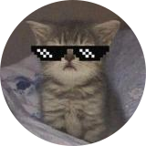
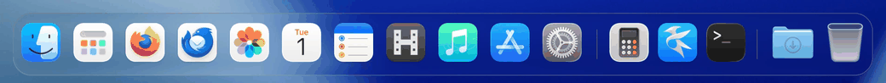
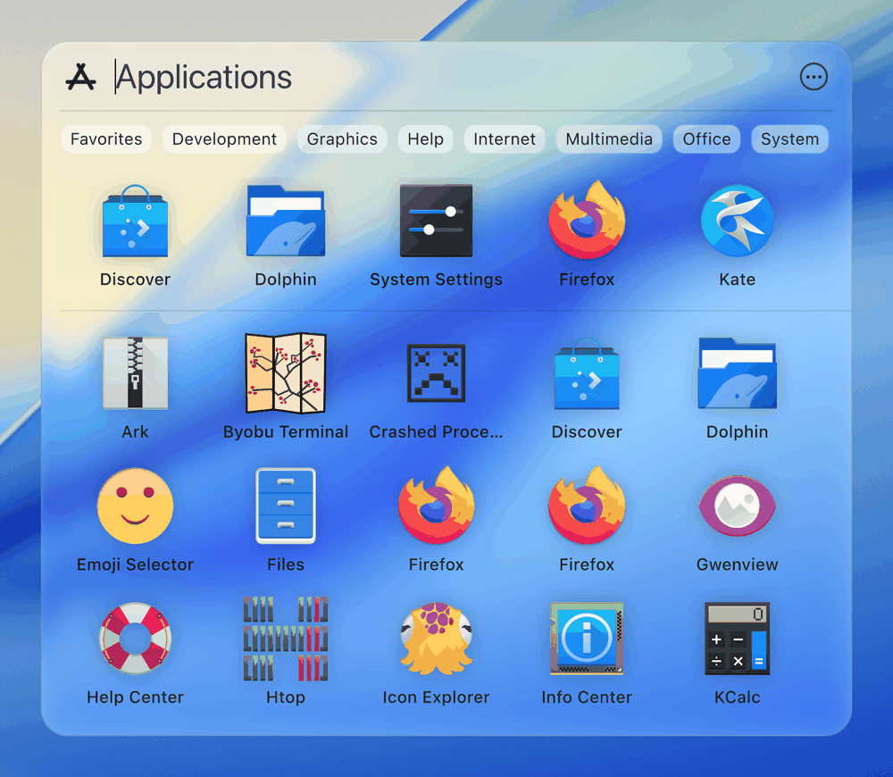
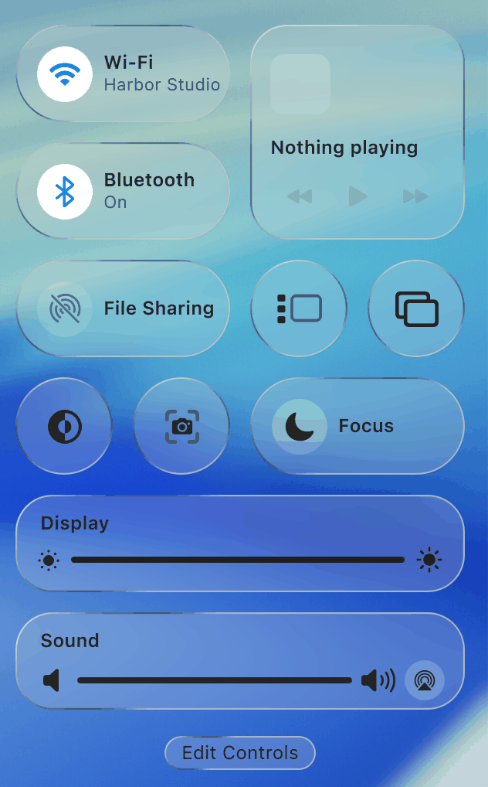
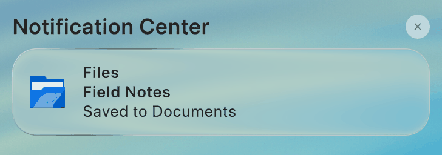
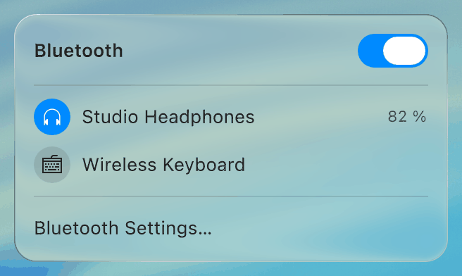
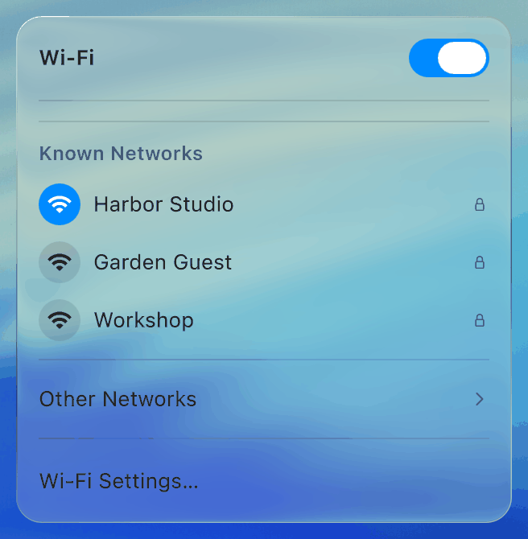
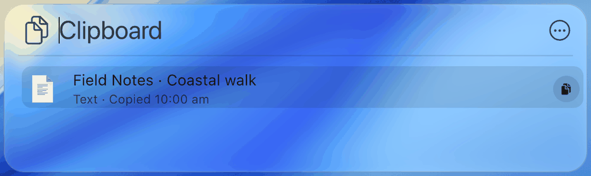
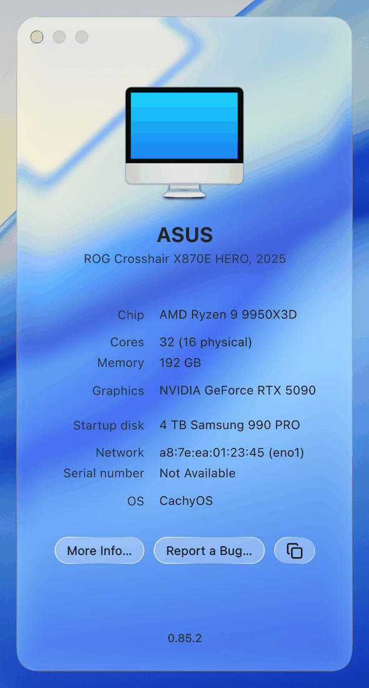
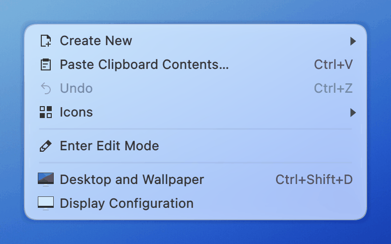

<p align="center">
  <!-- Adapted with ImageGen from artwork by Apple: https://developer.apple.com/assets/elements/icons/macos-26/macos-26-128x128_2x.png. Tux design by Larry Ewing. -->
  
</p>

<h1 align="center">适用于 Linux KDE 桌面的 macOS Tahoe Shell</h1>

<p align="center">
  <a href="README.md" lang="en" hreflang="en">🇺🇸 English</a> ·
  <a href="README.es.md" lang="es" hreflang="es">🇪🇸 Español</a> ·
  <a href="README.zh-CN.md" lang="zh-CN" hreflang="zh-CN" aria-current="page">🇨🇳 简体中文</a> ·
  <a href="README.pt-BR.md" lang="pt-BR" hreflang="pt-BR">🇧🇷 Português (Brasil)</a> ·
  <a href="README.de.md" lang="de" hreflang="de">🇩🇪 Deutsch</a> ·
  <a href="README.fr.md" lang="fr" hreflang="fr">🇫🇷 Français</a> ·
  <a href="README.it.md" lang="it" hreflang="it">🇮🇹 Italiano</a> ·
  <a href="README.ja.md" lang="ja" hreflang="ja">🇯🇵 日本語</a> ·
  <a href="README.ko.md" lang="ko" hreflang="ko">🇰🇷 한국어</a> ·
  <a href="README.ru.md" lang="ru" hreflang="ru">🇷🇺 Русский</a> ·
  <a href="README.ar.md" lang="ar" hreflang="ar">🇸🇦 العربية</a> ·
  <a href="README.hi.md" lang="hi" hreflang="hi">🇮🇳 हिन्दी</a> ·
  <a href="README.nl.md" lang="nl" hreflang="nl">🇳🇱 Nederlands</a> ·
  <a href="README.pl.md" lang="pl" hreflang="pl">🇵🇱 Polski</a> ·
  <a href="README.tr.md" lang="tr" hreflang="tr">🇹🇷 Türkçe</a>
</p>

<p align="center">
  <a href="https://github.com/lestercorderomurillo/macos-tahoe-liquid-kde/releases"></a>
  <a href="https://github.com/lestercorderomurillo/macos-tahoe-liquid-kde/actions/workflows/test.yml"></a>
  <a href="https://kde.org/plasma-desktop/"></a>
  <a href="LICENSE"></a>
  <a href="https://github.com/lestercorderomurillo/macos-tahoe-liquid-kde/issues/new"></a>
</p>


<p align="center">
  <sub>选择发行版以查看其测试状态。</sub>
</p>

<p align="center">
  <a href="tests/vm/PROOF.md#cachyos" title="CachyOS"></a>
  <a href="tests/vm/PROOF.md#arch" title="Arch Linux"></a>
  <a href="tests/vm/PROOF.md#endeavouros" title="EndeavourOS"></a>
  <a href="tests/vm/PROOF.md#fedora" title="Fedora"></a>
  <a href="tests/vm/PROOF.md#manjaro" title="Manjaro"></a>
  <a href="tests/vm/PROOF.md#artix" title="Artix Linux (OpenRC)"></a>
  <a href="tests/vm/PROOF.md#garuda" title="Garuda Linux"></a>
  <a href="tests/vm/PROOF.md#nobara" title="Nobara Linux"></a>
  <a href="tests/vm/PROOF.md#opensuse" title="openSUSE Tumbleweed"></a>
  <a href="tests/vm/PROOF.md#neon" title="KDE neon"></a>
  <a href="tests/vm/PROOF.md#debian" title="Debian testing / sid (Plasma 6.6+)"></a>
  <a href="tests/vm/PROOF.md#nixos" title="NixOS (experimental)"></a>
</p>

本项目用于自定义 Linux 上 KDE 桌面的外观，不包含任何 Apple 服务，也不会连接到这些服务。如需 Apple 服务，请[直接前往 Apple 官方商店选购](https://www.apple.com/store)。

> [!CAUTION]
> **滚动发布理念**
> 实验性项目。每天接收更新。更新可能破坏兼容性。请避免用于生产系统；[在此报告问题](https://github.com/lestercorderomurillo/macos-tahoe-liquid-kde/issues/new)。

> [!WARNING]
> **谨防收费的重新打包版本：本主题免费。**
>
> 如果你通过第三方渠道发现本主题，无需付费获取：直接从本仓库下载即可。我们保持项目免费，让所有人都能使用，无需付费。无需购买或订阅。

<br>


错误报告、修复、测试和文档：参阅[贡献指南](CONTRIBUTING.md)。

Tahoe 和 Golden Gate 的代码贡献者及问题报告者：

<p>
  <a href="https://github.com/lestercorderomurillo"></a>
  <a href="https://github.com/yanhenrique-dev"></a>
  <a href="https://github.com/naevui"></a>
  <a href="https://github.com/caioniehues"></a>
  <a href="https://github.com/404-not-found129"></a>
  <a href="https://github.com/myakupozluk"></a>
  <a href="https://github.com/EMS1998"></a>
  <a href="https://github.com/allfritz"></a>
  <a href="https://github.com/elegos"></a>
  <a href="https://github.com/kozeki-uii"></a>
  <a href="https://github.com/imightbelosthere"></a>
  <a href="https://github.com/evaildev"></a>
  <a href="https://github.com/xarblu"></a>
  <a href="https://github.com/PKMNPlatin"></a>
  <a href="https://github.com/matinlotfali"></a>
  <a href="https://github.com/luisbocanegra"></a>
  <a href="https://github.com/OliverChase2003"></a>
  <a href="https://github.com/RoxasYTB"></a>
  <a href="https://github.com/Flagwill"></a>
  <a href="https://github.com/4l3j0Ok"></a>
  <a href="https://github.com/0xrushi"></a>
  <a href="https://github.com/aenriii"></a>
  <a href="https://github.com/andreas399"></a>
  <a href="https://github.com/Andrew-Sor"></a>
  <a href="https://github.com/ardashir77"></a>
  <a href="https://github.com/azizaktas"></a>
  <a href="https://github.com/binary-pleb"></a>
  <a href="https://github.com/bneils"></a>
  <a href="https://github.com/FAYZER77"></a>
  <a href="https://github.com/fxrncyyisingithub"></a>
  <a href="https://github.com/germanbagutteorsomething"></a>
  <a href="https://github.com/iNarrow12"></a>
  <a href="https://github.com/IsaiahSHanson"></a>
  <a href="https://github.com/kuau"></a>
  <a href="https://github.com/Lando0007"></a>
  <a href="https://github.com/LilT59"></a>
  <a href="https://github.com/marcosfantonio"></a>
  <a href="https://github.com/moulikanand12345-lang"></a>
  <a href="https://github.com/nanechi"></a>
  <a href="https://github.com/nousernameget"></a>
  <a href="https://github.com/OpalSand"></a>
  <a href="https://github.com/P0sixSplo1t-2"></a>
  <a href="https://github.com/rokan00"></a>
  <a href="https://github.com/RussH"></a>
  <a href="https://github.com/Salkio"></a>
  <a href="https://github.com/Shivamingale3"></a>
  <a href="https://github.com/shoko3756"></a>
  <a href="https://github.com/Sonicx9876"></a>
  <a href="https://github.com/Tias-dev"></a>
  <a href="https://github.com/txhammer68"></a>
  <a href="https://github.com/vanshdev0101"></a>
  <a href="https://github.com/vialolis"></a>
  <a href="https://github.com/Whiddu"></a>
  <a href="https://github.com/yingmanwumen"></a>
  <a href="https://github.com/yofriendfromschool1"></a>
  <a href="https://github.com/zhaokelei"></a>
  <a href="https://github.com/blaykelarue"></a>
  <a href="https://github.com/JacobJS34"></a>
  <a href="https://github.com/Leon-Swains"></a>
  <a href="https://github.com/LucipurrsDad"></a>
  <a href="https://github.com/SinglerGold2"></a>
  <a href="https://github.com/CiderGuru"></a>
  <a href="https://github.com/soumyadeep70"></a>
</p>

<br>


### 多彩 Dock

为程序坞图标选择与桌面相配的颜色。

<p align="center">
  
</p>

<br>

### Quickbar

从顶栏打开当前应用的菜单。

<p align="center">
  
</p>

<br>

### Launchpad

搜索应用，或按类别浏览。

<p align="center">
  
</p>

<br>

### 控制中心

在同一菜单中调节无线网络、音量和亮度。

<p align="center">
  
</p>

<br>

### 通知

按应用查看最近的通知。

<p align="center">
  
</p>

<br>

### Finder

在 Finder 风格的窗口中浏览文件。

<p align="center">
  <a href="src/screenshots/previews/tahoe-finder-light-dark-21d755ca3c50.gif"></a>
</p>

<br>

### 历日

点击时钟即可查看月历。

<p align="center">
  
</p>

<br>

### Bluetooth

连接已配对的设备并查看其剩余电量。

<p align="center">
  
</p>

### Wi-Fi

查看可用网络和连接状态。

<p align="center">
  
</p>

<br>

### 电池

查看电池电量和充电状态。

<p align="center">
  
</p>

<br>

### 剪贴板历史记录

再次使用之前复制的文字和图片。

<p align="center">
  
</p>

<br>

### 系统信息

查看硬件、软件和主题信息。

<p align="center">
  
</p>

<br>

### Plasma 主题

菜单和弹窗跟随浅色或深色主题。

<p align="center">
  
</p>

<br>

### 启动画面

启动时显示与主题相配的画面。

<p align="center">
  
</p>

<br>

### 自适应对比度

文字颜色会随背景调整，让标签保持清晰。

<p align="center">
  
</p>

<br>


- **外观：**桌面、应用、图标和窗口装饰采用统一的浅色与深色主题，支持自动切换和为每台显示器单独设置壁纸。
- **玻璃特效：**可调节模糊、折射和色调，支持的菜单会根据背景调整文字颜色。
- **Dock：**支持固定应用、悬停放大、通知角标和隐藏设置，可随操作在不同显示器之间移动。
- **菜单栏与控制中心：**提供全局应用菜单和系统快捷控制，菜单栏设置可在不同显示器之间同步。
- **Launchpad：**提供两种布局，可搜索应用、浏览分类和收藏常用应用。
- **桌面小部件：**可将 Liquid Glass 小部件直接添加到桌面。
- **通知：**玻璃风格的通知横幅和分组历史记录，在应用支持时可使用快捷操作和回复。
- **剪贴板历史：**查找并重复使用复制过的文字和图片，也可以固定想保留的条目。
- **应用集成：**Nautilus 提供 Finder 风格的文件浏览体验，并支持 GTK 菜单集成和带配置备份的 Firefox 主题。
- **系统信息与启动：**主题化的系统信息窗口和可选的配套启动画面。
- **安装与恢复：**图形化安装程序随附主题资源，支持更新和设置备份，可在卸载时恢复设置。
- **语言：** 可在设置中选择安装程序的语言。Plasma 小部件使用桌面的语言。
- **兼容性：**支持基于 Arch 或 Fedora 的系统以及 openSUSE、Debian 和 KDE neon 上的 Plasma 6.6–6.8。
- **可选功能：**OLED 屏幕保护，以及对 NixOS 和 Home Manager 的实验性支持。

<br>


下载并打开安装程序：

```bash
git clone --filter=blob:none https://github.com/lestercorderomurillo/macos-tahoe-liquid-kde.git
cd macos-tahoe-liquid-kde
./installer
```

选择 **Express** 进行安装。再次打开 `./installer` 即可更新或卸载。

释放磁盘空间并保留 Git 工作副本和本地工作：

```bash
./installer --free-space
```

| 安装程序语言 | 状态 |
| --- | --- |
| 🇺🇸 英语 |  |
| 🇪🇸 西班牙语 |  |
| 🇨🇳 简体中文 |  |
| 🇧🇷 巴西葡萄牙语 |  |
| 🇩🇪 德语 |  |
| 🇫🇷 法语 |  |
| 🇮🇹 意大利语 |  |
| 🇷🇺 俄语 |  |
| 🇯🇵 日语 |  |
| 🇰🇷 韩语 |  |
| 🇸🇦 阿拉伯语 |  |
| 🇮🇳 印地语 |  |
| 🇳🇱 荷兰语 |  |
| 🇵🇱 波兰语 |  |
| 🇹🇷 土耳其语 |  |

<details>
<summary><b>系统要求</b></summary>

所需的桌面环境、构建工具和系统软件包。

- KDE Plasma 6.6+
- Python 3.10+ 和 PyQt6
- `sudo`
- Qt 6 开发工具
- 用于编译型 Plasma 组件和 KWin 特效的 KDE 与 Qt 6 开发包
- `cmake`, `g++`，以及 `pkg-config`（选择编译功能时）
- `dbus-send`
- `systemctl` 或 `crontab`（用于计划功能）

**dinit：**安装程序检测 dinit，并使用用户 cron 条目进行自动浅色/深色切换和 OLED 保护。需要运行中的 cron 守护进程；仅安装 `crontab` 不会启动它。在 Artix/dinit 上，使用以下命令准备：

```bash
sudo pacman -S --needed cronie cronie-dinit
sudo dinitctl --system enable cronie
```

自动切换在登录期间的 06:00 和 18:00 执行；cron 后端不会在登录时补执行。手动浅色/深色切换不依赖 cron。dinit 桌面验证尚未完成；现有 Artix 截图覆盖 OpenRC。

资源已随附。缺失的依赖和可选的 KDE Rounded Corners 需要网络连接。经过验证的 Rounded Corners 更新会删除旧的下载源码和压缩包。重新安装会原位替换受管理的资源目录树；成功复制后会清除临时数据，后续复制会清理中断的一次性暂存数据。恢复备份、浏览器配置备份和用户偏好将保留。开发用虚拟机镜像和截图包不是安装程序缓存，绝不会自动删除。

| 发行版 | Qt 6 工具 | KDE Plasma 6 开发包 |
|--------|------------|-----------------------------------|
| Arch 系列 | `pacman -S qt6-tools` | `pacman -S extra-cmake-modules plasma-workspace kdecoration libplasma libnotificationmanager libksysguard plasma-activities-stats` |
| Fedora 系列 | `dnf install qt6-qttools-devel` | `dnf install extra-cmake-modules plasma-workspace-devel kdecoration-devel libplasma-devel knotifications-devel libksysguard-devel kf6-plasma-activities-devel` |
| openSUSE Tumbleweed | `zypper install qt6-tools-devel` | `zypper install extra-cmake-modules plasma6-workspace-devel kdecoration-devel libKF6Plasma-devel libnotificationmanager6-devel libksysguard6-devel libKF6PlasmaActivitiesStats6-devel` |

</details>

<details>
<summary><b>OLED 保护</b></summary>

可选的面板位移；默认关闭。

在 **OLED 保护** 页面启用。在此选择位移间隔和最大像素位移；默认关闭。

**手动控制**

```bash
mac-tahoe-oled-care shift
mac-tahoe-oled-care restore
mac-tahoe-oled-care status
```

</details>

<br>


检查你的发行版、初始化系统和 Plasma 版本的支持情况。

<details>
<summary><b>发行版测试</b></summary>

在隔离的 Plasma 桌面中试用主题。

```bash
./vm <os>
```

**OS:** `cachyos` · `arch` · `manjaro` · `endeavouros` · `garuda` · `fedora` · `nobara` · `opensuse` · `neon` · `debian` · `artix` · `kubuntu`

`all` 启动所有发行版。云镜像目标会自动配置；其他目标使用以校验和固定的官方 ISO 安装程序。参阅[虚拟机设置与验证指南](tests/vm/README.md)。

`./vm kubuntu` 启动官方 Kubuntu 26.04.1 LTS ISO 并验证 SHA-256（配置来宾后，SSH 端口为 `2234`）。此新增启动器回归测试目标尚待完整的实际运行验证。

`./vm debian` 使用官方 Debian testing（Forky）云镜像，验证 SHA-512 校验和并配置 Plasma 桌面。以 `tester` 登录，密码为 `tester`；SSH 位于 `127.0.0.1:2232`。安装程序从来宾内可写副本 `/home/tester/macos-tahoe-liquid-kde` 打开；宿主仓库以只读方式挂载。使用 `./vm debian --clean` 从头重建一次性来宾。

此表中的全部 11 个发行版均通过实际虚拟机验证。选择状态徽章以查看已审阅截图和测试结果。

| | 名称 | 状态 |
|:--:|------|---------|
|  | CachyOS | [](tests/vm/PROOF.md#cachyos) |
|  | Arch Linux | [](tests/vm/PROOF.md#arch) |
|  | EndeavourOS | [](tests/vm/PROOF.md#endeavouros) |
|  | Fedora | [](tests/vm/PROOF.md#fedora) |
|  | Manjaro | [](tests/vm/PROOF.md#manjaro) |
|  | Artix Linux (OpenRC) | [](tests/vm/PROOF.md#artix) |
|  | Garuda Linux | [](tests/vm/PROOF.md#garuda) |
|  | Nobara | [](tests/vm/PROOF.md#nobara) |
|  | openSUSE Tumbleweed | [](tests/vm/PROOF.md#opensuse) |
|  | KDE neon | [](tests/vm/PROOF.md#neon) |
|  | Debian testing / sid (Plasma 6.6+) | [](tests/vm/PROOF.md#debian) |

**NixOS 和 Home Manager（测试中）**

使用 flake 模块，**不要使用图形安装程序**。实际桌面验证尚未完成。

**Flake 输入**（需要 Nixpkgs 和 Home Manager）：

```nix
inputs.mac-tahoe = {
  url = "github:lestercorderomurillo/macos-tahoe-liquid-kde/v0.55.2";
  inputs.nixpkgs.follows = "nixpkgs";
  inputs.home-manager.follows = "home-manager";
};
```

**NixOS：**导入 `inputs.mac-tahoe.nixosModules.default`。

```nix
services.desktopManager.plasma6.enable = true;
services.mac-tahoe.enable = true;
# services.mac-tahoe.plymouth.enable = true; # optional boot splash
```

**Home Manager：**导入 `inputs.mac-tahoe.homeManagerModules.default`。

```nix
programs.mac-tahoe = {
  enable = true;
  mode = "auto"; # or "light" / "dark"
  # appleAssets = true;
  # oledCare.enable = true;
};
```

**Apple 资源：**可选的非自由字体、壁纸和声音。启用 `appleAssets` 还需要：

```nix
nixpkgs.config.allowUnfreePredicate = pkg:
  builtins.elem (lib.getName pkg) [ "mac-tahoe-apple-assets" ];
```

**面板：**还需导入你自己的 plasma-manager 模块及 `inputs.mac-tahoe.homeManagerModules.plasma-manager`。启用 `programs.mac-tahoe.panels.enable` 并设置 `programs.mac-tahoe.panels.launchers`，例如 `[ "applications:org.kde.dolphin.desktop" ]`。这会替换布局，不会导入现有固定项目。

**可写设置：**保持 `kdeglobals`、`kwinrc`、`plasmarc`、`plasmashellrc`、`kcminputrc`、`plasma-org.kde.plasma.desktop-appletsrc`、`Kvantum/kvantum.kvconfig` 和当前 GTK 配置可写。避免将主题切换器管理的 plasma-manager 键设为不可变。

激活后请注销并重新登录。不会配置 Firefox 配置文件、GTK 书签和 SDDM。GTK 全局菜单需要 `programs.mac-tahoe.gtkAppmenuModule`。关闭 OLED 保护前，运行 `mac-tahoe-oled-care restore`；移除模块前，选择 Breeze。移除操作会保留用户设置。

</details>

<details>
<summary><b>初始化系统</b></summary>

自动主题切换和 OLED 保护使用以下调度后端：

| 初始化系统 | 调度 | 已记录测试 |
| --- | --- | --- |
| systemd | 用户定时器 |  |
| OpenRC | 用户 cron |  |
| dinit | 用户 cron |   |

OpenRC 和 dinit 需要运行中的 cron 守护进程。
[桌面测试结果](tests/vm/PROOF.md) · [dinit 调度检查](CONTRIBUTING.md#setup)。

</details>

<details>
<summary><b>Plasma 版本</b></summary>

支持 Plasma 6.6–6.8；编译特效使用宿主 SDK。

| Plasma | 支持 | 起始版本 |
|--------|---------|-------|
| 6.5 及更早版本 |  | 不适用 |
| 6.6 |  | v0.1.0 |
| 6.7 |  | v0.19.0 |
| 6.8 |  | v0.54.1 |

</details>

<br>


这是受 macOS 美学启发的独立重新实现。与 Apple 或 KDE 无关联，也未获其背书。“macOS”和“Apple”是 Apple Inc. 的商标。

macOS 徽标、随附壁纸、系统声音及 SF Pro / SF Mono 字体仍属于 Apple，不受本项目许可证覆盖。其他组件保留各自许可证和版权声明；有关范围及已知来源缺口，请参阅下方第三方声明索引。

整体以 [GPL-3.0](LICENSE) 授权；各组件许可证和第三方权利仍适用。请参阅[版权声明](NOTICE)、[许可与项目身份](LICENSING.md)及[第三方声明](THIRD_PARTY_NOTICES.md)。

<br>


<details>
<summary><b>项目、资源与致谢</b></summary>

项目参考与第三方组件：

- **[EliverLara](https://github.com/EliverLara/TahoeLauncher)**: `TahoeLauncher`: Launchpad 设计参考。
- **[vinceliuice](https://github.com/vinceliuice)**: `MacTahoe-icon-theme`: 基础图标和光标；GTK 设计参考。 [`MacTahoe-gtk-theme` Firefox CSS/SVG](https://github.com/vinceliuice/MacTahoe-gtk-theme/tree/main/other/firefox) 在此作为 MIT 许可的分支维护，支持配置备份和恢复。
- **[taj-ny](https://github.com/taj-ny/kwin-effects-forceblur)** 和 **[4v3ngR](https://github.com/4v3ngR/kwin-effects-glass)**: Better Blur 及其玻璃分支：Acrylic Glass 使用的上游代码（KWin 模糊效果作者的署名保留在源码头部）。
- **[luisbocanegra](https://github.com/luisbocanegra/plasma-panel-colorizer)**: `plasma-panel-colorizer` v7.3.0，离线随附并由布局步骤安装，用于为面板着色（GPL-3.0，附带许可证）。
- **[jaxparrow07](https://github.com/jaxparrow07/liquidglass-kde-widgets)**：`liquidglass-kde-widgets` 提供主题随附的 Liquid Glass 桌面小部件套件（GPL-3.0，附带许可证）。
- **[RoxasYTB](https://github.com/RoxasYTB)**：[照片小部件](https://github.com/jaxparrow07/liquidglass-kde-widgets/pull/41)可在桌面上显示照片。[Solid/Glass 样式自动切换](https://github.com/jaxparrow07/liquidglass-kde-widgets/pull/40)会在屏幕上有窗口打开时启用 Glass 样式。
- **[Matin Lotfaliei / KDE-Rounded-Corners](https://github.com/matinlotfali/KDE-Rounded-Corners)**: GPL-3.0 许可的 KWin 窗口圆角特效，从固定的 v0.9.0 版本获取并在线基于宿主 KWin SDK 构建（同时安装许可证）。
- **[ful1e5](https://github.com/ful1e5)**: `apple_cursor`: 替代光标设计参考。
- **[sahibjotsaggu](https://github.com/sahibjotsaggu)**: `San-Francisco-Pro-Fonts`: SF Pro / SF Mono 包的来源。
- **[Lucide](https://github.com/lucide-icons/lucide)**: 全局菜单随附的复制图标（ISC，© Lucide Contributors）。
- **[512pixels.net](https://512pixels.net/projects/default-mac-wallpapers-in-5k/)**: 高分辨率 macOS 壁纸档案。

如果遗漏了致谢，请[提交问题](https://github.com/lestercorderomurillo/macos-tahoe-liquid-kde/issues/new)。

</details>


[安装程序截图与测试](TESTING.md)。
