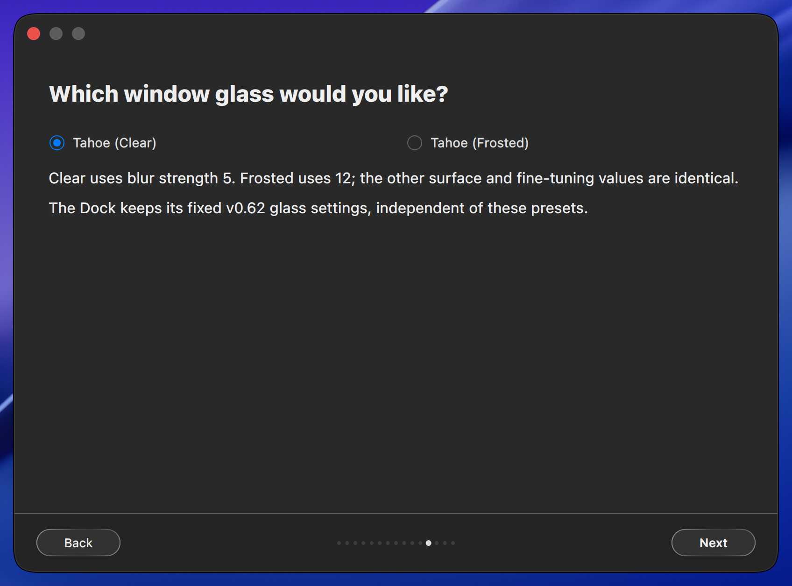
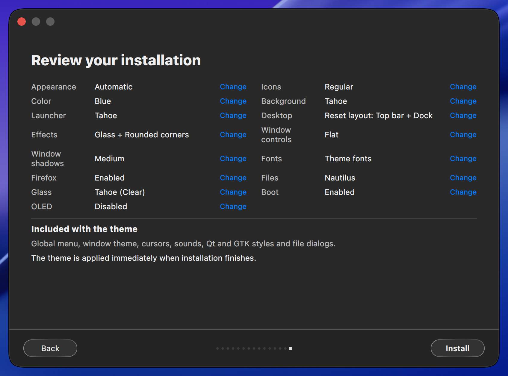

# Installer testing

Tahoe **v0.63rc2** provides Tahoe (Clear), Tahoe (Frosted) and Golden Gate
(Official) glass presets, with separate light/dark colors in a three-stop
gradient. The Dock retains fixed v0.62.0 blur, refraction, highlights and color
tuning independently of window settings. The existing Nautilus blur, scene
damage and competing-effect fixes remain included.

The full local suite passed **2,203 tests**, with **4 skipped**. The native
material checks cover gradient colors, positions, opacity, palette selection
and Dock isolation; the updated installer navigation passed all 29 tests.
Pixel comparisons of the captured Dock were identical across all three presets
in each of the four edition/mode combinations.
See the [preset gallery](GLASS_PRESETS.md) for every surface and fine-tuning
value, with light/dark photographs. Release captures use the pinned Plasma
6.8.1 VM; they do not establish new live qualification on other Plasma versions.
The [v0.62 rendering report](tests/native/acrylic_glass_062.md) retains its
original version-specific Wayland/X11 evidence.

The photographs below use the pinned disposable VM capture recipe and retain
reviewed, content-hashed provenance. Exact release commits require passing
push CI on both main and dev in both repositories.

## Installation steps

Scroll horizontally through the installation steps.

<table>
<tr>
  <td align="center"> Welcome</td>
  <td align="center"> Appearance</td>
  <td align="center"> Icons and color</td>
  <td align="center"> Wallpaper</td>
  <td align="center"> Launcher</td>
  <td align="center"> Top bar and Dock</td>
  <td align="center"> Effects</td>
  <td align="center"> Window controls</td>
  <td align="center"> Window shadows</td>
  <td align="center"> Fonts</td>
  <td align="center"> Firefox</td>
  <td align="center"> File manager</td>
  <td align="center"> Window glass</td>
  <td align="center"> Boot animation</td>
  <td align="center"> OLED protection</td>
  <td align="center"> Summary</td>
</tr>
</table>
