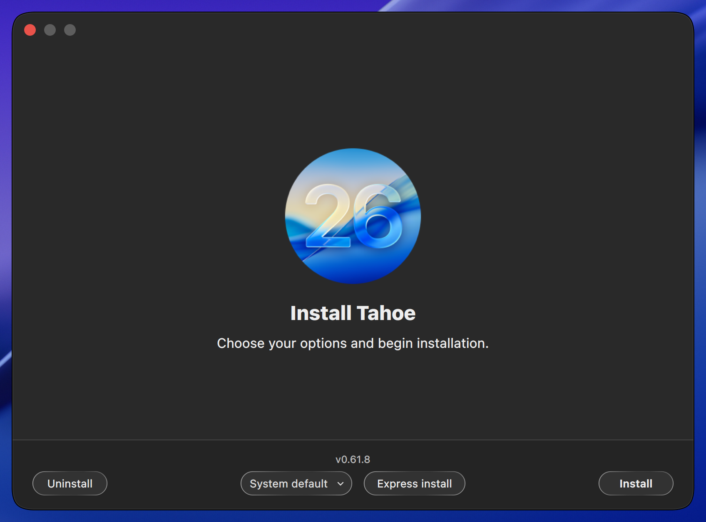
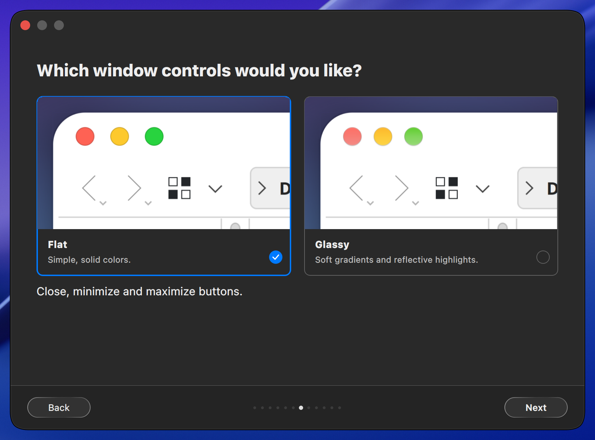
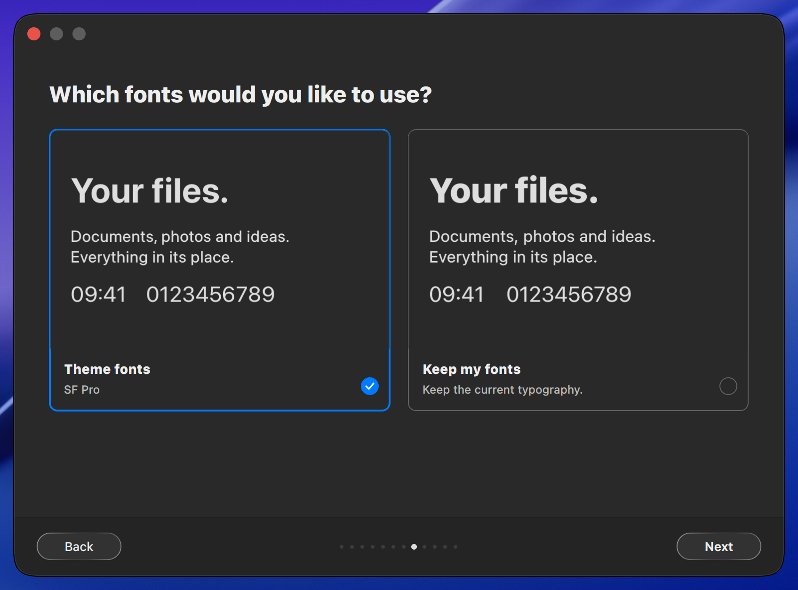
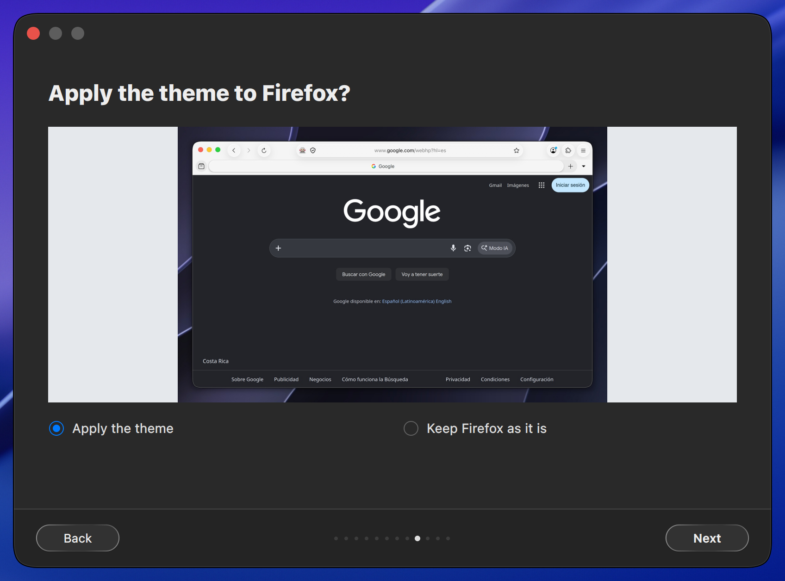
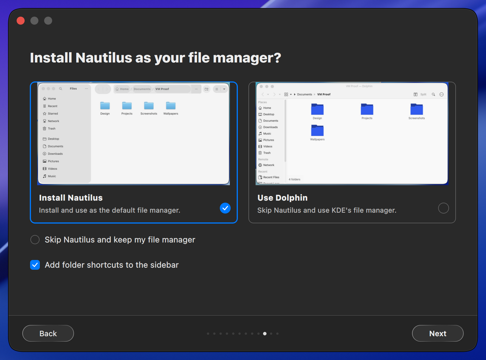
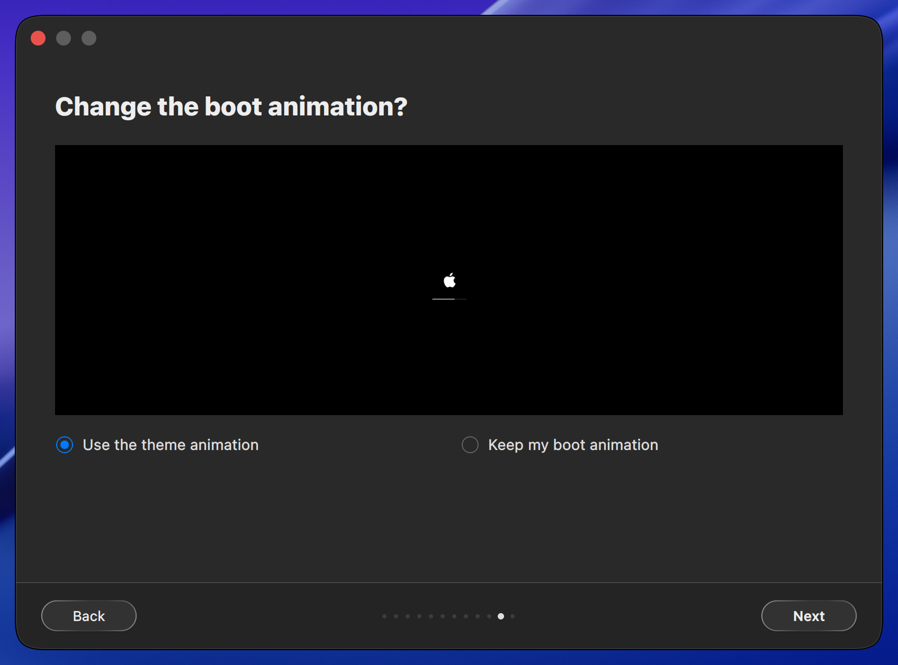
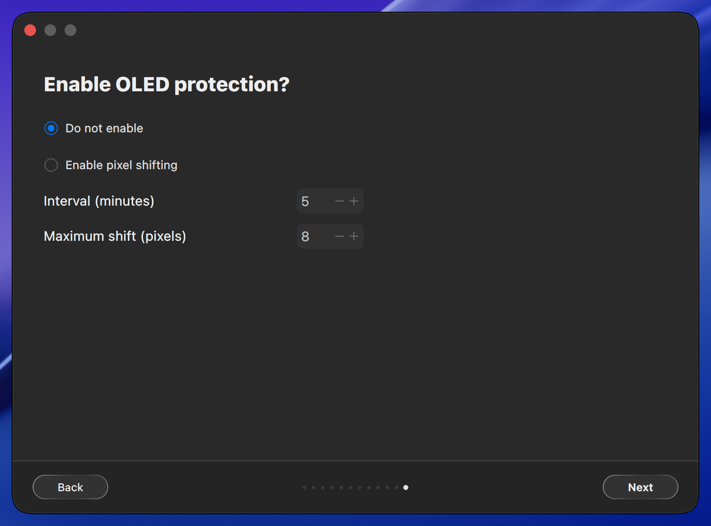
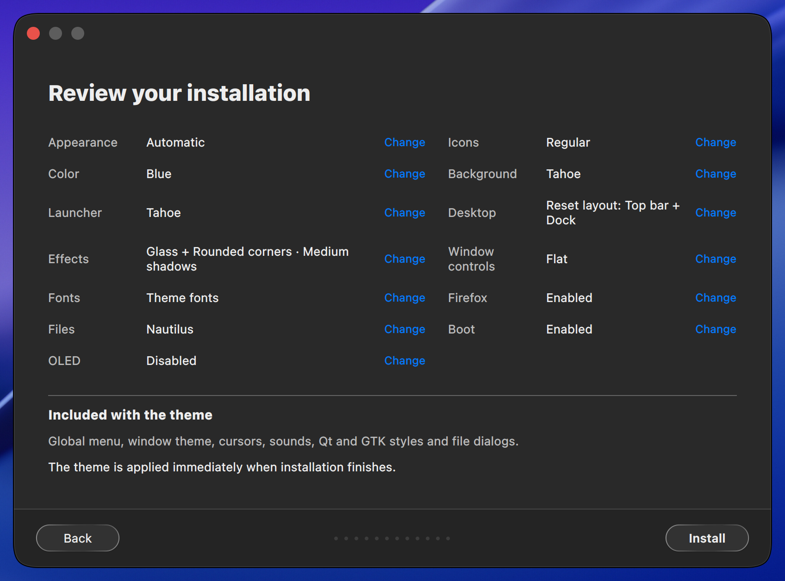

# Installer testing

Native installer screens for Tahoe 0.61.8, captured in a disposable KDE Plasma VM.
Dark appearance was selected for this installation test.
The gallery is captured from the release source and reviewed before publication.
Release checks cover both editions, theme switching, installation, reboot and removal.

For test commands and the capture workflow, see [CONTRIBUTING.md](CONTRIBUTING.md).

## v0.61.8 battery icon contrast

Both editions adapt fixed neutral battery fills and charging bolts to KDE's
foreground palette during icon staging. Generated Regular, Glass and offline
appearance themes also enable KDE palette recoloring for inherited icons.
Geometry, warning colors, symbolic
aliases and the saved percentage-display choice remain intact. The same
adaptation runs in the installer, offline icon-toolset bundles and Nix packaging;
the bundled source archive remains unchanged.

On CachyOS with Qt 6.11.2, the following 54 focused tests passed:

```sh
python -m pytest -q tests/test_battery_icons.py tests/test_icons_step.py \
  tests/test_icon_toolset.py tests/test_reserved_menu_icons.py tests/test_nix.py
```

The native KIconLoader probe checks 29,568 renders across the two base themes,
four installer themes and eight offline appearances: 0–100% charge, charging
and symbolic forms, 16/22/24/32 pixel
icons, 1/1.25/1.5/2 scaling, and light/dark/light palette changes. Before the
fix, the 16-pixel empty charging icon retained 16 white foreground pixels in
light mode. The original generated Regular theme also retained 70 white
foreground pixels at 22 pixels because it did not opt into palette recoloring.
The fixed probe passes. Installation, reinstall and uninstall
tests also preserve an explicit saved percentage-display setting.

A fresh overlay of the pinned KDE neon reference VM (Plasma 6.8.1, Qt 6.11.1)
passed the renderer probe and six sequential, individually reviewed previews:
light/dark/light for Tahoe and Golden Gate. These previews use synthetic charge
levels and verify artwork, not physical laptop battery telemetry. Their logs,
source-file hashes and image hashes are recorded in the development artifact
`/tmp/battery-evidence/evidence.json`. The generated Regular and Glass choices
are checked separately in `/tmp/battery-overlay-evidence`; the release gallery
is captured separately.
Golden Gate's wrapper suite passed all 45 tests. Nix asset assembly passed;
the full Nix build and distribution matrix remain exact-commit CI gates.
The complete shared suite was exercised on Golden Gate prepared content.
The first sandboxed run passed 1,964 tests, skipped four optional cases and
failed 18 checks (17 private-socket restrictions and the upstream README badge).
After restoring the current badge, those 18 checks and all five battery checks
passed on prepared content `e94fdd0da088e64426b8` with private D-Bus/Xvfb
sessions allowed. Passing tests with unchanged inputs were reused; the four
optional skips are not claimed as passes.
After enabling palette inheritance in generated themes, the 49 affected battery,
icon-toolset and menu-icon checks passed again on Golden Gate prepared content
`a1de53a41b46c737b1ab`. Both Regular and Glass choices passed all six VM
edition/mode cases; each focused preview was reviewed after capture.

## v0.61.7 window controls validation

The native wizard offers Flat and Glassy window controls, with the source
edition's default first. Navigation and summary editing preserve the explicit
choice for one transaction. The standalone switcher keeps the installed choice
across light/dark transitions. Both Aurorae families remain installed, while GTK
and global-theme staging follow the same selection.

On the maintainer's Linux environment with offscreen Qt, 172 component checks
passed for wizard navigation, input validation, Aurorae install/reinstall/removal,
GTK styling, global-theme defaults, configuration verification, shadows, Nix
asset assembly and screenshot validation:

```sh
QT_QPA_PLATFORM=offscreen PYTHONDONTWRITEBYTECODE=1 python -m pytest -q -p no:cacheprovider \
  tests/test_screenshot_checks.py tests/test_release_screenshots.py \
  tests/test_installer_wizard.py tests/test_cli.py tests/test_window_controls.py \
  tests/test_window_shadows.py tests/test_nix.py tests/test_step_guards.py
```

Golden Gate prepared content `ee41404ae82e135c7d39` also passed 261 affected
checks with the same code and preview assets, including GTK upgrades and the
standalone switcher's existing scheduling paths:

```sh
QT_QPA_PLATFORM=offscreen PYTHONDONTWRITEBYTECODE=1 python -m pytest -q -p no:cacheprovider \
  tests/test_installer_wizard.py tests/test_cli.py tests/test_window_controls.py \
  tests/test_window_shadows.py tests/test_screenshot_checks.py tests/test_nix.py \
  tests/test_step_guards.py tests/test_gtk_upgrade.py tests/test_theme_switch.py
```

The run passed 260 checks under filesystem isolation; the Unix-socket scheduling
case passed separately with permission to bind its temporary local socket.

The four new chooser previews were captured sequentially in a disposable overlay
of the pinned KDE neon VM (Plasma 6.8.1, Qt 6.11.1, Wayland), at 3840×2160 and
4× scale. The probe installed both styles, checked the selected Aurorae family
and matching GTK assets, and captured focused Dolphin windows in both modes.
The first unsettled crop was rejected; the bundled crops use the corrected
capture with verified final geometry. Source hashes and crop rectangles are in
`src/installer/assets/sources.json`. The complete release bundle separately uses
the fixed 2× profile and includes the new installer page for both editions and
both modes. It requires visual review and exact-commit CI before publication.

See [window-control construction and rendering limits](docs/window-controls.md).

## v0.61.5 reset default validation

The shared wizard now starts with **Reset Dock and panel customization** checked
in both editions. Unchecking it survives page navigation and keeps the existing
layout; checking it enables the layout cards and schedules the rebuild.

Focused development checks on the maintainer's Linux environment, with offscreen
Qt, cover source defaults, native wizard navigation, privileged option routing,
layout retry gating and the existing install/reinstall/uninstall component paths:

```sh
QT_QPA_PLATFORM=offscreen PYTHONDONTWRITEBYTECODE=1 python -m pytest -q -p no:cacheprovider \
  tests/test_installer_wizard.py tests/test_cli.py tests/test_installer_ui.py \
  tests/test_layout_step.py tests/test_static.py::test_readme_tests_count_badge_matches_collected_count
```

All 161 focused checks passed across the initial run and the affected CLI rerun
after updating its old default expectation. The same four component files passed
160 checks in Golden Gate prepared content `f4438e729918882ada4b`. No native
backend or layout implementation changed; the v0.61.4 explicit reset/preserve
VM evidence below remains applicable. The new release capture separately checks
both editions in light and dark mode in the pinned disposable KDE neon VM.
Exact-commit CI and reviewed fresh captures remain publication requirements.

## v0.61.4 focused validation

Installer changes were checked from Tahoe commits `217277a`, `78a5907` and
`3fdcba1` on the maintainer's Linux development environment, using offscreen
Qt for wizard navigation. The final shadow renderer passed all nine component
regressions, including rendered active/inactive SVG pixels, both appearance
modes, reinstall regeneration and uninstall cleanup.

```sh
QT_QPA_PLATFORM=offscreen python -m pytest -q \
  tests/test_window_shadows.py tests/test_installer_wizard.py tests/test_cli.py \
  tests/test_installer_ui.py tests/test_step_guards.py tests/test_release_screenshots.py
QT_QPA_PLATFORM=offscreen python -m pytest -q \
  tests/test_gtk_upgrade.py tests/test_gtk_window_geometry.py \
  tests/test_theme_switch.py tests/test_apply_safety.py
```

The first group passed 187 checks before the two rendered-shadow regressions
were added; the final shadow component then passed nine checks. The second
group passed 125 checks. Golden Gate's prepared source passed the affected
wizard/GTK checks (38), followed by all nine final shadow regressions. Its
wrapper suite passed 40 checks.

A disposable KDE neon VM (Plasma 6.8.1, Qt 6.11.1, Wayland) verified that a full
reinstall preserves customized panel IDs, widgets, Dock height and hiding
behavior, while an explicit reset restores the default layout. Skipping
Nautilus preserved the existing Dolphin MIME associations. Light/dark/light
configuration transitions passed. Shadow visual checks use the same pinned
VM image as the release capture profile; the release gallery has its own
complete capture and review gate.

The final candidate also exercises release selection before opening the wizard:
`tests/test_release_update.py tests/test_cli.py tests/test_installer_ui.py`
passed 115 checks. Temporary Git repositories verify the published tag and its
`VERSION`, reject dirty/diverged checkouts and mismatched versions, and ensure
an unpublished branch tip is not installed. Golden Gate's updated wrapper
suite passed 45 checks.

### Arch reproduction of issue #112

A disposable Arch VM used KWin 6.8.1-2, Plasma Workspace 6.8.1-1, Qt 6.12.0,
Mesa 26.2.5-1, Firefox 158.0.1-1 and Linux 7.2.11.arch1-1 on Wayland. These
match the reported software versions; the VM uses VirGL, not the reporter's
physical RX 9060 XT. Its official cloud image was checked against the published
SHA-256 before use. No host desktop settings were changed.

The install/switch/reboot sequence exposed a real appearance regression: a
legacy KConfig update erased the active inherited Plasma defaults at login,
leaving part of the desktop on Breeze. Commit `6f23ac7` retires that update and
makes its old no-argument invocation harmless. Explicit install/uninstall
cleanup remains available. The corrected VM passed native build and
`liquidglass` load verification, dark/light/dark application checks, a real
reboot and post-login theme checks. The KConfig/theme-switch/apply-safety group
passed 129 checks across the initial run and a separately permitted Unix-socket
case; the final expanded KConfig component passed all 10 checks.

Full installs and reinstalls separately verified preserving customized panel
IDs, widgets, Dock height and hiding behavior, and restoring defaults only with
an explicit reset. With Nautilus removed before installation, choosing to keep
the current file manager left Nautilus absent and preserved Dolphin MIME
associations. Light/dark/light checks passed. All four shadow levels were
captured and visually reviewed on Dolphin and Nautilus in both modes, with
unchanged frame geometry and increasing shadow intensity. Wizard, shadow and
release-update regressions passed 42 checks in Arch across two runs; the second
installed a missing Git test dependency and reran the five affected cases.

The first uninstall screenshot exposed a Firefox crash that the old validator
had missed. The SSH test launcher had omitted Plasma's `GTK3_MODULES` setting,
so Firefox lacked the existing appmenu lifetime protection. Commit `e173997`
recovers that setting and requires a responsive browser after uninstall. The
corrected run retained the same Firefox process and passed interactive
Marionette navigation, typing and click checks after full removal; its final
screenshot was reviewed. Session-environment, GTK appmenu and VM-validation
regressions passed 58 checks. This does not establish the cause of every freeze
on the reporter's physical GPU.

Development evidence is retained in `/tmp/issue112-arch/qualification-fixed`,
`/tmp/issue112-arch/options` and `/tmp/issue112-arch/firefox-retention`. The first
uninstall image is rejected and superseded by the final browser-retention run.
The drivers use `tests/vm/qualify.py` and `tests/vm/desktop_apps.py`; the layout
and shadow driver additionally records the chosen options and resource values.
Golden Gate's prepared source containing `e173997` passed 112 affected checks:

```sh
GOLDEN_GATE_TAHOE_SOURCE=/path/to/macos-tahoe-liquid-kde ./installer --prepare
# From the returned prepared source:
QT_QPA_PLATFORM=offscreen python -m pytest -q \
  tests/test_release_update.py tests/test_installer_wizard.py \
  tests/test_installer_ui.py tests/test_kconf_update.py \
  tests/test_session_env.py tests/test_window_shadows.py
```

These focused results supplement the required full distro matrix and exact
release-commit push CI on both `main` and `dev`; they do not replace those gates.
The release gallery requires a fresh complete capture after these changes.

## Installation steps

Scroll horizontally through the installation steps.

<table>
<tr>
  <td align="center"><br>Welcome</td>
  <td align="center"><br>Appearance</td>
  <td align="center"><br>Icons and color</td>
  <td align="center"><br>Wallpaper</td>
  <td align="center"><br>Launcher</td>
  <td align="center"><br>Top bar and Dock</td>
  <td align="center"><br>Effects</td>
  <td align="center"><br>Window controls</td>
  <td align="center"><br>Fonts</td>
  <td align="center"><br>Firefox</td>
  <td align="center"><br>File manager</td>
  <td align="center"><br>Boot animation</td>
  <td align="center"><br>OLED protection</td>
  <td align="center"><br>Summary</td>
</tr>
</table>
