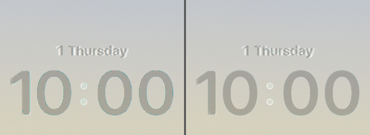
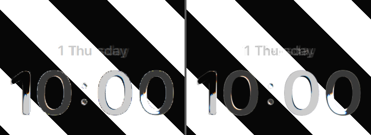
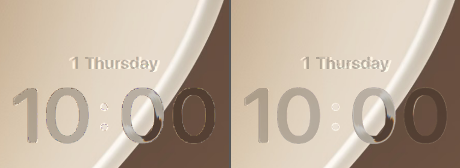
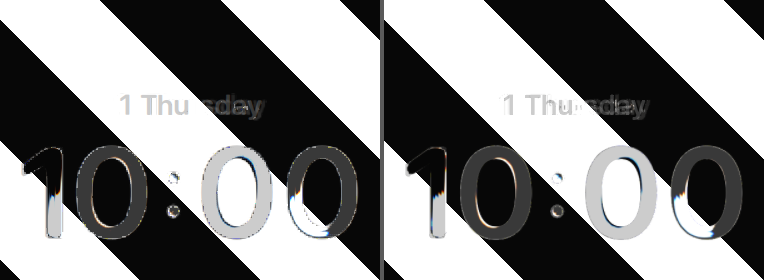

# Adaptive Contrast at 125%

Both editions were installed from candidate `d670a8de` on disposable KDE neon desktops running Plasma 6.8.1 on Wayland. The output was 3840×2160 at 125% scaling. The default column uses the edition wallpaper. The stress column uses sharp diagonal light and dark bands. Each PNG retains the captured device pixels. [Dimensions and SHA-256 for each gallery view](captures.json).

## Glass Text Clock edge comparison

The previous candidate is on the left and the revised candidate is on the right. Each pair uses the same clock geometry and wallpaper. The date and time are fixed in the guest. Inspect the outlines around the zeros and colon.

| Edition | Wallpaper | Comparison |
| --- | --- | --- |
| tahoe | default |  |
| tahoe | stress |  |
| golden-gate | default |  |
| golden-gate | stress |  |

## Tahoe

[Installed clock fingerprint and matched capture geometry](tahoe/capture.json)

| Component | Default | Stress |
| --- | --- | --- |
| global-menu-and-panel | [Default PNG](tahoe/default/global-menu-and-panel.png) | [Stress PNG](tahoe/stress/global-menu-and-panel.png) |
| global-menu-titles | [Default PNG](tahoe/default/global-menu-titles.png) | [Stress PNG](tahoe/stress/global-menu-titles.png) |
| panel-clock | [Default PNG](tahoe/default/panel-clock.png) | [Stress PNG](tahoe/stress/panel-clock.png) |
| panel-status-symbols | [Default PNG](tahoe/default/panel-status-symbols.png) | [Stress PNG](tahoe/stress/panel-status-symbols.png) |
| native-menu | [Default PNG](tahoe/default/native-menu.png) | [Stress PNG](tahoe/stress/native-menu.png) |
| control-center | [Default PNG](tahoe/default/control-center.png) | [Stress PNG](tahoe/stress/control-center.png) |
| notification-banner | [Default PNG](tahoe/default/notification-banner.png) | [Stress PNG](tahoe/stress/notification-banner.png) |
| notification-history | [Default PNG](tahoe/default/notification-history.png) | [Stress PNG](tahoe/stress/notification-history.png) |
| launcher | [Default PNG](tahoe/default/launcher.png) | [Stress PNG](tahoe/stress/launcher.png) |
| launcher-search | [Default PNG](tahoe/default/launcher-search.png) | [Stress PNG](tahoe/stress/launcher-search.png) |
| launcher-list | [Default PNG](tahoe/default/launcher-list.png) | [Stress PNG](tahoe/stress/launcher-list.png) |
| clipboard | [Default PNG](tahoe/default/clipboard.png) | [Stress PNG](tahoe/stress/clipboard.png) |
| options-menu | [Default PNG](tahoe/default/options-menu.png) | [Stress PNG](tahoe/stress/options-menu.png) |
| about-computer | [Default PNG](tahoe/default/about-computer.png) | [Stress PNG](tahoe/stress/about-computer.png) |
| about-application | [Default PNG](tahoe/default/about-application.png) | [Stress PNG](tahoe/stress/about-application.png) |
| desktop-widgets | [Default PNG](tahoe/default/desktop-widgets.png) | [Stress PNG](tahoe/stress/desktop-widgets.png) |
| widget-calendar | [Default PNG](tahoe/default/widget-calendar.png) | [Stress PNG](tahoe/stress/widget-calendar.png) |
| widget-clock-glass-text | [Default PNG](tahoe/default/widget-clock-glass-text.png) | [Stress PNG](tahoe/stress/widget-clock-glass-text.png) |
| widget-clock-analog | [Default PNG](tahoe/default/widget-clock-analog.png) | [Stress PNG](tahoe/stress/widget-clock-analog.png) |
| widget-clock-analog-2 | [Default PNG](tahoe/default/widget-clock-analog-2.png) | [Stress PNG](tahoe/stress/widget-clock-analog-2.png) |
| widget-clock-analog-3 | [Default PNG](tahoe/default/widget-clock-analog-3.png) | [Stress PNG](tahoe/stress/widget-clock-analog-3.png) |
| widget-clock-square | [Default PNG](tahoe/default/widget-clock-square.png) | [Stress PNG](tahoe/stress/widget-clock-square.png) |
| widget-city-1 | [Default PNG](tahoe/default/widget-city-1.png) | [Stress PNG](tahoe/stress/widget-city-1.png) |
| widget-city-2 | [Default PNG](tahoe/default/widget-city-2.png) | [Stress PNG](tahoe/stress/widget-city-2.png) |
| widget-city-3 | [Default PNG](tahoe/default/widget-city-3.png) | [Stress PNG](tahoe/stress/widget-city-3.png) |
| widget-city-digital | [Default PNG](tahoe/default/widget-city-digital.png) | [Stress PNG](tahoe/stress/widget-city-digital.png) |
| widget-music | [Default PNG](tahoe/default/widget-music.png) | [Stress PNG](tahoe/stress/widget-music.png) |
| widget-timer | [Default PNG](tahoe/default/widget-timer.png) | [Stress PNG](tahoe/stress/widget-timer.png) |
| widget-weather | [Default PNG](tahoe/default/widget-weather.png) | [Stress PNG](tahoe/stress/widget-weather.png) |
| widget-photos | [Default PNG](tahoe/default/widget-photos.png) | [Stress PNG](tahoe/stress/widget-photos.png) |
| photos-loaded | [Default PNG](tahoe/default/photos-loaded.png) | [Stress PNG](tahoe/stress/photos-loaded.png) |

## Golden Gate

[Installed clock fingerprint and matched capture geometry](golden-gate/capture.json)

| Component | Default | Stress |
| --- | --- | --- |
| global-menu-and-panel | [Default PNG](golden-gate/default/global-menu-and-panel.png) | [Stress PNG](golden-gate/stress/global-menu-and-panel.png) |
| global-menu-titles | [Default PNG](golden-gate/default/global-menu-titles.png) | [Stress PNG](golden-gate/stress/global-menu-titles.png) |
| panel-clock | [Default PNG](golden-gate/default/panel-clock.png) | [Stress PNG](golden-gate/stress/panel-clock.png) |
| panel-status-symbols | [Default PNG](golden-gate/default/panel-status-symbols.png) | [Stress PNG](golden-gate/stress/panel-status-symbols.png) |
| native-menu | [Default PNG](golden-gate/default/native-menu.png) | [Stress PNG](golden-gate/stress/native-menu.png) |
| control-center | [Default PNG](golden-gate/default/control-center.png) | [Stress PNG](golden-gate/stress/control-center.png) |
| notification-banner | [Default PNG](golden-gate/default/notification-banner.png) | [Stress PNG](golden-gate/stress/notification-banner.png) |
| notification-history | [Default PNG](golden-gate/default/notification-history.png) | [Stress PNG](golden-gate/stress/notification-history.png) |
| launcher | [Default PNG](golden-gate/default/launcher.png) | [Stress PNG](golden-gate/stress/launcher.png) |
| search-field | [Default PNG](golden-gate/default/search-field.png) | [Stress PNG](golden-gate/stress/search-field.png) |
| launcher-search | [Default PNG](golden-gate/default/launcher-search.png) | [Stress PNG](golden-gate/stress/launcher-search.png) |
| launcher-list | [Default PNG](golden-gate/default/launcher-list.png) | [Stress PNG](golden-gate/stress/launcher-list.png) |
| clipboard | [Default PNG](golden-gate/default/clipboard.png) | [Stress PNG](golden-gate/stress/clipboard.png) |
| options-menu | [Default PNG](golden-gate/default/options-menu.png) | [Stress PNG](golden-gate/stress/options-menu.png) |
| about-computer | [Default PNG](golden-gate/default/about-computer.png) | [Stress PNG](golden-gate/stress/about-computer.png) |
| about-application | [Default PNG](golden-gate/default/about-application.png) | [Stress PNG](golden-gate/stress/about-application.png) |
| desktop-widgets | [Default PNG](golden-gate/default/desktop-widgets.png) | [Stress PNG](golden-gate/stress/desktop-widgets.png) |
| widget-calendar | [Default PNG](golden-gate/default/widget-calendar.png) | [Stress PNG](golden-gate/stress/widget-calendar.png) |
| widget-clock-glass-text | [Default PNG](golden-gate/default/widget-clock-glass-text.png) | [Stress PNG](golden-gate/stress/widget-clock-glass-text.png) |
| widget-clock-analog | [Default PNG](golden-gate/default/widget-clock-analog.png) | [Stress PNG](golden-gate/stress/widget-clock-analog.png) |
| widget-clock-analog-2 | [Default PNG](golden-gate/default/widget-clock-analog-2.png) | [Stress PNG](golden-gate/stress/widget-clock-analog-2.png) |
| widget-clock-analog-3 | [Default PNG](golden-gate/default/widget-clock-analog-3.png) | [Stress PNG](golden-gate/stress/widget-clock-analog-3.png) |
| widget-clock-square | [Default PNG](golden-gate/default/widget-clock-square.png) | [Stress PNG](golden-gate/stress/widget-clock-square.png) |
| widget-city-1 | [Default PNG](golden-gate/default/widget-city-1.png) | [Stress PNG](golden-gate/stress/widget-city-1.png) |
| widget-city-2 | [Default PNG](golden-gate/default/widget-city-2.png) | [Stress PNG](golden-gate/stress/widget-city-2.png) |
| widget-city-3 | [Default PNG](golden-gate/default/widget-city-3.png) | [Stress PNG](golden-gate/stress/widget-city-3.png) |
| widget-city-digital | [Default PNG](golden-gate/default/widget-city-digital.png) | [Stress PNG](golden-gate/stress/widget-city-digital.png) |
| widget-music | [Default PNG](golden-gate/default/widget-music.png) | [Stress PNG](golden-gate/stress/widget-music.png) |
| widget-timer | [Default PNG](golden-gate/default/widget-timer.png) | [Stress PNG](golden-gate/stress/widget-timer.png) |
| widget-weather | [Default PNG](golden-gate/default/widget-weather.png) | [Stress PNG](golden-gate/stress/widget-weather.png) |
| widget-photos | [Default PNG](golden-gate/default/widget-photos.png) | [Stress PNG](golden-gate/stress/widget-photos.png) |
| photos-loaded | [Default PNG](golden-gate/default/photos-loaded.png) | [Stress PNG](golden-gate/stress/photos-loaded.png) |
