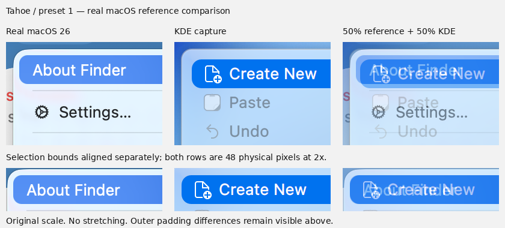

# Native menu reference comparison

The selection highlight follows genuine macOS menu screenshots: an 8 logical
pixel corner on a 24-pixel reference row, rather than a full semicircular cap.
The adjustment leaves native row heights, labels, shortcuts and hit targets
unchanged. It applies to both appearance modes and both editions.

Each edition keeps its own material and installer defaults. Tahoe starts with
launcher preset 1; Golden Gate starts with preset 2. Choosing the other launcher
layout changes that layout only, not the source edition's menu material. Explicit
wizard choices remain scoped to their individual settings.

## Real references

- [macOS 26 Tahoe, Stephen Hackett's screenshot library](https://512pixels.net/projects/aqua-screenshot-library/macos-26-tahoe/)
- [macOS 27 Golden Gate, Stephen Hackett's screenshot library](https://512pixels.net/projects/aqua-screenshot-library/macos-27-golden-gate/)

The Finder menu references are original 2× captures. Comparisons align the menu
border and selection bounds by translation, without stretching either image.
Overlays combine 50% of the real macOS picture with 50% of the KDE capture.
Reference screenshots remain third-party imagery, not theme assets or project
artwork. Their URLs, original hashes and crop coordinates accompany the overlays.

## Reviewed comparison

The mean left-edge difference on the 48-pixel selection row decreased from
2.875 to 0.125 physical pixels at 2×. This measures only the selection
corner, not text or the full menu. [Capture and reference provenance](../src/screenshots/previews/menu-tahoe-provenance-54683cf4f0d5.json)
records the exact source, original reference hashes and crop coordinates.
The real reference is light mode; both KDE appearance modes were reviewed.

## Limits

This is a selection-shape correction, not a claim of pixel-identical menus.
KDE action text, icon choices and menu width differ. The existing Kvantum frame
has a 9-pixel inset; the references have about 5 pixels. Its nine-slice frame
couples outer corner geometry to that inset. The outer frame and padding have
not been changed by this correction. The composited material also depends on
the actual wallpaper behind the popup; the comparison overlay is not a 50%
transparency setting for installed menus.
