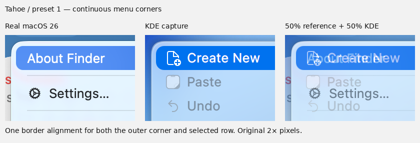

# Native menu reference comparison

Menu borders use continuous (squircle) corners, with approximately 17 logical
pixels of corner extent and a separate 5-pixel content inset. The blue selection
retains its measured 8-pixel corners on the 24-pixel reference row. The same
shape is used in light and dark mode, without changing either edition's material.

Tahoe installs launcher preset 1; Golden Gate installs preset 2. An explicit
launcher choice changes the layout independently of the edition's menu material.
The MacTahoe Qt style delegates ordinary widgets and material colors to Kvantum;
its menu adapter separates the outer curve from the content padding.

## System-menu presets

The active theme edition selects the system-menu symbols, independently of the
Launcher preset. Mode changes preserve that selection, and reopening an existing
menu reads the current edition again.

| Theme | Visible symbols |
| --- | --- |
| Tahoe | About, System Settings, App Store, Force Quit, Sleep, Restart, Shut Down, Lock Screen and Log Out |
| Golden Gate | About, System Settings and App Store; other rows reserve no icon column |

System Settings uses the reference 18-tooth wheel, three spokes and hollow hub.
The symbol contours are copied from the Apple font already bundled by the project,
with the source font hash and glyph IDs recorded in `systemmenusymbols.json`.
Tahoe also uses the reference stop octagon, low-bar Sleep circle, left-pointing
Restart triangle, power switch, padlock and user-circle symbols. The existing
App Store symbol is retained. Recent Items remains absent from this project.

## Real references

- [macOS 26 Tahoe](https://512pixels.net/projects/aqua-screenshot-library/macos-26-tahoe/)
- [macOS 27 Golden Gate](https://512pixels.net/projects/aqua-screenshot-library/macos-27-golden-gate/)

These are Stephen Hackett's real 2× Finder-menu screenshots. Each edition is
compared with its own reference. One translation aligns the outer border and
selection together; neither image is stretched. The overlay blends 50% of each
picture. That comparison opacity does not alter installed menu transparency.

## Reviewed comparison

[Capture and reference provenance](../src/screenshots/previews/menu-tahoe-provenance-6238e1806103.json)
records original URLs and hashes, crop coordinates, measured edges and the exact
implementation source. Both KDE appearance modes were reviewed in disposable VMs.
The adapter also rendered successfully with blur in an isolated KWin X11 session.

## Limits

This matches the corner and inset geometry, not every menu pixel. KDE action
labels and menu widths differ. System-menu symbol contours use the original
Apple font; the approved App Store drawing is retained. Colors depend on the wallpaper behind
the translucent surface. The real reference images are light mode; the dark KDE
menus were reviewed separately. Unchanged gallery photographs retain their
original source provenance.
