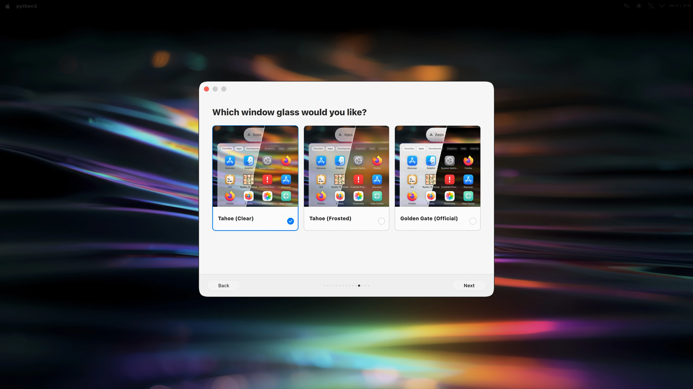
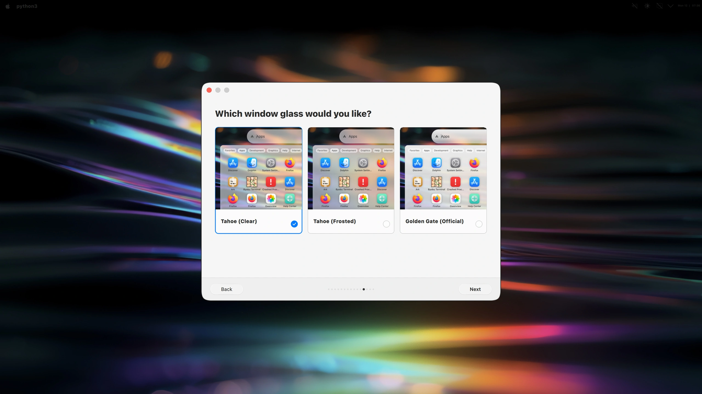
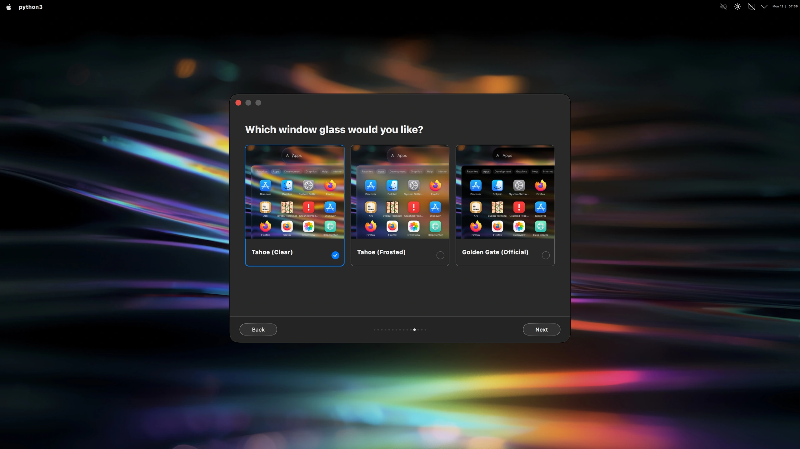
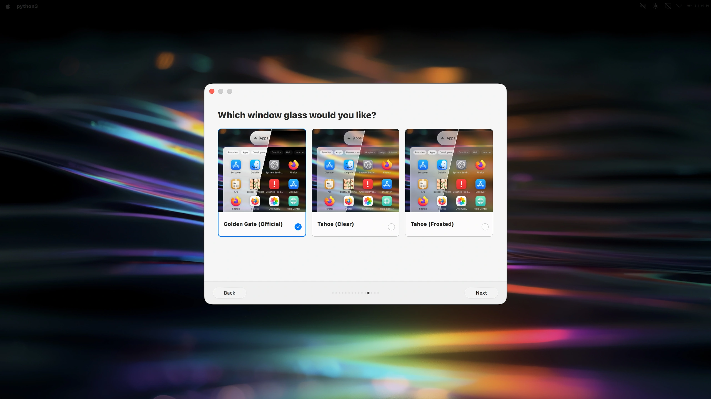
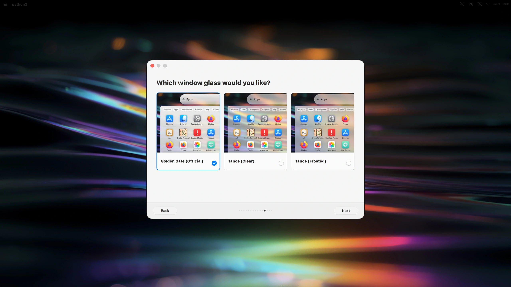
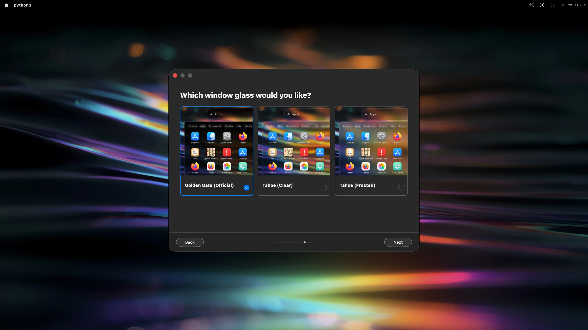

# Glass selection

Golden Gate launcher on Tahoe Iridescence, captured at 3840 × 2160. Previews follow the appearance selected earlier: Light, Dark, or Automatic (light / dark).

## Tahoe — Automatic — light / dark

## Tahoe — Light

## Tahoe — Dark

## Golden Gate — Automatic — light / dark

## Golden Gate — Light

## Golden Gate — Dark

