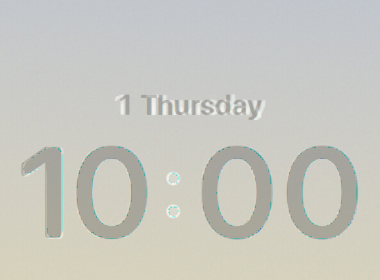
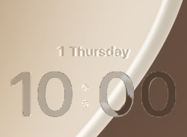
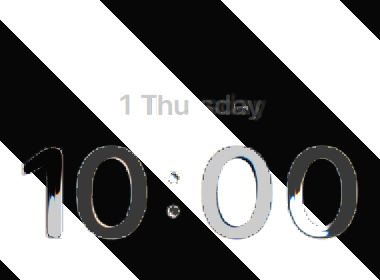

# Fractional-scale Glass Text Clock review

Both editions installed candidate `9a8d817b` in separate KDE neon guests running Plasma 6.8.1 on Wayland. These are physical-pixel crops from 3840×2160 screenshots at 125% scale. Each edition used its default wallpaper for the first view and the same diagonal black/white wallpaper for the second. Each capture record gives the source, widget geometry, installed widget hash and image hashes.

| Edition | Default | Stress | Capture record |
| --- | --- | --- | --- |
| Tahoe |  |  | [Tahoe](tahoe/capture.json) |
| Golden Gate |  |  | [Golden Gate](golden-gate/capture.json) |

At 100%, 125% and 145%, the Qt Quick probe animated an item over gray 77 and 78 and recorded the foreground at 30 positions per run. The foreground held white across those cells and switched back to black on gray 100. The two captured clock images per edition show stationary views. The motion observations come from the controlled animation. [Native probe output](native-probe.txt)

The shader probe rendered a gray-160 backing through the project's glass shader. At 125%, the client material sampler returned gray 103 and 157 at two positions on that rendered image. [Shader fixture](glass-shader-fixture.png)

For the original 126 installed component screenshots, see the [complete gallery](../README.md).
