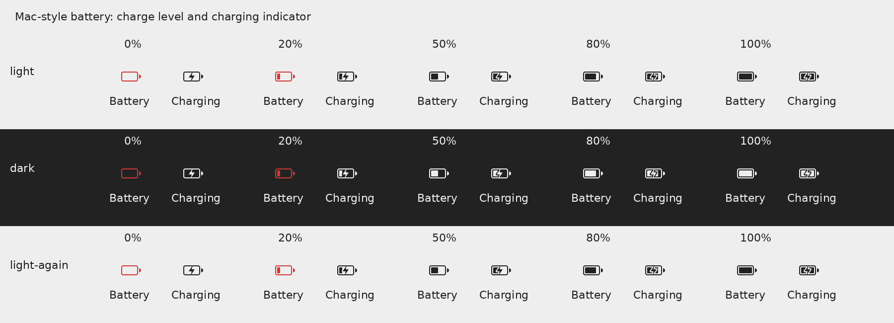
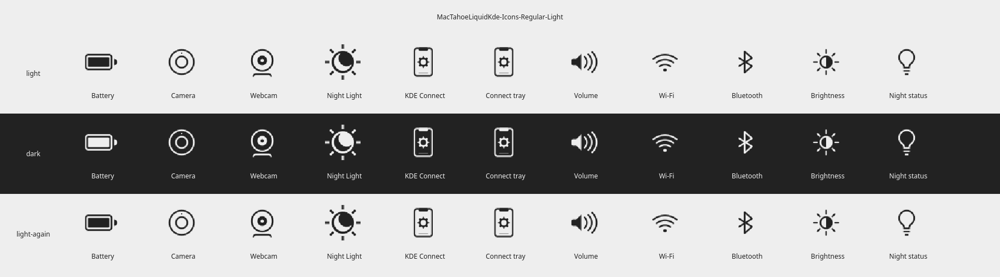

# Status icons — issues #114 and #117

Validated on 2026-10-30 (America/Costa_Rica). Runtime source:
`fb06ee7ab44cf55c283e585cd94aaa469d8eca37`, included in v0.61.11.
The images below are native rendering test artifacts produced inside the
checksum-pinned disposable VM, not photographs of a laptop battery.





## Changed behavior and scope

Both editions use the bundled horizontal Mac-style battery artwork, including
charge levels and charging indicators. Neutral status foregrounds follow KDE's
palette: dark in light mode and light in dark mode. Warning colors, artwork
geometry, original notices, canonical application artwork and the user's
battery percentage setting are preserved.

The installer, Nix asset staging and offline icon tool apply the same extracted
theme adaptation. Generated Regular, Glass and maintainer appearances enable
palette recoloring and reserve interface names, including every shortened
hyphen prefix KDE tries before consulting the base theme. This prevents
application tiles from replacing Battery, Camera, Night Light, KDE Connect,
Bluetooth and other interface symbols. No native backend or ABI changed.

## Focused development evidence

- Host: CachyOS, Python 3.14, Qt 6.11.2. Command:
  `python -m pytest -q -p no:cacheprovider tests/test_status_icons.py tests/test_icon_toolset.py tests/test_reserved_menu_icons.py tests/test_icons_step.py tests/test_nix.py --tb=short`
  — **56 passed**. [Complete output](status-icons/focused.log).
- The native test performs **32,340 renders** across 14 base/generated themes.
  It checks source resolution, nonempty QIcon rendering, foreground pixels,
  0–100% charge, charging/symbolic aliases, 16–64 pixel interface sizes,
  fractional battery scales, and light → dark → light on the same loader.
- Geometry checks cover every bundled status SVG and alias. Lifecycle checks
  exercise install, reinstall and uninstall with isolated destinations and
  preserve the saved percentage choice. External staging links are rejected.
- The original archive fails the same native control at the generic battery
  name: `light interface battery size=16 wrong=63`, resolving to
  `apps/scalable/battery.svg`. [Control output](status-icons/unpatched-control.log).
- A real generated theme in the first VM candidate exposed KDE's shortened
  Night Light lookup selecting `preferences-desktop-display.png`. That
  candidate was stopped before publication. The fixture now includes those
  prefix collisions; the final installed themes pass.
- The unchanged theme-switch regression component passed 120 checks during
  development. The combined initial focused command passed 176 checks; the
  final 56 checks above supersede its icon-generation evidence.

## Prepared Golden Gate and wrapper

`GOLDEN_GATE_TAHOE_SOURCE=/tmp/tahoe-issues-114-117 MAC_TAHOE_NO_UPDATE_CHECK=true ./install --prepare`
produced content-addressed source `39679337df4840f381b8` with Golden Gate's
wallpaper and launcher preset. In that source:

`python -m pytest -q -p no:cacheprovider tests/test_status_icons.py tests/test_icons_step.py tests/test_icon_toolset.py tests/test_reserved_menu_icons.py --tb=short`
— **53 passed**. [Complete output](status-icons/golden-gate-staged.log).

Golden Gate wrapper: `python -m pytest -q -p no:cacheprovider tests --tb=short`
— **80 passed**. [Complete output](status-icons/golden-gate-wrapper.log).

## Disposable VM build, resolution and rendering

- Image: sealed `neon-base-v2.qcow2`, SHA-256
  `2a09de13ad568da01a8e16dd93e6aec120e63375bfc0ec24b4e804b43ecb4f8c`.
  Environment: KDE neon, Plasma 6.8.1, Qt 6.11.1, Wayland desktop.
- Build: `cmake -S tests/native_status_icons -B build/status-proof` and
  `cmake --build build/status-proof -j2` succeeded with that guest's SDK.
- Resolution and behavior: the native probe ran against the actual installed
  base light/dark and Regular light/dark themes, **2,310 renders each; 9,240
  passed**. The loader rejects unexpected fallback paths and incorrect pixels.
  [Complete build/render/environment log](status-icons/vm-native.log).
- The supplied galleries were reviewed for icon identity, horizontal battery
  shape, charge fill, charging bolt, warning red, and black/white/black
  foreground transitions. The battery gallery arranges the probe's existing
  PNG output; it does not rerender or recolor the artwork.
- [Provenance and full image hashes](status-icons/provenance.json) identify
  the source archive, native probe and pinned guest. Documentation photographs
  are separately captured, reviewed and verified by `release-screenshots`.

Inside a disposable guest with this edition installed, reproduce the native
rendering with:

```sh
cmake -S tests/native_status_icons -B build/status-proof
cmake --build build/status-proof -j2
QT_QPA_PLATFORM=offscreen XDG_CONFIG_HOME=/tmp/status-proof-config \
  XDG_CACHE_HOME=/tmp/status-proof-cache \
  build/status-proof/status_icon_palette \
  MacTahoeLiquidKde-Icons-Regular-Light /tmp/status-proof-rendered
```

The probe writes `gallery.png` and individual battery-state PNGs. Run the same
command with each installed base and generated theme to cover its lookup path.

## Release evidence and limits

The primary CI jobs report **2,013 passed and 11 skipped**, from 2,024
collected cases. Every new status-icon test ran. The existing conditional skips
are one opt-in X11 plugin smoke check, three checks requiring the externally
supplied pinned Rounded Corners archive, and seven native Kvantum checks when
that style plugin is unavailable in the primary container. Those unchanged
backend/style checks are coverage limits and are excluded from the passing
count. The VM rendering and capture evidence above is recorded separately.

The full suite and configured distro matrix belong to required `test.yml`
push runs on the exact v0.61.11 commits on both `main` and `dev` in both
repositories. Release workflows enforce this gate; development evidence does
not substitute for it. CI links are included in the closing issue comments.

The guest has no physical laptop battery. These checks validate icon lookup,
rendering and palette transitions for explicit battery state names; they do
not claim to test hardware telemetry. No live host installer or host desktop
manipulation was used. Quickbar integration, a different Dock engine and new
macOS 27 artwork are separate optional suggestions, outside this bugfix.
