# Live desktop proof

Each green entry represents an installed graphical QEMU guest, native package
installation and compilation, light/dark rendering, Firefox interaction,
Nautilus appearance, a real reboot, and successful uninstall. The same installer
engine serves Tahoe and Golden Gate; their edition previews are captured separately
for each release. These results describe the recorded VM configuration.

[Run the checks yourself](README.md). Screenshots below are original 3840×2160
captures at 2× scale. Open an image to inspect it at full resolution.

<b>Debian testing (Forky) — ✅ VM verified · v0.57.3</b>

**Light**

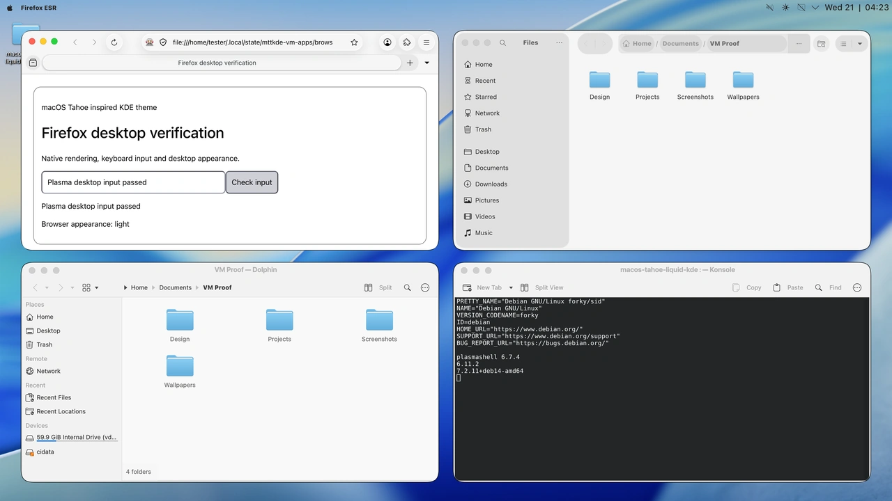

**Dark**

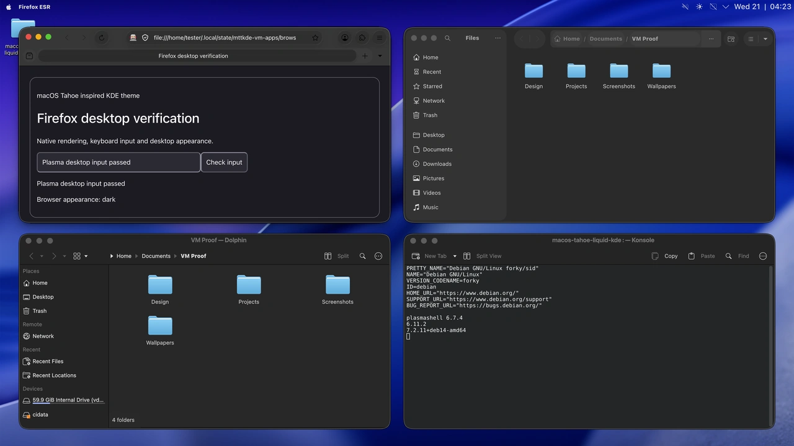

**After reboot**

**Tested VM**

Plasma 6.7.4 · Qt 6.11.2 · Wayland · systemd · VirtIO/virgl.
Official Debian testing cloud image, with a normal KDE desktop. Debian 13's
stock Plasma 6.3 is below this project's minimum; this run does not qualify it.

**Checks**

| Check | Result |
| --- | --- |
| Full installation and host SDK builds | ✅ Passed |
| Light and dark desktop, loaded Acrylic Glass, Dock autohide | ✅ Passed |
| Firefox rendering, text input, button action and appearance | ✅ Passed |
| Nautilus light/dark pixels and live switching | ✅ Passed |
| Live switch preserves app, Plasma and KWin processes | ✅ Passed |
| Reboot and desktop/app checks | ✅ Passed |
| Full uninstall and removal checks | ✅ Passed |

[Machine-readable results and image hashes](../../src/screenshots/vm/debian/report.json).

<b>CachyOS — ✅ VM verified · v0.57.4</b>

**Light**

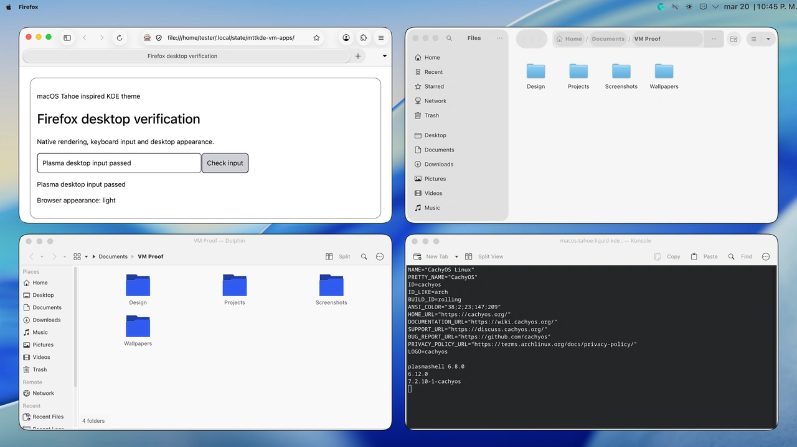

**Dark**

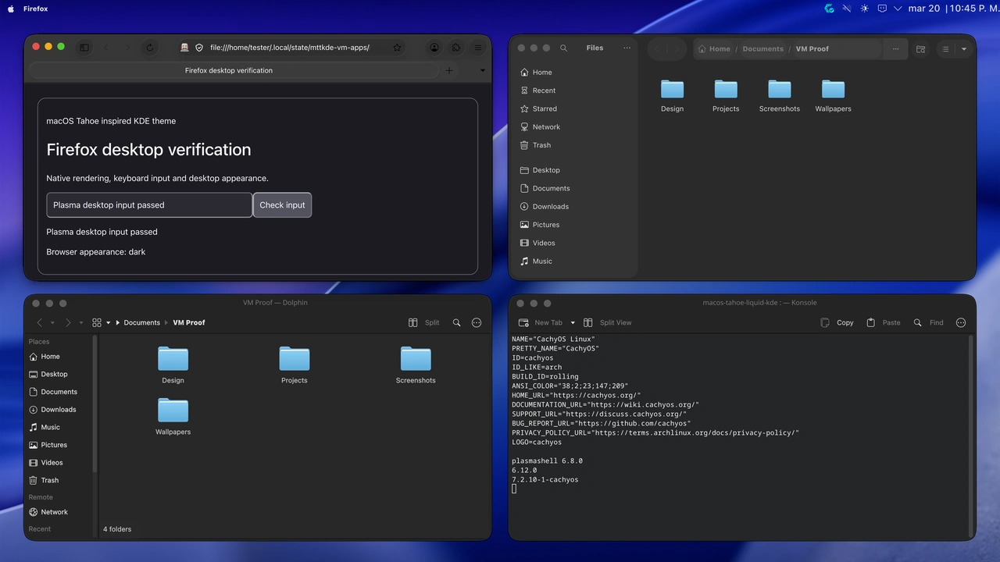

**After reboot**

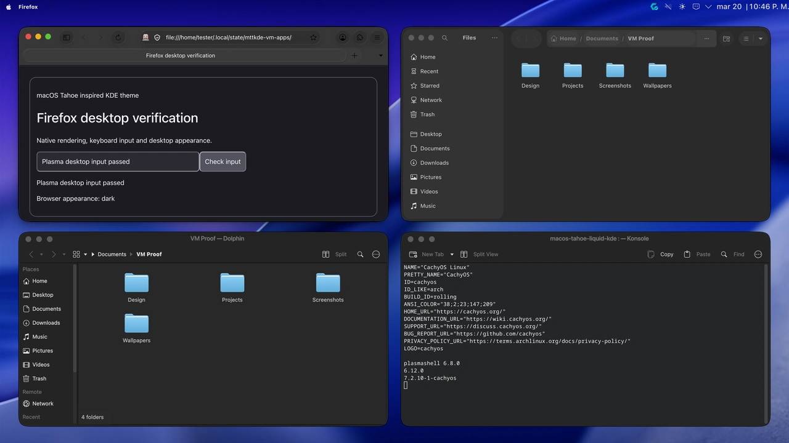

**Tested VM**

Plasma 6.8.0 · Qt 6.12.0 · Wayland · systemd · VirtIO/virgl.
Installed from the official CachyOS ISO and upgraded with its native repositories.

**Checks**

| Check | Result |
| --- | --- |
| Full installation and host SDK builds | ✅ Passed |
| Light and dark desktop, loaded Acrylic Glass, Dock autohide | ✅ Passed |
| Firefox rendering, text input, button action and appearance | ✅ Passed |
| Nautilus light/dark pixels and live switching | ✅ Passed |
| Live switch preserves app, Plasma and KWin processes | ✅ Passed |
| Reboot and desktop/app checks | ✅ Passed |
| Full uninstall and removal checks | ✅ Passed |

[Machine-readable results and image hashes](../../src/screenshots/vm/cachyos/report.json).

<b>Arch Linux — ✅ VM verified · v0.57.5</b>

**Light**

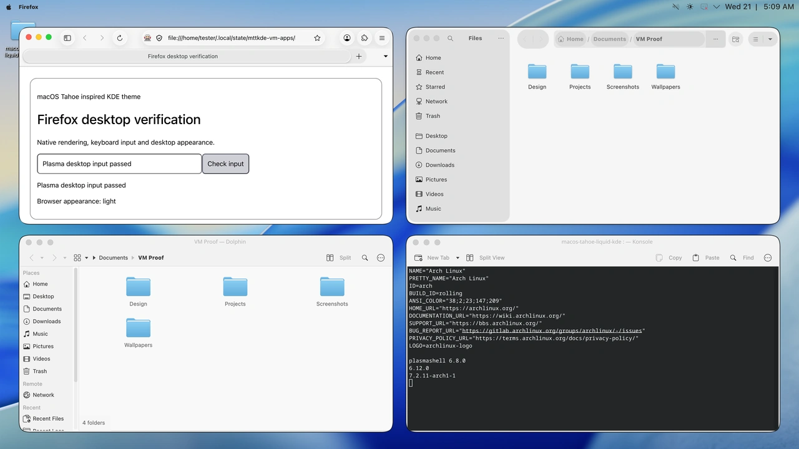

**Dark**

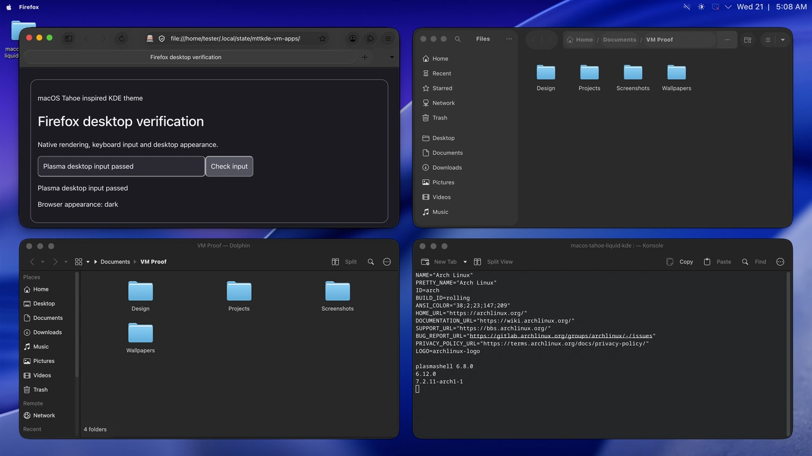

**After reboot**

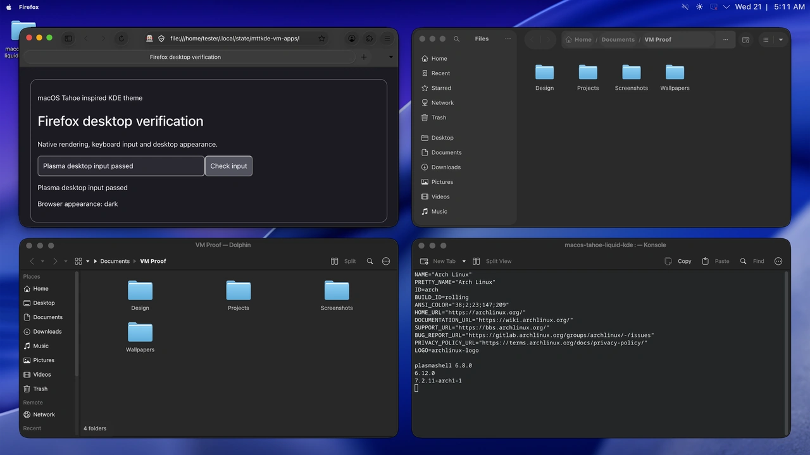

**Tested VM**

Plasma 6.8.0 · Qt 6.12.0 · Wayland · systemd · VirtIO/virgl.
Official Arch cloud image with KDE Plasma installed from its native repositories.

**Checks**

| Check | Result |
| --- | --- |
| Full installation and host SDK builds | ✅ Passed |
| Light and dark desktop, loaded Acrylic Glass, Dock autohide | ✅ Passed |
| Firefox rendering, text input, button action and appearance | ✅ Passed |
| Nautilus light/dark pixels and live switching | ✅ Passed |
| Live switch preserves app, Plasma and KWin processes | ✅ Passed |
| Reboot and desktop/app checks | ✅ Passed |
| Full uninstall and removal checks | ✅ Passed |

[Machine-readable results and image hashes](../../src/screenshots/vm/arch/report.json).

<b>EndeavourOS — ✅ VM verified · v0.57.9</b>

**Light**

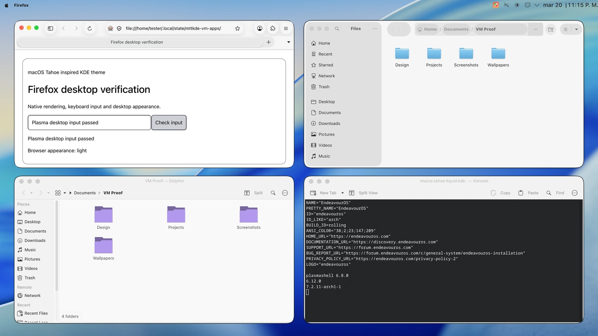

**Dark**

**After reboot**

**Tested VM**

Plasma 6.8.0 · Qt 6.12.0 · Wayland · systemd · VirtIO/virgl.
Official EndeavourOS ISO with native KDE desktop and a full distribution upgrade.

**Checks**

| Check | Result |
| --- | --- |
| Full installation and host SDK builds | ✅ Passed |
| Light and dark desktop, loaded Acrylic Glass, Dock autohide | ✅ Passed |
| Firefox rendering, text input, button action and appearance | ✅ Passed |
| Nautilus light/dark pixels and live switching | ✅ Passed |
| Live switch preserves app, Plasma and KWin processes | ✅ Passed |
| Reboot and desktop/app checks | ✅ Passed |
| Full uninstall and removal checks | ✅ Passed |

[Machine-readable results and image hashes](../../src/screenshots/vm/endeavouros/report.json).

<b>Fedora — ✅ VM verified · v0.57.8</b>

**Light**

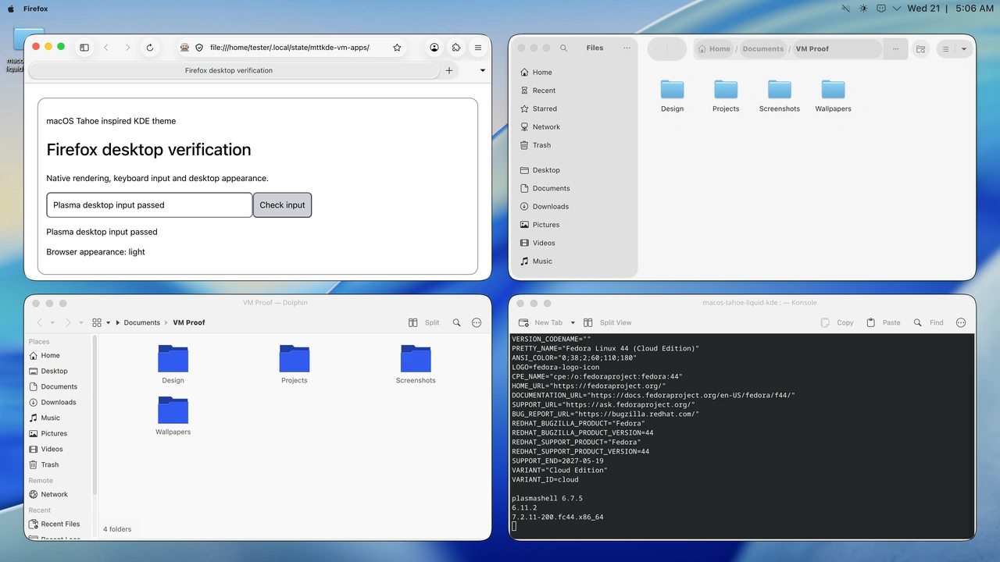

**Dark**

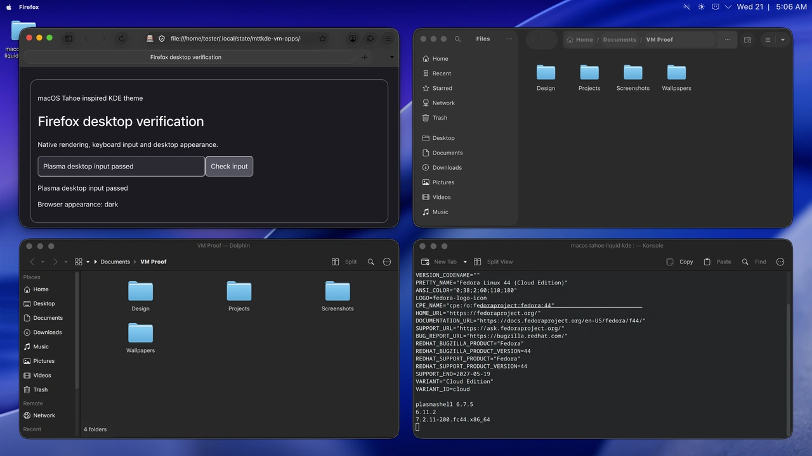

**After reboot**

**Tested VM**

Plasma 6.7.5 · Qt 6.11.2 · Wayland · systemd · VirtIO/virgl.
Official Fedora 44 cloud image with native KDE desktop and packages.

**Checks**

| Check | Result |
| --- | --- |
| Full installation and host SDK builds | ✅ Passed |
| Light and dark desktop, loaded Acrylic Glass, Dock autohide | ✅ Passed |
| Firefox rendering, text input, button action and appearance | ✅ Passed |
| Nautilus light/dark pixels and live switching | ✅ Passed |
| Live switch preserves app, Plasma and KWin processes | ✅ Passed |
| Reboot and desktop/app checks | ✅ Passed |
| Full uninstall and removal checks | ✅ Passed |

[Machine-readable results and image hashes](../../src/screenshots/vm/fedora/report.json).

<b>Manjaro — ✅ VM verified · v0.57.10</b>

**Light**

**Dark**

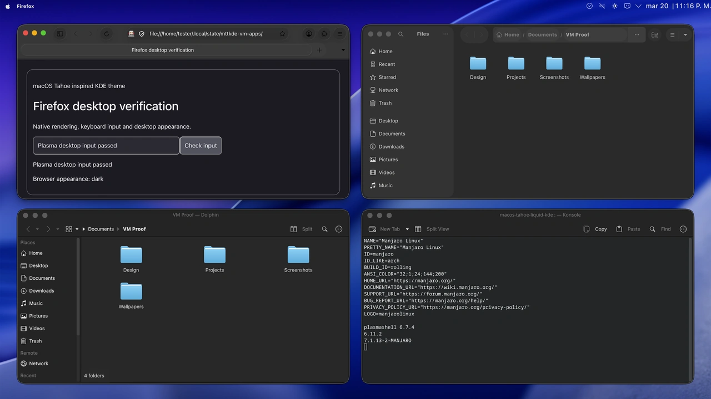

**After reboot**

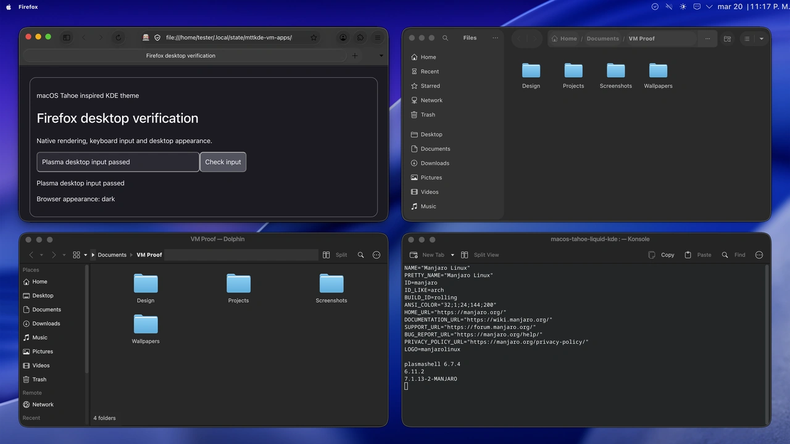

**Tested VM**

Plasma 6.7.4 · Qt 6.11.2 · Wayland · systemd · VirtIO/virgl.
Official Manjaro KDE ISO with native packages.

**Checks**

| Check | Result |
| --- | --- |
| Full installation and host SDK builds | ✅ Passed |
| Light and dark desktop, loaded Acrylic Glass, Dock autohide | ✅ Passed |
| Firefox rendering, text input, button action and appearance | ✅ Passed |
| Nautilus light/dark pixels and live switching | ✅ Passed |
| Live switch preserves app, Plasma and KWin processes | ✅ Passed |
| Reboot and desktop/app checks | ✅ Passed |
| Full uninstall and removal checks | ✅ Passed |

[Machine-readable results and image hashes](../../src/screenshots/vm/manjaro/report.json).

<b>Artix Linux (OpenRC) — ✅ VM verified · v0.57.11</b>

**Light**

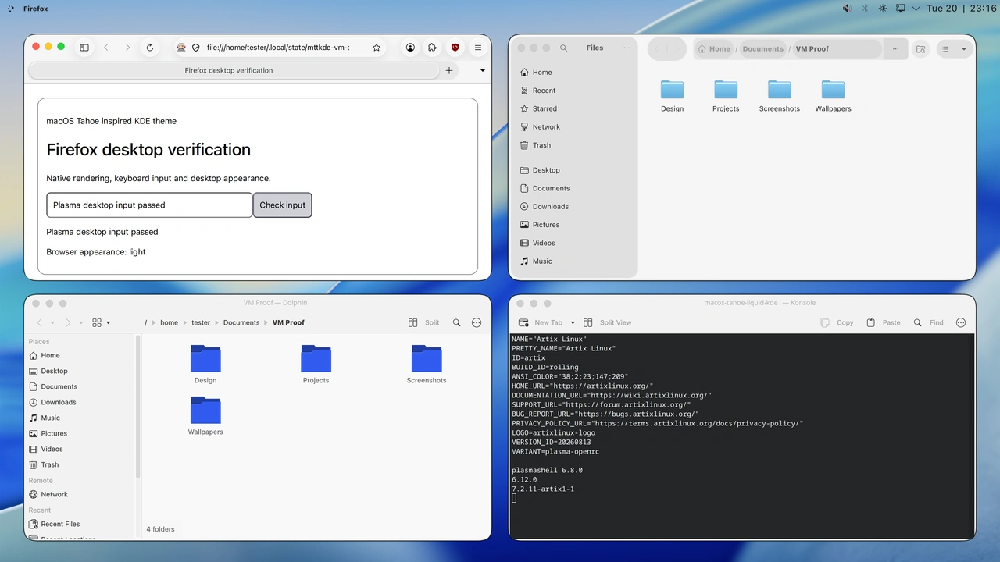

**Dark**

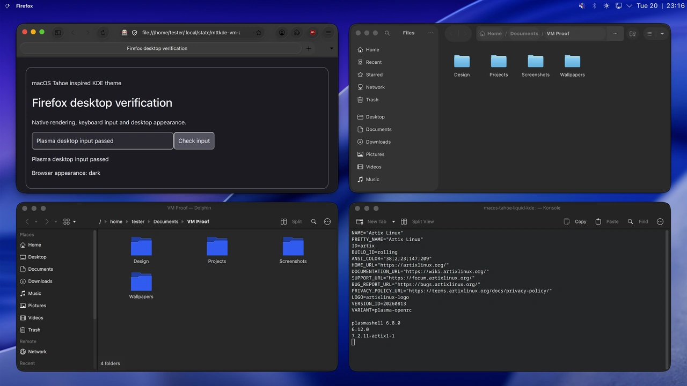

**After reboot**

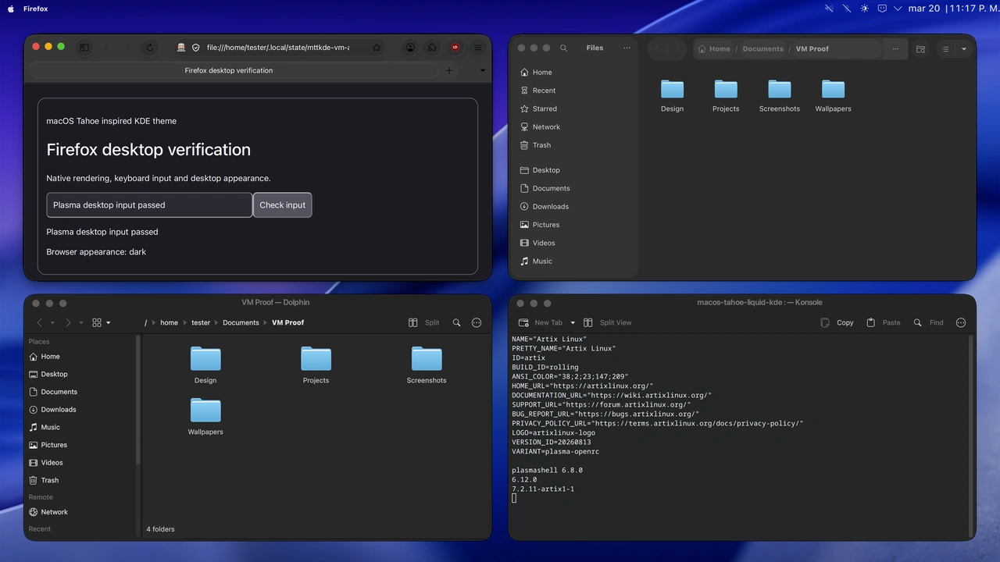

**Tested VM**

Plasma 6.8.0 · Qt 6.12.0 · Wayland · openrc · VirtIO/virgl.
Official Artix Plasma OpenRC ISO with native packages and per-user cron scheduling.

**Checks**

| Check | Result |
| --- | --- |
| Full installation and host SDK builds | ✅ Passed |
| Light and dark desktop, loaded Acrylic Glass, Dock autohide | ✅ Passed |
| Firefox rendering, text input, button action and appearance | ✅ Passed |
| Nautilus light/dark pixels and live switching | ✅ Passed |
| Live switch preserves app, Plasma and KWin processes | ✅ Passed |
| Reboot and desktop/app checks | ✅ Passed |
| Full uninstall and removal checks | ✅ Passed |

[Machine-readable results and image hashes](../../src/screenshots/vm/artix/report.json).

<b>Garuda Linux — ✅ VM verified · v0.57.12</b>

**Light**

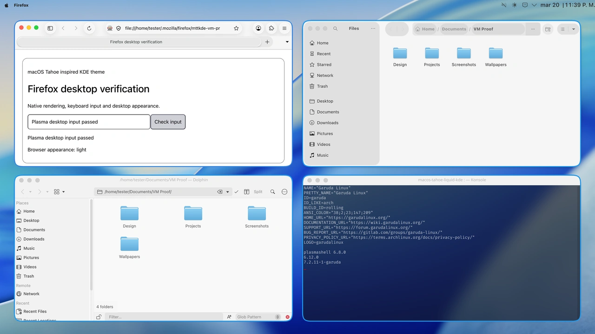

**Dark**

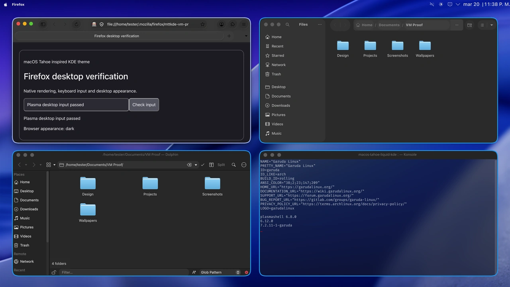

**After reboot**

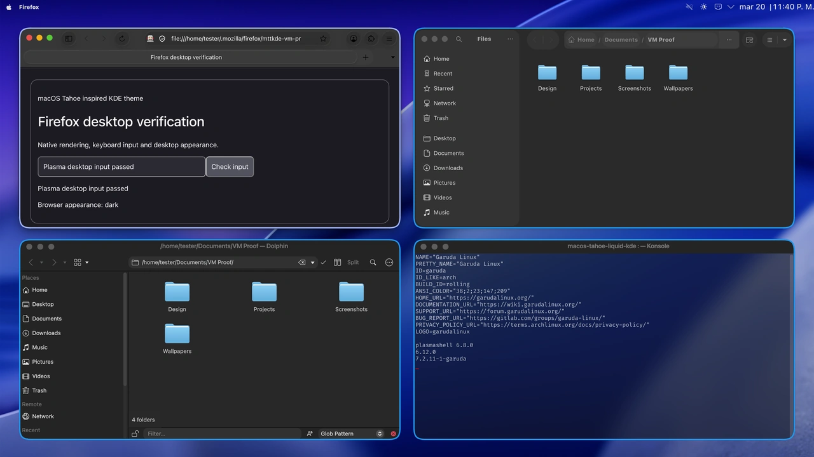

**Tested VM**

Plasma 6.8.0 · Qt 6.12.0 · Wayland · systemd · VirtIO/virgl.
Official Garuda KDE ISO with native packages.

**Checks**

| Check | Result |
| --- | --- |
| Full installation and host SDK builds | ✅ Passed |
| Light and dark desktop, loaded Acrylic Glass, Dock autohide | ✅ Passed |
| Firefox rendering, text input, button action and appearance | ✅ Passed |
| Nautilus light/dark pixels and live switching | ✅ Passed |
| Live switch preserves app, Plasma and KWin processes | ✅ Passed |
| Reboot and desktop/app checks | ✅ Passed |
| Full uninstall and removal checks | ✅ Passed |

[Machine-readable results and image hashes](../../src/screenshots/vm/garuda/report.json).

<b>Nobara — ✅ VM verified · v0.57.13</b>

**Light**

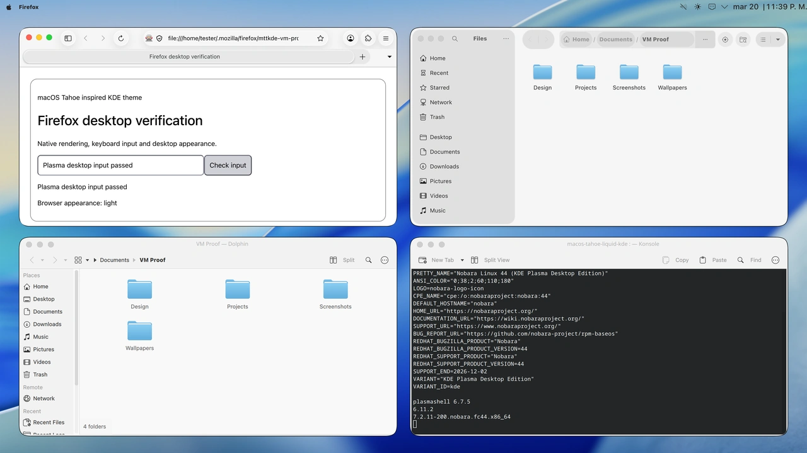

**Dark**

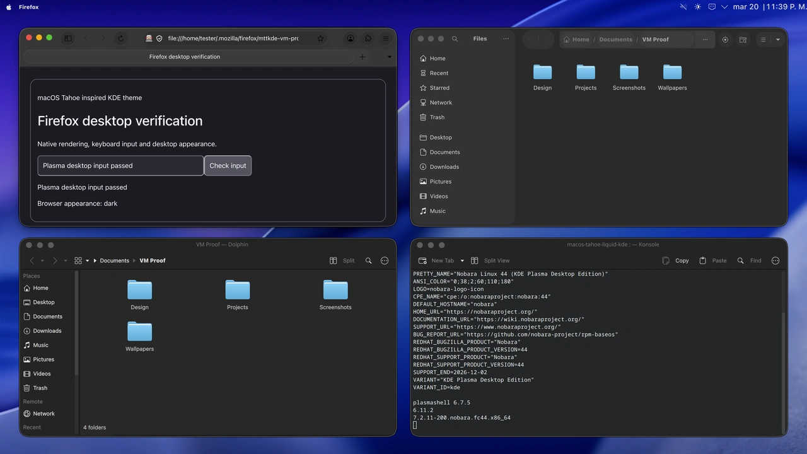

**After reboot**

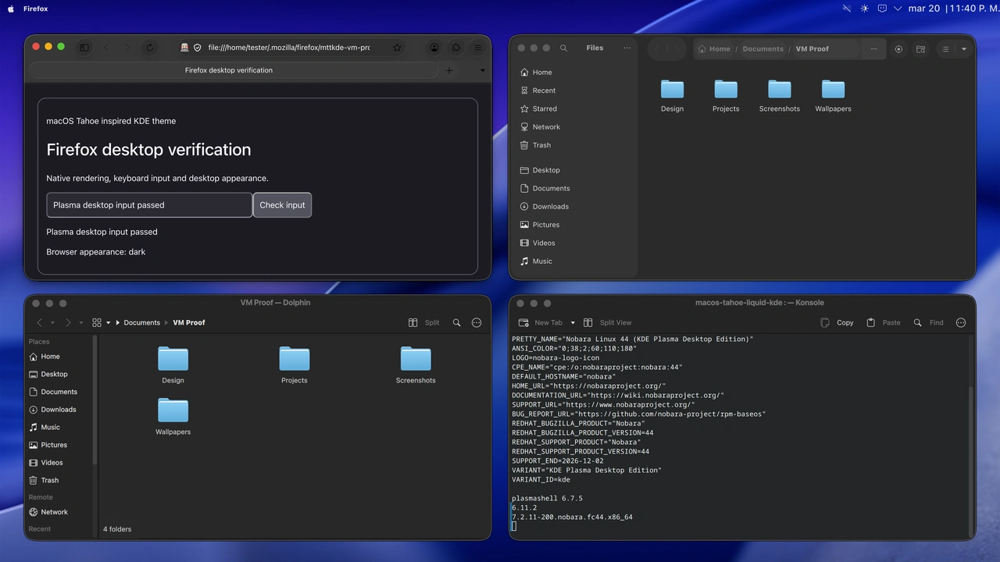

**Tested VM**

Plasma 6.7.5 · Qt 6.11.2 · Wayland · systemd · VirtIO/virgl.
Official Nobara 44 KDE ISO with native packages.

**Checks**

| Check | Result |
| --- | --- |
| Full installation and host SDK builds | ✅ Passed |
| Light and dark desktop, loaded Acrylic Glass, Dock autohide | ✅ Passed |
| Firefox rendering, text input, button action and appearance | ✅ Passed |
| Nautilus light/dark pixels and live switching | ✅ Passed |
| Live switch preserves app, Plasma and KWin processes | ✅ Passed |
| Reboot and desktop/app checks | ✅ Passed |
| Full uninstall and removal checks | ✅ Passed |

[Machine-readable results and image hashes](../../src/screenshots/vm/nobara/report.json).

<b>openSUSE Tumbleweed — ✅ VM verified · v0.57.7</b>

**Light**

**Dark**

**After reboot**

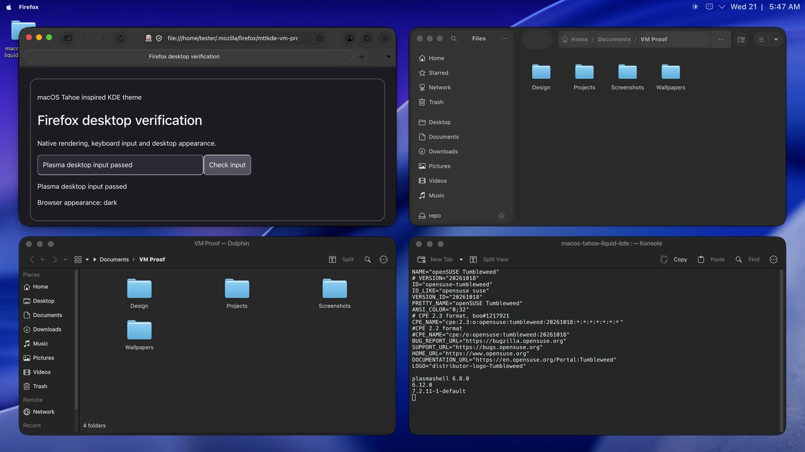

**Tested VM**

Plasma 6.8.0 · Qt 6.12.0 · Wayland · systemd · VirtIO/virgl.
Official openSUSE Tumbleweed cloud image with native KDE desktop and packages.

**Checks**

| Check | Result |
| --- | --- |
| Full installation and host SDK builds | ✅ Passed |
| Light and dark desktop, loaded Acrylic Glass, Dock autohide | ✅ Passed |
| Firefox rendering, text input, button action and appearance | ✅ Passed |
| Nautilus light/dark pixels and live switching | ✅ Passed |
| Live switch preserves app, Plasma and KWin processes | ✅ Passed |
| Reboot and desktop/app checks | ✅ Passed |
| Full uninstall and removal checks | ✅ Passed |

[Machine-readable results and image hashes](../../src/screenshots/vm/opensuse/report.json).

<b>KDE neon — ✅ VM verified · v0.57.6</b>

**Light**

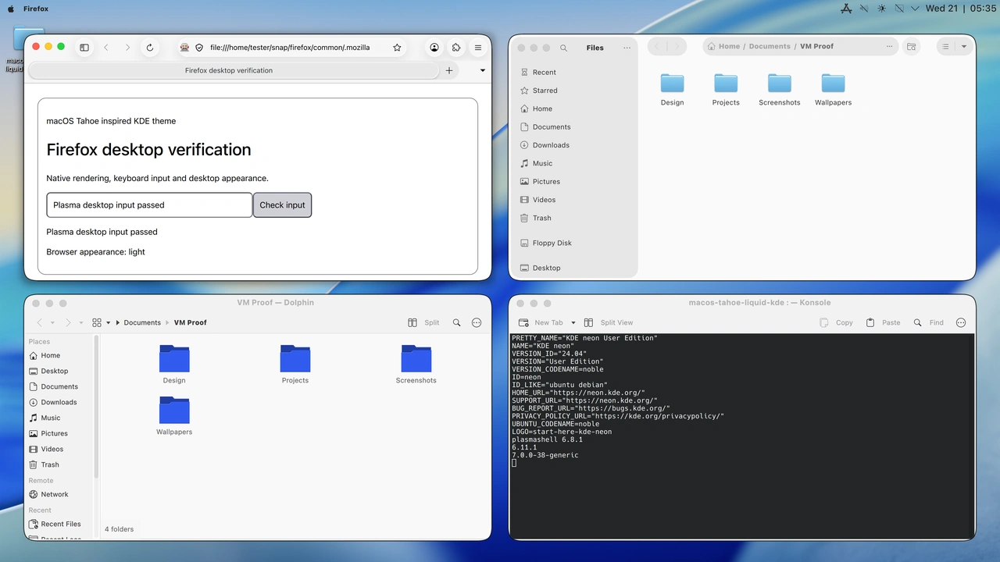

**Dark**

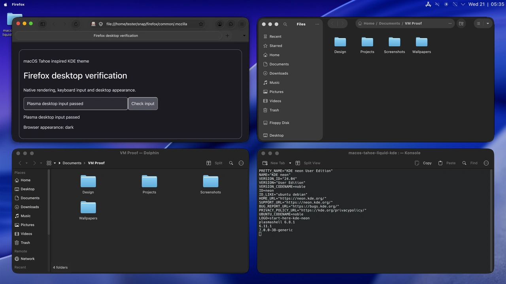

**After reboot**

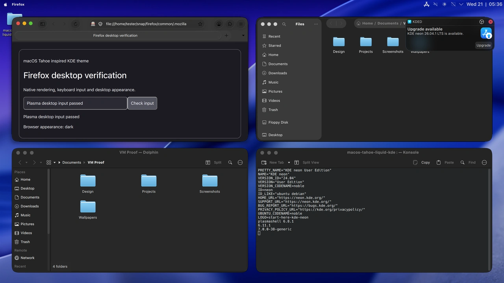

**Tested VM**

Plasma 6.8.1 · Qt 6.11.1 · Wayland · systemd · VirtIO/virgl.
Official KDE neon image with its native KDE desktop and packages.

**Checks**

| Check | Result |
| --- | --- |
| Full installation and host SDK builds | ✅ Passed |
| Light and dark desktop, loaded Acrylic Glass, Dock autohide | ✅ Passed |
| Firefox rendering, text input, button action and appearance | ✅ Passed |
| Nautilus light/dark pixels and live switching | ✅ Passed |
| Live switch preserves app, Plasma and KWin processes | ✅ Passed |
| Reboot and desktop/app checks | ✅ Passed |
| Full uninstall and removal checks | ✅ Passed |

[Machine-readable results and image hashes](../../src/screenshots/vm/neon/report.json).

<b>NixOS — evidence pending</b>

The NixOS and Home Manager installation route remains experimental. Live desktop
validation and reviewed screenshots have not been published yet.

All 11 distributions in the supported VM matrix have completed the live desktop checks above. The separate experimental NixOS route remains unqualified.
